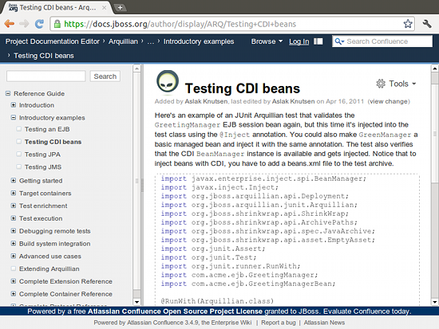

= Arquillian documentation now in Confluence
:sectids!:

I’m happy to announce that we have moved the Arquillian Reference Guide out of docbook format in the source tree and over to the new JBoss Documentation Confluence instance.

https://docs.jboss.org/author/display/ARQ/Home[Arquillian Documentation Editor] +

The old DocBook version has been imported and with a few fixes in the imported wiki code it all seems ok.

From now on, If you find any errors in the formating or content, you can simply just fix it pass:[~:)]
