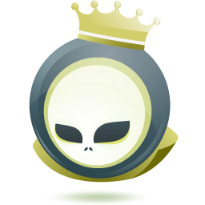

= Arquillian Nobles, we crown you!
:sectids!:

Even with the first beta still on the horizon, http://arquillian.org[Arquillian] has already begun to transform the enterprise testing landscape, making the formerly untestable *_testable_*.

The early influence of the Arquillian project is the result of a legion of community members integrating their diverse skills to flatten the barrier to integration testing. The collaboration across projects and across communities is truly inspiring. It’s safe to say that not only is the Arquillian invasion on, it’s well ahead of its release schedule. And that’s awesome. And the growing community is the reason why.

*Noble Ike*, the Arquillian prince, and the core project team, would like to recognize the community members that have helped shape Arquillian during each release cycle, either through code contributions, participation or advocacy. For donating their time, effort and patience to make Arquillian a better testing framework for the benefit of the community, we award each of them the title _Arquillian Noble_.

The link:/community/nobles[Arquillian Nobles page] on the project site lists the recipients along with the contributions they made. Contributors are awarded for either a specific release, or for general support of the project. The names of the community members crowned so far are listed here (for reference):

* Pete Muir
* Cheyenne Weaver
* Karel Piwko
* David Allen
* Andy Gibson
* Jason Porter
* Jesper Pedersen
* Jean Deruelle
* Thomas Diesler
* Stale Pedersen
* Nicklas Karlsson
* Ken Gullaksen
* Alejandro Montenegro
* Adrian Cole
* Paul Bakker
* German Escobar
* Michael Schuetz
* Adam Warski
* Markus Eisele
* Cosmin Martinconi
* John Ament
* Stuart Douglas
* Jordan Ganoff
* Lincoln Baxter III
* Mike Brock

[.info]
Community members may be crowned multiple times. Once a contributor becomes a team member, subsequent contributions are not listed here (team members are noble by default).

In addition to being listed on the link:/community/nobles[Arquillian Nobles] page, we are working to get a crown added to each recipient’s JBoss Community profile so that it is globally visible. We’ll announce when that’s available.

The more container adapters and extensions we create, the more power we put in the hands of the developer, and the better enterprise software will become. Feature transparency FTW!

Thanks to all the Arquillian Nobles, present and future, for making Arquillian awesome and for simplifying testing to child’s play!
