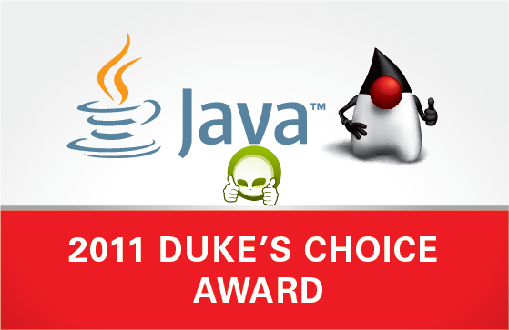
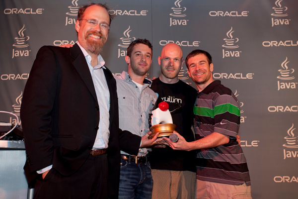
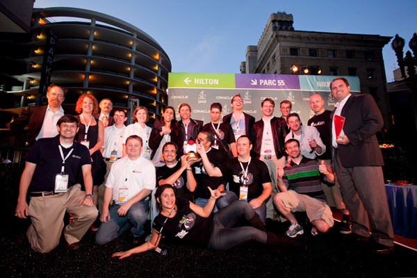

= Arquillian wins a Duke's Choice Award!
:sectids!:

Mark the date, October 2, 2011: Arquillian wins a http://www.java.com/en/dukeschoice[Duke’s Choice Award] for Innovative Integration Testing at http://www.oracle.com/javaone[JavaOne 2011]!

Is there a better way to start of a though week then to get a solid acknowledgement for the hardwork that you have already put in? I can’t think of any…

_Members of the Arquillian team receiving the Duke’s Choice Award (Andrew Lee Rubinger, Dan Allen and Aslak Knutsen)._

We accept this award as an ongoing challenge to innovate. We’ll continue our mission to explore strange new testing gaps, seek out new integration points and boldly go where no integration testing software has gone before. This award goes out to the entire Arquillian community: coders, bloggers and evangelists. Excellent work!

After receiving the award, we were invited as guests on the Java Spotlight podcast, which was recorded on site at JavaOne, to talk about Arquillian. You can find our interview at 11:02 into https://blogs.oracle.com/javaspotlight/entry/java_spotlight_episode_51_live[Episode 51] in the series.

We’d also like to congratulate the other Duke’s Choice Award winners as well: dooApp, Inductive Automation, jHome, JFrog, JRebel, LMAX, Rockwell Automation and one of our own, Netty. Great work! Duke certainly made some great choices this year.

