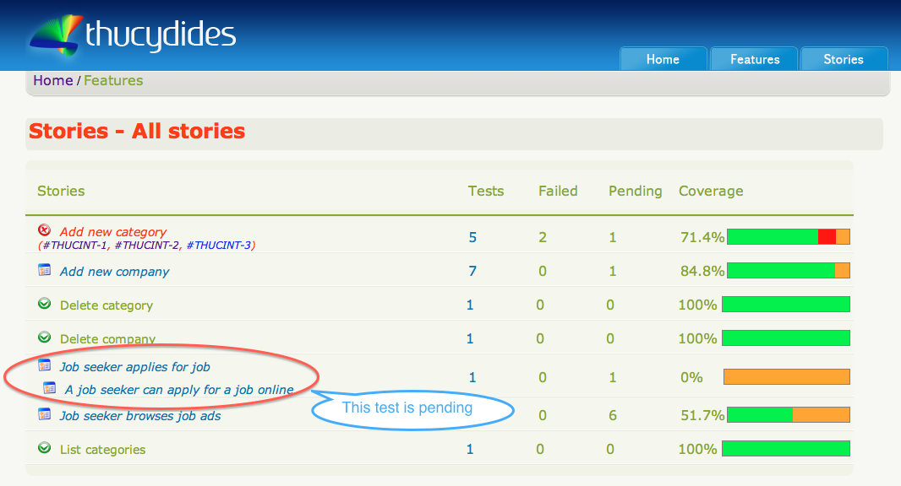

= Hack Idea: Fully Automate ATDD by Integrating Thucydides with Arquillian
:sectids!:

// Historical interpolation #{site.definition} = Arquillian is open source software that empowers you to test JVM-based applications more effectively. Created to defend the software galaxy from bugs, Arquillian brings your test to the runtime so you can focus on testing your application's behavior rather than managing the runtime. Using Arquillian, you can develop a comprehensive suite of tests from the convenience of your IDE and run them in any IDE, build tool or continuous integration environment. from https://arquillian.org/blog/2012/11/05/hack_idea_integrate_thucydides_and_arquillian/ (captured 2026-11-13).
// Historical interpolation #{site.irc_channel} = arquillian from https://arquillian.org/blog/2012/11/05/hack_idea_integrate_thucydides_and_arquillian/ (captured 2026-11-13).

Imagine being able to organize and structure your Arquillian tests as human-readable _specifications by example_ that describe at a high-level how the application should work, then being able to present illustrated documentation generated from a test run that gives all parties an account of the features under development and tracks feature sign-off through automation of the acceptance criteria.

This goal can be achieved by http://www.thucydides.info[Thucydides] and http://arquillian.org[Arquillian] joining forces. Acceptance tests will not only be agile and illustrated, but fully automated. With a https://github.com/VineetReynolds/thucydides-arquillian-example[proof of concept] in hand, we plan to advance this combination, including substituting Arquillian Drone to manage WebDriver, at the http://lanyrd.com/2012/devoxx/syzdq[Devoxx 2012 Hackergarten].

[discrete]
=== Introducing the candidates

[discrete]
==== What is Thucydides?

 Thucydides is a testing tool that encourages developers write more flexible and reusable end-to-end acceptance tests. In the style of link:http://www.javaworld.com/javaworld/jw-08-2011/110823-atdd-for-web-apps.html[Acceptance Test-Driven Development,title="ATDD"], Thucydides introduces a narrative for tests that describes the high-level requirements and automates the acceptance criteria using the tests. Developers then iterate using a test-driven approach to complete the requirements (i.e., stories), as depicted in the diagram below.

By analyzing the test metadata and test results, Thucydides generates illustrated documentation that describes how the application is used in the form of high-level requirements, acceptance criteria and screenshots, and records the progress of development.

[discrete]
==== What is Arquillian?

Arquillian is open source software that empowers you to test JVM-based applications more effectively. Created to defend the software galaxy from bugs, Arquillian brings your test to the runtime so you can focus on testing your application’s behavior rather than managing the runtime. Using Arquillian, you can develop a comprehensive suite of tests from the convenience of your IDE and run them in any IDE, build tool or continuous integration environment.

[discrete]
==== What is Arquillian Drone?

Arquillian Drone is an extension to Arquillian that manages the lifecycle of browsers for the purpose of controlling them from a test, thus simplifying automated functional / acceptance testing. Drone bootstraps the tooling necessary to send commands to the browser (e.g. Selenium Server, WebDriver, etc), spawns an instance of a browser, injects the browser API into the test class to allow tests to control that instance and, finally, properly disposes of the browser instance after the test is complete.

[discrete]
=== Integration benefits

[discrete]
==== Arquillian and Thucydides as yin and yang

While Thucydides handles automation of the browser—via the http://seleniumhq.org/docs/03_webdriver.html[WebDriver] library—it does not handle deploying the application being tested, nor does it manage the lifecycle of the container to which the application is deployed. In other words, it doesn’t automate _everything_. That’s where Arquillian steps in.

Thucydides brings the ATDD methodology and rich test reports to Arquillian, both new features to the Arquillian ecosystem. Arquillian complements Thucydides by managing the lifecycle of the container and deploying the application (as a whole or micro-deployment) to it. These services would otherwise need to be handled by the build when using Thucydides alone.

Beyond their combined core feature set, the integration brings all of the Arquillian extensions to Thucydides tests, opening the door to services such as loading seed data into the database, measuring performance and even managing browser automation. Speaking of managing browser automation…

[discrete]
==== More powerful browser automation with Drone

Bringing Arquillian Drone into the fold provides additional benefit by introducing a more powerful and flexible choice for controlling the browser in a Thucydides test, including simplified configuration, alternatives to WebDriver and extensions (e.g., Graphene). This secondary integration between Arquillian and Thucydides also unifies the developer experience with regard to how the browser is controlled across vanilla Arquillian Drone tests and Thucydides tests (embracing the concept that each tool should focus on doing one thing well).

Basic integration between Arquillian and Thucydides is a first step and getting Drone integrated is an optional (but valuable) bonus.

[discrete]
==== How this integration helps test writers

* Arquillian tests become contract deliverables by leveraging Thucydides’ language for ATDD
* Test segments of the webapp in isolation (using micro-deployments)
** Accelerates acceptance testing because entire application doesn’t have to be built and deployed
* Skip the build (e.g., Run As ++>++ XYZ Test in the IDE)
** automatic container lifecycle management
** deploy test archive defined in test class
** inject application (initial) URL into test
* Support for multiple target environments (e.g., local, dev, qa, staging)
* Write Thucydides tests using other test runners, such as TestNG and Spock
* Write Thucydides tests using any Arquillian-supported programming model (CDI, Spring, etc)
* Rich reports summarizing test results generated by Thucydides, something Arquillian doesn’t currently provide
* Use additional Arquillian extensions in Thucydides tests
* Integrated configuration (arquillian.xml) for containers and browsers++*++
* Use alternate browser automation libraries supported by Drone++*++
* Use Graphene page fragments to reduce boilerplate code common in acceptance tests++*++

pass:[*] requires Drone integration

[discrete]
==== Balancing responsibility

Thucydides’ strong suit is promoting ATDD through its programming model for writing acceptance tests as specifications by example and its reporting pipeline that summarizes test results as user stories. We believe Thucydides could move faster by focusing on tools and metrics needed to facilitate ATDD, allowing Arquillian to address the need of general purpose test extensions such as alternate test runners, data loading, browser automation, programming model integration, etc. In other words, Thucydides has more freedom to focus on its core competency, as stated on its website:

[quote]
____

Organize and structure acceptance tests, associate tests with the user stories or features that they test and generate illustrated documentation describing how the application is used based on the stories described by the tests.

____

[discrete]
=== Hacking on the integration

We plan to hack on this idea during the Hackergarten at Devoxx 2012. Keep in mind there is a https://github.com/VineetReynolds/thucydides-arquillian-example[proof of concept] we can reference as a starting point, described later in this section.

John Smart, the author of Thucydides, has offered to host the integration in the Thucydides code base, which is fantastic.

[discrete]
==== When and where are we hacking?

We are going to use the free Hackergarten day at Devoxx 2012 as an opportunity to put our heads together to make progress on this integration. Here are the details:

* When: Tue 13th November 2012, 09:30 – 16:30
* Where: Hackergarten at Devoxx 2012 (Metropolis, Antwerpen, Belgium)
* Conference URL: http://devoxx.com[pass:[http://devoxx.com]]
* Hashtag: https://twitter.com/search/%23hackdevoxx[++#++hackdevoxx] and https://twitter.com/search/%23arquillian[++#++arquillian]
* Lanyrd: http://lanyrd.com/2012/devoxx/syzdq[pass:[http://lanyrd.com/2012/devoxx/syzdq]]
* RSVP: https://plus.google.com/events/cukalsoit15mrhsokig3b02j8mk[Google{plus} Event: Arquillian Hands-On Coding at Devoxx 2012 Hackergarten]
* IRC: ++#++arquillian on Freenode

We’ll also be hacking throughout the week, either at the long white "`hacking`" tables on the second floor of the venue or after hours at a bar. Of course, anyone is welcome to hack on this idea at anytime from anywhere. This is open source!

[discrete]
==== Who will be there hacking?

* https://github.com/wakaleo[John Ferguson Smart] (Thucydides Lead)
* http://github.com/aslakknutsen[Aslak Knutsen] (Arquillian Lead)
* https://github.com/bartoszmajsak[Bartosz Majsak] (Arquillian team member, author of Beer Advisor)
* https://github.com/mojavelinux[Dan Allen] (Arquillian team member)
* https://github.com/jpapousek[Jan Papoušek] (Arquillian Drone contributor)
* https://github.com/lordofthejars[Alex Soto] (NoSQLUnit Lead, testing advocate)

https://github.com/kpiwko[Karel Piwko] (Arquillian Drone Lead) and https://github.com/VineetReynolds[Vineet Reynolds] (Arquillian Core and Thucydides integration) will be participating, time permitting, from afar. Feel free to reach out to them on IRC or the forums.

[discrete]
==== What we want to achieve

The following two tests are proposed milestones we want to achieve during the hack. They contrast what integration looks like without Drone to the integration with Drone. Thinking through these scenarios helps reveal integartion points that need to be exposed or refined.

[.info]
The tests in this section apply to the https://github.com/bartoszmajsak/Beer-Advisor[Beer Advisor] sample application.

*Sample test without Drone integration*

[listing,role="prettify",subs=verbatim]
----
@RunWith(ThucydidesRunner.class) // or @RunWith(Arquillian.class)
@Story(BeerAdvisorFeatures.SearchingBeers.class)
public class SearchingBeersStory {

    // Thucydides members

    @Managed(uniqueSession = true)
    public WebDriver browser;

    @ManagedPages
    public Pages pages;

    @Steps
    public SearchingSteps searchingSteps;

    // Arquillian members

    @Deployment(testable = false)
    public static WebArchive createTestArchive() {
       return ShrinkWrap.create(WebArchive.class, "searching-beers-story.war")...;
    }

    @ArquillianResource
    URL deploymentUrl;

    // Tests

    @Before
    public void before_tests() {
        pages.setDefaultBaseUrl(deploymentUrl.toExternalForm());
    }

    @Test
    public void should_find_all_usa_beers() {
        searchingSteps.on_main_beer_advisor_page();
        searchingSteps.search_for("from usa");
        searchingSteps.should_contain_beers(new Beer("90 minute IPA"), new Beer("Mirror Pond"));
    }
}
----

The following steps outline the interplay between Arquillian and Thucydides while the test executes in this scenario.

* Either Arquillian or Thucydides takes over test execution and activate both frameworks
* Responding to the test suite start event, Arquillian and configures and starts (or connects to) the container
* Arquillian deploys test archive(s) to container
* Arquillian injects the application URL into the @ArquillianResource URL inject point of the test
* Thucydides spawns a browser instance using WebDriver
* Thucydides executes tests, sending browser commands to WebDriver
* Thucydides takes screenshots using WebDriver as the browser is interacting with the web application
* Thucydides destoys the browser instance using WebDriver
* Arquillian undeploys the test archive
* Arquillian stops the container
* Thucydides generates reports from the high-level summarizes, screenshots and test results

Any Arquillian extensions that are loaded should also work as normal.

*Sample test with Drone integration*

[listing,role="prettify",subs=verbatim]
----
@RunWith(ThucydidesRunner.class) // or @RunWith(Arquillian.class)
@Story(BeerAdvisorFeatures.SearchingBeers.class)
public class SearchingBeersStory {

    // Thucydides members

    @Steps
    public SearchingSteps searchingSteps;

    // Arquillian members

    @Deployment(testable = false)
    public static WebArchive createTestArchive() {
       return ShrinkWrap.create(WebArchive.class, "searching-beers-story.war")...;
    }

    @Drone // may get moved to the page objects
    public WebDriver browser;

    // Tests

    @Test
    public void should_find_all_usa_beers() {
        searchingSteps.on_main_beer_advisor_page();
        searchingSteps.search_for("from usa");
        searchingSteps.should_contain_beers(new Beer("90 minute IPA"), new Beer("Mirror Pond"));
    }
}
----

The following steps outline the interplay between Arquillian and Thucydides while the test executes in this scenario.

* Either Arquillian or Thucydides takes over test execution and activate both frameworks
* Arquillian configures and starts (or connects to) the container
* Arquillian deploys test archive(s) to container
* Arquillian injects the application URL into the @ArquillianResource URL injection point of the test
* Arquillian Drone spawns a browser instance using the configured browser automation library (e.g., WebDriver)
* Arquillian Drone sets the default base URL on the managed pages
* Thucydides executes tests, sending browser commands to the browser automation library
* Arquillian Drone takes screenshots as the browser is interacting with the web application
* Arquillian Drone destoys the browser instance using the configured browser automation library
* Arquillian undeploys the test archive
* Arquillian stops the container
* Thucydides generates reports from the high-level summarizes, screenshots and test results

Any Arquillian Drone extensions, such as Graphene, that are loaded should also work as normal.

[discrete]
==== Sample code to use for exploring the integration

* https://github.com/bartoszmajsak/Beer-Advisor[Beer Advisor] by Bartosz Majsak
* https://github.com/VineetReynolds/thucydides-arquillian-example[Currency Exchange] by Vineet Reynolds

[discrete]
==== Prior work

Vineet Reynolds has been experimenting with https://github.com/VineetReynolds/thucydides-arquillian-example/[an integration between Thucydides and Arquillian Core]. Vineet’s integration code uses a Thucydides https://github.com/VineetReynolds/thucydides-arquillian-example/blob/master/src/test/java/com/mycompany/listeners/ArquillianListener.java[StepListener implementation] to weave the Arquillian lifecycle into the test. Tests are run using the Thucydides testrunner, while Arquillian manages the container lifecycle and performs the deployment of archives defined in the tests. The integration does not incorporate Arquillian Drone, opting to leave management of WebDriver up to Thucydides.

Aslak and Bartosz improved upon the integration and incorporated it into the https://github.com/bartoszmajsak/Beer-Advisor[Beer Advisor sample app] for their JavaZone talk in September 2012. They introduced a https://github.com/bartoszmajsak/Beer-Advisor/blob/master/thucydides-tests/src/test/java/org/arquillian/example/thucydides/ArquillianEnricher.java[JUnit Rule] that activates the Arquillian services that run before and after each test method, such as test enrichment. A JUnit Rule is currently necessary due to insufficient hooks in Thucydides, but it gets the job done. Eventually we want to phase out the JUnit Rule because it exposes integration plumbing in the test.

[discrete]
==== Engineering challenges

*Challenge ++#++1: Unified test runner*

Thucydides needs a startup API that isn’t coupled with JUnit so that Arquillian is able to perform the startup in an extension. At the moment there is a lot of setup code in the https://github.com/thucydides-webtests/thucydides/blob/master/thucydides-junit/src/main/java/net/thucydides/junit/runners/ThucydidesRunner.java[ThucydidesRunner] to reproduce. The alternative is that Thucydides provides enough hooks in its https://github.com/thucydides-webtests/thucydides/blob/master/thucydides-core/src/main/java/net/thucydides/core/steps/StepEventBus.java[StepEventBus] for Arquillian to hook its own startup into the Thucydides lifecycle. In the integration prototype, a JUnit rule is used to activate Arquillian in a Thucydides test, but this is not the most elegant approach.

Ideally, the pass:[<code>@RunWith(Arquillian.class)</code>] annotation should be enough for Arquillian to drive Thucydides if Arquillian detects Thucydides is also in use (e.g., the pass:[<code>@Story</code>] annotation is present on the test class). This is the preferred approach since it simplifies the experience for the user across the test suite (a single pass:[<code>@RunWith</code>] for all integration tests) and it may make the integration more compatible with extensions since Arquillian has a more sophisticated event bus.

*Challenge ++#++2: Drone integration*

When Drone is integrated, the user has an option to use the browser automation library (directly or via the page object pattern) as with other Drone tests or use the page object support provided by Thucydides. Drone should be able to pass Thucydides the WebDriver instance so that Thucydides can operate its own page objects.

Ideally, the integration with Drone should cut down on as many redundant declarations in the class as possible to simplify test authoring. That means that the pass:[<code>@Drone</code>] injection point is used to access the browser instance and and pass:[<code>@ArquillianResource URL</code>] injection point is used to access the initial (base) url.

Karel Piwko mentioned that Drone needs a better SPI for improved integration with Arquillian Graphene, slated for 1.2.0.Final. He believes the Drone SPI will also help facilitate Thucydides integration. It also opens the door for Drone to be integrated into Thucydides on its own.

*Happy hacking!*

[discrete]
=== Resources

* Thucydides: http://thucydides.info[project page] – http://thucydides.info/docs/thucydides[reference guide] – http://wakaleo.com/thucydides-javadoc[API documentation]
* http://www.javaworld.com/javaworld/jw-08-2011/110823-atdd-for-web-apps.html[Acceptance test-driven development for web applications] by John Smart (JavaWorld)
* http://www.javaworld.com/javaworld/jw-10-2011/111018-thucydides-for-atdd.html[Selenium 2 and Thucydides for ATDD] by John Smart (JavaWorld)
* http://vimeo.com/49484334[Real Agile: How Real Tests Lead to Real Progress] by Aslak Knutsen and Bartosz Majsak (JavaZone 2012)
* http://www.youtube.com/watch?v=Xxpk2YGa6Do[How to test enterprise applications] by Alex Soto (LinuxTag 2012)
* https://github.com/VineetReynolds/thucydides-arquillian-example[Prototype of Arquillian and Thucydides integration] by Vineet Reynolds
* https://community.jboss.org/message/772475[Arquillian Thucydides integration discussion post]
