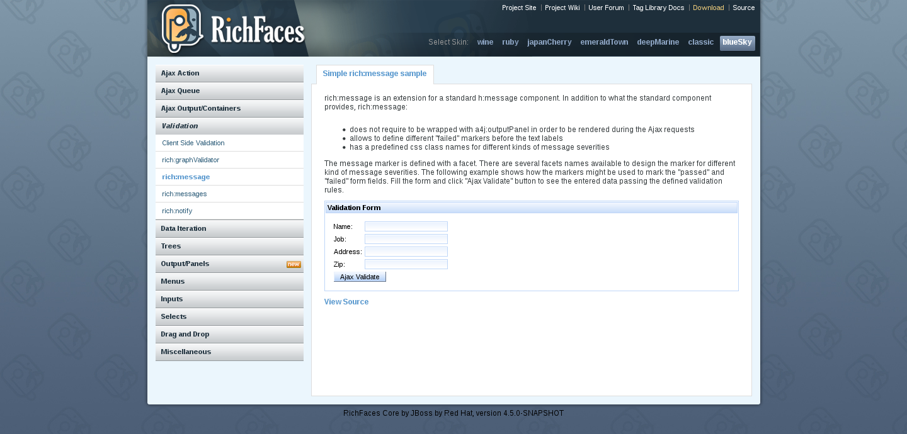
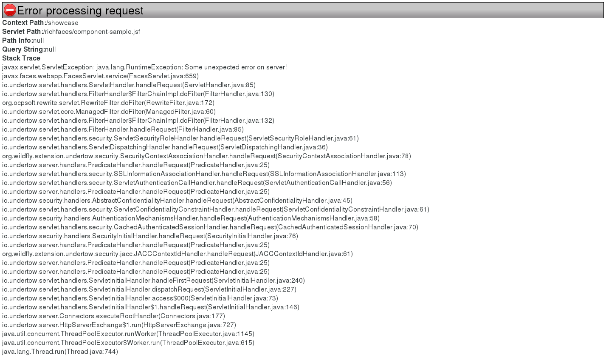

= Graphene 2.1.0.Alpha1 Released
:sectids!:

pass:[<i class="icon-star">]pass:[</i>] Screenshooter::
+
--
The major addition for Graphene toolset in 2.1.0.Alpha1 is a possibility to take screenshots while running functional tests. Together with awesome the link:/modules/recorder-extension/[Arquillian Recorder] extension, you end up with clean and informative reports full of screenshots of your tests.
--

Working with these reports decreases the chance that you will have to debug the test in order to fix it. From now on you can just take a peek at the screenshot, the test method name and failure message; all in one place, and you will know how to fix it!

Here is a screenshot made just after the initial page is opened:

And here is a page when the test fails:

If you want to see the full report produced by Arquillian Recorder, have a sneak peek on link:/images/blog/arquillian-graphene-2.1.0.Alpha1/arquillian_report.html[this actual report] from the test above.

There are no changes required to test code itself:

[listing,role="prettify",subs=verbatim]
----
@Test
@RunAsClient
public void testSubmitCorrectData() {
    detailsPage.fillInCorrectData();
    detailsPage.submitForm();
    waitAjax().until()
        .element(detailsPage.getSuccessfulySubmittedMessage)).is().visible();
}
----

[discrete]
==== Basic usage

The basic configuration is described in https://github.com/arquillian/arquillian-graphene/blob/master/extension/screenshooter/README.adoc[this README file.] Please review it in order to learn how to incorporate this extension into your test suite.

Please bear in mind that this is only the Alpha1 release, and that there is plenty of space for improvement. Indeed your ideas are very welcomed!

pass:[<i class="icon-star">]pass:[</i>] Support for Page Objects written in Groovy::
+
--
Thanks to Chris Jones addition, Graphene now supports Page Objects written in Groovy!

This nice improvement will eventually be merged back to 2.0.
--

pass:[<i class="icon-star">]pass:[</i>] Interceptor precedence::
+
--
In this release we also added a _int getPrecedence_ method to Interceptor interface. It gives you a chance to tell Graphene which order to execute the pass:[[interceptors&#93;(https://docs.jboss.org/author/display/ARQGRA2/Graphene+Interceptors).]

The smaller the precedence is, the later the interceptor is invoked. This allows to make the extensions work together as needed.
--
