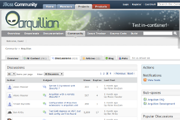
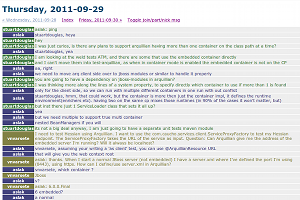
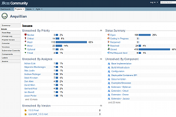
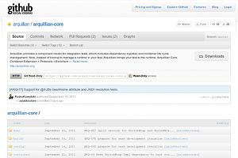

== Where Are We?

Arquillian is an open-source project with several ways to participate. The link:http://community.jboss.org/en/arquillian[Arquillian space] on JBoss Community and the `#arquillian` IRC channel are the main places to meet other contributors.

== Forums and Wiki

The user and development forums host questions, project discussions, and community-edited articles. Share tips, guides, or anything that helps other Arquillian users.

* link:http://community.jboss.org/en/arquillian?view=discussions[User discussions]
* link:http://community.jboss.org/en/arquillian/dev?view=discussions[Development discussions]

== Chat (IRC)

Join `#arquillian` on Freenode to talk about Arquillian, ShrinkWrap, and testing. The channel is logged by link:http://transcripts.jboss.org/channel/irc.freenode.org/%23arquillian/[JBossBot].

== Issue Tracker

The project tracks bugs and feature requests in link:https://issues.jboss.org/browse/ARQ[the Arquillian issue tracker]. A JBoss Community account is required to file an issue.

== Source Repository

Arquillian source code is hosted in the link:https://github.com/arquillian[Arquillian organization] on GitHub. Fork a repository, make improvements, and send a pull request.

== Arquillian Nobles

We value the contributions made by the Arquillian community. Visit the link:/community/nobles[Arquillian Nobles] page and the link:/community/contributors[full contributor list].
