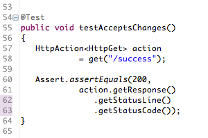
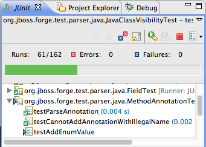
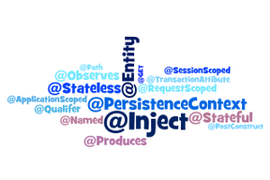
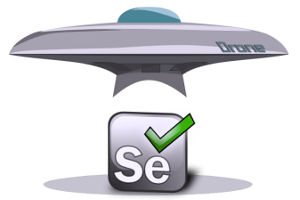
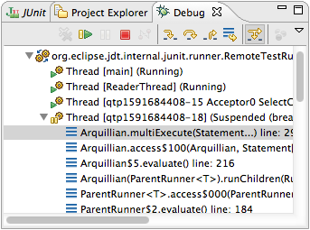
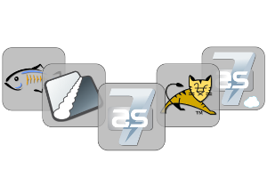

= Feature Tour

== Real Tests

Mocks can be tactical, but Arquillian lets you write real tests against a real environment.

Learn to use this feature at link:/guides/getting_started/#a_closer_look[Getting Started].

== IDE Friendly

Arquillian integrates with JUnit, TestNG, and the IDE and build tools you already use.

== Test Enrichment

Arquillian injects CDI beans, EJB components, and other container resources directly into tests.

== Classpath Control

Micro-deployments isolate the test scenario and deploy faster than a full application.

== Drive the Browser

Arquillian Drone abstracts Selenium setup so you can focus on browser-based testing.

== Debug the Server

Drop a breakpoint in the test or application code and debug inside the server from your IDE.

== Container Agnostic

Run the same test against embedded, managed, or remote containers and switch environments easily.

== Extensible Platform

Arquillian provides extension points for the testing tools and integrations your project needs.

== Strong Tooling

JBoss Forge and the Arquillian tooling ecosystem provide a quick path from project setup to tests.

<strong>Death to all bugs!</strong>

