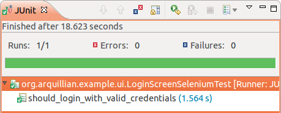

= Functional Testing using Drone and Graphene
:sectids!:

This guide introduces you to functional testing using the Arquillian Graphene extension. After reading this guide, you’ll be able to:

* Add required Arquillian extensions to your Arquillian-based test suite
* Package portions of your web application to test the web user interface (UI)
* Inject WebDriver API to your test case
* Control the browser using Graphene to validate the behavior of your web application

You’ll appreciate how much heavy lifting Graphene is doing to perform automated functional testing!

[discrete,id="assumptions"]
=== Assumptions

We’ll assume that you’ve read the Arquillian link:/guides/getting_started[Getting Started] guide and have an Arquillian test suite setup in your project. We’ll be adding a simple pass:[<acronym title="JavaServer Faces">JSF</acronym>] login form to the project as an example web UI to test. From there, you can apply these instructions to web pages written in any web framework you would like to test.

The instructions in this guide are specific to a Maven project, though remember that Arquillian is not tied to Maven in any way. We’ll be running the tests on a JBoss AS 7 instance, though you can use any web container supported by Arquillian.

In this guide, we’ll be using the following technologies:

* Arquillian
* Arquillian Drone
* Arquillian Graphene
* Selenium WebDriver

All these listed technologies are part of the Arquillian test platform. Both Arquillian Drone and Graphene are working with http://seleniumhq.org[Selenium WebDriver], which is, in short, https://dvcs.w3.org/hg/webdriver/raw-file/default/webdriver-spec.html[a standard technology] for browser automation. Arquillian Drone integrates the Selenium framework with Arquillian and facilitates some of the tedious processes needed to test the frontend of any web application. Arquillian Graphene is built on top of the http://selenium.googlecode.com/git/docs/api/java/org/openqa/selenium/WebDriver.html[Selenium WebDriver API] and adds a lot of features for writing reusable and maintainable functional tests. You will see them in a minute!

If you’re already familiar with Selenium, you’ll discover that Arquillian manages the Selenium life cycle in much the same way it manages the container life cycle. If Selenium is new to you, this is a great opportunity to begin using its enhanced version Graphene to test the web UI of your application.

[discrete,id="introducing_client_mode"]
=== Introducing Client Mode

If you’ve ever written an Arquillian based test, you know that it looks almost the same as a unit test in your unit testing framework of choice. Let’s look at an example of an Arquillian test that uses JUnit:

[listing,role=prettify,subs=verbatim]
----
@RunWith(Arquillian.class)
public class BasicInContainerTest {
    @Deployment
    public static JavaArchive createDeployment() {
        return ShrinkWrap.create(JavaArchive.class)
            .addClass(MyBean.class)
            .addAsManifestResource(EmptyAsset.INSTANCE, "beans.xml");
    }
    
    @Inject
    MyBean bean;
 
    @Test
    public void should_inject_bean_instance() {
        Assert.assertNotNull(bean);
    }
}
----

Here we have deployed a CDI bean to the server inside a bean archive. In the test, we’ve injected the instance of the bean, then asserted that the injection has occurred. Arquillian first enriches the archive with the test infrastructure. It then connects to the server to deploy the archive and execute the test method inside of the container by launching the JUnit test runner a second time inside that environment. Finally, Arquillian retrieves the results from that remote execution. This example demonstrates the default run mode of Arquillian: in-container. In a sense, the local JUnit runner is a client of the container, being driven by Arquillian.

The other run mode in Arquillian is the client run mode. In this mode, Arquillian deploys the test archive '`as is`' to the container. It then allows the tests to run in the same JVM as the test runner. Now your test case is a client of the container. The test no longer runs inside the container, yet Arquillian still handles the life cycle of the container as well as deployment of the test archive. It’s the ideal mode for web UI testing.

[discrete,id="enabling_client_mode"]
=== Enabling Client Mode

How do you activate client mode? Quite simply. You either mark a deployment as non-testable, meaning Arquillian will not enrich the archive, or you can mark a specified method with the annotation ``+@RunAsClient+``. Here’s an example:

[listing,role=prettify,subs=verbatim]
----
@RunWith(Arquillian.class)
public class BasicClientTest {
    @Deployment(testable = false)
    public static WebArchive createDeployment() {
        return ShrinkWrap.create(WebArchive.class)
            .addClasses(MyBean.class)
            .setWebXML("WEB-INF/web.xml");
    }
    
    @Test
    public void should_login_successfully() {
    }
}
----

It’s also possible to mix in-container and client modes in the same test! Just leave off the ``+testable+`` attribute. Any method annotated with ``+@RunAsClient+`` will execute from the client, the remainder will execute inside the container, giving you the best of both worlds!

[listing,role=prettify,subs=verbatim]
----
@RunWith(Arquillian.class)
public class MixedRunModeTest {
    @Deployment
    public static JavaArchive createDeployment() {
        return ShrinkWrap.create(JavaArchive.class)
            .addClass(MyBean.class)
            .addAsManifestResource(EmptyAsset.INSTANCE, "beans.xml");
    }
    
    @Inject
    MyBean bean;
 
    @Test
    public void should_run_in_container() {
        // executed from the server JVM
        Assert.assertNotNull(bean);
    }

    @Test
    @RunAsClient
    public void should_run_as_client() {
        // executed from the client JVM
    }
}
----

Now that you understand how to run a test in client mode, let’s check out how to test a web UI by using Arquillian Graphene to drive your browser.

[discrete,id="graphene_overview"]
=== Graphene Overview

Arquillian Graphene is a set of extensions for the http://docs.seleniumhq.org[WebDriver API], focused on rapid development and usability in a Java environment. Its API encourages people to write tests for AJAX-based web applications in a concise and maintainable way. Graphene strives for reusable tests by simplifying the use of web page abstractions (https://docs.jboss.org/author/display/ARQGRA2/Page+Objects[Page Objects] and https://docs.jboss.org/author/display/ARQGRA2/Page+Fragments[Page Fragments]). You will get a taste of the Graphene API in just a minute!

Arquillian Graphene depends on Arquillian Drone, which is an extension that manages the life cycle of the tested browsers. Drone simplifies the initial test setup and prepares tests for continuous integration in variety of web browsers.

Currently the list of supported browsers is pretty large, a bounded set of those provided by the Selenium project: e.g. Chrome, Firefox, Internet Explorer, Safari, Opera. It also supports the http://blog.arhg.net/2009/10/what-is-headless-browser.html[headless browsers] PhantomJS and HTMLUnit. Like Arquillian Core; Arquillian Graphene and Arquillian Drone extensions are, well, pretty extensible.

Let’s get Arquillian Graphene configured so that we can start writing some tests.

[.info]
Even though you don’t have to learn Graphene in order to use WebDriver in Arquillian tests, it is highly recommended. When using Graphene, the most tedious parts of using WebDriver will be brought under control and you’ll seamlessly leverage best practices.

[.info]
For more information about how Drone can enable you with Selenium 1 testing, or testing in a mobile environment, check out the https://docs.jboss.org/author/display/ARQ/Drone[Drone reference documentation].

[discrete,id="set_up_graphene"]
=== Set Up Graphene

Let’s start by setting up the libraries in the Maven pom.xml file needed to use the Graphene extension. As with the previous tutorials, we need to instruct Maven which versions of the artifacts to use by importing a pass:[<acronym title="Bill of Materials">BOM</acronym>], or version matrix. If you followed the getting started guide, you should already have a BOM defined for Arquillian in the ``+<dependencyManagement>+`` section.

[.filename]
pom.xml

[listing,role=prettify,subs=verbatim]
----
<!-- clip -->
<dependencyManagement>
    <dependencies>
        <dependency>
            <groupId>org.jboss.arquillian</groupId>
            <artifactId>arquillian-bom</artifactId>
            <version>1.1.11.Final</version>
            <type>pom</type>
            <scope>import</scope>
        </dependency>
    </dependencies>
</dependencyManagement>
<!-- clip -->
----

Below that ``+<dependency>+``, add another entry for defining the version matrix for Drone and Selenium transitive dependencies, leaving you with the following result:

[.filename]
pom.xml

[listing,role=prettify,subs=verbatim]
----
<!-- clip -->
<dependencyManagement>
    <dependencies>
        <dependency>
            <groupId>org.jboss.arquillian</groupId>
            <artifactId>arquillian-bom</artifactId>
            <version>1.1.11.Final</version>
            <type>pom</type>
            <scope>import</scope>
        </dependency>
        <dependency>                                      <!-- Selenium bom is optional - see note below -->
            <groupId>org.jboss.arquillian.selenium</groupId>
            <artifactId>selenium-bom</artifactId>
            <version>2.53.1</version>
            <type>pom</type>
            <scope>import</scope>
        </dependency>
        <dependency>
            <groupId>org.jboss.arquillian.extension</groupId>
            <artifactId>arquillian-drone-bom</artifactId>
            <version>2.0.1.Final</version>
            <type>pom</type>
            <scope>import</scope>
        </dependency>
    </dependencies>
</dependencyManagement>
<!-- clip -->
----

[.info]
Theoretically, you don’t need to specify the selenium-bom because the Selenium versions are managed by ``+arquillian-drone-bom+``. However, the Selenium release cadence is much higher then the Drone one, so it can happen that in some cases you need to use newer Selenium version than that one managed by Drone. In this case is using ``+selenium-bom+`` reasonable. +
*IMPORTANT* If you use ``+selenium-bom+`` make sure that it is specified before the ``+arquillian-drone-bom+`` (or also before other BOMs that manage Selenium version) to make te change effective.

If you’ve set up Arquillian previously, you should already have the JUnit and Arquillian JUnit integration dependencies under the ``+dependencies+`` element.

[.filename]
pom.xml

[listing,role=prettify,subs=verbatim]
----
<!-- clip -->
<dependencies>
    <dependency>
        <groupId>org.jboss.arquillian.junit</groupId>
        <artifactId>arquillian-junit-container</artifactId>
        <scope>test</scope>
    </dependency>
    <dependency>
        <groupId>junit</groupId>
        <artifactId>junit</artifactId>
        <scope>test</scope>
        <version>4.11</version>
    </dependency>
</dependencies>
<!-- clip -->
----

Next, add the Graphene dependency, which brings you all the other required dependencies:

[.filename]
pom.xml

[listing,role=prettify,subs=verbatim]
----
<!-- clip -->
<dependency>
    <groupId>org.jboss.arquillian.graphene</groupId>
    <artifactId>graphene-webdriver</artifactId>
    <version>2.1.0.Final</version>
    <type>pom</type>
    <scope>test</scope>
</dependency>
<!-- clip -->
----

You have to specify the dependency on a container adapter. We will use the http://wildfly.org/[WildFly] 10 remote container, because it is an effective way to develop tests. You can read more about that in the blog http://lukas.fryc.eu/blog/2013/06/testing-jsf-richfaces-arquillian-2-rapid-test-development.html[rapid test development turnaround] (the section "`Remote Servers`").

[.filename]
pom.xml

[listing,role=prettify,subs=verbatim]
----
<!-- clip -->
<dependency>
    <groupId>org.wildfly.arquillian</groupId>
    <artifactId>wildfly-arquillian-container-remote</artifactId>
    <version>2.0.0.Final</version>
    <scope>test</scope>
</dependency>
<!-- clip -->
----

[.important]
If you are testing against multiple containers, then the container adapter should be included in a dedicated profile, as described in the Arquillian link:/guides/getting_started[Getting Started] guide.

You typically need to test your web application across different browsers. Let’s add a unified way to choose which browser we want to test in our ``+pom.xml+``. First, create a profile for each desired browser.

[.filename]
pom.xml

[listing,role=prettify,subs=verbatim]
----
<!-- clip -->
<properties>
    <browser>phantomjs</browser> <!-- PhantomJS will be our default browser if no profile is specified-->
</properties>
<!-- clip -->

<!-- clip -->
<profiles>
    <profile>
       <id>firefox</id>
       <properties>
          <browser>firefox</browser>
       </properties>
    </profile>
    <profile>
       <id>chrome</id>
       <properties>
           <browser>chrome</browser>
       </properties>
    </profile>

    <!-- feel free to add any other browser you like -->
</profiles>
<!-- clip -->
<build>
    <!-- clip -->
    <!-- test resource filtering evaluates ${browser} expression in arquillian.xml -->
    <testResources>
        <testResource>
            <directory>src/test/resources</directory>
            <filtering>true</filtering>
        </testResource>
    </testResources>
    <!-- clip -->
</build>
<!-- clip -->
----

Next you need to setup ``+arquillian.xml+`` in order to change the Arquillian settings for browser selection. Add the following to the ``+arquillian.xml+``:

[.filename]
arquillian.xml

[listing,role=prettify,subs=verbatim]
----
<arquillian>

    <!-- clip -->
    <extension qualifier="webdriver">
        <property name="browser">${browser}</property>
    </extension>
    <!-- clip -->

</arquillian>
----

[.info]
http://phantomjs.org/[PhantomJS] can be used as the default browser; thanks to its ability to operate in resource-limited environments such as continuous integration servers, while closely simulating the behavior of the Chrome browser.

[.important]
If you’re using Maven prior to version 3.0.5 and you can’t upgrade, you’ll need to use ``+maven-resource-plugin+`` version 2.5 or higher in order for the filtering of test resources to work correctly. You can do that by specifying the plugin version in of your ``+pom.xml+`` file.

[discrete,id="create_a_login_screen"]
=== Create a Login Screen

When writing a web UI test, you have to make sure you deploy a complete web application, even if it’s only a fraction of your full application (e.g., a micro application). Therefore, the ``+@Deployment+`` method for these types of tests is going to be a bit more complex, but don’t let it turn you off. Over time, you’ll divide up the deployment into reusable parts to trim down the configuration on a per-test basis.

To create the login screen of the application, we need the following files and resources:

. Credentials bean to capture the username and password
. User bean to represent the current user
. Login controller to authenticate the user and produce the current user
. Login page
. Home page (landing page after successful login)

If you haven’t done so already, open the project in your IDE. Next, create a ``+Credentials+`` class in the ``+org.arquillian.example+`` package.

[.filename]
src/main/java/org/arquillian/example/Credentials.java

[listing,role=prettify,subs=verbatim]
----
package org.arquillian.example;

import javax.enterprise.inject.Model;

@Model
public class Credentials {
    private String username;
    private String password;

    public String getUsername() {
        return username;
    }

    public void setUsername(String username) {
        this.username = username;
    }

    public String getPassword() {
        return password;
    }

    public void setPassword(String password) {
        this.password = password;
    }
}
----

``+Credentials+`` is a request-scoped, named bean (as indicated by the ``+@Model+`` stereotype annotation) to make it capable of capturing data from the JSF login form we are going to create.

Next, create the ``+User+`` class in the same package. In a more advanced example this class would likely serve as a JPA entity and we would retrieve the user’s information from a database. For now, we’ll stick with a more basic use case.

[.filename]
src/main/java/org/arquillian/example/User.java

[listing,role=prettify,subs=verbatim]
----
package org.arquillian.example;

public class User {
    private String username;

    public User() {}
    
    public User(String username) {
        this.username = username;
    }
    
    public String getUsername() {
        return username;
    }

    public void setUsername(String username) {
        this.username = username;
    }
}
----

Next up, create the ``+LoginController+`` class, again in the same package. For the purpose of this example, this implementation only accepts a user name and password of "`demo`" and issues a welcome message when the login is successful.

[.filename]
src/main/java/org/arquillian/example/LoginController.java

[listing,role=prettify,subs=verbatim]
----
package org.arquillian.example;

import java.io.Serializable;

import javax.enterprise.context.SessionScoped;
import javax.enterprise.inject.Produces;
import javax.faces.application.FacesMessage;
import javax.faces.context.FacesContext;
import javax.inject.Inject;
import javax.inject.Named;

@Named
@SessionScoped
public class LoginController implements Serializable {
    private static final long serialVersionUID = 1L;

    private static final String SUCCESS_MESSAGE = "Welcome";
    private static final String FAILURE_MESSAGE =
        "Incorrect username and password combination";

    private User currentUser;
    private boolean renderedLoggedIn = false;
    
    @Inject
    private Credentials credentials;
    
    public String login() {
        if ("demo".equals(credentials.getUsername()) &&
            "demo".equals(credentials.getPassword())) {
            currentUser = new User("demo");
            FacesContext.getCurrentInstance().addMessage(null,
                new FacesMessage(SUCCESS_MESSAGE));
            return "home.xhtml";
        }

        FacesContext.getCurrentInstance().addMessage(null,
            new FacesMessage(FacesMessage.SEVERITY_WARN,
                FAILURE_MESSAGE, FAILURE_MESSAGE));
        return null;
    }
    
    public boolean isRenderedLoggedIn() {
        if(currentUser != null) {
            return renderedLoggedIn;
        } else {
            return false;
        }
    }
    
    public void renderLoggedIn() {
        this.renderedLoggedIn = true;
    }
    
    @Produces
    @Named
    public User getCurrentUser() {
        return currentUser;
    }
}
----

The ``+LoginController+`` is ``+@SessionScoped+`` so that it can store the current user for the duration of the user’s session, and ``+@Named+`` so that it can be accessed by the action button on the login form.

Finally we need to create the UI screens. In the ``+src/main/webapp+`` directory create a login page:

[.filename]
src/main/webapp/login.xhtml

[listing,role=prettify,subs=verbatim]
----
<!DOCTYPE html>
<html xmlns="http://www.w3.org/1999/xhtml"
    xmlns:ui="http://java.sun.com/jsf/facelets"
    xmlns:h="http://java.sun.com/jsf/html"
    xmlns:f="http://java.sun.com/jsf/core">
    <head>
        <title>Log in</title>
    </head>
    <body>
        <h:messages/>
        <h:form id="loginForm" prependId="false">
            <h:panelGrid columns="2">
                <h:outputLabel for="userName">Username:</h:outputLabel>
                <h:inputText id="userName" value="\#{credentials.username}"/>
                <h:outputLabel for="password">Password:</h:outputLabel>
                <h:inputSecret id="password" value="\#{credentials.password}"/>
                <h:commandButton id="login" value="Log in"
                    action="\#{loginController.login}"/>
            </h:panelGrid>
        </h:form>
    </body>
</html>
----

and a home page:

[.filename]
src/main/webapp/home.xhtml

[listing,role=prettify,subs=verbatim]
----
<!DOCTYPE html>
<html xmlns="http://www.w3.org/1999/xhtml"
 xmlns:ui="http://java.sun.com/jsf/facelets"
	xmlns:h="http://java.sun.com/jsf/html"
	xmlns:f="http://java.sun.com/jsf/core">
<h:head>
	<title>Home</title>
</h:head>
<h:body>
	<h:messages />
	<h:form prependId="false">
		<h:commandButton value="Who Am I ?" action="\#{loginController.renderLoggedIn}">
			<f:ajax render="whoami" />
		</h:commandButton>
		<h:panelGroup id="whoami">
			<h:panelGroup rendered="\#{loginController.renderedLoggedIn}">
				
You are signed in as \#{currentUser.username}.

			</h:panelGroup>
		</h:panelGroup>
	</h:form>
</h:body>
</html>
----

Now we need to write a test to see if these components come together to produce a functioning login screen.

[discrete,id="create_a_test_archive"]
=== Create a Test Archive

Here’s the shell of a test case for testing the login screen with just the ``+@Deployment+`` method in place. All the files all listed explicitly to illustrate what’s being included.

[.filename]
src/test/java/org/arquillian/example/LoginScreenGrapheneTest.java

[listing,role=prettify,subs=verbatim]
----
package org.arquillian.example;

import java.io.File;
import org.jboss.arquillian.container.test.api.Deployment;
import org.jboss.arquillian.junit.Arquillian;
import org.jboss.shrinkwrap.api.ShrinkWrap;
import org.jboss.shrinkwrap.api.asset.EmptyAsset;
import org.jboss.shrinkwrap.api.asset.StringAsset;
import org.jboss.shrinkwrap.api.spec.WebArchive;
import org.junit.Assert;
import org.junit.Test;
import org.junit.runner.RunWith;

@RunWith(Arquillian.class)
public class LoginScreenGrapheneTest {
    private static final String WEBAPP_SRC = "src/main/webapp";
    
    @Deployment(testable = false)
    public static WebArchive createDeployment() {
        return ShrinkWrap.create(WebArchive.class, "login.war")
            .addClasses(Credentials.class, User.class, LoginController.class)
            .addAsWebResource(new File(WEBAPP_SRC, "login.xhtml"))
            .addAsWebResource(new File(WEBAPP_SRC, "home.xhtml"))
            .addAsWebInfResource(EmptyAsset.INSTANCE, "beans.xml")
            .addAsWebInfResource(
                new StringAsset("<faces-config version=\"2.0\"/>"),
                "faces-config.xml");
    }
}
----

[.important]
Don’t forget to set the ``+testable = false+`` attribute on the ``+@Deployment+`` annotation to enable client mode.

[.warning]
The Java EE 6 specification requires a ``+faces-config.xml+`` descriptor to be present in WEB-INF to activate JSF. Unlike ``+beans.xml+``, however, the ``+faces-config.xml+`` descriptor cannot be an empty file. It must contain at least the root node and the version attribute to specify the JSF version in use.

If you have a lot of web pages that are part of the test, having to add them to the archive individually is tedious. Instead, you can import them in bulk using the ``+ExplodedImporter+`` from ShrinkWrap. Here’s an example of how to add all the web sources that end in ``+.xhtml+`` to the archive:

[.filename]
src/test/java/org/arquillian/example/LoginScreenGrapheneTest.java

[listing,role=prettify,subs=verbatim]
----
// clip
import org.jboss.shrinkwrap.api.Filters;
import org.jboss.shrinkwrap.api.GenericArchive;
import org.jboss.shrinkwrap.api.importer.ExplodedImporter;
// clip

return ShrinkWrap.create(WebArchive.class, "login.war")
    .addClasses(Credentials.class, User.class, LoginController.class)
    .merge(ShrinkWrap.create(GenericArchive.class).as(ExplodedImporter.class)
        .importDirectory(WEBAPP_SRC).as(GenericArchive.class),
        "/", Filters.include(".*\\.xhtml$"))
    .addAsWebInfResource(EmptyAsset.INSTANCE, "beans.xml")
    .addAsWebInfResource(
        new StringAsset("<faces-config version=\"2.0\"/>"),
        "faces-config.xml");

// clip
----

For more information about how to use ``+ExplodedImporter+`` for this task, and alternative strategies, see https://community.jboss.org/wiki/HowDoIAddAllWebResourcesToTheShrinkWrapArchive[this FAQ].

One way to trim this down is to move the creation of the archive to a utility class and refer to it whenever you need this particular micro application. That leaves you with a much simpler ``+@Deployment+`` method:

[.filename]
src/test/java/org/arquillian/example/LoginScreenGrapheneTest.java

[listing,role=prettify,subs=verbatim]
----
// clip
@RunWith(Arquillian.class)
public class LoginScreenGrapheneTest {
    @Deployment(testable = false)
    public static WebArchive createDeployment() {
        return Deployments.createLoginScreenDeployment();
    }
}
----

Now let’s get a handle to Drone and Graphene.

[discrete,id="inject_the_webdriver_api"]
=== Inject the WebDriver API

Let’s start with injecting the well known ``+WebDriver+`` object, which represents a handle to the browser:

[.filename]
src/test/java/org/arquillian/example/LoginScreenGrapheneTest.java

[listing,role=prettify,subs=verbatim]
----
// clip
import org.jboss.arquillian.drone.api.annotation.Drone;
import org.openqa.selenium.WebDriver;
// clip

@RunWith(Arquillian.class)
public class LoginScreenGrapheneTest {
    @Deployment(testable = false)
    public static WebArchive createDeployment() {
        return Deployments.createLoginScreenDeployment();
    }

    @Drone
    private WebDriver browser;
}
----

*That’s it!* The ``+@Drone+`` injection point tells Drone to create an instance of the browser controller, http://selenium.googlecode.com/git/docs/api/java/index.html[WebDriver], before the first client test is run, then inject that object into the test case.

*Oh wait!* Where is Graphene? In fact, Graphene wraps the instance of the browser you have just injected. It instruments the WebDriver API in order to enable more advanced features. Where possible, it doesn’t persuade any of it’s own syntax.

There’s one more thing. We’re testing web UI, but how do we know the URL of the deployed application? Well, Arquillian already has a solution. Just use ``+@ArquillianResource+`` to inject the URL.

[.filename]
src/test/java/org/arquillian/example/LoginScreenGrapheneTest.java

[listing,role=prettify,subs=verbatim]
----
// clip
import java.net.URL;
import org.jboss.arquillian.test.api.ArquillianResource;
// clip

@RunWith(Arquillian.class)
public class LoginScreenGrapheneTest {
    @Deployment(testable = false)
    public static WebArchive createDeployment() {
        return Deployments.createLoginScreenDeployment();
    }

    @Drone
    private WebDriver browser;

    @ArquillianResource
    private URL deploymentUrl;
}
----

Now even the URL of your deployed archive is injected in the test. It’s now time to drive the browser to verify the functionality of the web application.

[discrete,id="drive_the_browser"]
=== Drive the Browser

Here’s the test method that pokes at the login screen to make sure it works. We use Graphene to verify that the welcome message appears after a successful login.

[.filename]
src/test/java/org/arquillian/example/LoginScreenGrapheneTest.java

[listing,role=prettify,subs=verbatim]
----
// clip
import static org.jboss.arquillian.graphene.Graphene.guardHttp;
import static org.jboss.arquillian.graphene.Graphene.waitAjax;
import static org.junit.Assert.assertEquals;
import static org.junit.Assert.assertTrue;

import org.openqa.selenium.WebElement;
import org.openqa.selenium.support.FindBy;

@FindBy(id = "loginForm:userName")                                  // 2. injects an element
private WebElement userName;

@FindBy(id = "loginForm:password")
private WebElement password;

@FindBy(id = "loginForm:login")
private WebElement loginButton;

@Test
public void should_login_successfully() {
    browser.get(deploymentUrl.toExternalForm() + "login.jsf");      // 1. open the tested page

    userName.sendKeys("demo");                                      // 3. control the page
    password.sendKeys("demo");

    guardHttp(loginButton).click();

    assertEquals("Welcome", facesMessage.getText().trim());
    whoAmI.click();
    waitAjax().until().element(signedAs).is().present();
    assertTrue(signedAs.getText().contains("demo"));
}
// clip
----

Once the browser is started and Drone injects the ``+WebDriver+`` handle to the test instance, we need to open the tested page (++*++step 1++*++). Notice how we are using the URL of an application deployed into a container.

We can finally start to control the page to test its behavior.

But before you can dive into controlling the page, you need to describe the page you are going to test – you need to locate elements on the page.

In *step 2*, we have injected a handle for element using the ``+FindBy+`` annotation. This annotation is known as being the basis for page logic encapsulation.

In *step 3*, we are just controlling the page using the ``+WebElement+`` API – the entry point for operations on DOM elements.

[.info]
Do you like how HTML and CSS help you to split page logic and its associated presentation? In the same sense, the ``+FindBy+`` annotation splits the page into structure and test-logic. You will get to know more advanced usages of page abstraction later in this guide.

Finally you are able to run the test! Choose the ``+firefox+`` profile of your project in your IDE (CTRL {plus} P hotkey in Eclipse). +
Right click on the test in your IDE and select Run As ++>++ JUnit test. Don’t forget to start your JBoss AS 7.1.1.Final instance before running the test. Arquillian will then connect to JBoss AS in order to magically flip through the pages. The result of the test will appear as normal in your JUnit view.

*Congratulations!* You’ve just tested that your application login page work correctly in Firefox! *[.greenbar]#Green bar#*!

You can also run the test on the command line using Maven:

[listing,role=command,subs=verbatim]
----
$ mvn test -Pfirefox
----

You don’t get a pretty green bar, but you should have seen Maven wrap up with no test failures or errors.

[.info]
The test works in Firefox, but what about other browsers? Switching browsers is easy with the current setup, you just need to select the right maven profile. To test with Chrome you also need to point Arquillian to the chrome driver, which can be downloaded from this https://code.google.com/p/chromedriver/downloads/list[site]. You will also need to specify the ``+chromeDriverBinary+`` property in the ``+webdriver+`` extension configuration in your ``+arquillian.xml+``.

In order to test your page without executing any real browsers, let’s disable all profiles. Your test will run against the headless PhantomJS browser, which we specified earlier as the default browser.%

*Oh, wait!* But we haven’t tested anything yet, we have just opened the page and have written text into the text inputs.

[discrete,id="defining_the_test_logic"]
=== Defining the Test Logic

Let’s define what we will actually test: when a user logs into the application, he can use an AJAX widget which prints his name.

For that, we will need to describe all the elements that we will find on our test page:

[listing,role=prettify,subs=verbatim]
----
// clip
import org.jboss.arquillian.graphene.findby.FindByJQuery;
// clip

@FindBy(id = "loginForm:userName")          // 1. injects an element by default location strategy ("idOrName")
private WebElement userName;

@FindBy(id = "loginForm:password")
private WebElement password;

@FindBy(id = "login")
private WebElement loginButton;

@FindBy(tagName = "li")                     // 2. injects a first element with given tag name
private WebElement facesMessage;

@FindByJQuery("p:visible")                  // 3. injects an element using jQuery selector
private WebElement signedAs;

@FindBy(css = "input[type=submit]")
private WebElement whoAmI;
// clip
----

As you can see, we use the ``+@FindBy+`` annotation again to inject more elements. However, now we’re specify how to locate the elements in more detail.

There are a number of strategies for how to locate an element on the tested page; and you should always prefer the most effective way:

* ``+@FindBy(id = "id")+`` – fastest strategy
* ``+@FindBy(css = "selector")+`` – CSS selectors (uses DOM method ``+querySelectorAll()+``), familiar to web developers
* ``+@FindByJQuery("selector")+`` – jQuery selectors are CSS selectors syntax with powerful extensions

[.info]
If you don’t specify the location strategy, you’ll use the default one; finding elements by their ID or name. In this case you don’t have to specify a String as the ``+@FindBy+`` parameter, the Field name is used.

Once you have described the page structure, you can use the DOM elements to manipulate the page:

[.filename]
src/test/java/org/arquillian/example/LoginScreenGrapheneTest.java

[listing,role=prettify,subs=verbatim]
----
// clip
@Test
public void should_login_successfully() {
    browser.get(deploymentUrl.toExternalForm() + "login.jsf");

    userName.sendKeys("demo");
    password.sendKeys("demo");

    loginButton.click();
    assertEquals("Welcome", facesMessage.getText().trim());

    whoAmI.click();
    assertTrue(signedAs.getText().contains("demo"));
}
// clip
----

You can now run the test again: *[.redbar]#Red bar#*

*Ah, what happened?!* If you weren’t lucky (as I wasn’t), you got a failure.

The problem you might run into is one of the tedious issues of with Selenium testing: every action you instruct the browser to do might lead to an update of the page state.

[.info]
As you will experience, most of the actions on AJAX-enabled pages don’t block the Selenium execution. In the end, you will need to synchronize almost all the page interactions. In fact, in order to be sure the tests won’t fail intermitently no matter where they are run, you should synchronize each manipulation with the page. Only that way will you ensure reproducibility.

[.important]
You should forget about using delays as a method of synchronization in your tests. A poorly written test can run on your development machine but it can simply fail in more problematic environments.

Graphene takes this challenge seriously, and allows you to cope with it as simple as possible.

This is Graphene’s way to concisely synchronize the page state:

[listing,role=prettify,subs=verbatim]
----
// clip
import static org.jboss.arquillian.graphene.Graphene.guardAjax;
// clip

browser.get(deploymentUrl.toExternalForm() + "login.jsf"); // first page load doesn't have to be synchronized

userName.sendKeys("demo");
password.sendKeys("demo");

guardHttp(loginButton).click();                            // 1. synchronize full-page request
assertEquals("Welcome", facesMessage.getText().trim());

guardAjax(whoAmI).click();                                 // 2. synchronize AJAX request
assertTrue(signedAs.getText().contains("demo"));
// clip
----

*That’s it!* All you need is to wrap the two page instructions!

When we click on the login button (++*++step 1++*++), we are re-locating to another page, so we are using https://docs.jboss.org/author/display/ARQGRA2/Request+Guards[Request Guards] to wait until the full-page update ends.

Then we click on the button to discovered the user’s name, and we guard the AJAX request – the test won’t continue until the page is fully updated as a result of the AJAX request.

Let’s run the test again: *[.greenbar]#Green bar#*

We were able to improve the test, so that no matter how slow or resource-limited your machine is, your test will run. It will deterministically verify the web page logic.

[.info]
Sometimes you will run into situations where Request Guards can’t help you. In these cases you can always use the precise Waiting API – it allows you to describe the conditions on which the test should wait.

The situations where the Request Guards API or implicit waiting won’t help you:

* the page is updated without any prior server interaction
* JavaScript updates the pages once the request ends
* HTTP redirects

For the sake of completeness, let’s look at how you could refactor the test when Request Guards don’t help:

[listing,role=prettify,subs=verbatim]
----
// clip
import static org.jboss.arquillian.graphene.Graphene.waitModel;
// clip

browser.get(deploymentUrl.toExternalForm() + "login.jsf");

userName.sendKeys("demo");
password.sendKeys("demo");

waitModel().until().element(facesMessage).is().present();     // once the element is present, page is loaded
assertEquals("Welcome", facesMessage.getText().trim());

guardAjax(whoAmI).click();
waitAjax().until().element(signedAs).text().contains("demo"); // use condition as an assertion
// clip
----

Use Request Guards whereever you can, as they are the simplest form of synchronization API. Use the Waiting API everywhere else.

[discrete,id="abstract_pages_and_their_fragments"]
=== Abstract Pages and their Fragments

As your application grows, you will continue to author new tests. It will quickly become apparent that you need to tame the size of your growing functional test suite.

[.important]
A huge functional test suite without a proper structure can become a maintainance nightmare.

It is possible that a bell in your head already started to ring when you read the test logic defined above:

* it’s mixing elements of two pages into a single test class
* as each action in an application needs to be authorized, tests will need to go through the login action repeatedly

These are exactly the cases where Graphene will help you achieve proper test structure.

Let’s start with separating the test into two pages: a login page and a home page:

[.filename]
src/test/java/org/arquillian/example/LoginPage.java

[listing,role=prettify,subs=verbatim]
----
package org.arquillian.example;

import static org.jboss.arquillian.graphene.Graphene.guardHttp;

import org.jboss.arquillian.graphene.enricher.findby.FindBy;
import org.jboss.arquillian.graphene.spi.annotations.Location;
import org.openqa.selenium.WebElement;

@Location("login.jsf")
public class LoginPage {

    @FindBy(id = "loginForm:userName")
    private WebElement userName;

    @FindBy(id = "loginForm:password")
    private WebElement password;

    @FindBy(id = "login")
    private WebElement loginButton;
    
    public void login(String userName, String password) {
        this.userName.sendKeys(userName);
        this.password.sendKeys(password);
        guardHttp(loginButton).click();
    }
}
----

Notice how the page encapsulates the location of the home page using the ``+@Location+`` annotation. It is like a bookmark for the tests.

Now a class for the home page:

[.filename]
src/test/java/org/arquillian/example/HomePage.java

[listing,role=prettify,subs=verbatim]
----
package org.arquillian.example;

import static org.jboss.arquillian.graphene.Graphene.guardAjax;

import org.jboss.arquillian.graphene.GrapheneElement;
import org.jboss.arquillian.graphene.enricher.findby.FindBy;
import org.openqa.selenium.WebElement;

public class HomePage {

    @FindBy(tagName = "li")
    private WebElement facesMessage;

    @FindBy(jquery = "#whoami p:visible")
    private GrapheneElement signedAs;

    @FindBy(css = "input[type=submit]")
    private GrapheneElement whoAmI;

    public void assertOnHomePage() {
        assertEquals("We should be on home page", "Welcome", getMessage());
    }
    
    public String getMessage() {
        return facesMessage.getText().trim();
    }

    public String getUserName() {
        if (!signedAs.isPresent()) {
          whoAmI();
        }
        return signedAs.getText();
    }

    private void whoAmI() {
        guardAjax(whoAmI).click();
    }
}
----

Since we have abstracted the pages into separate classes, we are now able to thoroughly simplify the test:

[.filename]
src/test/java/org/arquillian/example/HomePage.java

[listing,role=prettify,subs=verbatim]
----
//clip
import org.jboss.arquillian.graphene.spi.annotations.Page;

@Page
private HomePage homePage;

@Test
public void should_login_successfully( @InitialPage LoginPage loginPage ) {

   loginPage.login(USER_NAME, USER_PASSWORD);
   homePage.assertOnHomePage();

   assertTrue(homePage.getUserName(), USER_NAME);
}
//clip
----

Run the tests and again… *[.greenbar]#Green Bar#*

Awesome! The Page Objects pattern has been applied.

Graphene initializes the page objects wherever it sees a ``+@Page+`` annotation. In special cases it injects an ``+@InitialPage+`` which looks at the page object class for the ``+@Location+`` annotation and loads it in the browser automatically.

[.info]
What is the added value of this refactoring? Tests are decoupled from the HTML code, so they are more readable. The introduction of change to the application would be less error prone as the tests are more robust.

But that’s not where our refactoring ends.

In our use case, we have just one login form. But some applications provide the same login form on multiple pages, so they can navigate visitors to authenticated areas. They could also define more than one form on one page! How can we avoid duplications?

Fortunately Graphene provides you with the https://docs.jboss.org/author/display/ARQGRA2/Page+Fragments[Page Fragments] pattern – Page Fragments allow you to encapsulate small reocurring pieces of pages into reusable abstractions.

[.info]
The canonical example of page fragments is widgets: styled and driven by scripts, they usually give our pages interactivity that our users needs for fluent use of an application.

Let’s create a new class ``+LoginForm+``. Populate it with the same code which was in the ``+LoginPage+``:

[.filename]
src/test/java/org/arquillian/example/LoginForm.java

[listing,role=prettify,subs=verbatim]
----
//clip
public class LoginForm {

    @Root
    private WebElement form;

    @FindBy(css = "input[type=text]")
    private WebElement userName;

    @FindBy(css = "input[type=password]")
    private WebElement password;

    @FindBy(css = "input[type=submit]")
    private WebElement loginButton;
    
    public void login(String userName, String password) {
        this.userName.sendKeys(userName);
        this.password.sendKeys(password);
        guardHttp(loginButton).click();
    }
}
----

We have a general enough implementation of LoginForm, just a few differences here:

Notice that we have changed the locators to use CSS selectors – we can’t use ID locators since there can’t be two login forms which contain input elements with the same IDs.

Additionally we have defined the ``+@Root+`` element, which serves as a root of the page fragment (or widget) on a page. Let’s use the fragment in a page so we can understand the case better:

[.filename]
src/test/java/org/arquillian/example/LoginPage.java

[listing,role=prettify,subs=verbatim]
----
//clip
@Location("login.jsf")
public class LoginPage {

    @FindBy
    private LoginForm loginForm;        // locates the root of a page fragment on a particular page
    
    public LoginForm getLoginForm() {   // we can either manipulate with the login form or just expose it
       return loginForm;
    }
}
//clip
----

We’re using the same mechanism for locating Page Fragments as we used for ``+WebElement+`` fields. The usage of the page fragment in the test is pretty straightforward.

_Arquillian makes integration testing a breeze. Arquillian Graphene adds great support for functional tests. Together, they make developing tests fun again._

[discrete,id="documentation_and_other_useful_resources"]
=== Documentation and other useful resources

If you are looking for more Graphene goodness, be sure to check the https://docs.jboss.org/author/display/ARQGRA2/Home[Graphene Reference Documentation].

[.info]
This guide really isn’t the fastest way to develop functional tests, but the goal of this guide is just to teach you the basics. You can refer to tips & tricks on how to achieve http://lukas.fryc.eu/blog/2013/06/testing-jsf-richfaces-arquillian-2-rapid-test-development.html[rapid test development turnaround].

[.info]
Even though this guide follows the best practices on how to manage Graphene, including a few extra tricks allowing you to do continuous integration, you should follow up by reading http://lukas.fryc.eu/blog/2013/06/testing-jsf-richfaces-arquillian-4-continous-integration.html[how to achieving good coverage] to guard your test against regressions across multiple browsers.
