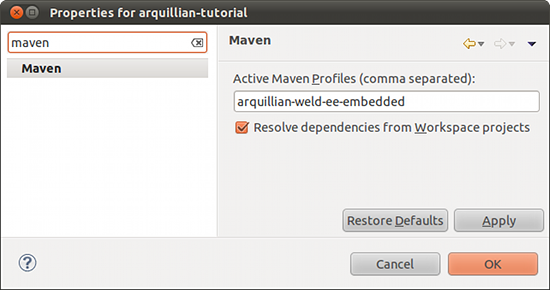

= Getting Started
:sectids!:

// Historical arquillian-core version 1.4.0.Final from https://arquillian.org/guides/getting_started/ (captured 2026-11-13).

This guide introduces you to Arquillian. After reading this guide, you’ll be able to:

* Add the Arquillian infrastructure to a Maven-based Java project
* Write an Arquillian test that asserts the behavior of a pass:[<acronym title="Contexts and Dependency Injection">CDI</acronym>] bean
* Execute the Arquillian test in multiple compatible containers in both Maven and Eclipse

You’ll learn all of these skills by incorporating Arquillian into the test suite of a Java EE application built with Maven. We’ve designed this guide to be a _fast read_ to get you started quickly!

[discrete,id="assumptions"]
=== Assumptions

The simplest way to get started with Arquillian is to incorporate it into the test suite of a project build that offers dependency management. Today, the most widely used build tool in this category is http://maven.apache.org[Apache Maven]. This guide will navigate you to your first *[.greenbar]#green bar#* using a new Maven project.

[.info]
Arquillian does not depend on Maven, or any specific build tool for that matter. It works just as well—if not better—when used in a project with an Ant or Gradle build. Ideally, the build tool should offer dependency management as it simplifies the task of including the Arquillian libraries since they are distributed in the http://search.maven.org[Maven Central repository].

This guide assumes you have Maven available, either in your command shell or your pass:[<acronym title="Integrated Development Environment">IDE</acronym>]. If you don’t, please http://maven.apache.org/download.html[download and install Maven now]. You’ll also need http://www.oracle.com/technetwork/java/javase/downloads[pass:[<acronym title="Java Development Kit">JDK</acronym>] 1.5] or higher installed on your machine, though JDK 1.6 is preferred.

[discrete,id="create_a_new_project"]
=== Create a New Project

There are two ways we recommend you create a new Maven project:

. link:#generate_project_from_archetype[Generate a project from a Maven archetype]
. link:#create_project_using_forge[Create and customize a project using JBoss Forge]

By far, http://jboss.org/forge[JBoss Forge] is the simpler approach, but this guide will offer both options in the event you aren’t ready to adopt JBoss Forge. Select from one of the two options above to jump to the instructions.

[.info]
If you already have a Maven project, you can use this section as review to ensure you have the proper dependencies before moving on.

[discrete,id="generate_project_from_archetype"]
==== Generate a Project from a Maven Archetype

First, create a Maven-based Java project using the following command:

[listing,role=command,subs=verbatim]
----
$ mvn archetype:generate -DarchetypeGroupId=net.avh4.mvn.archetype \
-DarchetypeArtifactId=java-1.6-archetype
----

_Copy the text after the ``+$+`` and paste it into your command shell_. Respond to the prompts by entering the value shown after each double colon in the pane below. Hit the Enter key after each entry (as indicated by ``+<ENTER>+``).

[listing,role=output,subs=verbatim]
----
Define value for property 'groupId': : org.arquillian.example <ENTER>
Define value for property 'artifactId': : arquillian-tutorial <ENTER>
Define value for property 'version': : <ENTER>
Define value for property 'package': : <ENTER>
Confirm properties configuration:
groupId: org.arquillian.example
artifactId: arquillian-tutorial
version: 1.0-SNAPSHOT
package: org.arquillian.example
Y: : <ENTER>
----

This command generated a Maven-based Java project inside the current directory in a new folder named ``+arquillian-tutorial+``. Switch to that directory. The file structure of the project is shown below.

[.filetree]
* src/
** main/
*** java/ – Place all application Java source files here (under Java package)
*** resources/ – Place all application configuration files here
** test/
*** java/ – Place all test Java source files heres (under Java package)
*** resources/ – Place all test configuration files here (e.g., arquillian.xml)
* pom.xml – The Maven build file. Tells Maven how your project should be built.

The project generator also created a Java package named ``+org.arquillian.example+`` underneath the two ``+java+`` folders. You should put your Java source files in this package rather than at the root of the ``+java+`` folder.

Go ahead and open up the ``+pom.xml+`` in your editor. You should see an XML file containing basic project information, a build section and a dependencies section.

[.info]
You’ll notice the project is configured to use Java 1.6 and JUnit 4.8, the minimum recommended versions of Java and JUnit for using Arquillian, respectively.

[.warning]
Arquillian also supports TestNG 5. However, we’ll be using JUnit throughout this guide.

*You can remove all the ``+<dependency>+`` elements below the JUnit dependency as they aren’t required.* After making this change, the file should match the contents below (slightly formatted):

[.filename]
pom.xml

[listing,role=prettify,subs=verbatim]
----
<?xml version="1.0" encoding="UTF-8"?>
<project xmlns="http://maven.apache.org/POM/4.0.0"
    xmlns:xsi="http://www.w3.org/2001/XMLSchema-instance"
    xsi:schemaLocation="
        http://maven.apache.org/POM/4.0.0
        http://maven.apache.org/xsd/maven-4.0.0.xsd">
    <modelVersion>4.0.0</modelVersion>

    <groupId>org.arquillian.example</groupId>
    <artifactId>arquillian-tutorial</artifactId>
    <version>1.0-SNAPSHOT</version>
    <packaging>jar</packaging>

    <name>arquillian-tutorial</name>
    <url>http://arquillian.org</url>

    <properties>
        <project.build.sourceEncoding>UTF-8</project.build.sourceEncoding>
    </properties>

    <build>
        <plugins>
            <plugin>
                <artifactId>maven-compiler-plugin</artifactId>
                <version>2.3.2</version>
                <configuration>
                    <source>1.6</source>
                    <target>1.6</target>
                </configuration>
            </plugin>
        </plugins>
    </build>
    <dependencies>
        <dependency>
            <groupId>junit</groupId>
            <artifactId>junit</artifactId>
            <version>4.12</version>
            <scope>test</scope>
        </dependency>
    </dependencies>
</project>
----

We’re going to be writing Java EE 7 components. Therefore, we need to add the Java EE 7 API to the classpath so we can compile these components.

Open up the ``+pom.xml+`` file once again and add the following XML fragment directly inside the ``+<dependencies>+`` element. Here’s how the ``+<dependencies>+`` element should look once you’re done:

[.filename]
pom.xml

[listing,role=prettify,subs=verbatim]
----
<!-- clip -->
<dependencies>
    <dependency>
        <groupId>org.jboss.spec</groupId>
        <artifactId>jboss-javaee-7.0</artifactId>
        <version>1.0.3.Final</version>
        <type>pom</type>
        <scope>provided</scope>
    </dependency>
    <dependency>
        <groupId>junit</groupId>
        <artifactId>junit</artifactId>
        <version>4.12</version>
        <scope>test</scope>
    </dependency>
</dependencies>
<!-- clip -->
----

The foundation of your project is now ready! Skip to the next section, link:#open_the_project_in_eclipse[Open the Project in Eclipse], so we can start writing some code!

[discrete,id="create_project_using_forge"]
==== Create a Project Using Forge

http://jboss.org/forge[JBoss Forge] is a command shell for rapid-application development in a standards-based environment. Another way to think of it is that it’s like Maven Archetypes on steroids.

Installing Forge is a relatively short process, and this guide will take you through the fundamentals. Follow these simple steps to get Forge installed:

. http://downloads.jboss.org/forge/releases/3.4.0.Final/forge-distribution-3.4.0.Final-offline.zip[Download Forge]
. Unzip the distribution into a folder on your harddrive, which we’ll call ``+$FORGE_HOME+`` +
We’ll assume you extracted the distribution to a folder named ``+forge+`` in your home directory
. Add ``+$FORGE_HOME/bin+`` to your path (Windows, Linux or Mac OSX)

On Unix based operating systems, adding Forge to your path typically means editing your $HOME/.bashrc or $HOME/.profile; you will need to set the following environment variables:

[listing,role=command,subs=verbatim]
----
$ export FORGE_HOME=$HOME/forge/
$ export PATH=$PATH:$FORGE_HOME/bin
----

[.info]
On Windows, you’ll need to right-click on open the "`Control Panel`", then click "`System Properties`", open the "`Advanced`" tab, then click "`Environment Variables`" and add these two entries visually. We recommended setting User variables for Forge, unless you have placed the unzipped distribution in a folder where all users can access it.

Now that Forge is installed (i.e., extracted), open a command prompt (a shell) and run the ``+forge+`` command:

[listing,role=command,subs=verbatim]
----
$ forge
   _____
  |  ___|__  _ __ __ _  ___
  | |_ / _ \| `__/ _` |/ _ \  \\
  |  _| (_) | | | (_| |  __/  //
  |_|  \___/|_|  \__, |\___|
                  |___/

[no project] ~ $
----

That’s it! You’ve got Forge up and running. Now it’s time to create the project.

Inside the Forge shell, execute the following command to create a blank project, much like we created a project using the Maven Archetype above:

[listing,role=command,subs=verbatim]
----
$ project-new --named arquillian-tutorial --topLevelPackage org.arquillian.example
----

This command generates a Maven-based Java project inside a new folder named ``+arquillian-tutorial+`` under the current directory.

The file structure of the project Forge generates is shown below:

[.filetree]
* src/
** main/
*** java/ – Place all application Java source files here (under Java package)
*** resources/ – Place all application configuration files here
**** META-INF/
***** forge.xml – An empty Forge settings file
** test/
*** java/ – Place all test Java source files heres (under Java package)
*** resources/ – Place all test configuration files here (e.g., arquillian.xml)
* pom.xml – The Maven build file. Tells Maven how your project should be built.

Forge also makes the project folder your current directory within the Forge shell.

[listing,role=command,subs=verbatim]
----
[arquillian-tutorial] arquillian-tutorial $
----

What we need to add now is the Java EE APIs. That’s done using the ``+project add-dependency+`` command below:

[listing,role=command,subs=verbatim]
----
$ project-add-dependencies org.jboss.spec:jboss-javaee-7.0:1.0.3.Final:pom:provided
----

You’ll also need to add JUnit 4.12, the minimum required version of JUnit to use Arquillian, as a test-scoped dependency:

[listing,role=command,subs=verbatim]
----
$ project-add-dependencies junit:junit:4.12:test
----

Forge adds the JBoss Community repository to the pom.xml file. This repository is not required to use Arquillian. (However, you can keep it if you are using other libraries only available in the JBoss Community repository). If you do decide to remove the repository, you can easily do so using the following Forge command:

[listing,role=command,subs=verbatim]
----
$ project-remove-repository --url http://repository.jboss.org/nexus/content/groups/public
----

The result of the pom.xml that Forge generates is shown below:

[.filename]
pom.xml

[listing,role=prettify,subs=verbatim]
----
<?xml version="1.0" encoding="UTF-8"?>
<project xsi:schemaLocation="http://maven.apache.org/POM/4.0.0 http://maven.apache.org/xsd/maven-4.0.0.xsd" xmlns="http://maven.apache.org/POM/4.0.0"
    xmlns:xsi="http://www.w3.org/2001/XMLSchema-instance">
    <modelVersion>4.0.0</modelVersion>
    <groupId>org.arquillian.tutorial</groupId>
    <artifactId>arquillian-tutorial</artifactId>
    <version>1.0.0-SNAPSHOT</version>
    <packaging>war</packaging>
    <properties>
    <maven.compiler.source>1.8</maven.compiler.source>
    <maven.compiler.target>1.8</maven.compiler.target>
    <project.build.sourceEncoding>UTF-8</project.build.sourceEncoding>
    </properties>
    <dependencyManagement>
      <dependencies>
        <dependency>
          <groupId>org.jboss.spec</groupId>
          <artifactId>jboss-javaee-7.0</artifactId>
          <version>1.0.3.Final</version>
          <type>pom</type>
          <scope>provided</scope>
        </dependency>
        <dependency>
          <groupId>junit</groupId>
          <artifactId>junit</artifactId>
          <version>4.12</version>
          <scope>test</scope>
        </dependency>
      </dependencies>
    </dependencyManagement>
    <dependencies>
      <dependency>
        <groupId>org.jboss.spec</groupId>
        <artifactId>jboss-javaee-7.0</artifactId>
        <type>pom</type>
        <scope>provided</scope>
      </dependency>
      <dependency>
        <groupId>junit</groupId>
        <artifactId>junit</artifactId>
        <scope>test</scope>
      </dependency>
    </dependencies>
    <build>
      <finalName>arquillian-tutorial</finalName>
      <plugins>
        <plugin>
          <artifactId>maven-war-plugin</artifactId>
          <version>2.4</version>
          <configuration>
            <failOnMissingWebXml>false</failOnMissingWebXml>
          </configuration>
        </plugin>
      </plugins>
    </build>
</project>
----

The foundation of your project is now ready! Let’s now open the project in Eclipse so we can start writing some code!

[discrete,id="open_the_project_in_eclipse"]
=== Open the Project in Eclipse

When developing a Java project, you’ll likely use an IDE such as Eclipse. That’s why Arquillian has been designed to be IDE friendly. You can run Arquillian tests from the IDE without any special configuration. Let’s start taking advantage of the IDE immediately.

Begin by launching Eclipse. Since this is a Maven project, you need the http://eclipse.org/m2e[Maven Integration for Eclipse] (m2e) plugin installed in order to open the project.

[discrete]
==== Installing the m2e plugin

If you don’t already have the m2e plugin installed, the simplest way to get it is to install http://jboss.org/tools[JBoss Tools]. Follow these steps to install it from the Eclipse Marketplace (sort of like the app store for Eclipse).

. Select ``+Help > Eclipse Marketplace...+`` from the main menu
. Type "`jboss tools`" (without quotes) in the Find input field, then press Enter
. Click the Install button next to JBoss Tools (Indigo)
. Complete the install wizard, then restart Eclipse if prompted

JBoss Tools provides a nice environment for developing Java EE applications, including excellent CDI support. Don’t worry, it’s not a heavyweight plugin.

However, if you just want the Maven integration without the extras that JBoss Tools brings, you can follow these steps instead:

. Select ``+Help > Eclipse Marketplace...+`` from the main menu
. Type "`maven`" (without quotes) in the Find input field, then press Enter
. Click the Install button next to Maven Integration for Eclipse
. Complete the install wizard, then restart Eclipse if prompted
. Repeat the steps to install the Maven Integration for Eclipse WTP

[discrete]
==== Using m2e to import the project

Once you have the Maven Integration plugin installed, follow these steps to open the project:

. Select ``+File > Import...+`` from the main menu
. Type "`existing maven`" (without quotes) in the import source field
. Select the option Existing Maven Projects, then click the Next button
. Click the Browse… button
. Navigate to the project folder in the file browser, select it, then click the OK button
. Click the Finish button to open the project

Eclipse will recognize the Maven project and open it in the Project Navigator view. If you expand the project, it should look similar to this image:

image:/images/guides/arquillian_tutorial_eclipse_project.png[/images/guides/arquillian++_++tutorial++_++eclipse++_++project]

Now we can really get down to business!

[discrete,id="create_a_component"]
=== Create a Component

In order to write an Arquillian test, we need to have a component for it to test. Let’s begin by creating a basic component so that you can learn how to execute an Arquillian test without other distractions. We’ll gradually move to more complex scenarios.

In your IDE, create a new Java class named ``+Greeter+`` in the ``+org.arquillian.example+`` package. Replace the contents of the file with this greeter logic:

[.filename]
src/main/java/org/arquillian/example/Greeter.java

[listing,role=prettify,subs=verbatim]
----
package org.arquillian.example;

import java.io.PrintStream;

/**
 * A component for creating personal greetings.
 */
public class Greeter {
    public void greet(PrintStream to, String name) {
        to.println(createGreeting(name));
    }

    public String createGreeting(String name) {
        return "Hello, " + name + "!";
    }
}
----

We want to verify that this class behaves properly when invoked as a pass:[<acronym title="Contexts and Dependency Injection">CDI</acronym>] bean. Of course, we could simply write a unit test. But let’s pretend that the bean uses enterprise services such as dependency injection and messaging and must be used inside a container. (Besides, that way we give it room to grow +~;)+)

To use the class as a CDI bean, we’ll be injecting it into the test using the ``+@Inject+`` annotation. That calls for an Arquillian test! That means it’s time to add the Arquillian API to the project!

[discrete,id="add_the_arquillian_apis"]
=== Add the Arquillian APIs

Once again open up the ``+pom.xml+`` file at the root of the project in your editor. We need to instruct Maven which versions of the artifacts to use. Insert the following XML fragment directly above the ``+<build>+`` element to import the pass:[<acronym title="Bill of Materials">BOM</acronym>], or version matrix, for Arquillian’s transitive dependencies.

[.filename]
pom.xml

[listing,role=prettify,subs=verbatim]
----
<!-- clip -->
<dependencyManagement>
    <dependencies>
        <dependency>
            <groupId>org.jboss.arquillian</groupId>
            <artifactId>arquillian-bom</artifactId>
            <version>1.4.0.Final</version>
            <scope>import</scope>
            <type>pom</type>
        </dependency>
    </dependencies>
</dependencyManagement>
<!-- clip -->
----

Next, append the following XML fragment directly under the last ``+<dependency>+`` element to add the Arquillian JUnit integration:

[.filename]
pom.xml

[listing,role=prettify,subs=verbatim]
----
<!-- clip -->
<dependency>
    <groupId>org.jboss.arquillian.junit</groupId>
    <artifactId>arquillian-junit-container</artifactId>
    <scope>test</scope>
</dependency>
<!-- clip -->
----

The Arquillian JUnit integration artifact also adds the Arquillian Core and ShrinkWrap APIs to the test classpath. You need all of these libraries to write and compile a JUnit Arquillian test.

[.info]
To use TestNG instead of JUnit, substitute the Arquillian JUnit integration with the Arquillian TestNG integration.

(Optional) We recommend upgrading the Maven Surefire Plugin from the default version, for reasons described in https://community.jboss.org/wiki/WhatVersionOfSurefireShouldIUseToRunMyArquillianTestsInAMavenBuild[this FAQ]. You can set the version of the Surefire Plugin by appending this ``+<plugin>+`` element inside the ``+<plugins>+`` element, just below the Maven Compiler Plugin:

[.filename]
pom.xml

[listing,role=prettify,subs=verbatim]
----
<!-- clip -->
<plugin>
    <artifactId>maven-surefire-plugin</artifactId>
    <version>2.17</version>
</plugin>
<!-- clip -->
----

If you’re having trouble with the pom.xml up to this point, you can download the file https://raw.github.com/arquillian/arquillian-examples/master/arquillian-tutorial/pom-no-container-profiles.xml[pom-no-container-profiles.xml] from the https://github.com/arquillian/arquillian-examples/tree/master/arquillian-tutorial[example project] and rename it to pom.xml.

*You’re all set to write your first Arquillian test!*

[discrete,id="write_an_arquillian_test"]
=== Write an Arquillian Test

An Arquillian test looks just like a unit test, just with some extra flair. Let’s return to the IDE to create one.

[.warning]
If you get the message "`Project configuration is out of date with pom.xml`" then right click and select Project ++>++ Maven ++>++ Update Project Configuration to resync the project.

Begin by creating a new JUnit test case in src/test/java named ``+GreeterTest+`` and assign it the package name ``+org.arquillian.example+``. You won’t need the typical JUnit setup and tearDown methods since Arquillian will handle the heavy lifting. Here’s what we have so far:

[.filename]
src/test/java/org/arquillian/example/GreeterTest.java

[listing,role=prettify,subs=verbatim]
----
package org.arquillian.example;

import org.junit.Assert;
import org.junit.Test;

public class GreeterTest {
    @Test
    public void should_create_greeting() {
        Assert.fail("Not yet implemented");
    }
}
----

Now, about that flair. An Arquillian test case must have three things:

. A ``+@RunWith(Arquillian.class)+`` annotation on the class
. A public static method annotated with ``+@Deployment+`` that returns a ShrinkWrap archive
. At least one method annotated with ``+@Test+``

The ``+@RunWith+`` annotation tells JUnit to use Arquillian as the test controller. Arquillian then looks for a public static method annotated with the ``+@Deployment+`` annotation to retrieve the test archive (i.e., micro-deployment). Then some magic happens and each ``+@Test+`` method is run inside the container environment.

[.info]
The ``+@Deployment+`` method is only mandatory for tests that run inside the container and no extension is loaded that otherwise generates the test archive. Client-side tests do not require a test archive, and therefore, do not require a ``+@Deployment+`` method.

[discrete]
==== What’s a test archive?

The purpose of the test archive is to isolate the classes and resources which are needed by the test from the remainder of the classpath. Unlike a normal unit test, Arquillian does not simply tap the entire classpath. Instead, you include only what the test needs (which may be the entire classpath, if that’s what you decide). The archive is defined using http://jboss.org/shrinkwrap[ShrinkWrap], which is a Java API for creating archives (e.g., jar, war, ear) in Java. The micro-deployment strategy lets you focus on precisely the classes you want to test. As a result, the test remains very lean and manageable.

Once the ShrinkWrap archive is deployed to the server, it becomes a real archive. The container deployer has no knowledge that the archive was package by ShrinkWrap. You can think of ShrinkWrap as a Java-based build tool, with one exception. In the optimal case, it streams the archive to the server instead of writing the archive to disk. But what it creates is an authentic archive.

[.info]
ShrinkWrap also supports resolving artifacts (libraries) and create configuration files programmatically, which can then be added to the test archive. For a more thorough introduction to ShrinkWrap, see the link:/guides/shrinkwrap_introduction[ShrinkWrap introduction] guide.

Let’s add that Arquillian flair to the test by replacing its contents with the code below:

[.filename]
src/test/java/org/arquillian/example/GreeterTest.java

[listing,role=prettify,subs=verbatim]
----
package org.arquillian.example;

import org.jboss.arquillian.container.test.api.Deployment;
import org.jboss.arquillian.junit.Arquillian;
import org.jboss.shrinkwrap.api.ShrinkWrap;
import org.jboss.shrinkwrap.api.asset.EmptyAsset;
import org.jboss.shrinkwrap.api.spec.JavaArchive;
import org.junit.Assert;
import org.junit.Test;
import org.junit.runner.RunWith;

@RunWith(Arquillian.class)
public class GreeterTest {

    @Deployment
    public static JavaArchive createDeployment() {
        return ShrinkWrap.create(JavaArchive.class)
            .addClass(Greeter.class)
            .addAsManifestResource(EmptyAsset.INSTANCE, "beans.xml");
    }

    @Test
    public void should_create_greeting() {
        Assert.fail("Not yet implemented");
    }
}
----

Using ShrinkWrap, we’ve defined a Java archive (jar) as the deployment. It includes the ``+Greeter+`` class that the test will invoke and an empty beans.xml in the META-INF directory to activate CDI in this archive.

If you want to see the contents of the archive that ShrinkWrap creates when the test is run, you can print the archive to stdout (i.e., the console) before returning it.

[listing,role=prettify,subs=verbatim]
----
@Deployment
public static JavaArchive createDeployment() {
    JavaArchive jar = ShrinkWrap.create(JavaArchive.class)
        .addClass(Greeter.class)
        .addAsManifestResource(EmptyAsset.INSTANCE, "beans.xml");
    System.out.println(jar.toString(true));
    return jar;
}
----

This produces the following output when the test is run:

[listing,role=output,subs=verbatim]
----
2ac9cd28-a71a-479a-a785-750b40221766.jar:
/META-INF/
/META-INF/beans.xml
/org/
/org/arquillian/
/org/arquillian/example/
/org/arquillian/example/Greeter.class
----

ShrinkWrap assigned the archive a random name since we didn’t specify one explicitly. We’ll cover another way to inspect the archive in the follow-up guide, link:/guides/getting_started_rinse_and_repeat/#export_the_deployment[Getting Started: Rinse and Repeat].

Now all we need to do is inject the ``+Greeter+`` instance into a field directly above the test method and replace the unimplemented test method with one that asserts the behavior of the bean. To give you that warm fuzzy feeling, we’ll also print the greeting to the console. Replace the test method with the code below and add an import for ``+javax.inject.Inject+``.

[.filename]
src/test/java/org/arquillian/example/GreeterTest.java

[listing,role=prettify,subs=verbatim]
----
// clip
import javax.inject.Inject;
// clip

@Inject
Greeter greeter;

@Test
public void should_create_greeting() {
    Assert.assertEquals("Hello, Earthling!",
        greeter.createGreeting("Earthling"));
    greeter.greet(System.out, "Earthling");
}
----

Here’s how the test should look when you’re done:

[.filename]
src/test/java/org/arquillian/example/GreeterTest.java

[listing,role=prettify,subs=verbatim]
----
package org.arquillian.example;

import javax.inject.Inject;
import org.jboss.arquillian.container.test.api.Deployment;
import org.jboss.arquillian.junit.Arquillian;
import org.jboss.shrinkwrap.api.ShrinkWrap;
import org.jboss.shrinkwrap.api.asset.EmptyAsset;
import org.jboss.shrinkwrap.api.spec.JavaArchive;
import org.junit.Test;
import org.junit.Assert;
import org.junit.runner.RunWith;

@RunWith(Arquillian.class)
public class GreeterTest {

    @Deployment
    public static JavaArchive createDeployment() {
        return ShrinkWrap.create(JavaArchive.class)
            .addClass(Greeter.class)
            .addAsManifestResource(EmptyAsset.INSTANCE, "beans.xml");
    }

    @Inject
    Greeter greeter;

    @Test
    public void should_create_greeting() {
        Assert.assertEquals("Hello, Earthling!",
            greeter.createGreeting("Earthling"));
        greeter.greet(System.out, "Earthling");
    }
}
----

You’ve written your first Arquillian test!

Ah, but you’re probably wondering how to run it +~:S+ If you’re thinking, "`Just like a unit test`", then you’re correct! However, we first need to add a container adapter to the classpath.

[discrete,id="add_a_container_adapter"]
=== Add a Container Adapter

We’ve been talking a lot about testing in a container, but so far we haven’t discussed which one we’ll be using. That’s because it’s a runtime decision.

Arquillian selects the target container based on which container adapter is available on the test classpath. A _container adapter_ controls and communicates with a container (e.g., Weld Embedded, JBoss AS, GlassFish, etc). That means we’ll need to add additional libraries to the project.

An Arquillian test can be executed in any container that’s compatible with the programming model used in the test (as long as that container has an Arquillian adapter, of course). Our test is using the CDI programming model, so we need to use any container to supports CDI. We want fast turnaround during development, so we’ll start with the Weld EE embedded container (i.e., an embedded CDI runtime).

Open the ``+pom.xml+`` file again and add the following group of dependencies directly below the other ``+<dependency>+`` elements:

[.filename]
pom.xml

[listing,role=prettify,subs=verbatim]
----
<!-- clip -->
<dependency>
    <groupId>org.jboss.arquillian.container</groupId>
    <artifactId>arquillian-weld-ee-embedded-1.1</artifactId>
    <version>1.0.0.CR9</version>
    <scope>test</scope>
</dependency>
<dependency>
    <groupId>org.jboss.weld</groupId>
    <artifactId>weld-core</artifactId>
    <version>2.3.5.Final</version>
    <scope>test</scope>
</dependency>
<dependency>
    <groupId>org.slf4j</groupId>
    <artifactId>slf4j-simple</artifactId>
    <version>1.6.4</version>
    <scope>test</scope>
</dependency>
<!-- clip -->
----

To summarize, here are the three libraries you need to use Arquillian:

. Arquillian JUnit integration (or TestNG integration)
. Arquillian container adapter for the target container
. Container runtime (for an embedded container) or container client (for a remote container)

We’re using an embedded container in this example, so we need the container runtime, Weld.

Now back to running the test.

[discrete,id="run_the_arquillian_test"]
=== Run the Arquillian Test

Once you add all the necessary Arquillian libraries to the classpath, you can run an Arquillian test just like a unit test, whether you are running it from the IDE, the build script or any other test plugin. Let’s run the test in Eclipse.

From the IDE window, right click on the GreeterTest.java file in the Package Explorer (or in the editor) and select Run As ++>++ JUnit Test from the context menu.

image:/images/guides/arquillian_tutorial_run_junit_test.png[/images/guides/arquillian++_++tutorial++_++run++_++junit++_++test]

When you run the test, you should see the following lines printed to the console:

[listing,role=output,subs=verbatim]
----
21 [main] INFO org.jboss.weld.Version - WELD-000900 2.3.5 (Final)
Hello, Earthling!
----

You should then see the JUnit view appear, revealing a *[.greenbar]#green bar#*!

image:/images/guides/arquillian_tutorial_junit_green_bar.png[/images/guides/arquillian++_++tutorial++_++junit++_++green++_++bar]

You can also run the test on the commandline using Maven:

[listing,role=command,subs=verbatim]
----
$ mvn test
----

You should see the following lines printed to the console:

[listing,role=output,subs=verbatim]
----
-------------------------------------------------------
T E S T S
-------------------------------------------------------
Running org.arquillian.example.GreeterTest
19 [main] INFO org.jboss.weld.Version - WELD-000900 2.3.5 (Final)
Hello, Earthling!
Tests run: 1, Failures: 0, Errors: 0, Skipped: 0, Time elapsed: 0.907 sec
----

*Congratulations!* You’ve earned your first *[.greenbar]#green bar#* with Arquillian!

[discrete,id="a_closer_look"]
=== A Closer Look

How do you know that CDI really worked? For all you know, Arquillian created a new instance of the ``+Greeter+`` class and injected it into the test without any involvement from CDI. Let’s prove it’s there.

Create a new CDI bean named ``+PhraseBuilder+`` in the ``+org.arquillian.example+`` package that can create phrases from templates.

[.filename]
src/main/java/org/arquillian/example/PhraseBuilder.java

[listing,role=prettify,subs=verbatim]
----
package org.arquillian.example;

import java.text.MessageFormat;
import java.util.HashMap;
import java.util.Map;
import javax.annotation.PostConstruct;

public class PhraseBuilder {
    private Map<String, String> templates;

    public String buildPhrase(String id, Object... args) {
        return MessageFormat.format(templates.get(id), args);
    }

    @PostConstruct
    public void initialize() {
        templates = new HashMap<String, String>();
        templates.put("hello", "Hello, {0}!");
    }
}
----

Next, open up the ``+Greeter+`` class and create a new constructor that will inject ``+PhraseBuilder+`` using constructor injection. Then, delegate the task of creating the greeting to the injected bean.

[.filename]
src/main/java/org/arquillian/example/Greeter.java

[listing,role=prettify,subs=verbatim]
----
package org.arquillian.example;

import java.io.PrintStream;
import javax.inject.Inject;

public class Greeter {

    private PhraseBuilder phraseBuilder;

    @Inject
    public Greeter(PhraseBuilder phraseBuilder) {
        this.phraseBuilder = phraseBuilder;
    }

    public void greet(PrintStream to, String name) {
        to.println(createGreeting(name));
    }

    public String createGreeting(String name) {
        return phraseBuilder.buildPhrase("hello", name);
    }
}
----

Now, in order for the test to work, an instance of ``+PhraseBuilder+`` must be created, its ``+@PostConstruct+`` method must be invoked and it must be injected into the constructor of ``+Greeter+`` when an instance of ``+Greeter+`` is created. We can be certain CDI is working if all that comes together.

One last step. Because we created a new class, we must be sure that it gets included in the test archive that the ``+@Deployment+`` method returns. Simply change this line:

[listing,role=prettify,subs=verbatim]
----
.addClass(Greeter.class)
----

…to this one:

[listing,role=prettify,subs=verbatim]
----
.addClasses(Greeter.class, PhraseBuilder.class)
----

Run the test again. You should get another *[.greenbar]#green bar#*! Feels good, doesn’t it?

[discrete,id="debug_the_test"]
=== Debug the Test

This is going to be a short chapter. Why? Because an Arquillian test is so straightforward that you debug it exactly how you debug a unit test. Just add a breakpoint anywhere—either in the test or in the application code. Then right click on the file and select Debug As ++>++ JUnit Test. You’re now debugging in the container! Have fun poking around!

image:/images/guides/arquillian_tutorial_debugging_test.png[/images/guides/arquillian++_++tutorial++_++debugging++_++test]

[.warning]
If you’re using a remote container, Debug As does not cause breakpoints to be activated. Instead, you need to start the container in debug mode and attach the debugger. That’s because the test is run in a different JVM than the original test runner.

As you’ve just witnessed, Arquillian is the ideal tool for testing CDI applications. It takes care of loading the CDI environment and injecting beans directly into the test. Best of all, when using an embedded CDI container, the test runs just as quickly as a unit test. If that’s all you need, then you can exit the tutorial now and start writing tests.

*But wait!* Is the embedded container telling the whole story? Will the component work if running inside a full container?

One of the perks of Arquillian is that you can run the same test in different compatible containers, whether it’s another embedded container or a standalone container. If you intend to use a real container, read on.

[discrete,id="add_more_containers"]
=== Add More Containers

As you learned earlier, Arquillian selects the container based on which container adapter is on the classpath. To switch to another container, you just change which container adapter is on the classpath before you run the test.

[.important]
You can only have one container adapter on the classpath at a time. Arquillian will abort execution of the test if it detects multiple adapters.

One way to swap the libraries on the classpath is to manually edit the dependencies defined in ``+pom.xml+``. But that’s just tedious. The recommended approach is to use Maven profiles.

[discrete]
==== Setting up Maven profiles

Maven profiles allow you to partition your dependencies into groups, one group for each container adapter and its related artifacts. When running the tests, you activate one of those groups, which in turn selects a target container. The profile is activated either using either a commandline flag (-P) or a preference in the IDE.

Open up the ``+pom.xml+`` and create a new profile for Weld EE embedded by inserting the following XML directly under the ``+<dependencies>+`` element:

[.filename]
pom.xml

[listing,role=prettify,subs=verbatim]
----
<!-- clip -->
<profiles>
    <profile>
        <id>arquillian-weld-ee-embedded</id>
        <dependencies>
            <dependency>
                <groupId>org.jboss.spec</groupId>
                <artifactId>jboss-javaee-7.0</artifactId>
                <version>1.0.3.Final</version>
                <type>pom</type>
                <scope>provided</scope>
            </dependency>
            <dependency>
                <groupId>org.jboss.arquillian.container</groupId>
                <artifactId>arquillian-weld-ee-embedded-1.1</artifactId>
                <version>1.0.0.CR9</version>
                <scope>test</scope>
            </dependency>
            <dependency>
                <groupId>org.jboss.weld</groupId>
                <artifactId>weld-core</artifactId>
                <version>2.3.5.Final</version>
                <scope>test</scope>
            </dependency>
            <dependency>
                <groupId>org.slf4j</groupId>
                <artifactId>slf4j-simple</artifactId>
                <version>1.6.4</version>
                <scope>test</scope>
            </dependency>
        </dependencies>
    </profile>
</profiles>
<!-- clip -->
----

Next, *remove* the ``+jboss-javaee-7.0+`` dependency and the dependencies for the Weld EE embedded container adapter from the main ``+<dependencies>+`` section. Here’s how the ``+<dependencies>+`` and ``+<profiles>+`` sections should look when you’re done:

[.filename]
pom.xml

[listing,role=prettify,subs=verbatim]
----
<!-- clip -->
<dependencies>
    <dependency>
        <groupId>junit</groupId>
        <artifactId>junit</artifactId>
        <version>4.12</version>
        <scope>test</scope>
    </dependency>
    <dependency>
        <groupId>org.jboss.arquillian.junit</groupId>
        <artifactId>arquillian-junit-container</artifactId>
        <scope>test</scope>
    </dependency>
</dependencies>
<profiles>
    <profile>
        <id>arquillian-weld-ee-embedded</id>
        <dependencies>
            <dependency>
                <groupId>org.jboss.spec</groupId>
                <artifactId>jboss-javaee-7.0</artifactId>
                <version>1.0.3.Final</version>
                <type>pom</type>
                <scope>provided</scope>
            </dependency>
            <dependency>
                <groupId>org.jboss.arquillian.container</groupId>
                <artifactId>arquillian-weld-ee-embedded-1.1</artifactId>
                <version>1.0.0.CR9</version>
                <scope>test</scope>
            </dependency>
            <dependency>
                <groupId>org.jboss.weld</groupId>
                <artifactId>weld-core</artifactId>
                <version>2.3.5.Final</version>
                <scope>test</scope>
            </dependency>
            <dependency>
                <groupId>org.slf4j</groupId>
                <artifactId>slf4j-simple</artifactId>
                <version>1.6.4</version>
                <scope>test</scope>
            </dependency>
        </dependencies>
    </profile>
</profiles>
<!-- clip -->
----

[.info]
The Java EE API dependency has been moved to the profile since some containers, like Embedded GlassFish, already provide these libraries. Having both on the classpath at the same time results in conflicts. Therefore, we have to play this classpath dance.

We’ll now include two additional profiles in the ``+pom.xml+`` inside the ``+<profiles>+`` element, the first for http://embedded-glassfish.java.net[Embedded GlassFish]:

[.filename]
pom.xml

[listing,role=prettify,subs=verbatim]
----
<!-- clip -->
<profile>
    <id>arquillian-glassfish-embedded</id>
    <dependencies>
        <dependency>
            <groupId>org.jboss.arquillian.container</groupId>
            <artifactId>arquillian-glassfish-embedded-3.1</artifactId>
            <version>1.0.0.CR4</version>
            <scope>test</scope>
        </dependency>
        <dependency>
            <groupId>org.glassfish.main.extras</groupId>
            <artifactId>glassfish-embedded-all</artifactId>
            <version>3.1.2</version>
            <scope>provided</scope>
        </dependency>
    </dependencies>
</profile>
<!-- clip -->
----

and the other for JBoss AS managed:

[.filename]
pom.xml

[listing,role=prettify,subs=verbatim]
----
<!-- clip -->
<profile>
    <id>arquillian-jbossas-managed</id>
    <dependencies>
        <dependency>
            <groupId>org.jboss.spec</groupId>
            <artifactId>jboss-javaee-7.0</artifactId>
            <version>1.0.3.Final</version>
            <type>pom</type>
            <scope>provided</scope>
        </dependency>
        <dependency>
            <groupId>org.jboss.as</groupId>
            <artifactId>jboss-as-arquillian-container-managed</artifactId>
            <version>7.1.1.Final</version>
            <scope>test</scope>
        </dependency>
        <dependency>
            <groupId>org.jboss.arquillian.protocol</groupId>
            <artifactId>arquillian-protocol-servlet</artifactId>
            <scope>test</scope>
        </dependency>
    </dependencies>
</profile>
<!-- clip -->
----

[.info]
By default, JBoss AS 7 deploys test archives to the server using the JMX protocol. We’ve gone ahead and added the dependency for the Servlet protocol in the ``+arquillian-jbossas-managed+`` profile just so it’s there if you need to use it in the future. See https://community.jboss.org/wiki/WhyDoIGetNoActiveContextsForScopeTypeWhenTestingOnJBossAS7[this FAQ] for instructions on how to switch to it.

You now have the choice of running the tests in one of three containers.

If you’re having trouble with the pom.xml up to this point, you can download the file https://raw.github.com/arquillian/arquillian-examples/master/arquillian-tutorial/pom.xml[pom.xml] from the https://github.com/arquillian/arquillian-examples/tree/master/arquillian-tutorial[example project].

[discrete,id="test_across_containers"]
=== Test Across Containers

When you refresh the project in Eclipse, you’ll notice that it no longer builds. That’s because you need to activate one of the container profiles. Let’s activate the Weld EE embedded profile to restore the previous state.

There are two ways to activate a Maven profile in Eclipse (assuming you are using the http://www.eclipse.org/m2e[Maven Integration for Eclipse]):

. Manual configuration (standard approach)
. Maven profile selector (JBoss Tools)

[discrete]
==== Set active Maven profile: Manual configuration

To set the active profile manually, follow these steps:

. Right click on the project and select Properties
. Select the Maven properties tab
. Enter the profile id in the Active Maven Profiles field (e.g., ``+arquillian-weld-ee-embedded+``)
. Click the OK button and accept the project changes

Here’s the Maven properties screen showing the profile we’ve activated:

[discrete]
==== Set active Maven profile: Maven profile selector

If you have JBoss Tools installed, selecting the active profile becomes much easier:

. Right click on the project and select Maven ++>++ Select Active Profiles… +
(alternatively, you can use the keybinding Ctrl{plus}Shift{plus}P or the button in the toolbar)
. Check the box next to the profile you want to activate (e.g., ``+arquillian-weld-ee-embedded+``)
. Click the OK button

Here’s the Maven profile selector dialog showing the profile we’ve activated:

image:/images/guides/arquillian_tutorial_maven_profile_selector.png[/images/guides/arquillian++_++tutorial++_++maven++_++profile++_++selector]

Once you’ve activate the profile, the compile errors will disappear and you’ll be able to run the test again successfully.

Another option to active a profile is to set one of the profiles to be active by default. Let’s make the Weld EE Embedded profile the default by adding an ``+<activation>+`` element to the profile definition:

[.filename]
pom.xml

[listing,role=prettify,subs=verbatim]
----
<!-- clip -->
<profile>
    <id>arquillian-weld-ee-embedded</id>
    <activation>
        <activeByDefault>true</activeByDefault>
    </activation>
    <dependencies>
        <!-- hidden -->
    </dependencies>
</profile>
<!-- clip -->
----

Now you no longer have to select a profile in the IDE since this one will be automatically selected. However, to use a different profile (exclusively), you have to first explicitly deactivate this profile.

[discrete]
==== Switching between containers

You already know the test works in Weld EE Embedded. Let’s switch to GlassFish embedded by repeating the steps above, this time activating only the ``+arquillian-glassfish-embedded+`` profile.

[.info]
If you set the Weld EE Embedded profile to be active by default, you have to explicitly disable it to use another profile. You can disable a profile in the Maven Profile selector by right clicking on the entry and selecting Deactivate from the context menu. You’ll see this prefixes the profile name with an exclamation mark (e.g., ``+!arquillian-weld-ee-embedded+``). Multiple profile selections (or deactivations) are separated by commas.

Run the test again. You should see GlassFish start in the console…and another *[.greenbar]#green bar#*!

You’ve now run the same test on two different embedded containers, a CDI container (Weld) and a Java EE container (GlassFish). Both of these executions are in process. To really be sure the component works in a pure environment, we need to use a standalone container. Let’s switch to using JBoss AS.

To run the test on a standalone instance of JBoss AS, you first need to set it up. You can either:

. Download and unpack it in a location outside the project
. Use Maven to download and unpack it during a build

Follow these steps to setup JBoss AS 7 outside the project:

. http://jboss.org/jbossas/downloads[Download JBoss AS 7] (make sure the version you download matches the version of the ``+jboss-as-arquillian-container-managed+`` dependency in your ``+pom.xml+``)
. Extract the archive
. (optional) Set the ``+JBOSS_HOME+`` environment variable to the path of the extracted directory

If you have JBoss AS installed (i.e., extracted) and your ``+JBOSS_HOME+`` environment variable set to that location, you can activate the ``+arquillian-jbossas-managed+`` profile and run the test. You should see JBoss AS start in the console…and another *[.greenbar]#green bar#*!

[.info]
The message printed to System.out gets written to the server log instead of the console, so look over there.

If you want Maven to handle this task for you instead (optional), add the following XML fragment under the ``+<id>+`` element of the ``+arquillian-jbossas-managed+`` profile:

[.filename]
pom.xml

[listing,role=prettify,subs=verbatim]
----
<!-- clip -->
<build>
    <plugins>
        <plugin>
            <artifactId>maven-dependency-plugin</artifactId>
            <executions>
                <execution>
                    <id>unpack</id>
                    <phase>process-test-classes</phase>
                    <goals>
                        <goal>unpack</goal>
                    </goals>
                    <configuration>
                        <artifactItems>
                            <artifactItem>
                                <groupId>org.jboss.as</groupId>
                                <artifactId>jboss-as-dist</artifactId>
                                <version>7.1.1.Final</version>
                                <type>zip</type>
                                <overWrite>false</overWrite>
                                <outputDirectory>target</outputDirectory>
                            </artifactItem>
                        </artifactItems>
                    </configuration>
                </execution>
            </executions>
        </plugin>
    </plugins>
</build>
<!-- clip -->
----

To target a managed JBoss AS 7 instance downloaded by Maven, you also need a small bit of Arquillian configuration. Create the following configuration file and assign the value of the ``+jbossHome+`` property to the location where JBoss AS 7 is installed. If you’re using the Maven dependency plugin, the location is ``+target/jboss-as-7.1.1.Final+``.

[.filename]
src/test/resources/arquillian.xml

[listing,role=prettify,subs=verbatim]
----
<arquillian xmlns="http://jboss.org/schema/arquillian"
    xmlns:xsi="http://www.w3.org/2001/XMLSchema-instance"
    xsi:schemaLocation="
        http://jboss.org/schema/arquillian
        http://jboss.org/schema/arquillian/arquillian_1_0.xsd">
    <container qualifier="jbossas-managed" default="true">
        <configuration>
            <property name="jbossHome">target/jboss-as-7.1.1.Final</property>
        </configuration>
    </container>
</arquillian>
----

Now change the active Maven profile to ``+arquillian-jbossas-managed+``, then run the test again. You should see JBoss AS starting in the console…and yet another *[.greenbar]#green bar#*!

That’s the _same_ test, this time running in a full Java EE container. Arquillian packages the test, deploys to the container as a Java EE archive, executes the tests remotely, captures the results and feeds them back to the Eclipse JUnit result view (or in the Maven surefire results).

If you want to dive deeper into Arquillian, move on to link:/guides/getting_started_rinse_and_repeat[Getting Started: Rinse and Repeat] guide. To learn how to use Forge to automate Arquillian setup and test generation, read through link:/guides/get_started_faster_with_forge[Get Started Faster with Forge].
