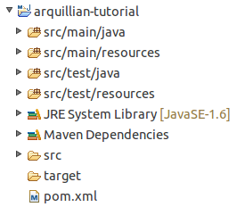
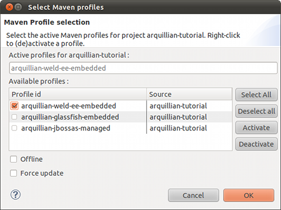

Ce guide a pour objectif de vous initier à Arquillian. Après la lecture de ce document nous espérons que vous serez capable de :

* Ajouter Arquillian et son environnement d'exécution à un projet Java basé sur Maven
* Ecrire un cas de test (test case) avec Arquillian afin d'affirmer (assert) le comportement d'un bean CDI (Contexts and Dependency Injection)
* Exécuter le test dans plusieurs conteneurs.

Vous apprendrez tout ça en ajoutant Arquillian dans les séries de test de votre application Java EE avec un build Maven. Nous avons conçu ce guide pour que vous puissiez commencer très rapidement !

=== Hypothèses

La façon la plus simple pour démarrer avec Arquillian consiste à l'intégrer à une série de tests (test suite) dans un projet disposant d'une gestion de dépendances. Actuellement l'outil le plus connu de cette catégorie est link:http://maven.apache.org.[Apache Maven] Ce guide vous accompagnera dans la réalisation de votre premier projet Maven *(greenbar)barre verte* .

[NOTE]
====
Arquillian ne dépend pas de maven, ni d'autres outils de build. Il est facilement intégrable avec les projets utilisant Ant ou Gradle comme outils de build. Idéalement, l'outil pour le build doit offrir une gestion de dépendances afin de simplifier l'ajout des librairies d'Arquillian puisqu'ils sont disponibles dans le "Maven Central repository":maven_search
====

Ce guide suppose que vous disposiez déjà de Maven,soit en ligne de commande ou dans votre IDE (Environnement de développement intégré). Si ce n'est pas le cas, link:http://maven.apache.org/download.html.[installez le maintenant] Vous aurez besoin aussi du link:http://www.oracle.com/technetwork/java/javase/downloads[JDK(Java Development Kit) 1.5] installé dans votre machine.

=== Créer un nouveau projet

Nous vous recommandons deux façons pour créer votre nouveau projet Maven:

# link:#generate_project_from_archetype[Générer un projet à partir d'un archétype Maven]
# link:#create_project_using_forge[Créer et personnaliser un projet en utilisant JBoss Forge]

Actuellement link:http://jboss.org/forge[JBoss Forge] est l'approche la plus simple, toutefois, ce guide vous proposera les deux options si vous n'êtes pas encore prêt à adopter JBoss Forge. Choisissez l'une des deux options ci dessus pour vous rendre directement aux instructions.

[NOTE]
====
Si vous disposez déjà d'un projet Maven, cette section vous servira à vérifier que vous avez les bonnes dépendances avant d'aller plus loin!.
====

[#generate_project_from_archetype]
==== Générez un projet à partir d'un archétype Maven

Tout d'abord, créez un projet java avec Maven en utilisant la commande ci-dessous.

[source,command]
----
$ mvn archetype:generate -DarchetypeGroupId=net.avh4.mvn.archetype \
-DarchetypeArtifactId=java-1.6-archetype
----
_Copiez le texte après `$` et collez le dans votre shell._ Répondez aux questions en saisissant les valeurs indiquées ci-dessous après chaque paire de deux points puis validez (comme indiqué par `<ENTER>`).

[source,output]
----
Définir la valeur pour la propriété (Define value for property) 'groupId': : org.arquillian.example <ENTER>
Define value for property 'artifactId': : arquillian-tutorial <ENTER>
Define value for property 'version': : <ENTER>
Define value for property 'package': : <ENTER>
Confirmer cette configuration des propriétés (Confirm properties configuration):
groupId: org.arquillian.example
artifactId: arquillian-tutorial
version: 1.0-SNAPSHOT
package: org.arquillian.example
Y: : <ENTER>
----
Cette commande génère un projet Java basé sur Maven dans un nouveau dossier du répertoire courant, avec `arquillian-tutorial` comme nom. Ci-dessous la structure des fichiers du projet:

(filetree)* src/
** main/
*** java/ - Placez tous les fichiers du code source java ici (sous forme de packages Java)
*** resources/ - Placez tous les fichiers de configuration de votre application ici
** test/
*** java/ - Placez toutes les classes de test ici (sous forme de packages java)
*** resources/ - Placez tous les fichiers de configuration des tests ici (i.e. arquillian.xml)
* pom.xml - Le fichier Maven pour le build. Indique à Maven comment votre projet doit être construit.

[NOTE]
====
Le projet est pré-configuré pour utiliser Java 1.6 et JUnit 4.8, ce sont les versions minimum requises pour pouvoir utiliser Arquillian.
====

Le générateur crée aussi un package Java `org.arquillian.example`. Vous devez alors mettre vos classes Java sous ce package au lieu de les mettre à la racine du répertoire `java`.

[WARNING]
====
Notez qu'Arquillian supporte aussi TestNG 5 même si, tout au long de ce guide, nous utiliserons uniquement JUnit
====

Ouvrez le fichier `pom.xml` avec votre éditeur préféré. Il s'agit d'un fichier XML contenant une configuration de base pour votre projet, une section pour le build et une autre pour les dépendances. *Tout les éléments `<dependency>` sous JUnit ne sont pas obligatoires, vous pouvez donc les supprimer.*

Après avoir effectué ce changement, vous devez obtenir le contenu suivant:

[source]
----
[source]
----
<?xml version="1.0" encoding="UTF-8"?>
<project xmlns="http://maven.apache.org/POM/4.0.0"
    xmlns:xsi="http://www.w3.org/2001/XMLSchema-instance"
    xsi:schemaLocation="
        http://maven.apache.org/POM/4.0.0
        http://maven.apache.org/xsd/maven-4.0.0.xsd">
    <modelVersion>4.0.0</modelVersion>
----
    <groupId>org.arquillian.example</groupId>
    <artifactId>arquillian-tutorial</artifactId>
    <version>1.0-SNAPSHOT</version>
    <packaging>jar</packaging>

    <name>arquillian-tutorial</name>
    <url>http://arquillian.org</url>

    <properties>
        <project.build.sourceEncoding>UTF-8</project.build.sourceEncoding>
    </properties>

    <build>
        <plugins>
            <plugin>
                <groupId>org.apache.maven.plugins</groupId>
                <artifactId>maven-compiler-plugin</artifactId>
                <version>2.3.2</version>
                <configuration>
                    <source>1.6</source>
                    <target>1.6</target>
                </configuration>
            </plugin>
        </plugins>
    </build>
    <dependencies>
        <dependency>
            <groupId>junit</groupId>
            <artifactId>junit</artifactId>
            <version>4.12</version>
            <scope>test</scope>
        </dependency>
    </dependencies>
</project>

Nous serons amenés à écrire des composants Java EE 7. Donc, nous aurons sûrement besoin d'ajouter l'API Java EE 7 dans le classpath pour pouvoir compiler ces composants.

Ouvrez à nouveau le fichier `pom.xml` et ajoutez le fragment XML ci dessous directement sous le tag `<dependencies>`.

[source]
----
[source]
----
<!-- clip -->
<dependencies>
    <dependency>
        <groupId>org.jboss.spec</groupId>
        <artifactId>jboss-javaee-7.0</artifactId>
        <version>1.0.3.Final</version>
        <type>pom</type>
        <scope>provided</scope>
    </dependency>
    <dependency>
        <groupId>junit</groupId>
        <artifactId>junit</artifactId>
        <version>4.12</version>
        <scope>test</scope>
    </dependency>
</dependencies>
<!-- clip -->
----
Le squelette de votre projet est maintenant prêt ! Allez directement à la section link:#open_project_in_eclipse[ouvrir le projet dans eclipse] pour écrire un peu du code !

[#create_project_using_forge]
==== Créer un projet en utilisant Forge

link:http://jboss.org/forge[JBoss Forge] est un shell fournissant une ligne de commande dédiée au développement rapide d'applications respectant les standards. On peut aussi le voir comme un générateur Maven sous stéroïdes.

Le processus d'installation de Forge est très simple. Le guide ci-dessous vous permettra de démarrer rapidement. Vous n'aurez qu'à suivre les étapes suivantes:

# link:http://downloads.jboss.org/forge/releases/3.4.0.Final/forge-distribution-3.4.0.Final-offline.zip[Téléchargez Forge] et dézippez-le dans un dossier sur votre disque, la suite de ce guide référencera ce dossier par `$FORGE_HOME`

# Ajoutez `$FORGE_HOME/bin` dans votre path (Windows, Linux or Mac OSX)

Dans les systèmes d'exploitation basés sur UNIX, ajouter Forge dans votre path revient à éditer $HOME/.bashrc ou $HOME/.profile;

[source,command]
----
$ export FORGE_HOME=$HOME/forge/
$ export PATH=$PATH:$FORGE_HOME/bin
----
[NOTE]
====
Dans Windows, vous aurez besoin de faire un clic droit sur "Panneau de configuration", cliquez sur "Propriétés Système", ouvrez l'onglet "Avancé" , puis cliquer sur "variables d'environnement" et ajouter ces deux entrées. Nous recommandons d'utiliser les variables utilisateurs pour Forge (et non pas des variables système), à moins que vous ayez mis la distribution dans un répertoire accessible par tous les utilisateurs.
====

Forge est maintenant installé, ouvrez une invite de commande et exécutez la commande `forge`:

[source,command]
----
$ forge
   _____
  |  ___|__  _ __ __ _  ___
  | |_ / _ \| `__/ _` |/ _ \  \\
  |  _| (_) | | | (_| |  __/  //
  |_|  \___/|_|  \__, |\___|
                  |___/
----
[no project] ~ $

C'est tout ! Forge est à présent lancé. Il est maintenant temps de créer le projet.

Dans le shell Forge, exécutez les commandes suivantes pour créer un projet vide. La démarche est semblable à la création d'un projet via un Archetype Maven:

[source,command]
----
$ project-new --named arquillian-tutorial --topLevelPackage org.arquillian.example
----
Cette commande génère un projet Java basé sur Maven dans un nouveau sous répertoire `arquillian-tutorial`  du répertoire courant.

La structure des fichiers du projet Forge se présente comme suit :

(filetree)* src/
** main/
*** java/ - Placez tous les fichiers Java ici (sous forme de packages java)
*** resources/ - Mettez tous les fichiers de configurations ici.
**** META-INF/
***** forge.xml - un fichier vide pour la configuration du projet Forge
** test/
*** java/ - Placez tous les fichier de tests Java ici (sous forme de packages java)
*** resources/ - Mettez tous les fichiers de configurations pour les tests ici. (i.e. arquillian.xml)
* pom.xml - le fichier pour le build Maven.

Forge change également son répertoire courant pour le dossier de votre projet.

[source,command]
----
[arquillian-tutorial] arquillian-tutorial $
----

Nous avons maintenant besoin d'ajouter les APIs Java EE en utilisant la commande `project add-dependency` comme suit:

[source,command]
----
$ project-add-dependencies org.jboss.spec:jboss-javaee-7.0:1.0.3.Final:pom:provided
----
Vous aurez aussi besoin d'ajouter JUnit 4.12, la version minimale pour utiliser Arquillian. Cette dépendance doit, bien entendu, être en scope test.

[source,command]
----
$ project-add-dependencies junit:junit:4.12:test
----
Forge a alors généré le pom.xml suivant:

[source]
----
[source]
----
<?xml version="1.0" encoding="UTF-8"?>
<project xsi:schemaLocation="http://maven.apache.org/POM/4.0.0 http://maven.apache.org/xsd/maven-4.0.0.xsd" xmlns="http://maven.apache.org/POM/4.0.0"
    xmlns:xsi="http://www.w3.org/2001/XMLSchema-instance">
    <modelVersion>4.0.0</modelVersion>
    <groupId>org.arquillian.tutorial</groupId>
    <artifactId>arquillian-tutorial</artifactId>
    <version>1.0.0-SNAPSHOT</version>
    <packaging>war</packaging>
    <properties>
    <maven.compiler.source>1.8</maven.compiler.source>
    <maven.compiler.target>1.8</maven.compiler.target>
    <project.build.sourceEncoding>UTF-8</project.build.sourceEncoding>
    </properties>
    <dependencyManagement>
      <dependencies>
        <dependency>
          <groupId>org.jboss.spec</groupId>
          <artifactId>jboss-javaee-7.0</artifactId>
          <version>1.0.3.Final</version>
          <type>pom</type>
          <scope>provided</scope>
        </dependency>
        <dependency>
          <groupId>junit</groupId>
          <artifactId>junit</artifactId>
          <version>4.12</version>
          <scope>test</scope>
        </dependency>
      </dependencies>
    </dependencyManagement>
    <dependencies>
      <dependency>
        <groupId>org.jboss.spec</groupId>
        <artifactId>jboss-javaee-7.0</artifactId>
        <type>pom</type>
        <scope>provided</scope>
      </dependency>
      <dependency>
        <groupId>junit</groupId>
        <artifactId>junit</artifactId>
        <scope>test</scope>
      </dependency>
    </dependencies>
    <build>
      <finalName>arquillian-tutorial</finalName>
      <plugins>
        <plugin>
          <artifactId>maven-war-plugin</artifactId>
          <version>2.4</version>
          <configuration>
            <failOnMissingWebXml>false</failOnMissingWebXml>
          </configuration>
        </plugin>
      </plugins>
    </build>
</project>
----

[NOTE]
====
Notez qu'Arquillian est désormais disponible dans le repository Maven Central. La référence au repository JBoss pourrait donc être supprimée. Toutefois, il est probable que vous en ayez besoin pour d'autres dépendance JBoss pas encore disponibles dans le repository Maven central.
====

[WARNING]
====
Si vous considérez que la déclaration des repositories Maven dans le pom.xml est un antipattern, nous vous recommandons de lire "ces instructions":http://community.jboss.org/wiki/MavenGettingStarted-Users pour activer la gestion globale des repositories dans le fichier settings.xml.
====

La structure de votre projet est maintenant prête, il est temps de coder un peu !

=== Ouvrez le projet dans Eclipse

Développer des projets Java nécessite d'utiliser un IDE comme Eclipse par exemple. Pour faciliter vos développements, Arquillian s'intègre facilement avec votre IDE en vous permettant de lancer vos tests Arquillian à partir de votre environnement de travail.

Commencez par lancer votre Eclipse. Comme le projet est utilise Maven vous aurez besoin que le plugin link:http://eclipse.org/m2e[Maven Integration for Eclipse] (m2e) soit installé dans Eclipse. Si vous n'avez encore installé ce plugin les étapes suivantes vous permettront de le faire :

# Sélectionnez `Help > Eclipse Marketplace...` dans la barre de menu
# Saisissez "jboss tools" (sans guillemets) et validez avec Entrer
# Cliquez sur le bouton d'installation à coté de JBoss Tools (Indigo)
# Terminez l'installation et redémarrez Eclipse si le logiciel vous le propose

JBoss Tools fournit un environnement intégré pour les applications Java EE , Avec un excellent support de CDI...

Si vous voulez juste l'intégration pour Maven sans les autres outils, vous pouvez suivre ces étapes:

# Sélectionnez `Help > Eclipse Marketplace...` dans la barre de menu
# Saisissez "maven" (sans guillemets) et validez avec Entrer
# Cliquer sur le bouton d'installation
# Terminez l'installation et redémarrez Eclipse si le logiciel vous le propose
# Répétez les mêmes étapes pour installer l'intégration Maven pour Eclipse WTP

Une fois le plugin Maven installé, suivez ces étapes pour ouvrir votre projet:

# Sélectionnez `File > Import...` dans la barre de menu
# Saisissez "existing maven" dans le champ de recherche
# Choisissez l'option "Existing Maven Projects", puis cliquez sur le bouton "Next".
# Cliquez sur le bouton "Browse..."
# Naviguez vers votre projet et cliquez sur le bouton "Ok".
# Cliquez sur le bouton "Finish" pour ouvrir le projet.

Eclipse va reconnaitre et ouvrir votre projet Maven dans la vue navigateur. Si vous dépliez le projet, vous devez normalement obtenir quelque chose de semblable à ça :

Nous pouvons maintenant entrer dans le vif du sujet !

=== Créer un composant

Pour écrire un test Arquillian, nous avons besoin d'un composant à tester. Commençons par un composant basique pour créer un test Arquillian simple. Nous passerons ensuite à des scénarios de test plus complexes.

Dans votre IDE, créez une nouvelle classe Java `Greeter` dans le package `org.arquillian.example`. Remplacez le contenu du fichier avec ce code :

[source]
----
[source]
----
package org.arquillian.example;
----
import java.io.PrintStream;

/**
 * A component for creating personal greetings.
 */
public class Greeter {
    public void greet(PrintStream to, String name) {
        to.println(createGreeting(name));
    }

    public String createGreeting(String name) {
        return "Hello, " + name + "!";
    }
}

Nous souhaitons vérifier que cette classe se comporte correctement lorsqu'elle est invoquée en tant que bean CDI (Contexts and Dependency Injection). Evidement nous pourrions écrire un simple test unitaire, mais supposons que cette classe fasse appel à des services d'entreprise comme l'injection de dépendance et le messaging et doive donc être utilisée dans un conteneur (ou que nous anticipions son futur enrichissement ~;)

Pour utiliser cette classe en tant que bean CDI, nous devons l'injecter dans le test via l'annotation `Inject`. Cela nécessite que notre test utilise Arquillian ! Il est donc temps d'ajouter les APIs Arquillian à notre projet !

=== Ajoutez les APIs Arquillian

A nouveau, éditez le fichier `pom.xml` situé dans la racine du projet. Nous devons indiquer à Maven les versions des artefacts à utiliser. Insérez l'extrait suivant juste au dessus de la section `<build>` pour importer le BOM (Bill of Materials) d'Arquillian (une compilation des atefacts et dépendances transitives nécessaires à la configuration du framework)

[source]
----
[source]
----
<!-- clip -->
<dependencyManagement>
    <dependencies>
        <dependency>
            <groupId>org.jboss.arquillian</groupId>
            <artifactId>arquillian-bom</artifactId>
            <version>#{site.components['arquillian-core'].latest_version}</version>
            <scope>import</scope>
            <type>pom</type>
        </dependency>
    </dependencies>
</dependencyManagement>
<!-- clip -->
----
Puis ajoutez l'extrait XML suivant juste sous le dernier élément `<dependency>` pour ajouter l'intégration Arquillian à JUnit :

[source]
----
[source]
----
<!-- clip -->
<dependency>
    <groupId>org.jboss.arquillian.junit</groupId>
    <artifactId>arquillian-junit-container</artifactId>
    <scope>test</scope>
</dependency>
<!-- clip -->
----
L'artefact d'intégration Arquillian à JUnit ajoute également par transitivité les APIs Arquillian et ShrinkWrap au classpath de test. Toutes ces bibliothèques sont nécessaires pour écrire et compiler un test Arquillian sous JUnit.

[NOTE]
====
Pour utiliser TestNG à la place de JUnit, il suffit de remplacer l'artefact d'intégration JUnit Arquillian avec celui d'intégration TestNG Arquillian
====

Si vous rencontrez des problèmes avec votre pom.xml à ce stade, vous pouvez télécharger le fichier via link:https://gist.github.com/1263892.[ce gist]

*Vous êtes prêt à écrire votre premier test Arquillian !*

=== Ecrivez un Test Arquillian

Un test Arquillian ressemble à un test unitaire classique avec quelques petits ajustements. Retournons à l'IDE

[WARNING]
====
Si l'IDE vous affiche le message "Project configuration is out of date with pom.xml" faites un clic droit sur le projet et sélectionnez Maven > Update Project Configuration pour re-synchroniser le projet
====

Commencez par créer un nouveau test JUnit dans src/test/java au sein du package `org.arquillian.example` et appelez-le `GreeterTest`. Vous n'aurez pas besoin d'effectuer une configuration compliquée car Arquillian s'occupe de cette partie ingrate. Voici ce que nous devons déjà avoir :

[source]
----
[source]
----
package org.arquillian.example;
----
import org.junit.Assert;
import org.junit.Test;

public class GreeterTest {
    @Test
    public void should_create_greeting() {
        Assert.fail("Not yet implemented");
    }
}

Venons-en aux fameux ajustements. Un cas de test Arquillian doit contenir trois éléments :

# une annotation `RunWith(Arquillian.class)` sur la classe
# Une méthode statique retournant une archive ShrinkWrap annotée avec `Deployment`
# Au moins une méthode annotée avec `Test`

L'annotation `RunWith` indique à JUnit d'utiliser Arquillian comme contrôleur pour le test. Arquillian cherche alors une méthode statique annotée avec `Deployment` pour récupérer l'archive de test (i.e. le micro-déploiement). C'est là que l'effet magique se produit en faisant en sorte que toutes les méthodes @@Test soient exécutées dans l'environnement du conteneur.

==== Qu'est-ce qu'une archive de test ?

L'objectif de l'archive de test est d'isoler les classes et ressources nécessaires au test en écartant le reste. Contrairement à un test unitaire classique, le test Arquillian ne va pas rechercher dans tout le classpath. Vous incluez seulement ce dont le test à besoin (éventuellement tout le classpath si c'est nécessaire). L'archive en question est définie à l'aide de link:http://jboss.org/shrinkwrap,[ShrinkWrap] une API java pour générer des archives (i.e. jar, war, ear). L'approche par micro-déploiement permet de vous concentrer sur les classes que vous souhaitez tester et sur elles-seules.

[NOTE]
====
ShrinkWrap permet également la récupération d'artefacts et la création de fichier de configuration qui peuvent être ajoutés à l'archive de test. Pour une introduction plus complète à ShrinkWrap, référez vous à "ShrinkWrap introduction":/guides/shrinkwrap_introduction guide.
====

Ajoutons le déploiement à notre test :

[source]
----
[source]
----
package org.arquillian.example;
----
import org.jboss.arquillian.container.test.api.Deployment;
import org.jboss.arquillian.junit.Arquillian;
import org.jboss.shrinkwrap.api.ShrinkWrap;
import org.jboss.shrinkwrap.api.asset.EmptyAsset;
import org.jboss.shrinkwrap.api.spec.JavaArchive;
import org.junit.Assert;
import org.junit.Test;
import org.junit.runner.RunWith;

@RunWith(Arquillian.class)
public class GreeterTest {

    @Deployment
    public static JavaArchive createDeployment() {
        return ShrinkWrap.create(JavaArchive.class)
            .addClass(Greeter.class)
            .addAsManifestResource(EmptyAsset.INSTANCE, "beans.xml");
    }

    @Test
    public void should_create_greeting() {
        Assert.fail("Not yet implemented");
    }
}

Avec ShrinkWrap nous avons défini une archive Java (jar) pour le déploiement. Cette dernière inclut la classe `Greeter` que le test invoquera et un fichier beans.xml vide dans le répertoire META-INF pour activer CDI dans l'archive.

A présent, tout ce que nous devons faire c'est injecter une instance de `Greeter` dans un champ juste au dessus de la méthode de test et de remplacer la méthode de test non implémentée par du code vérifiant le comportement du bean. Pour parfaire cette (future) sensation de plénitude, nous imprimerons le message de bienvenue dans la console.

[source]
----
[source]
----
// clip
import javax.inject.Inject;
// clip
----
@Inject
Greeter greeter;

@Test
public void should_create_greeting() {
    Assert.assertEquals("Hello, Earthling!",
        greeter.createGreeting("Earthling"));
    greeter.greet(System.out, "Earthling");
}

Voici la tête du test quand vous aurez fini :

[source]
----
[source]
----
package org.arquillian.example;
----
import javax.inject.Inject;
import org.jboss.arquillian.container.test.api.Deployment;
import org.jboss.arquillian.junit.Arquillian;
import org.jboss.shrinkwrap.api.ShrinkWrap;
import org.jboss.shrinkwrap.api.asset.EmptyAsset;
import org.jboss.shrinkwrap.api.spec.JavaArchive;
import org.junit.Test;
import org.junit.Assert;
import org.junit.runner.RunWith;

@RunWith(Arquillian.class)
public class GreeterTest {

    @Deployment
    public static JavaArchive createDeployment() {
        return ShrinkWrap.create(JavaArchive.class)
            .addClass(Greeter.class)
            .addAsManifestResource(EmptyAsset.INSTANCE, "beans.xml");
    }

    @Inject
    Greeter greeter;

    @Test
    public void should_create_greeting() {
        Assert.assertEquals("Hello, Earthling!",
            greeter.createGreeting("Earthling"));
        greeter.greet(System.out, "Earthling");
    }
}

Vous venez d'écrire votre premier test Arquillian !

Bien, mais vous vous demandez peut être comment l'exécuter ~:S Si vous vous dites "Comme un test unitaire" vous avez bon ! Toutefois, nous devons auparavant ajouter un adaptateur de conteneur au classpath.

=== Ajout d'un adaptateur de conteneur

Nous avons beaucoup parlé d'exécuter des tests dans un conteneur, mais jusqu'ici nous n'avons pas mentionné lequel. C'est parce qu'il s'agit d'une décision à prendre au runtime.

Arquillian choisit le conteneur cible en fonction de l'adaptateur de conteneur disponible dans le classpath de test. Cela implique l'ajout de nouvelles bibliothèques au projet.

Un test Arquillian peut être exécuté dans n'importe quel conteneur supportant le modèle de programmation utilisé dans le test (à partir du moment où le conteneur dispose d'un adaptateur Arquillian). Notre test utilise le modèle de programmation CDI, nous devons donc utiliser un conteneur supportant CDI. Pour être le plus efficace dans nos développement nous utiliserons le conteneur embarqué Weld EE (Weld EE embedded container).

Ouvrez une nouvelle fois le fichier `pom.xml` et ajoutez le groupe de dépendances suivant juste au dessous des autres éléments `<dependency>` :
[source]
----
[source]
----
<!-- clip -->
<dependency>
    <groupId>org.jboss.arquillian.container</groupId>
    <artifactId>arquillian-weld-ee-embedded-1.1</artifactId>
    <version>1.0.0.CR9</version>
    <scope>test</scope>
</dependency>
<dependency>
    <groupId>org.jboss.weld</groupId>
    <artifactId>weld-core</artifactId>
    <version>2.3.5.Final</version>
    <scope>test</scope>
</dependency>
<dependency>
    <groupId>org.slf4j</groupId>
    <artifactId>slf4j-simple</artifactId>
    <version>1.6.4</version>
    <scope>test</scope>
</dependency>
<!-- clip -->
----
En résumé, les trois bibliothèques dont vous aurez besoin pour utiliser Arquillian (avec JUnit) sont :

# L'intégration Arquillian pour JUnit
# L'adaptateur Arquillian pour le conteneur cible
# Le runtime du conteneur (pour un conteneur embarqué) ou le conteneur lieur même (pour un conteneur à distance)

Dans notre exemple, nous utilisons le conteneur Weld embarqué.

Retournons maintenant à notre test.

=== Exécutez le Test Arquillian

Une fois que vous avez ajouté toutes les bibliothèques nécessaires au classpath, vous pouvez exécuter le test Arquillian comme un test unitaire, depuis votre IDE, le script de build ou tout autre plugin de test. Regardons ce que ça donne dans Eclipse.

Dans la fenêtre de l'IDE, cliquez droit sur fichier GreeterTest.java à partir du package explorer (ou l'éditeur) et choisissez Run as > JUnit Test dans le menu contextuel.

image::/images/guides/arquillian_tutorial_run_junit_test.png[]

Lorsque vous lancez le test, vous devez voir les lignes suivantes s'afficher dans la console :

[source,output]
----
21 [main] INFO org.jboss.weld.Version - WELD-000900 2.3.5 (Final)
Hello, Earthling!
----
Vous devez également voir apparaître la vue JUnit, révélant une *(greenbar)barre verte* !

image::/images/guides/arquillian_tutorial_junit_green_bar.png[]

Vous pouvez également lancer le test depuis la ligne de commande via Maven :

[source,command]
----
$ mvn test
----
Vous devez voir les lignes suivantes s'afficher dans la console :

[source,output]
----
-------------------------------------------------------
T E S T S
-------------------------------------------------------
Running org.arquillian.example.GreeterTest
19 [main] INFO org.jboss.weld.Version - WELD-000900 2.3.5 (Final)
Hello, Earthling!
Tests run: 1, Failures: 0, Errors: 0, Skipped: 0, Time elapsed: 0.907 sec
----
*Félicitations !* vous venez de remporter votre première *(greenbar)barre verte* avec Arquillian !

=== Regardons de plus près

Comme savoir si CDI a vraiment fonctionné ? Tout ce que nous pouvons dire, c'est qu'Arquillian a créé une nouvelle instance de la classe `Greeter` et l'a injectée dans le test sans savoir si CDI a été sollicité. Pour prouver que CDI est là lançons une petite démonstration.

Créez un nouveau bean CDI appelé `PhraseBuilder` dans le package `org.arquillian.example`. Ce bean peut fournir des phrases à partir de modèles.

[source]
----
[source]
----
package org.arquillian.example;
----
import java.text.MessageFormat;
import java.util.HashMap;
import java.util.Map;
import javax.annotation.PostConstruct;

public class PhraseBuilder {
    private Map<String, String> templates;

    public String buildPhrase(String id, Object... args) {
        return MessageFormat.format(templates.get(id), args);
    }

    @PostConstruct
    public void initialize() {
        templates = new HashMap<String, String>();
        templates.put("hello", "Hello, {0}!");
    }
}

Ensuite, éditez la classe `Greeter` et ajoutez-y un nouveau constructeur qui injectera `PhraseBuilder` via le mécanisme d'injection dans le constructeur de CDI. Déléguez, ensuite la tâche de création du message de bienvenue au bean injecté.

[source]
----
[source]
----
package org.arquillian.example;
----
import java.io.PrintStream;
import javax.inject.Inject;

public class Greeter {

    private PhraseBuilder phraseBuilder;

    @Inject
    public Greeter(PhraseBuilder phraseBuilder) {
        this.phraseBuilder = phraseBuilder;
    }

    public void greet(PrintStream to, String name) {
        to.println(createGreeting(name));
    }

    public String createGreeting(String name) {
        return phraseBuilder.buildPhrase("hello", name);
    }
}

Maintenant, pour que le test fonctionne, une instance de `PhraseBuilder` doit être créée, sa méthode de callback `postConstruct` invoquée et doit être injectée dans le constructeur de `Greeter` lorsqu'une instance de `Greeter` est créée. Si tout ça fonctionne, c'est forcément que CDI est à l'oeuvre.

Dernière point. Comme nous créons une nouvelle classe, nous devons être sûrs qu'elle sera ajoutée dans l'archive retournée par la méthode `Deployment` du test. Il suffit juste de changer la ligne :

[source]
----
.addClass(Greeter.class)
----
... en:

[source]
----
.addClasses(Greeter.class, PhraseBuilder.class)
----
Lancez le test à nouveau. Vous devez obtenir une autre *(greenbar)barre verte* ! Ca le fait, hein ?

=== Déboguez le Test

Ce chapitre sera court. Pourquoi ? Parce qu'un test Arquillian se debogue exactement comme un test unitaire. Ajoutez juste un point d'arrêt soit dans le test soit dans le code testé. Ensuite, faites un cic droit sur le fichier et choisissez Debug As > JUnit Test. Vous allez pouvoir déboguer dans le conteneur ! Amusez-vous à explorer le contexte de votre code !

image::/images/guides/arquillian_tutorial_debugging_test.png[]

[WARNING]
====
Si vous utilisez un conteneur en mode remote, "Debug As" n'active pas les points d'arrêt. Vous aurez besoin de démarrer le conteneur en mode debug et d'y associer le débogueur. Ceci est dû au fait que le test tourne dans une JVM différente du moteur qui l'a déclenché
====

Comme nous venons de le démontrer Arquillian est l'outil idéal pour tester des applications CDI. Il s'occupe de charger l'environnement CDI et d'injecter les beans directement dans le test. Encore mieux en utilisant un conteneur CDI embarqué, le test s'exécute aussi rapidement qu'un test unitaire. Si vous n'avez besoin de rien de plus, vous pouvez arrêter ce tutoriel et commencer à écrire vos tests.

*Mais !* Le conteneur embarqué est-il suffisant ? Notre composant fonctionnera-t'il s'il est exécuté dans un vrai conteneur ?

L'un des atouts d'Arquillian est qu'il permet de lancer le même test dans des conteneurs différents, qu'il s'agisse d'un autre conteneur embarqué ou d'un conteneur effectif. Si vous envisagez d'utiliser plusieurs conteneurs poursuivez votre lecture.

=== Ajoutez d'autres Conteneurs

Comme vous l'avez vu précédemment, Arquillian choisit le conteneur en fonction de l'adaptateur de conteneur présent dans le classpath. Pour changer de conteneur, il suffit donc de changer l'adaptateur disponible dans le classpath avant le lancement du test.

p(important). %Il ne peut y avoir qu'un seul adaptateur présent dans le classpath.%

Une façon de changer les bibliothèques présentes dans le classpath est d'éditer manuellement les dépendances définies dans le `pom.xml`  chaque fois que nécessaire. Mais ça devient vite n'importe quoi. Il y a une solution nettement meilleure.

Nous pouvons utiliser des profils Maven pour séparer les dépendances dans différents groupes pour chaque adaptateur de conteneur et leurs dépendances associées. Lorsque vous lancez les tests vous activez l'un de ces groupes pour choisir le conteneur, soit en paramètre en ligne de commande (-P) ou une préférence dans l'IDE.

Ouvrez le fichier `pom.xml` et ajoutez un nouveau profil pour le conteneur Weld EE embarqué en insérant l'extrait XML suivant juste sous l'élément `<dependencies>` :

[source]
----
[source]
----
<!-- clip -->
<profiles>
    <profile>
        <id>arquillian-weld-ee-embedded</id>
        <dependencies>
            <dependency>
                <groupId>org.jboss.spec</groupId>
                <artifactId>jboss-javaee-7.0</artifactId>
                <version>1.0.3.Final</version>
                <type>pom</type>
                <scope>provided</scope>
            </dependency>
            <dependency>
                <groupId>org.jboss.arquillian.container</groupId>
                <artifactId>arquillian-weld-ee-embedded-1.1</artifactId>
                <version>1.0.0.CR9</version>
                <scope>test</scope>
            </dependency>
            <dependency>
                <groupId>org.jboss.weld</groupId>
                <artifactId>weld-core</artifactId>
                <version>2.3.5.Final</version>
                <scope>test</scope>
            </dependency>
            <dependency>
                <groupId>org.slf4j</groupId>
                <artifactId>slf4j-simple</artifactId>
                <version>1.6.4</version>
                <scope>test</scope>
            </dependency>
        </dependencies>
    </profile>
</profiles>
<!-- clip -->
----
Ensuite *retirez* les dépendances `jboss-javaee-7.0` et celles pour l'adaptateur Weld EE embarqué de la section `<dependencies>` principale. Voici à quoi les sections  `<dependencies>` et `<profiles>` doivent ressembler lorsque vous avez fini :

[source]
----
[source]
----
<!-- clip -->
<dependencies>
    <dependency>
        <groupId>junit</groupId>
        <artifactId>junit</artifactId>
        <version>4.12</version>
        <scope>test</scope>
    </dependency>
    <dependency>
        <groupId>org.jboss.arquillian.junit</groupId>
        <artifactId>arquillian-junit-container</artifactId>
        <scope>test</scope>
    </dependency>
</dependencies>
<profiles>
    <profile>
        <id>arquillian-weld-ee-embedded</id>
        <dependencies>
            <dependency>
                <groupId>org.jboss.spec</groupId>
                <artifactId>jboss-javaee-7.0</artifactId>
                <version>1.0.3.Final</version>
                <type>pom</type>
                <scope>provided</scope>
            </dependency>
            <dependency>
                <groupId>org.jboss.arquillian.container</groupId>
                <artifactId>arquillian-weld-ee-embedded-1.1</artifactId>
                <version>1.0.0.CR9</version>
                <scope>test</scope>
            </dependency>
            <dependency>
                <groupId>org.jboss.weld</groupId>
                <artifactId>weld-core</artifactId>
                <version>2.3.5.Final</version>
                <scope>test</scope>
            </dependency>
            <dependency>
                <groupId>org.slf4j</groupId>
                <artifactId>slf4j-simple</artifactId>
                <version>1.6.4</version>
                <scope>test</scope>
            </dependency>
        </dependencies>
    </profile>
</profiles>
<!-- clip -->
----
[NOTE]
====
La dépendance Java EE API a été déplacée dans le profil car certains conteneurs, comme Glassfish embarqué, fournissent déjà ces bibliothèques. Avoir les deux dans le classpath en même temps créerait des conflits. Raison pour laquelle nous devons faire cette gymnastique des classpath
====

Nous allons maintenant ajouter deux nouveaux profils dans le `pom.xml` au sein de l'élément `<profiles>`. Le premier pour link:http://embedded-glassfish.java.net[Glassfish embarqué] :

[source]
----
[source]
----
<!-- clip -->
<profile>
    <id>arquillian-glassfish-embedded</id>
    <dependencies>
        <dependency>
            <groupId>org.jboss.arquillian.container</groupId>
            <artifactId>arquillian-glassfish-embedded-3.1</artifactId>
            <version>1.0.0.CR4</version>
            <scope>test</scope>
        </dependency>
        <dependency>
            <groupId>org.glassfish.main.extras</groupId>
            <artifactId>glassfish-embedded-all</artifactId>
            <version>3.1.2</version>
            <scope>provided</scope>
        </dependency>
    </dependencies>
</profile>
<!-- clip -->
----
et le second pour JBoss AS managé :

[source]
----
[source]
----
<!-- clip -->
<profile>
    <id>arquillian-jbossas-managed</id>
    <dependencies>
        <dependency>
            <groupId>org.jboss.spec</groupId>
            <artifactId>jboss-javaee-7.0</artifactId>
            <version>1.0.3.Final</version>
            <type>pom</type>
            <scope>provided</scope>
        </dependency>
        <dependency>
            <groupId>org.jboss.as</groupId>
            <artifactId>jboss-as-arquillian-container-managed</artifactId>
            <version>7.1.1.Final</version>
            <scope>test</scope>
        </dependency>
    </dependencies>
</profile>
<!-- clip -->
----
Vous pouvez maintenant choisir de lancer vos tests dans l'un des 3 conteneurs.

Si vous rencontrez des problèmes avec votre pom.xml à ce stade, vous pouvez télécharger le fichier via link:https://gist.github.com/1263934.[ce gist]

=== Testez avec plusieurs conteneurs

Lorsque vous rafraichirez le projet dans Eclipse vous remarquerez qu'il ne se construit plus. C'est parce qu'il vous faut activer l'un des profils de conteneur. Activons le profil Weld EE embarqué pour revenir au comportement précédent.

Il y a deux façons d'activer un profil Maven dans Eclipse :

# La configuration manuelle (approche standard)
# L'activateur de profil Maven (avec JBoss Tools)

==== Activation du profil Maven manuellement

Pour activer le profil manuellement, suivez ces étapes :

# Faites un clic droit sur le projet et choisissez Properties
# Choisissez l'onglet Maven properties
# Saisissez l'identifiant de profil le champ Active Maven Profiles (i.e., `arquillian-weld-ee-embedded`)
# Cliquez sur OK pour accepter le changement de configuration du projet

Voici l'écran des propriétés Maven montrant le profil que nous venons d'activer :

image::/images/guides/arquillian_tutorial_maven_properties.png[]

==== Activation du profil Maven via l'activateur de profil

Si JBoss Tools est installé, choisir le profil actif est nettement plus facile :

# Faites un clic droit sur le projet et choisissez Maven > Select Active Profiles...
(alternativement, vous pouvez utiliser le raccourci Ctrl-Shift-P ou le bouton dans la barre d'icônes)
# Cochez la case correspondant au profil souhaité (i.e., `arquillian-weld-ee-embedded`)
# Cliquez sur OK

Voici la boîte de dialogue de sélection de profil Maven montrant le profil que nous venons d'activer

Une fois le profil activé, vous devriez pouvoir lancer le test à nouveau.

Vous savez déjà comment le test fonctionne dans Weld EE embarqué. Changeons pour le conteneur Glassfish embarqué en répétant les étapes ci-dessus et activant seulement le profil `arquillian-glassfish-embedded`. Exécutez le test à nouveau. Vous devriez voir Glassfish démarrer dans la console... et une autre *(greenbar)barre verte* !

Vous avez donc exécuté le même test dans deux conteneurs embarqués différents. Un conteneur CDI (Weld) et un conteneur Java EE (Glassfish). Dans les deux cas le test est exécuté dans le même processus. Pour être vraiment sûr que le composant fonctionne dans un vrai environnement, nous devons utiliser un conteneur indépendant. Changeons de profil pour utiliser JBoss AS.

Pour lancer le test dans une instance indépendante de JBoss AS, vous devez tout d'abord la configurer. Vous pouvez soit :

# Le télécharger et le décompresser dans un endroit en dehors du projet, ou
# vous pouvez demander à Maven de le télécharger et décompresser pour vous pendant le build

Suivez ces étapes pour configurer JBoss AS 7 en dehors du projet :

# link:http://jboss.org/jbossas/downloads[Téléchargez JBoss AS 7]
(assurez-vous que la version que vous choisissez correspond à la version que vous avez définie dans votre `pom.xml` pour `<artifactId>jboss-as-arquillian-container-managed</artifactId>`)
# Décompressez l'archive
# (optionnel) Définissez la variable d'environnement `JBOSS_HOME` en lui donnant comme valeur le chemin du répertoire de décompression

Pour que Maven gère cette tache à votre place, ajoutez l'extrait XML suivant sous l'élément `<id>` du profil `arquillian-jbossas-managed` :

[source]
----
[source]
----
<!-- clip -->
<build>
    <plugins>
        <plugin>
            <artifactId>maven-dependency-plugin</artifactId>
            <executions>
                <execution>
                    <id>unpack</id>
                    <phase>process-test-classes</phase>
                    <goals>
                        <goal>unpack</goal>
                    </goals>
                    <configuration>
                        <artifactItems>
                            <artifactItem>
                                <groupId>org.jboss.as</groupId>
                                <artifactId>jboss-as-dist</artifactId>
                                <version>7.1.1.Final</version>
                                <type>zip</type>
                                <overWrite>false</overWrite>
                                <outputDirectory>target</outputDirectory>
                            </artifactItem>
                        </artifactItems>
                    </configuration>
                </execution>
            </executions>
        </plugin>
    </plugins>
</build>
<!-- clip -->
----
Pour utiliser une instance JBoss A 7 comme cible, vous avez également besoin d'un petit bout de configuration Arquillian. Créez le fichier de configuration suivant et assignez à la propriété `jbossHome` le chemin où JBoss AS 7 est installé. Si vous utilisez le plugin Maven de gestion des dépendances, l'emplacement est `target/jboss-as-7.1.1.Final`.

[source]
----
[source]
----
<arquillian xmlns="http://jboss.org/schema/arquillian"
    xmlns:xsi="http://www.w3.org/2001/XMLSchema-instance"
    xsi:schemaLocation="
        http://jboss.org/schema/arquillian
        http://jboss.org/schema/arquillian/arquillian_1_0.xsd">
    <container qualifier="jbossas-managed" default="true">
        <configuration>
            <property name="jbossHome">target/jboss-as-7.1.1.Final</property>
        </configuration>
    </container>
</arquillian>
----
Changez maintenant le profil Maven actif pour `arquillian-jbossas-managed`, puis lancez à nouveau le test. Vous devriez voir JBoss AS démarrer dans la console... et encore une *(greenbar)barre verte*!

[NOTE]
====
Les messages envoyés dans System.out ont été écrits dans les logs du serveur au lieu de la console
====

C'est le _même_ test, cette fois lancé dans un conteneur Java EE standard (non embarqué). Arquillian package le test, le déploie dans le conteneur comme une archive Java EE, exécute le test à distance, capture le résultat pour alimenter la vue JUnit dans Eclipse (ou les résultats surefire de Maven).

Si vous disposez de moins de temps vous pouvez également regarder link:http://blog.ippon.fr/2012/01/30/ippevent-arquillian-le-film/.[cette présentation (en VF) d'Arquillian faite en janvier 2012 par Alexis Hassler]
