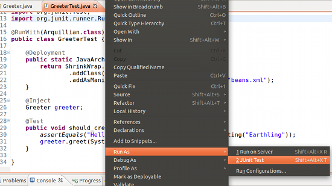

= Getting Started
:sectids!:

// Historical arquillian-core version 1.4.0.Final from https://arquillian.org/guides/getting_started_ja/ (captured 2026-11-13).

このガイドではArquillianを紹介します。このガイドを読むと、以下のことができるようになります：

* MavenベースのJavaプロジェクトに、Arquillianインフラストラクチャを追加する
* pass:[<acronym title="Contexts and Dependency Injection">CDI</acronym>] beanの振る舞いを検証するArquillianのテストを書く
* MavenとEclipseから、互換性のある複数のコンテナ上でArquillianのテストを実行する

これらのスキルを、MavenでビルドされるJava EEアプリケーションのテストスイートにArquillianを組み込むことによって学びます。このガイドは、読者がさっと始められるように、 _速く読めるよう_ デザインされています！

[discrete,id="前提"]
=== 前提

Arquillianを始める最もシンプルな方法は、依存性の管理をしているプロジェクトのテストスイートに組み込むことです。今日、このカテゴリで最も広く利用されているビルドツールは、 http://maven.apache.org[Apache Maven] です。このガイドでは、サンプルのMavenプロジェクトを使って、最初の *[.greenbar]#グリーンバー#* へ案内します。

[.info]
ArquillianはMavenには、もっと言えばどんな特定のビルドツールにも依存しません。それはAntやGradleでビルドするプロジェクトで使っても—より優れているとは言わないまでも—同じように機能します。理想的には、ビルドツールは、 http://search.maven.org[Maven Central repository] で配布されているArquillianライブラリをプロジェクトに追加するタスクを単純化できる、依存性管理を提供している物がいいでしょう。

このガイドは、読者がコマンドシェルとIDE(Integrated Development Environment:統合開発環境)からMavenを利用できると仮定しています。もしそうでなければ、 http://maven.apache.org/download.html[Mavenをダウンロードしてインストールしてください] 。 また、 http://www.oracle.com/technetwork/java/javase/downloads[pass:[<acronym title="Java Development Kit">JDK</acronym>] 1.5] 以降のインストールが必要で、JDK 1.6を推奨します。

[discrete,id="新しいプロジェクトを作成する"]
=== 新しいプロジェクトを作成する

新しいプロジェクトを作成する際に、お勧めの方法が2つあります：

. link:#generate_project_from_archetype[Maven archetypeからプロジェクトを生成する]
. link:#create_project_using_forge[JBoss Forgeでプロジェクトを作成、カスタマイズする]

間違いなく、 http://jboss.org/forge[JBoss Forge] はより簡単なやり方ですが、このガイドではJBoss Forgeをまだ受け入れられないことを考慮して、両方のオプションを示します。上で示した二つのオプションからどちらかを選んで、次の説明に飛んでください。

[.info]
既存のMavenプロジェクトがあれば、この章を、次章に進む前に正しい依存性の設定になっているかのレビューとして使うことができます。

[discrete,id="generate_project_from_archetype"]
==== Maven Archetypeからプロジェクトを生成する

まず、以下のコマンドでMavenベースのJavaプロジェクトを生成します：

[listing,role=command,subs=verbatim]
----
$ mvn archetype:generate -DarchetypeGroupId=net.avh4.mvn.archetype \
-DarchetypeArtifactId=java-1.6-archetype
----

_``+$+`` 以降のテキストをコピーして、コマンドシェルにペーストしてください。_ プロンプトでは、それぞれ、コロン2つの後に示している値を入力してください。（ ``+<ENTER>+`` で示しているように）各行でエンターキーを押してください。

[listing,role=output,subs=verbatim]
----
Define value for property 'groupId': : org.arquillian.example <ENTER>
Define value for property 'artifactId': : arquillian-tutorial <ENTER>
Define value for property 'version': : <ENTER>
Define value for property 'package': : <ENTER>
Confirm properties configuration:
groupId: org.arquillian.example
artifactId: arquillian-tutorial
version: 1.0-SNAPSHOT
package: org.arquillian.example
Y: : <ENTER>
----

このコマンドは、カレントディレクトリに ``+arquillian-tutorial+`` という新しいフォルダを作り、そこにMavenベースのJavaプロジェクトを生成します。このプロジェクトのファイル構成は、次のようになります：

[.filetree]
* src/
** main/
*** java/ – アプリケーションのすべてのJavaソースファイルをここに置きます。（Javaパッケージの下に置きます）
*** resources/ – アプリケーションの設定ファイルをここに置きます。
** test/
*** java/ – すべてのテスト用のJavaソースコードをここに置きます。（Javaパッケージの下に置きます）
*** resources/ – すべてのテスト用の設定ファイルをここに置きます。（例：arquillian.xml）
* pom.xml – Mavenのビルドファイルです。Mavenでどのようにプロジェクトをビルドするか定義します。

プロジェクトジェネレータはまた、2つの ``+java+`` フォルダの下に、 ``+org.arquillian.example+`` というJavaパッケージを作成しています。 ``+java+`` フォルダ直下ではなく、このパッケージの下にJavaソースファイルを置いてください。

さて、エディタで ``+pom.xml+`` を開いてください。XMLファイルには、基本的なプロジェクト情報、ビルドセクション、依存セクションが含まれているのが分かります。

[.info]
このプロジェクトは、Arquillianがそれぞれ最低限要求するバージョンであるJava 1.6とJUnit 4.8を使用するようにあらかじめ設定されていることに気づくでしょう。

[.warning]
Arquillianはまた、TestNG 5をサポートしています。しかしこのガイドでは、JUnitを使用します。

*JUnitのdependencyより下の ``+<dependency>+`` 要素は、不要なので削除してもかまいません。* 編集が終わったら、以下のようになっているはずです（少し整形しています）：

[.filename]
pom.xml

[listing,role=prettify,subs=verbatim]
----
<?xml version="1.0" encoding="UTF-8"?>
<project xmlns="http://maven.apache.org/POM/4.0.0"
    xmlns:xsi="http://www.w3.org/2001/XMLSchema-instance"
    xsi:schemaLocation="
        http://maven.apache.org/POM/4.0.0
        http://maven.apache.org/xsd/maven-4.0.0.xsd">
    <modelVersion>4.0.0</modelVersion>

    <groupId>org.arquillian.example</groupId>
    <artifactId>arquillian-tutorial</artifactId>
    <version>1.0-SNAPSHOT</version>
    <packaging>jar</packaging>

    <name>arquillian-tutorial</name>
    <url>http://arquillian.org</url>

    <properties>
        <project.build.sourceEncoding>UTF-8</project.build.sourceEncoding>
    </properties>

    <build>
        <plugins>
            <plugin>
                <groupId>org.apache.maven.plugins</groupId>
                <artifactId>maven-compiler-plugin</artifactId>
                <version>2.3.2</version>
                <configuration>
                    <source>1.6</source>
                    <target>1.6</target>
                </configuration>
            </plugin>
        </plugins>
    </build>
    <dependencies>
        <dependency>
            <groupId>junit</groupId>
            <artifactId>junit</artifactId>
            <version>4.12</version>
            <scope>test</scope>
        </dependency>
    </dependencies>
</project>
----

これからJava EE 7コンポーネントを書きます。そのため、Java EE 7 APIをクラスパスに追加する必要があります。そうすれば、これらのコンポーネントをコンパイルできます。

``+pom.xml+`` ファイルをもう一度開き、そのXMLフラグメントを ``+<dependencies>+`` 要素の下に追加してください。 ``+<dependencies>+`` 要素追加後は、以下のようになります：

[.filename]
pom.xml

[listing,role=prettify,subs=verbatim]
----
<!-- clip -->
<dependencies>
    <dependency>
        <groupId>org.jboss.spec</groupId>
        <artifactId>jboss-javaee-7.0</artifactId>
        <version>1.0.3.Final</version>
        <type>pom</type>
        <scope>provided</scope>
    </dependency>
    <dependency>
        <groupId>junit</groupId>
        <artifactId>junit</artifactId>
        <version>4.12</version>
        <scope>test</scope>
    </dependency>
</dependencies>
<!-- clip -->
----

プロジェクトの基本は準備できました！ link:#open_the_project_in_eclipse[プロジェクトをEclipseで開く] に進んでください。コードを書きはじめます！

[discrete,id="create_project_using_forge"]
==== Forgeでプロジェクトを生成する

http://jboss.org/forge[JBoss Forge] は、標準ベースの環境で高速アプリケーション開発をするためのコマンドシェルです。別の見方をすれば、ドーピングしたMaven Archetypeのようなものです。

Forgeのインストールは、比較的短い手順であり、このガイドでは、基礎を体験します。以下の簡単なステップに従ってインストールしてください：

. http://downloads.jboss.org/forge/releases/3.4.0.Final/forge-distribution-3.4.0.Final-offline.zip[Forgeをダウンロード]
. ダウンロードしたディストリビューションをディスクの任意の場所に展開します。展開されたフォルダを ``+$FORGE_HOME+`` と呼びます。 +
ホームディレクトリの ``+forge+`` というフォルダに配布物を展開したと仮定します。
. ``+$FORGE_HOME/bin+`` を（WindowsやLinux、Mac OSXの）パスに追加します。

Unixベースのオペレーティングシステムでは、Forgeをパスに追加するというのは、一般的には、ユーザの$HOME/.bashrcまたは、$HOME/.profileを編集することになります。以下の環境変数をセットしてください：

[listing,role=command,subs=verbatim]
----
$ export FORGE_HOME=$HOME/forge/
$ export PATH=$PATH:$FORGE_HOME/bin
----

[.info]
Windowsでは、“コントロールパネル”を開き、右クリックして“システムのプロパティ”をクリックします。“詳細設定”タブを開き、“環境変数”をクリックします。そして、これらの二つのエントリを追加します。展開した配布物をすべてのユーザーがアクセスできる場所に置いていない限り、ユーザー変数にForgeを設定することをおすすめします。

これでForgeがインストール（つまり、展開）されたので、コマンドプロンプト（シェル）を開き、 ``+forge+`` コマンドを実行してください：

[listing,role=command,subs=verbatim]
----
$ forge
   _____
  |  ___|__  _ __ __ _  ___
  | |_ / _ \| `__/ _` |/ _ \  \\
  |  _| (_) | | | (_| |  __/  //
  |_|  \___/|_|  \__, |\___|
                  |___/

[no project] ~ $
----

これだけです！Forgeが起動しました。さあ、プロジェクトを作る時です。

Forgeシェル上で、新しいプロジェクトを生成するために、以下のコマンドを実行してください。これは、上で、Maven Archetypeで作成したプロジェクトとそっくりです：

[listing,role=command,subs=verbatim]
----
$ project-new --named arquillian-tutorial --topLevelPackage org.arquillian.example
----

このコマンドは、 ``+arquillian-tutorial+`` という MavenベースのJavaプロジェクトをカレントディレクトリの新規フォルダの下に生成します。

Forgeが生成したこのプロジェクトのファイル構成を以下に示します：

[.filetree]
* src/
** main/
*** java/ – アプリケーションのすべてのJavaソースファイルをここに置きます。（Javaパッケージの下に置きます）
*** resources/ – アプリケーションの設定ファイルをここに置きます。
**** META-INF/
***** forge.xml – 空のForge設定ファイルです。
** test/
*** java/ – すべてのテスト用のJavaソースコードをここに置きます。（Javaパッケージの下に置きます）
*** resources/ – すべてのテスト用の設定ファイルをここに置きます。（例：arquillian.xml）
* pom.xml – Mavenのビルドファイルです。Mavenでどのようにプロジェクトをビルドするか定義します。

また、ForgeはプロジェクトフォルダをForgeシェルのカレントディレクトリにします。

[listing,role=command,subs=verbatim]
----
[arquillian-tutorial] arquillian-tutorial $
----

次に追加する必要があるのは、Java EE APIです。以下の ``+project add-dependency+`` コマンドでできます：

[listing,role=command,subs=verbatim]
----
$ project-add-dependencies org.jboss.spec:jboss-javaee-7.0:1.0.3.Final:provided:pom
----

また、Arquillianが最低限要求するバージョンである、JUnit 4.12をテストスコープの依存性として追加する必要があります：

[listing,role=command,subs=verbatim]
----
$ project-add-dependencies junit:junit:4.12:test
----

Forgeは、JBoss Communityリポジトリをpom.xmlファイルに追加します。このリポジトリはArquillianに関しては不要です。（しかし、JBoss Commuityリポジトリにしかない他のライブラリを利用しているならば、残しておくこともできます。）リポジトリを削除すると決めれば、以下のForgeのコマンドで簡単に実行できます：

[listing,role=command,subs=verbatim]
----
$ project-remove-repository --url http://repository.jboss.org/nexus/content/groups/public
----

Forgeが生成したpom.xmlを以下に示します：

[.filename]
pom.xml

[listing,role=prettify,subs=verbatim]
----
<?xml version="1.0" encoding="UTF-8"?>
<project xsi:schemaLocation="http://maven.apache.org/POM/4.0.0 http://maven.apache.org/xsd/maven-4.0.0.xsd" xmlns="http://maven.apache.org/POM/4.0.0"
    xmlns:xsi="http://www.w3.org/2001/XMLSchema-instance">
    <modelVersion>4.0.0</modelVersion>
    <groupId>org.arquillian.tutorial</groupId>
    <artifactId>arquillian-tutorial</artifactId>
    <version>1.0.0-SNAPSHOT</version>
    <packaging>war</packaging>
    <properties>
    <maven.compiler.source>1.8</maven.compiler.source>
    <maven.compiler.target>1.8</maven.compiler.target>
    <project.build.sourceEncoding>UTF-8</project.build.sourceEncoding>
    </properties>
    <dependencyManagement>
      <dependencies>
        <dependency>
          <groupId>org.jboss.spec</groupId>
          <artifactId>jboss-javaee-7.0</artifactId>
          <version>1.0.3.Final</version>
          <type>pom</type>
          <scope>provided</scope>
        </dependency>
        <dependency>
          <groupId>junit</groupId>
          <artifactId>junit</artifactId>
          <version>4.12</version>
          <scope>test</scope>
        </dependency>
      </dependencies>
    </dependencyManagement>
    <dependencies>
      <dependency>
        <groupId>org.jboss.spec</groupId>
        <artifactId>jboss-javaee-7.0</artifactId>
        <type>pom</type>
        <scope>provided</scope>
      </dependency>
      <dependency>
        <groupId>junit</groupId>
        <artifactId>junit</artifactId>
        <scope>test</scope>
      </dependency>
    </dependencies>
    <build>
      <finalName>arquillian-tutorial</finalName>
      <plugins>
        <plugin>
          <artifactId>maven-war-plugin</artifactId>
          <version>2.4</version>
          <configuration>
            <failOnMissingWebXml>false</failOnMissingWebXml>
          </configuration>
        </plugin>
      </plugins>
    </build>
</project>
----

プロジェクトの基本は準備できました！Eclipseでプロジェクトを開きましょう。コードを書きはじめます！

[discrete,id="プロジェクトをeclipseで開く"]
=== [[open_the_project_in_eclipse]]プロジェクトをEclipseで開く

Javaプロジェクトで開発するときは、EclipseのようなIDEを使うでしょう。だから、Arquillianは、IDEフレンドリーに設計されています。特別な設定をしなくてもArquillianテストをIDEから実行できます。IDEの利点をすぐに活用しましょう。

Eclipseの起動から始めます。これはMavenプロジェクトなので、プロジェクトを開くには http://eclipse.org/m2e[Maven Integration for Eclipse] (m2e)のインストールが必要です。

[discrete]
==== m2eプラグインのインストール

もしまだインストールしていなければ、簡単な方法は、 http://jboss.org/tools[JBoss Tools] をインストールすることです。次のステップに従ってEclipseマーケットプレイス（Eclipseのアプリケーションストアのようなもの）からインストールしてください。

. メインメニューから、 ``+Help > Eclipse Marketplace...+`` を選択
. 検索フィールドに”jboss tools”（引用符は除く）と入力し、Enterを押す
. JBoss Tools (Indigo)のインストールボタンをクリック
. インストールウィザードを完了して、再起動のプロンプトが表示されたら再起動する

JBoss Tools はJava EEアプリケーション開発の快適な環境を提供します。心配しないで、これはそんなに重いプラグインではありません。

しかし、余分なJBoss ToolsなしでMavenの統合をしたい場合は、下のステップに従ってください：

. メインメニューから、 ``+Help > Eclipse Marketplace...+`` を選択
. 検索フィールドに”maven”と入力し（引用符を除く）、Enterを押す
. Maven Integration for Eclipseのインストールボタンをクリック
. インストールウィザードを完了して、再起動のプロンプトが表示されたら再起動する
. Maven Integration for Eclipse WTPについてステップを繰り返す

[discrete]
==== m2eを使ってプロジェクトをインポートする

Maven Integrationプラグインをインストールしたら、以下のステップでプロジェクトを開きます：

. メインメニューから、 ``+File > Import...+`` を選択
. input sourceフィールドで”existing maven”（引用符を除く）と入力する
. Existing Maven Projectsオプションを選択し、Nextボタンをクリックする
. Browse…ボタンをクリックする
. ファイルブラウザでプロジェクトフォルダへ移動して選択し、OKボタンをクリックする
. Finishボタンをクリックして、プロジェクトを開く

EclipseはMavenプロジェクトを認識し、プロジェクトナビゲータビューで開きます。プロジェクトを展開したら、次の画像と同様に見えるでしょう：

image:/images/guides/arquillian_tutorial_eclipse_project.png[/images/guides/arquillian++_++tutorial++_++eclipse++_++project]

これで、ついに本題にたどり着きました！

[discrete,id="コンポーネントを作る"]
=== コンポーネントを作る

Arquillianテストを書くために、テスト対象のコードが必要です。余計なものがないところでArquillianテストをどのように実行するか学ぶために、ビジネスコンポーネントの作成から始めましょう。だんだん複雑なシナリオに進みます。

IDEで、新しくJavaの ``+Greeter+`` クラスを ``+org.arquillian.example+`` パッケージに作成してください。内容を以下のように挨拶するロジックで置き換えてください：

[.filename]
src/main/java/org/arquillian/example/Greeter.java

[listing,role=prettify,subs=verbatim]
----
package org.arquillian.example;

import java.io.PrintStream;

/**
 * A component for creating personal greetings.
 */
public class Greeter {
    public void greet(PrintStream to, String name) {
        to.println(createGreeting(name));
    }

    public String createGreeting(String name) {
        return "Hello, " + name + "!";
    }
}
----

このクラスがCDI(Contexts and Dependency Injection) beanとして注入された際に、正しく振る舞うことを検証したいと考えています。もちろん、簡単にユニットテストを書くこともできます。しかしこのbeanは依存性注入やメッセージングのようなエンタープライズサービスを使用していて、コンテナ内で使用されなければならないということにしましょう（加えて、それに成長の機会を与えます +~;)+ ）。

このクラスをCDI beanとして使うために、 ``+@Inject+`` アノテーションでテストに注入します。これはArquillianテストを必要とします！つまり、Arquillian APIをプロジェクトに追加する時です！

[discrete,id="arquillian_apiを追加する"]
=== Arquillian APIを追加する

もう一度、プロジェクト直下にある ``+pom.xml+`` をエディタで開きます。Mavenにどのバージョンのアーティファクトを使うかを示します。Arquillianの推移的な依存性のためのBOM(Bill of Materials)またはバージョンマトリックスをインポートするため、以下のXMLフラグメントを、 ``+<build>+`` 要素の上に追加してください。

[.filename]
pom.xml

[listing,role=prettify,subs=verbatim]
----
<!-- clip -->
<dependencyManagement>
    <dependencies>
        <dependency>
            <groupId>org.jboss.arquillian</groupId>
            <artifactId>arquillian-bom</artifactId>
            <version>1.4.0.Final</version>
            <scope>import</scope>
            <type>pom</type>
        </dependency>
    </dependencies>
</dependencyManagement>
<!-- clip -->
----

次に、Arquillian-JUnitインテグレーションを加えるために、次のXMLフラグメントを最後の ``+<dependency>+`` 要素の下に追加してください：

[.filename]
pom.xml

[listing,role=prettify,subs=verbatim]
----
<!-- clip -->
<dependency>
    <groupId>org.jboss.arquillian.junit</groupId>
    <artifactId>arquillian-junit-container</artifactId>
    <scope>test</scope>
</dependency>
<!-- clip -->
----

Arquillian-JUnitインテグレーションアーティファクトは、Arquillian CoreとShrinkWrapのAPIもテストクラスパスに追加します。これらの全ライブラリは、JUnit Arquillianテストを書き、コンパイルする際に必要です。

[.info]
JUnitの代わりにTestNGを使うためには、Arquillian JUnitインテグレーションをArquillian TestNGインテグレーションで置き換えてください。

（オプション） https://community.jboss.org/wiki/WhatVersionOfSurefireShouldIUseToRunMyArquillianTestsInAMavenBuild[このFAQ] で説明しているように、MavenのSurefireプラグインをデフォルトのバージョンからアップグレードすることをお勧めします。Surefire Pluginのバージョンは、 ``+<plugins>+`` 要素内の、Maven Compiler Pluginの下に、以下の ``+<plugin>+`` 要素を加えると設定できます：

[.filename]
pom.xml

[listing,role=prettify,subs=verbatim]
----
<!-- clip -->
<plugin>
    <groupId>org.apache.maven.plugins</groupId>
    <artifactId>maven-surefire-plugin</artifactId>
    <version>2.17</version>
</plugin>
<!-- clip -->
----

ここまでで、pom.xmlになにか問題があれば、 https://raw.github.com/arquillian/arquillian-examples/master/arquillian-tutorial/pom-no-container-profiles.xml[pom-no-container-profiles.xml] ファイルを https://github.com/arquillian/arquillian-examples/tree/master/arquillian-tutorial[サンプルプロジェクト] からダウンロードできるので、pom.xmlにリネームしてください。

*最初のArquillianテストを書く準備ができました！*

[discrete,id="arquillianテストを書く"]
=== Arquillianテストを書く

Arquillianテストは、すこし余分なフレアのある、単なるユニットテストのように見えます。IDEに戻って一つ作成しましょう。

[.warning]
もし”Project configuration is out of date with pom.xml”というメッセージが表示されたら、プロジェクトを再同期するために右クリックしてProject ++>++ Maven ++>++ Update Project Configurationを選択してください.

src/test/javaにて、``+GreeterTest+`` という新しいJUnitテストケースを作成し、パッケージ名を ``+org.arquillian.example+`` として始めます。力仕事はほとんどArquillianがやるので、よくあるsetupとtearDownメソッドは不要です。今のところ、次のようになります：

[.filename]
src/test/java/org/arquillian/example/GreeterTest.java

[listing,role=prettify,subs=verbatim]
----
package org.arquillian.example;

import org.junit.Assert;
import org.junit.Test;

public class GreeterTest {
    @Test
    public void should_create_greeting() {
        Assert.fail("Not yet implemented");
    }
}
----

では、フレアについてです。Arquillianテストケースは、以下の3点が必要です：

. クラスへの ``+@RunWith(Arquillian.class)+`` アノテーションの付加
. ``+@Deployment+`` でアノテートされ、ShrinkWrapアーカイブを返すパブリックなスタティックメソッド
. ``+@Test+`` でアノテートされた、少なくとも一つのメソッド

``+@RunWith+`` アノテーションは、JUnitに、Arquillianをテストコントローラとして使用することを伝えます。Arquillianはテストアーカイブ（つまり、マイクロデプロイメント）を受け取るために ``+@Deployment+`` アノテーションのついたパブリックなスタティックメソッドを探します。そしてマジックが起きて、それぞれの ``+@Test+`` メソッドはコンテナ環境内で実行されます。

[discrete]
==== テストアーカイブとは？

テストアーカイブの目的は、テストに必要なクラスとリソースを、クラスパスにあるそれ以外から隔離することです。通常のユニットテストとは異なり、Arquillianは単純にクラスパス上のすべてをタップしたりしません。その代わり、テストに必要なもの（もしクラスパス上のすべてと決めれば、それかもしれません）だけを含めます。このアーカイブは、 http://jboss.org/shrinkwrap[ShrinkWrap] を使って定義されます。これはアーカイブ（つまり、jar、war、ear）作成用のJava APIです。マイクロデプロイメントストラテジーにより、明確にテストしたいクラスにフォーカスできます。その結果として、テストは無駄のない状態のまま保たれます。

一度ShrinkWrapアーカイブがサーバーにデプロイされると、それは現実のアーカイブになります。そのコンテナのデプロイヤーはそのアーカイブがShrinkWrapによってアーカイブされたことについてはまったく知りません。ShrinkWrapについては、一つだけ例外的な部分のあるJavaベースのビルドツールと考えることもできます。最適なケースでは、ディスクにアーカイブを書き込むことなくサーバーに送ります。それでもそれが作るのは、本物のアーカイブです。

[.info]
また、ShrinkWrapはアーティファクト（ライブラリ）の解決をサポートします。プログラム的に設定ファイルを作成し、テストアーカイブに追加します。ShrinkWrapのより詳細な説明は、 link:/guides/shrinkwrap_introduction[ShrinkWrap introduction] を参照してください。

コードを下記のように置き換えて、Arquillianのフレアをテストに加えましょう：

[.filename]
src/test/java/org/arquillian/example/GreeterTest.java

[listing,role=prettify,subs=verbatim]
----
package org.arquillian.example;

import org.jboss.arquillian.container.test.api.Deployment;
import org.jboss.arquillian.junit.Arquillian;
import org.jboss.shrinkwrap.api.ShrinkWrap;
import org.jboss.shrinkwrap.api.asset.EmptyAsset;
import org.jboss.shrinkwrap.api.spec.JavaArchive;
import org.junit.Assert;
import org.junit.Test;
import org.junit.runner.RunWith;

@RunWith(Arquillian.class)
public class GreeterTest {

    @Deployment
    public static JavaArchive createDeployment() {
        return ShrinkWrap.create(JavaArchive.class)
            .addClass(Greeter.class)
            .addAsManifestResource(EmptyAsset.INSTANCE, "beans.xml");
    }

    @Test
    public void should_create_greeting() {
        Assert.fail("Not yet implemented");
    }
}
----

ShrinkWrapを使って、Javaアーカイブ（jar）をデプロイメントとして定義しました。このアーカイブは、テスト対象の ``+Greeter+`` クラスと、META-INFディレクトリ内にこのアーカイブでCDIを有効にするための空のbeans.xmlファイルを含みます。

もしテスト実行時にShrinkWrapが作成したアーカイブの内容を見たければ、アーカイブを返す前に内容を標準出力（つまり、コンソール）に出力することができます。

[listing,role=prettify,subs=verbatim]
----
@Deployment
public static JavaArchive createDeployment() {
    JavaArchive jar = ShrinkWrap.create(JavaArchive.class)
        .addClass(Greeter.class)
        .addAsManifestResource(EmptyAsset.INSTANCE, "beans.xml");
    System.out.println(jar.toString(true));
    return jar;
}
----

このコードは、テスト実行時に以下のように出力します：

[listing,role=output,subs=verbatim]
----
2ac9cd28-a71a-479a-a785-750b40221766.jar:
/META-INF/
/META-INF/beans.xml
/org/
/org/arquillian/
/org/arquillian/example/
/org/arquillian/example/Greeter.class
----

明示的に指定しなかったので、ShrinkWrapは、このアーカイブにランダムな名前を割り当てています。別の link:/guides/getting_started_rinse_and_repeat/#export_the_deployment[Getting Started: Rinse and Repeat] ガイドで、アーカイブを特定する他の方法を説明します。

ここでやるべきことは、テストメソッドの上で ``+Greeter+`` インスタンスを直接フィールドに注入し、未実装のテストメソッドをそのbeanの振る舞いを検証するものに置き換えることです。読者に和んでもらえるように、コンソールにも挨拶を出力します。テストメソッドを以下のように置き換えて ``+javax.inject.Inject+`` のインポート文を追加してください。

[.filename]
src/test/java/org/arquillian/example/GreeterTest.java

[listing,role=prettify,subs=verbatim]
----
// clip
import javax.inject.Inject;
// clip

@Inject
Greeter greeter;

@Test
public void should_create_greeting() {
    Assert.assertEquals("Hello, Earthling!",
        greeter.createGreeting("Earthling"));
    greeter.greet(System.out, "Earthling");
}
----

編集が終わったらどのようにテストがどうなっているかというと：

[.filename]
src/test/java/org/arquillian/example/GreeterTest.java

[listing,role=prettify,subs=verbatim]
----
package org.arquillian.example;

import javax.inject.Inject;
import org.jboss.arquillian.container.test.api.Deployment;
import org.jboss.arquillian.junit.Arquillian;
import org.jboss.shrinkwrap.api.ShrinkWrap;
import org.jboss.shrinkwrap.api.asset.EmptyAsset;
import org.jboss.shrinkwrap.api.spec.JavaArchive;
import org.junit.Test;
import org.junit.Assert;
import org.junit.runner.RunWith;

@RunWith(Arquillian.class)
public class GreeterTest {

    @Deployment
    public static JavaArchive createDeployment() {
        return ShrinkWrap.create(JavaArchive.class)
            .addClass(Greeter.class)
            .addAsManifestResource(EmptyAsset.INSTANCE, "beans.xml");
    }

    @Inject
    Greeter greeter;

    @Test
    public void should_create_greeting() {
        Assert.assertEquals("Hello, Earthling!",
            greeter.createGreeting("Earthling"));
        greeter.greet(System.out, "Earthling");
    }
}
----

最初のArquillianテストが書けました！

ああ、でもどのように動かすのか、疑問に思ってるかもしれませんね +~:S+ “ユニットテストみたいに”と思っているなら、それは正解です！しかし、クラスパスにコンテナアダプタを追加する必要があります。

[discrete,id="コンテナアダプタを追加する"]
=== コンテナアダプタを追加する

これまで、コンテナでテストすることについて数多く語ってきましたが、今のところどれを使うかは検討しませんでした。それは、実行時に決定することだからです。

Arquillianは、テストクラスパスで利用可能なコンテナの中からターゲットコンテナを選択します。 _コンテナアダプタ_ は、コンテナをコントロールし、通信するものです（コンテナそのものではありません）。だから、プロジェクトにもっとライブラリを追加します。

Arquillianのテストは、テストで使用するプログラミングモデルと互換性があるならば（つまり、コンテナ用のArquillianアダプタがあるならば）どんなコンテナでも実行できます。私達のテストは、CDIプログラミングモデルを使用しているので、CDIをサポートするコンテナを使う必要があります。開発中は高速にターンアラウンドしたいので、Weld EEエンベデッドコンテナから始めましょう。

また ``+pom.xml+`` を開き、他の ``+<dependency>+`` 要素の下に、 以下の依存性のグループを追加してください：

[.filename]
pom.xml

[listing,role=prettify,subs=verbatim]
----
<!-- clip -->
<dependency>
    <groupId>org.jboss.arquillian.container</groupId>
    <artifactId>arquillian-weld-ee-embedded-1.1</artifactId>
    <version>1.0.0.CR9</version>
    <scope>test</scope>
</dependency>
<dependency>
    <groupId>org.jboss.weld</groupId>
    <artifactId>weld-core</artifactId>
    <version>2.3.5.Final</version>
    <scope>test</scope>
</dependency>
<dependency>
    <groupId>org.slf4j</groupId>
    <artifactId>slf4j-simple</artifactId>
    <version>1.6.4</version>
    <scope>test</scope>
</dependency>
<!-- clip -->
----

まとめると、Arquillianを使うには、（JUnitと共に）以下の3つのライブラリが必要です：

. Arquillian JUnit インテグレーション
. ターゲットコンテナ向けのArquillianコンテナアダプタ
. コンテナのランタイム（エンベデッドコンテナ向け）または、コンテナのクライアント（リモートコンテナ向け）

このサンプルでは、エンベデッドコンテナを使っています。それで、コンテナのランタイムであるWeldが必要です。

さて、テストに戻ります。

[discrete,id="arquillianテストの実行"]
=== Arquillianテストの実行

Arquillianに必要なすべてのライブラリをクラスパスに追加したら、ユニットテストのようにArquillianテストを実行できます。IDEから実行することも、ビルドスクリプトやどんなテストプラグインから実行することもできます。Eclipseから実行してみましょう。

IDEのウィンドウから、Package Explorer（またはエディタ）のGreeterTest.javaを右クリックしてコンテキストメニューからRun As ++>++ JUnit Testを選択します。

テストを実行したら、以下の行がコンソールに出力されるでしょう：

[listing,role=output,subs=verbatim]
----
21 [main] INFO org.jboss.weld.Version - WELD-000900 2.3.5 (Final)
Hello, Earthling!
----

それから、JUnitビューが表示され、 *[.greenbar]#グリーンバー#* が現れます！

image:/images/guides/arquillian_tutorial_junit_green_bar.png[/images/guides/arquillian++_++tutorial++_++junit++_++green++_++bar]

コマンドラインから、Mavenでテストを実行することもできます：

[listing,role=command,subs=verbatim]
----
$ mvn test
----

以下の行がコンソールに出力されるでしょう：

[listing,role=output,subs=verbatim]
----
-------------------------------------------------------
T E S T S
-------------------------------------------------------
Running org.arquillian.example.GreeterTest
19 [main] INFO org.jboss.weld.Version - WELD-000900 2.3.5 (Final)
Hello, Earthling!
Tests run: 1, Failures: 0, Errors: 0, Skipped: 0, Time elapsed: 0.907 sec
----

*おめでとう！* Arquillianを使って、最初の *[.greenbar]#グリーンバー#* に到達しました！

[discrete,id="詳しく見る"]
=== 詳しく見る

CDIが実際にはどのように動作しているかわかりますか？わかっていることは、Arquillianは、 ``+Greeter+`` クラスの新しいインスタンスを作成し、CDIとは無関係にテストに注入することだけです。そこを調べてみましょう。

``+org.arquillian.example+`` パッケージに ``+PhraseBuilder+`` という新しいCDI beanを作成します。これは、テンプレートからフレーズを生成します。

[.filename]
src/main/java/org/arquillian/example/PhraseBuilder.java

[listing,role=prettify,subs=verbatim]
----
package org.arquillian.example;

import java.text.MessageFormat;
import java.util.HashMap;
import java.util.Map;
import javax.annotation.PostConstruct;

public class PhraseBuilder {
    private Map<String, String> templates;

    public String buildPhrase(String id, Object... args) {
        return MessageFormat.format(templates.get(id), args);
    }

    @PostConstruct
    public void initialize() {
        templates = new HashMap<String, String>();
        templates.put("hello", "Hello, {0}!");
    }
}
----

次に、 ``+Greeter+`` クラスを開き、コンストラクタインジェクションを使って ``+PhraseBuilder+`` を注入する、新しいコンストラクタを作成します。それから、挨拶を作るタスクを注入されたbeanに移譲します。

[.filename]
src/main/java/org/arquillian/example/Greeter.java

[listing,role=prettify,subs=verbatim]
----
package org.arquillian.example;

import java.io.PrintStream;
import javax.inject.Inject;

public class Greeter {

    private PhraseBuilder phraseBuilder;

    @Inject
    public Greeter(PhraseBuilder phraseBuilder) {
        this.phraseBuilder = phraseBuilder;
    }

    public void greet(PrintStream to, String name) {
        to.println(createGreeting(name));
    }

    public String createGreeting(String name) {
        return phraseBuilder.buildPhrase("hello", name);
    }
}
----

さて、テスト実行のために、 ``+PhraseBuilder+`` のインスタンスが作成され、 その ``+@PostConstruct+`` メソッドが実行されなければならず、 ``+Greeter+`` のインスタンスが作成されるときに ``+Greeter+`` のコンストラクタに注入されなければなりません。これらがすべてが起きれば、CDIが動作していることを確認できます。

最後のステップです。新しいクラスを作ったので、テスト時に ``+@Deployment+`` メソッドが返すアーカイブにそれを加える必要があります。簡単に、以下の行を変更してください：

[listing,role=prettify,subs=verbatim]
----
.addClass(Greeter.class)
----

…このように：

[listing,role=prettify,subs=verbatim]
----
.addClasses(Greeter.class, PhraseBuilder.class)
----

もう一度テストを実行してください。また、 *[.greenbar]#グリーンバー#* が表示されます！気持ちいいでしょう？

[discrete,id="テストをデバッグする"]
=== テストをデバッグする

これは短い章になるでしょう。なぜか？Arquillianのテストは、とても直接的なので、まさにユニットテストをデバッグするようにデバッグします。テストコードでも、アプリケーションコードでも、どこにでもブレークポイントを追加するだけです。それから、ファイルを右クリックして、Debug As ++>++ JUnit Testを選択します。これでコンテナでデバッグができます！楽しく見て回ってください！

image:/images/guides/arquillian_tutorial_debugging_test.png[/images/guides/arquillian++_++tutorial++_++debugging++_++test]

[.warning]
リモートコンテナを使っている場合、Debug As ではブレークポイントが有効になりません。その代わりに、コンテナをデバッグモードで起動して、デバッガをアタッチする必要があります。これは、テストが元々のテストランナーとは異なるJVM上で実行されているためです。

いま経験したように、ArquillianはCDIアプリケーションのテストには理想的なツールです。それはCDI環境のロードを行い、テストに直接、beanを注入します。もっとも良い点は、エンベデッドCDIコンテナを使っていると、ユニットテストのように素早く実行することです。これで要望が満たせたら、このチュートリアルを抜けてテストを書き始めてもかまいません。

*でもちょっと待って！* エンベデッドコンテナはすべてのストーリーを語ってくれるでしょうか？コンポーネントは、完全なコンテナ上で実行しても動作するでしょうか？

Arquillianの恩恵の一つは、同じテストを互換性のある異なるコンテナ上で実行できることです。別のエンベデッドコンテナや、スタンドアロンのコンテナであっても。実際のコンテナを使いたいなら、読み進めてください。

[discrete,id="さらにコンテナを追加する"]
=== さらにコンテナを追加する

以前に学んだように、Arquillianはクラスパス上のコンテナアダプタを元に、コンテナを選択します。別のコンテナに切り替えるには、クラスパス上のコンテナアダプタをテストの前に変更するだけです。

[.important]
テスト実行の時点では、クラスパス上にコンテナアダプタは一つだけ存在できます。Arquillianは、複数のアダプタを見つけたら、テストの実行を中止します。

クラスパス上のライブラリを切り替える一つの方法は、毎回手動で ``+pom.xml+`` に依存の定義を編集することです。でもそれは退屈なだけです。おすすめのアプローチは、Mavenのプロファイルを使うことです。

[discrete]
==== Mavenのプロファイルを設定する

Mavenのプロファイルを使えば、依存をグループに入れて区別することができます。コンテナアダプタと関連するアーティファクト毎に、一つのグループです。テスト実行時に、対象のコンテナを選択するためにグループのうちの一つを有効化します。そのプロファイルはコマンドラインフラグ（-P）や、IDEのプリファレンスから、有効化されます。

``+pom.xml+`` を開き、以下のXMLを ``+<dependencies>+`` 要素直下に追加して、Weld EEエンベデッド用の新しいプロファイルを作ります：

[.filename]
pom.xml

[listing,role=prettify,subs=verbatim]
----
<!-- clip -->
<profiles>
    <profile>
        <id>arquillian-weld-ee-embedded</id>
        <dependencies>
            <dependency>
                <groupId>org.jboss.spec</groupId>
                <artifactId>jboss-javaee-7.0</artifactId>
                <version>1.0.3.Final</version>
                <type>pom</type>
                <scope>provided</scope>
            </dependency>
            <dependency>
                <groupId>org.jboss.arquillian.container</groupId>
                <artifactId>arquillian-weld-ee-embedded-1.1</artifactId>
                <version>1.0.0.CR9</version>
                <scope>test</scope>
            </dependency>
            <dependency>
                <groupId>org.jboss.weld</groupId>
                <artifactId>weld-core</artifactId>
                <version>2.3.5.Final</version>
                <scope>test</scope>
            </dependency>
            <dependency>
                <groupId>org.slf4j</groupId>
                <artifactId>slf4j-simple</artifactId>
                <version>1.6.4</version>
                <scope>test</scope>
            </dependency>
        </dependencies>
    </profile>
</profiles>
<!-- clip -->
----

次に、 ``+jboss-javaee-7.0+`` への依存とWeld EEエンベデッドコンテナアダプタへの依存をメインの ``+<dependencies>+`` セクションから *削除します* 。編集後に、 ``+<dependencies>+`` と ``+<profiles>+`` セクションがどうなっているかを以下に示します：

[.filename]
pom.xml

[listing,role=prettify,subs=verbatim]
----
<!-- clip -->
<dependencies>
    <dependency>
        <groupId>junit</groupId>
        <artifactId>junit</artifactId>
        <version>4.12</version>
        <scope>test</scope>
    </dependency>
    <dependency>
        <groupId>org.jboss.arquillian.junit</groupId>
        <artifactId>arquillian-junit-container</artifactId>
        <scope>test</scope>
    </dependency>
</dependencies>
<profiles>
    <profile>
        <id>arquillian-weld-ee-embedded</id>
        <dependencies>
            <dependency>
                <groupId>org.jboss.spec</groupId>
                <artifactId>jboss-javaee-7.0</artifactId>
                <version>1.0.3.Final</version>
                <type>pom</type>
                <scope>provided</scope>
            </dependency>
            <dependency>
                <groupId>org.jboss.arquillian.container</groupId>
                <artifactId>arquillian-weld-ee-embedded-1.1</artifactId>
                <version>1.0.0.CR9</version>
                <scope>test</scope>
            </dependency>
            <dependency>
                <groupId>org.jboss.weld</groupId>
                <artifactId>weld-core</artifactId>
                <version>2.3.5.Final</version>
                <scope>test</scope>
            </dependency>
            <dependency>
                <groupId>org.slf4j</groupId>
                <artifactId>slf4j-simple</artifactId>
                <version>1.6.4</version>
                <scope>test</scope>
            </dependency>
        </dependencies>
    </profile>
</profiles>
<!-- clip -->
----

[.info]
エンベデッドGlassFishなどいくつかのコンテナは、Java EE APIを提供しているので、これらのライブラリへの依存はプロファイル以下に移動しました。同時に両方が同じクラスパス上にあると、コンフリクトを引き起こします。それで、このクラスパスのダンスをしなければなりません。

ここで2つのプロファイルを ``+pom.xml+`` の ``+<profiles>+`` 要素内に追加します。一つ目は、 http://embedded-glassfish.java.net[Embedded GlassFish] ：

[.filename]
pom.xml

[listing,role=prettify,subs=verbatim]
----
<!-- clip -->
<profile>
    <id>arquillian-glassfish-embedded</id>
    <dependencies>
        <dependency>
            <groupId>org.jboss.arquillian.container</groupId>
            <artifactId>arquillian-glassfish-embedded-3.1</artifactId>
            <version>1.0.0.CR4</version>
            <scope>test</scope>
        </dependency>
        <dependency>
            <groupId>org.glassfish.main.extras</groupId>
            <artifactId>glassfish-embedded-all</artifactId>
            <version>3.1.2</version>
            <scope>provided</scope>
        </dependency>
    </dependencies>
</profile>
<!-- clip -->
----

もう一つは、JBoss AS マネージド：

[.filename]
pom.xml

[listing,role=prettify,subs=verbatim]
----
<!-- clip -->
<profile>
    <id>arquillian-jbossas-managed</id>
    <dependencies>
        <dependency>
            <groupId>org.jboss.spec</groupId>
            <artifactId>jboss-javaee-7.0</artifactId>
            <version>1.0.3.Final</version>
            <type>pom</type>
            <scope>provided</scope>
        </dependency>
        <dependency>
            <groupId>org.jboss.as</groupId>
            <artifactId>jboss-as-arquillian-container-managed</artifactId>
            <version>7.1.1.Final</version>
            <scope>test</scope>
        </dependency>
        <dependency>
            <groupId>org.jboss.arquillian.protocol</groupId>
            <artifactId>arquillian-protocol-servlet</artifactId>
            <scope>test</scope>
        </dependency>
    </dependencies>
</profile>
<!-- clip -->
----

[.info]
デフォルトでは、JBoss AS 7はテストアーカイブをJMXプロトコルを使ってデプロイします。すでに、今後必要になったときのために、このサーブレットプロトコルの依存性を ``+arquillian-jbossas-managed+`` プロファイルに追加しています。こちらに変更する方法はpass:[、&quot;このFAQ&quot;:https://community.jboss.org/wiki/WhyDoIGetNoActiveContextsForScopeTypeWhenTestingOnJBossAS7] を参照してください。

これで、このテストは3つのコンテナの中から一つを選んで実行できるようになりました。

ここまでで、pom.xmlになにか問題があれば、 https://raw.github.com/arquillian/arquillian-examples/master/arquillian-tutorial/pom.xml[pom.xml] ファイルを https://github.com/arquillian/arquillian-examples/tree/master/arquillian-tutorial[サンプルプロジェクト] からダウンロードできます。

[discrete,id="コンテナを越えてテストする"]
=== コンテナを越えてテストする

Eclipseでプロジェクトをリフレッシュしたら、ビルドされないことに気づくでしょう。これは、コンテナプロファイルのどれかを有効にする必要があるからです。前の状態を復元するためにWeld EEエンベデッドプロファイルを有効にしましょう。

EclipseでMavenプロファイルを有効にするには、2つのやり方があります（ http://www.eclipse.org/m2e[Maven Integration for Eclipse] を前提としています）：

. 手動で設定（標準的なやり方）
. Maven profile selector (JBoss Tools)

[discrete]
==== 有効なMavenプロファイルのセット：手動で設定

手動で有効なプロファイルをセットするには、以下のステップに従います：

. プロジェクトを右クリックして、Propertiesを選択する
. Maven propertiesを選択する
. Active Maven Profilesフィールドに、プロファイルIDを入力する（例えば、 ``+arquillian-weld-ee-embedded+`` ）
. OKボタンをクリックし、プロジェクトの変更を承諾する

以下が、プロファイルを有効にしたMaven properties画面です：

image:/images/guides/arquillian_tutorial_maven_properties.png[/images/guides/arquillian++_++tutorial++_++maven++_++properties]

[discrete]
==== 有効なMavenプロファイルのセット：Maven profile selector

JBoss Toolsがインストール済みなら、有効なプロファイルの選択はより簡単です：

. プロジェクトを右クリックし、 Maven ++>++ Select Active Profiles… を選択する +
（あるいは、 Ctrl{plus}Shift{plus}P のキーバインディングか、ツールバーのボタンも使えます）
. 有効化したいプロファイルの隣のチェックボックスをチェックする（例えば、 ``+arquillian-weld-ee-embedded+`` ）
. OKボタンをクリックする

次が、有効化したプロファイルを表示しているMaven profile selectorダイアログです：

image:/images/guides/arquillian_tutorial_maven_profile_selector.png[/images/guides/arquillian++_++tutorial++_++maven++_++profile++_++selector]

一度プロファイルを有効化したら、コンパイラのエラーは消え、テストはまた成功するはずです。

プロファイルを有功にする別の方法としては、どれかのプロファイルをデフォルトで有効になるように設定します。 プロファイル定義に ``+<activation>+`` エレメントを追加して、Weld EE Embeddedプロファイルをデフォルトにしてみましょう：

[.filename]
pom.xml

[listing,role=prettify,subs=verbatim]
----
<!-- clip -->
<profile>
    <id>arquillian-weld-ee-embedded</id>
    <activation>
        <activeByDefault>true</activeByDefault>
    </activation>
    <dependencies>
        <!-- hidden -->
    </dependencies>
</profile>
<!-- clip -->
----

自動的にプロファイルが選択されるようになったので、もうIDEでプロファイルを選択する必要はなくなりました。しかし、他のプロファイル（だけ）を使う場合、まずこのプロファイルをデフォルトからの解除が必要です。

[discrete]
==== コンテナを切り替える

すでにこのテストがWeld EEエンベデッドで成功することはおわかりですね。上のステップを繰り返してGlassFishエンベデッドに切り替え、今回は ``+arquillian-glassfish-embedded+`` だけを有効にします。

[.info]
Weld EEエンベデッドをデフォルトにする場合、他のプロファイルを確実に無効にしてください。Mave Profle selectorで、エントリを右クリックして、コンテキストメニューからDeactiveを選択すると、プロファイルを無効にできます。これで、プロファイル名の前にエクスクラメーションマークが表示されます（例えば、 ``+!arquillian-weld-ee-embedded+`` ）。複数のファイルが選択されている（または無効化されている）のは、コンマで分けられています。

テストをまた実行。GlassFishがコンソールで起動するのが見えて…今度も *[.greenbar]#グリーンバー#* です！

これで、同じテストを異なる二つのエンベデッドコンテナで実行しました。CDIコンテナ（Weld）とJava EEコンテナ（GlassFish）です。どちらも実行はプロセス内です。純粋な環境でコンポーネントが正常に動作するか本当に確認するには、スタンドアロンのコンテナが必要です。JBoss ASを使うよう切り替えましょう。

スタンドアロンのJBoss ASインスタンスでテストするには、まず初めに次のどちらかのセットアップが必要です：

. ダウンロードしてプロジェクト外の場所に展開する
. ビルド中にMavenでダウンロード、展開する

プロジェクト外でJBoss AS 7をセットアップするには、以下の手順に従ってください：

. http://jboss.org/jbossas/downloads[JBoss AS 7をダウンロードする] +
（選んだバージョンが、 ``+pom.xml+`` の ``+<artifactId>jboss-as-arquillian-container-managed</artifactId>+`` で定義しているバージョンとあっていることを確認してください）
. アーカイブを展開する
. （オプション）展開したディレクトリのパスを ``+JBOSS_HOME+`` 環境変数にセット

もしJBoss ASがインストール済み（つまり、展開済み）で、 ``+JBOSS_HOME+`` 環境変数がその場所を指し示しているなら、 ``+arquillian-jbossas-managed+`` プロファイルを有効にして、テストを実行できます。コンソールではJBoss ASが起動しているのが見えて…また *[.greenbar]#グリーンバー#* です！

[.info]
標準出力に出力されるメッセージは、コンソールではなくサーバーログに出力されるので、そちらで見てください。

Mavenでこのタスクを実行したい場合（オプション）、 ``+arquillian-jbossas-managed+`` プロファイルの ``+<id>+`` 要素の後に、以下のXMLフラグメントを追加してください：

[.filename]
pom.xml

[listing,role=prettify,subs=verbatim]
----
<!-- clip -->
<build>
    <plugins>
        <plugin>
            <artifactId>maven-dependency-plugin</artifactId>
            <executions>
                <execution>
                    <id>unpack</id>
                    <phase>process-test-classes</phase>
                    <goals>
                        <goal>unpack</goal>
                    </goals>
                    <configuration>
                        <artifactItems>
                            <artifactItem>
                                <groupId>org.jboss.as</groupId>
                                <artifactId>jboss-as-dist</artifactId>
                                <version>7.1.1.Final</version>
                                <type>zip</type>
                                <overWrite>false</overWrite>
                                <outputDirectory>target</outputDirectory>
                            </artifactItem>
                        </artifactItems>
                    </configuration>
                </execution>
            </executions>
        </plugin>
    </plugins>
</build>
<!-- clip -->
----

MavenでダウンロードしたJBoss AS 7マネージドインスタンスをターゲットにするには、もう少しArquillianに設定が必要です。以下の設定ファイルを作成し、 ``+jbossHome+`` プロパティの値を、JBoss AS 7がインストールされた場所にします。Maven依存プラグインを使っている場合は、場所は、 ``+target/jboss-as-7.1.1.Final+`` です。

[.filename]
src/test/resources/arquillian.xml

[listing,role=prettify,subs=verbatim]
----
<arquillian xmlns="http://jboss.org/schema/arquillian"
    xmlns:xsi="http://www.w3.org/2001/XMLSchema-instance"
    xsi:schemaLocation="
        http://jboss.org/schema/arquillian
        http://jboss.org/schema/arquillian/arquillian_1_0.xsd">
    <container qualifier="jbossas-managed" default="true">
        <configuration>
            <property name="jbossHome">target/jboss-as-7.1.1.Final</property>
        </configuration>
    </container>
</arquillian>
----

さて、有効なMavenプロファイルを ``+arquillian-jbossas-managed+`` に変更して、またテストを実行します。コンソールでJBoss ASの起動が見えて…またもや *[.greenbar]#グリーンバー#* です！

これは _同じ_ テストです。今回は完全なJava EEコンテナで実行しました。Arquillianはテストをパッケージ化して、Java EEアーカイブとしてコンテナにデプロイし、リモートでテストを実行し、結果を取得したのち、EclipseのJUnitビュー（またはMavenのsurefire results）に伝えます。

Arquillianをより深く知りたい場合は、 link:/guides/getting_started_rinse_and_repeat[Getting Started: Rinse and Repeat] ガイドへどうぞ。Arquillianを自動的に設定するためのForgeの使い方については、 link:/guides/get_started_faster_with_forge[Get Started Faster with Forge] を読んでください。
