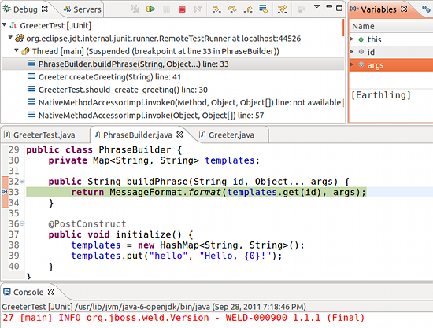

= Aan de slag
:sectids!:

// Historical arquillian-core version 1.4.0.Final from https://arquillian.org/guides/getting_started_nl/ (captured 2026-11-13).

Dit is een introductie handleiding voor Arquillian. Na het lezen van deze handleiding, kun je:

* Arquillian aan een Maven project toevoegen
* Een Arquillian test case schrijven en het gedrag van een pass:[<acronym title="contexts en Dependency Injection">CDI</acronym>] bean controleren
* De Arquillian test in verschillende containers uitvoeren

Je leert dit alles door Arquillian toe te voegen aan de tests van een op Maven gebaseerde Java EE applicatie. We hebben deze +
handleiding zo gemaakt dat je snel van start kan!

[discrete,id="veronderstellingen"]
=== Veronderstellingen

De makkelijkste manier om te starten met Arquillian is door het toe te voegen aan de '`test suite`' van een project dat op +
afhankelijkheid management (Dependency Management) is gebaseerd. Vandaag de dag is de meest gebruikte tool in deze categorie +
http://maven.apache.org[Apache Maven]. Deze handleiding voert je naar je eerste *[.greenbar]#green bar#* (groene balk) met een voorbeeld +
Maven project.

[.info]
Arquillian is niet afhankelijk van Maven, of van een andere specifieke build tool. Het werkt net zo goed—zelfs +
beter—met projecten die op Ant of Gradle gebaseerd zijn. Idealiter, heeft de build tool een dependency management systeem, want dat vereenvoudigd de integratie, omdat Arquillian via http://search.maven.org[Maven Central repository]. gedistribueerd wordt.

Deze handleiding gaat er van uit dat maven beschikbaar is op de opdrachtprompt of in je pass:[<acronym title="Integrated Development Environment">IDE</acronym>]. Zo niet, http://maven.apache.org/download.html[installeer Maven nu]. Je moet ook http://www.oracle.com/technetwork/java/javase/downloads[pass:[<acronym title="Java Development Kit">JDK</acronym>] 1.5] of beter geïnstalleerd hebben.

[discrete,id="creëer_een_nieuw_project"]
=== Creëer een nieuw Project

Er zijn twee manieren de we aanbevelen om een nieuw Maven project te creëren:

. link:#generate_project_from_archetype[Creëer een Maven project met behulp van een Maven archetype]
. link:#create_project_using_forge[Creëer een project met JBoss Forge en pas het aan]

Verreweg, is http://jboss.org/forge[JBoss Forge] de makkelijkste manier, maar deze handleiding bied beide opties als je niet klaar bent om naar JBoss Forge over te stappen. Kies een van de twee opties en spring naar de instructies.

[.info]
Als je al een Maven project hebt, kun je deze sectie gebruiken om te zien of je de juiste "`dependencies`" hebt voordat je verder gaat

[discrete,id="generate_project_from_archetype"]
==== Genereer een Project met behulp van een Maven Archetype

Allereerst, creëer een Maven gebaseerd Java project met het volgende commando.

[listing,role=command,subs=verbatim]
----
$ mvn archetype:generate -DarchetypeGroupId=net.avh4.mvn.archetype \
-DarchetypeArtifactId=java-1.6-archetype
----

_Kopieer de tekst na het ``+$+`` teken en plak het in je commando regel._ Voeg, wanneer je gevraagd wordt de volgende waardes achter de dubbele punt in en bevestig na iedere regel met ``+<ENTER>+``.

[listing,role=output,subs=verbatim]
----
Define value for property 'groupId': : org.arquillian.example <ENTER>
Define value for property 'artifactId': : arquillian-tutorial <ENTER>
Define value for property 'version': : <ENTER>
Define value for property 'package': : <ENTER>
Confirm properties configuration:
groupId: org.arquillian.example
artifactId: arquillian-tutorial
version: 1.0-SNAPSHOT
package: org.arquillian.example
Y: : <ENTER>
----

Dit commando genereerd een Maven gebaseerd Java project in een map met de naam ``+arquillian-tutorial+`` in de huidige map. De bestands structuur van het project ziet er uit als volgt:

[.filetree]
* src/
** main/
*** java/ – Plaats alle Java bestanden hier (in Java packages)
*** resources/ – Plaats alle applicatie configuratie bestanden hier
** test/
*** java/ – Plaats alle test Java Source bestanden hier (in Java packages)
*** resources/ – Plaats alle test configuratie bestanden hier (b.v., arquillian.xml)
* pom.xml – Het Maven build bestand. Verteld Maven hoe het project gebouwd moet worden.

[.info]
Het project is ingesteld om Java 1.6 en Junit 4.8, de minimale versies van Java en Junit om te testen met Arquillian te gebruiken.

De generator heeft ook een Java package genaamd: ``+org.arquillian.example+`` gecreëer in de twee ``+java+`` mappen. Het is beter je Java source bestanden in dit package te plaatsen dan direct in de ``+java+`` map.

[.warning]
Arquillian ondersteund ook TestNG 5. Echter, in deze hele handleiding gebruiken we JUnit

Open de ``+pom.xml+`` in je IDE of teksteditor. Je ziet een XML bestand met basis project informatie, een ``+<build>+`` en een ``+<dependencies>+`` sectie. *Je kunt alle ``+<dependency>+`` elementen onder JUnit verwijderen, omdat ze niet nodig zijn.*

Na deze verandering ziet je bestand er zo uit (ingekort voor leesbaarheid):

[.filename]
pom.xml

[listing,role=prettify,subs=verbatim]
----
<?xml version="1.0" encoding="UTF-8"?>
<project xmlns="http://maven.apache.org/POM/4.0.0"
    xmlns:xsi="http://www.w3.org/2001/XMLSchema-instance"
    xsi:schemaLocation="
        http://maven.apache.org/POM/4.0.0
        http://maven.apache.org/xsd/maven-4.0.0.xsd">
    <modelVersion>4.0.0</modelVersion>

    <groupId>org.arquillian.example</groupId>
    <artifactId>arquillian-tutorial</artifactId>
    <version>1.0-SNAPSHOT</version>
    <packaging>jar</packaging>

    <name>arquillian-tutorial</name>
    <url>http://arquillian.org</url>

    <properties>
        <project.build.sourceEncoding>UTF-8</project.build.sourceEncoding>
    </properties>

    <build>
        <plugins>
            <plugin>
                <groupId>org.apache.maven.plugins</groupId>
                <artifactId>maven-compiler-plugin</artifactId>
                <version>2.3.2</version>
                <configuration>
                    <source>1.6</source>
                    <target>1.6</target>
                </configuration>
            </plugin>
        </plugins>
    </build>
    <dependencies>
        <dependency>
            <groupId>junit</groupId>
            <artifactId>junit</artifactId>
            <version>4.12</version>
            <scope>test</scope>
        </dependency>
    </dependencies>
</project>
----

We gaan Java EE 7 componenten schrijven, daarom moeten we Java EE 7 API aan het classpath toevoegen zodat we deze componenten kunnen compileren.

Open de ``+pom.xml+`` nog een keer en voeg het volgende XML fragment toe aan het ``+<dependencies>+`` element. Zo zou het er uit moeten zien wanneer je klaar bent:

[.filename]
pom.xml

[listing,role=prettify,subs=verbatim]
----
<!-- clip -->
<dependencies>
    <dependency>
        <groupId>org.jboss.spec</groupId>
        <artifactId>jboss-javaee-7.0</artifactId>
        <version>1.0.3.Final</version>
        <type>pom</type>
        <scope>provided</scope>
    </dependency>
    <dependency>
        <groupId>junit</groupId>
        <artifactId>junit</artifactId>
        <version>4.12</version>
        <scope>test</scope>
    </dependency>
</dependencies>
<!-- clip -->
----

[.important]
We raden je aan dat je de artefacten onder ``+javax:javaee-api+`` *niet te gebruiken*. Deze bibliotheek bevat klassen met ingekorte methoden, en zullen er voor zorgen dat je vreemde Absent Code Errors in je tests krijgt. "`Meer daarover lees de FAQ`" :http://community.jboss.org/wiki/WhatsTheCauseOfThisExceptionJavalangClassFormatErrorAbsentCode .

De basis van je project is nu klaar! Sla de volgende sectie over en ga naar link:#open_project_in_eclipse[open het project in Eclipse] zodat we kunnen beginnen met het schrijven van code!

[discrete,id="create_project_using_forge"]
==== Creëer een project met Forge

http://jboss.org/forge[JBoss Forge] is een commando prompt om snel applicaties te ontwikkelen in een standaard omgeving. Je kunt het ook zien als Maven Archtypes met steroïden

Het installeren van Forge is een kort proces, en in deze handleiding behandelen we de basis. Volg deze simpele stappen om het te installeren:

. http://downloads.jboss.org/forge/releases/3.4.0.Final/forge-distribution-3.4.0.Final-offline.zip[Download Forge] en pak het uit in een map op je harde schijf genaamd ``+$FORGE_HOME+`` +
We nemen aan dat je de de map genaamd ``+forge+`` in je home uitgepakt hebt
. Voeg ``+$FORGE_HOME/bin+`` toe aan het pad (Windows, Linux or Mac OSX)

Op Unix gebaseerde besturings systemen, Forge toevoegen aan het pad gebeurt door je $HOME/.bashrc of $HOME/.profile aan te passen en de volgende variabelen to te voegen:

[listing,role=command,subs=verbatim]
----
$ export FORGE_HOME=$HOME/forge/
$ export PATH=$PATH:$FORGE_HOME/bin
----

[.info]
Op Windows, moet je rechts klikken op het "`Controle Paneel`", en dan op klikken op "`Systeem Eigenschappen`", open de "`Advanced`" tab, en klik dan op "`Omgevingsvariabelen`" en voeg dan deze twee variabelen toe. Aan te bevelen is om deze toe te voegen aan "`Gebruikersvariabelen`", tenzij je ze op een plaats hebt uitgepakt waar iedereen toegang heeft.

Nu dat Forge geïnstalleerd is (d.w.z., uitgepakt), open een commando prompt en voer het ``+forge+`` commando uit:

[listing,role=command,subs=verbatim]
----
$ forge
   _____
  |  ___|__  _ __ __ _  ___
  | |_ / _ \| `__/ _` |/ _ \  \\
  |  _| (_) | | | (_| |  __/  //
  |_|  \___/|_|  \__, |\___|
                  |___/

[no project] ~ $
----

Dat is het! Forge loopt en nu is het tijd om een project te maken.

Type het volgende commando in de "`Forge shell`" om een blanco project te creëren, dit is vergelijkbaar met een Maven Archetype zoals hier boven beschreven:

[listing,role=command,subs=verbatim]
----
$ project-new --named arquillian-tutorial --topLevelPackage org.arquillian.example
----

Dit commando genereerd een Maven gebaseerd Java project in een nieuwe map genaamd ``+arquillian-tutorial+`` in de huidige map

De bestands structuur van het project dat Forge genereerd is het volgende:

[.filetree]
* src/
** main/
*** java/ – Plaats alle Java bestanden hier (in Java packages)
*** resources/ – Plaats alle applicatie configuratie bestanden hier
**** META-INF/
***** forge.xml – An empty Forge settings file
** test/
*** java/ – Plaats alle test Java Source bestanden hier (in Java packages)
*** resources/ – Plaats alle test configuratie bestanden hier (b.v., arquillian.xml)
* pom.xml – Het Maven build bestand. Verteld Maven hoe het project gebouwd moet worden.

Forge wisselt automatisch naar de gegeneerde project map.

[listing,role=command,subs=verbatim]
----
[arquillian-tutorial] arquillian-tutorial $
----

Wat we nu toe moeten voegen zijn de Java EE APIs, dat doet men door het volgende ``+project add-dependency+`` commando uit te voeren:

[listing,role=command,subs=verbatim]
----
$ project-add-dependencies org.jboss.spec:jboss-javaee-7.0:1.0.3.Final:pom:provided
----

Ook dient JUnit minimum versie 4.12 toegevoegd te worden met scope test:

[listing,role=command,subs=verbatim]
----
$ project-add-dependencies junit:junit:4.12:test
----

Het resultaat van de pom dat Forge genereerd is het volgende:

[.filename]
pom.xml

[listing,role=prettify,subs=verbatim]
----
<?xml version="1.0" encoding="UTF-8"?>
<project xsi:schemaLocation="http://maven.apache.org/POM/4.0.0 http://maven.apache.org/xsd/maven-4.0.0.xsd" xmlns="http://maven.apache.org/POM/4.0.0"
    xmlns:xsi="http://www.w3.org/2001/XMLSchema-instance">
    <modelVersion>4.0.0</modelVersion>
    <groupId>org.arquillian.tutorial</groupId>
    <artifactId>arquillian-tutorial</artifactId>
    <version>1.0.0-SNAPSHOT</version>
    <packaging>war</packaging>
    <properties>
    <maven.compiler.source>1.8</maven.compiler.source>
    <maven.compiler.target>1.8</maven.compiler.target>
    <project.build.sourceEncoding>UTF-8</project.build.sourceEncoding>
    </properties>
    <dependencyManagement>
      <dependencies>
        <dependency>
          <groupId>org.jboss.spec</groupId>
          <artifactId>jboss-javaee-7.0</artifactId>
          <version>1.0.3.Final</version>
          <type>pom</type>
          <scope>provided</scope>
        </dependency>
        <dependency>
          <groupId>junit</groupId>
          <artifactId>junit</artifactId>
          <version>4.12</version>
          <scope>test</scope>
        </dependency>
      </dependencies>
    </dependencyManagement>
    <dependencies>
      <dependency>
        <groupId>org.jboss.spec</groupId>
        <artifactId>jboss-javaee-7.0</artifactId>
        <type>pom</type>
        <scope>provided</scope>
      </dependency>
      <dependency>
        <groupId>junit</groupId>
        <artifactId>junit</artifactId>
        <scope>test</scope>
      </dependency>
    </dependencies>
    <build>
      <finalName>arquillian-tutorial</finalName>
      <plugins>
        <plugin>
          <artifactId>maven-war-plugin</artifactId>
          <version>2.4</version>
          <configuration>
            <failOnMissingWebXml>false</failOnMissingWebXml>
          </configuration>
        </plugin>
      </plugins>
    </build>
</project>
----

[.info]
Arquillian wordt gedistribueerd met Maven en is in de Central repository, dus de JBoss Public repository in de pom.xml is niet nodig en kan worden verwijderd. Maar deze repository is misschien nodig voor andere JBoss software die niet in Maven Central beschikbaar is.

[.warning]
Als van het kamp bent dat vind dat expliciet gedefinieerde repositories in je project’s pom.xml een "`antipattern`" is, lees dan http://community.jboss.org/wiki/MavenGettingStarted-Users[deze instructies] hoe je de repositories globaal kunt definiëren in het settings.xml bestand.

De basis van je project is nu klaar! Open het project in Eclipse zodat we kunnen beginnen met het schrijven van code!

[discrete,id="open_het_project_in_eclipse"]
=== [[open_project_in_eclipse]]Open het Project in Eclipse

Als je aan een Java project werkt gebruik je waarschijnlijk een IDE zoals Eclipse. Daarom is Arquillian ontworpen om goed binnen een IDE gebruikt te kunnen worden, zodat je je tests kunt laten lopen binnen de IDE zonder veranderingen. Daarom beginnen we gelijk in de IDE omgeving.

Begin met het straten van Elicpse. Omdat dit een Maven project, heb je de plugin http://eclipse.org/m2e[Maven Integration for Eclipse] (m2e) nodig om het project te kunnen openen. Als je die nog niet geinstalleerd hebt, de makkelijkste manier om het te installeren is door http://jboss.org/tools[JBoss Tools] te installeren. Volg de stappen en installeer het van de Eclipse Marketplace (een soort van app store voor Eclipse).

. Selecteer ``+Help > Eclipse Markt...+`` van het hoofdmenu
. Type "`jboss tools`" in het zoek veld (zonder aanhalingstekens) en druk op Enter
. Klik op de Installeren knop zodat JBoss Tools (Indigo) geinstalleerd wordt
. Volg de "`wizard`" en herstart Eclipse wanneer het gevraagd wordt

JBoss Tools bied een goede omgeving voor het ontwikkelen van Java EE applicaties, inclusief goede CDI ondersteuning. Maak je geen zorgen deze plugin is niet groot.

Echter, als je alleen de Maven integratie zonder de extra’s die JBoss Tools met zich mee brengt, wilt volg dan deze stappen:

. Selecteer ``+Help > Eclipse Markt...+`` van het hoofdmenu
. Type "`maven`" in het zoek veld (zonder aanhalingstekens) en druk op Enter
. Klik op de Installeeren knop zodat Maven Integration voor Eclipse geinstalleerd wordt
. Volg de "`wizard`" en herstart Eclipse wanneer het gevraagd wordt
. Herhaal deze stappen om Maven Integration for Eclipse WTP te installeeren

Wanneer je de Maven Integration plugin geinstalleed hebt volg deze stappen om het project te openen:

. Selecteer ``+File > Import...+`` van het hoofdmenu
. Type "`existing maven`" in het zoek veld
. Selecteer de optie Existing Maven Projects, en klik de Volgende knop
. Klik de Bladeren… knop
. Navigeer naar de project map op je bestandssysteem en klik op de OK button
. Klik de Klaar knop om het project te openen

Eclipse herkend de Maven structuur en opent het in de Project Navigatie View. Als je het project open klapt moet het er ongeveer uitzien als het onderstaande plaatje:

image:/images/guides/arquillian_tutorial_eclipse_project.png[/images/guides/arquillian++_++tutorial++_++eclipse++_++project]

Nu kunnen we echt beginnen!

[discrete,id="creëer_een_component"]
=== Creëer een Component

Om een Arquillian test te kunnen maken hebben we eerst een component nodig dat we kunnen testen. Laten we beginnen met een simpel component zodat we kunnen leren hoe we Arquillian kunnen gebruiken zonder onnodige afleiding. Daarna voegen we langzaam meer complexiteit toe.

In je IDE creëer een nieuwe Java klasse met de naam ``+Greeter+`` in het ``+org.arquillian.example+`` package. Vervang de inhoud van dit bestand met het volgende:

[.filename]
src/main/java/org/arquillian/example/Greeter.java

[listing,role=prettify,subs=verbatim]
----
package org.arquillian.example;

import java.io.PrintStream;

/**
 * A component for creating personal greetings.
 */
public class Greeter {
    public void greet(PrintStream to, String name) {
        to.println(createGreeting(name));
    }

    public String createGreeting(String name) {
        return "Hello, " + name + "!";
    }
}
----

We willen verifiëren dat deze klasse reageert zoals we bedoeld hebben wanneer we hem gebruiken als CDI bean. We kunnen natuurlijk een simpel unit test schrijven, maar laten we doen alsof deze bean enterprise services zoals dependency injection en messaging gebruikt en in een container getest moet worden. (Bovendien geven we het ruimte om te groeien +~;)+)

Om een CDI bean te kunnen gebruiken zullen we het injecteren met ``+@Inject+`` annotatie in de test. Om dat te kunnen moet het een Arquillian test zijn. Hoogste tijd om de Arquillian API aan het project toe te voegen!

[discrete,id="toevoegen_van_de_arquillian_apis"]
=== Toevoegen van de Arquillian APIs

Open de ``+pom.xml+`` file opnieuw in je editor. We moeten Maven vertellen welke versie te gebruiken. Voeg het volgende fragment toe direct boven het ``+<build>+`` element. Dit importeert de pass:[<acronym title="Bill of Materials">BOM</acronym>], of te wel de versie matrix voor Arquillians dependencies.

[.filename]
pom.xml

[listing,role=prettify,subs=verbatim]
----
<!-- clip -->
<dependencyManagement>
    <dependencies>
        <dependency>
            <groupId>org.jboss.arquillian</groupId>
            <artifactId>arquillian-bom</artifactId>
            <version>1.4.0.Final</version>
            <scope>import</scope>
            <type>pom</type>
        </dependency>
    </dependencies>
</dependencyManagement>
<!-- clip -->
----

Nu moet het volgende nog onder de laatste ``+<dependency>+`` worden toegevoegd voor de Arquilian JUnit integratie:

[.filename]
pom.xml

[listing,role=prettify,subs=verbatim]
----
<!-- clip -->
<dependency>
    <groupId>org.jboss.arquillian.junit</groupId>
    <artifactId>arquillian-junit-container</artifactId>
    <scope>test</scope>
</dependency>
<!-- clip -->
----

De Arquillian JUnit integratie artifact voegt ook Arquillian en ShrinkWrap APIs toe aan het test classpath. Je hebt deze bibliotheken nodig om een Arquillian JUnit test te kunnen schrijven en compileren.

[.info]
Om TestNG te gebruiken in plaats van JUnit, vervang de Arquillian JUnit integratie met de Arquillian TestNG integratie.

Als je problemen hebt met het samenstellen van de pom.xml, je kunt hem ook https://gist.github.com/1263892[van deze gist] downloaden

*Nu ben je kaar om je eerste Arquillian test te schrijven!*

[discrete,id="schrijf_een_arquillian_test"]
=== Schrijf een Arquillian Test

Een Arquillian test ziet er net zo uit als een unit test, met een paar extras. Terug naar je IDE.

[.warning]
Wanner je het bericht "`Project configuration is out of date with pom.xml`" krijgt, klik dan met de rechter muis knop op het project en selecteer Project ++>++ Maven ++>++ Update Project Configuration om het project weer in sync te krijgen

Begin met het creëren van een nieuwe JUnit test case in src/test/java in het ``+org.arquillian.example+`` package en noem het ``+GreeterTest+``. Je hebt de teardown methoden niet nodig omdat Arquillian dat voor ons doet. +
Dit is wat we hebben:

[.filename]
src/test/java/org/arquillian/example/GreeterTest.java

[listing,role=prettify,subs=verbatim]
----
package org.arquillian.example;

import org.junit.Assert;
import org.junit.Test;

public class GreeterTest {
    @Test
    public void should_create_greeting() {
        Assert.fail("Not yet implemented");
    }
}

P. Nu die extras. Een Arquillian test case moet drie dingen hebben:

# Een @@RunWith(Arquillian.class)@ annotatie op de klasse
# Een statische methode geannoteerd met @@Deployment@ die een ShrinkWrap archive retourneert
# Teminste één methode geannoteerd met @@Test@

De @@RunWith@ annotatatie zegt JUnit Arquillian te gebruiken als test controlleur. Arquillian kijkt naar een methode geannoteerd met de @@Deployment@ annotatie voor de test archive (d.w.z., micro-deployment). Dan gebeurt er iets magisch en elke @@Test@ methode wordt uitgevoerd binnen de container omgeving.
----

[discrete]
==== Wat is een test archive?

Het nut van een test archive is om de klasse en de resources die nodig zijn voor de test te isoleren van de rest. In contrast met normale unit test, bindt Arquillian niet het hele classpath in, maar alleen wat nodig is voor de test (dat kan het hele classpath zijn, als je dat wilt). De archive is gedefinieerd door middel van http://jboss.org/shrinkwrap[ShrinkWrap], een Java API voor het creëren van archives (b.v. jar, war, ear) in Java. De micro deployment geeft je de mogelijkheid precies te zeggen wat getest moet worden en als gevolg worden de test zeer slank.

[.info]
ShrinkWrap bied ook ondersteuning voor het vinden van artifacten (bibliotheken) en het creëren van configuratie bestanden in code, die aan een archive kunnen worden toegevoegd. Voor meer informatie over ShrinkWrap, lees de link:/guides/shrinkwrap_introduction[ShrinkWrap introductie] handleiding.

Laten we deze Arquillian extra’s toevoegen aan de test:

[.filename]
src/test/java/org/arquillian/example/GreeterTest.java

[listing,role=prettify,subs=verbatim]
----
package org.arquillian.example;

import org.jboss.arquillian.container.test.api.Deployment;
import org.jboss.arquillian.junit.Arquillian;
import org.jboss.shrinkwrap.api.ShrinkWrap;
import org.jboss.shrinkwrap.api.asset.EmptyAsset;
import org.jboss.shrinkwrap.api.spec.JavaArchive;
import org.junit.Assert;
import org.junit.Test;
import org.junit.runner.RunWith;

@RunWith(Arquillian.class)
public class GreeterTest {

    @Deployment
    public static JavaArchive createDeployment() {
        return ShrinkWrap.create(JavaArchive.class)
            .addClass(Greeter.class)
            .addAsManifestResource(EmptyAsset.INSTANCE, "beans.xml");
    }

    @Test
    public void should_create_greeting() {
        Assert.fail("Not yet implemented");
    }
}
----

Met ShrinkWrap, definiëren we een Java archive (jar) voor de deployment daarin bevind zich de ``+Greeter+`` klasse die de test zal uitvoeren en een lege beans.xml bestand in de META-INF map om CDI te activeren.

Wat we nu nog moeten doen is een veld te definiëren boven de methode waar een instantie van ``+Greeter+`` geinjecteerd kan worden en de test methode te implementeren zodat het gedrag van de bean wordt getest. Om een goed gevoel te krijgen printen we ook de uitvoer naar de console.

[.filename]
src/test/java/org/arquillian/example/GreeterTest.java

[listing,role=prettify,subs=verbatim]
----
// clip
import javax.inject.Inject;
// clip

@Inject
Greeter greeter;

@Test
public void should_create_greeting() {
    Assert.assertEquals("Hello, Earthling!",
        greeter.createGreeting("Earthling"));
    greeter.greet(System.out, "Earthling");
}
----

Zo moet het er uit zien als je klaar bent:

[.filename]
src/test/java/org/arquillian/example/GreeterTest.java

[listing,role=prettify,subs=verbatim]
----
package org.arquillian.example;

import javax.inject.Inject;
import org.jboss.arquillian.container.test.api.Deployment;
import org.jboss.arquillian.junit.Arquillian;
import org.jboss.shrinkwrap.api.ShrinkWrap;
import org.jboss.shrinkwrap.api.asset.EmptyAsset;
import org.jboss.shrinkwrap.api.spec.JavaArchive;
import org.junit.Test;
import org.junit.Assert;
import org.junit.runner.RunWith;

@RunWith(Arquillian.class)
public class GreeterTest {

    @Deployment
    public static JavaArchive createDeployment() {
        return ShrinkWrap.create(JavaArchive.class)
            .addClass(Greeter.class)
            .addAsManifestResource(EmptyAsset.INSTANCE, "beans.xml");
    }

    @Inject
    Greeter greeter;

    @Test
    public void should_create_greeting() {
        Assert.assertEquals("Hello, Earthling!",
            greeter.createGreeting("Earthling"));
        greeter.greet(System.out, "Earthling");
    }
}
----

Je hebt je eerste Arquillian test geschreven!

Ah, je denkt vast hoe moet ik dit uitvoeren +~:S+ Als je denkt, "`Gewoon als een unit test`" dan heb je het goed! Maar, eerst moeten we nog een container adapter toevoegen aan het classpath.

[discrete,id="toeveogen_van_een_container_adapter"]
=== Toeveogen van een Container Adapter

We hebben veel gesproken over een testen in een container, maar tot dus ver hebben we het niet gehad over welke. Dat is omdat het een beslissing is die we maken bij het uitvoeren van de test.

Arquillian selecteerd de contianer gebaseerd op welke container beschikbaar is op het test classpath. Dat betekend dat we nog meer bibliotheken toevoegen aan het project.

Een Arquillian test kan uitgevoerd worden in elke container die compatibel is met het programmeer model van de test (als er een Arquillian adapter beschikbaar is). Onze test gebruikt CDI programmeer model, dus we hebben een container nodig die CDI ondersteund. Tijdens de ontwikkeling willen we snel resultaat, daarom we starten met Weld EE embedded container.

Open de ``+pom.xml+`` nog een keer en voeg de volgende groep van dependencies direct onder de andere ``+<dependency>+`` elemeneten toe:

[.filename]
pom.xml

[listing,role=prettify,subs=verbatim]
----
<!-- clip -->
<dependency>
    <groupId>org.jboss.arquillian.container</groupId>
    <artifactId>arquillian-weld-ee-embedded-1.1</artifactId>
    <version>1.0.0.CR9</version>
    <scope>test</scope>
</dependency>
<dependency>
    <groupId>org.jboss.weld</groupId>
    <artifactId>weld-core</artifactId>
    <version>2.3.5.Final</version>
    <scope>test</scope>
</dependency>
<dependency>
    <groupId>org.slf4j</groupId>
    <artifactId>slf4j-simple</artifactId>
    <version>1.6.4</version>
    <scope>test</scope>
</dependency>
<!-- clip -->
----

Samenvattend, dit zijn de drie bibliotheken die je nodig hebt om Arquillian te gebruiken (met JUnit):

. Arquillian JUnit integration
. Arquillian container adapter voor de gewenste doel container
. De container runtime (voor een embedded container) of een Container client (voor een remote container)

We gebruiken een embedded container in dit voorbeeld, dus hebben we een container runtime, namelijk Weld.

Terug naar de test.

[discrete,id="uitvoeren_van_de_arquillian_test"]
=== Uitvoeren van de Arquillian Test

Nu we alle bibliotheken voor Arquillian hebben toegevoegd aan het classpath, kunnen we de Arquillian test case uitvoeren net zoals een gewone unit test, ongeacht we dat doen in de IDE of een build script of een andere test plugin. Laten we de test uitvoeren in Eclipse.

Rechts klik op het GreeterTest.java bestand in de Package Exporer (of in de editor) en selecteer Uitvoeren als ++>++ JUnit Test van het context menu.

image:/images/guides/arquillian_tutorial_run_junit_test.png[/images/guides/arquillian++_++tutorial++_++run++_++junit++_++test]

Wanneer de test loopt, ze je het volgende verschijnen in de console:

[listing,role=output,subs=verbatim]
----
21 [main] INFO org.jboss.weld.Version - WELD-000900 2.3.5 (Final)
Hello, Earthling!
----

De JUnit view verschijnt met daarin een *[.greenbar]#green bar#*!

image:/images/guides/arquillian_tutorial_junit_green_bar.png[/images/guides/arquillian++_++tutorial++_++junit++_++green++_++bar]

Je kunt de test ook laten lopen in de commando prompt met behulp van Maven:

[listing,role=command,subs=verbatim]
----
$ mvn test
----

Het volgende zal dan als uitvoer verschijnen:

[listing,role=output,subs=verbatim]
----
-------------------------------------------------------
T E S T S
-------------------------------------------------------
Running org.arquillian.example.GreeterTest
19 [main] INFO org.jboss.weld.Version - WELD-000900 2.3.5 (Final)
Hello, Earthling!
Tests run: 1, Failures: 0, Errors: 0, Skipped: 0, Time elapsed: 0.907 sec
----

*Gefeliciteerd!* Je hebt je eerste *[.greenbar]#green bar#* met Arquillian verdient!

[discrete,id="beter_bekeken"]
=== Beter bekeken

Hoe weet je dat CDI echt werkt? Het is mogelijk dat Arquillian een nieuwe instantie van de ``+Greeter+`` klasse creëerd en de test geinjecteert, zonder CDI te gebruiken. Laat we bewijzen dat het echt CDI gebruikt.

Creëer een nieuwe CDI bean genaamd ``+PhraseBuilder+`` in het ``+org.arquillian.example+`` package. Deze bean kan zinnen samenstellen uit sjablonen.

[.filename]
src/main/java/org/arquillian/example/PhraseBuilder.java

[listing,role=prettify,subs=verbatim]
----
package org.arquillian.example;

import java.text.MessageFormat;
import java.util.HashMap;
import java.util.Map;
import javax.annotation.PostConstruct;

public class PhraseBuilder {
    private Map<String, String> templates;

    public String buildPhrase(String id, Object... args) {
        return MessageFormat.format(templates.get(id), args);
    }

    @PostConstruct
    public void initialize() {
        templates = new HashMap<String, String>();
        templates.put("hello", "Hello, {0}!");
    }
}
----

Open de ``+Greeter+`` klasse en creëer een nieuwe constructor die de ``+PhraseBuilder+`` injecteert, via constructor injectie. Dan delegeer hij de taak van het maken van de begroeting aan de geïnjecteerde bean.

[.filename]
src/main/java/org/arquillian/example/Greeter.java

[listing,role=prettify,subs=verbatim]
----
package org.arquillian.example;

import java.io.PrintStream;
import javax.inject.Inject;

public class Greeter {

    private PhraseBuilder phraseBuilder;

    @Inject
    public Greeter(PhraseBuilder phraseBuilder) {
        this.phraseBuilder = phraseBuilder;
    }

    public void greet(PrintStream to, String name) {
        to.println(createGreeting(name));
    }

    public String createGreeting(String name) {
        return phraseBuilder.buildPhrase("hello", name);
    }
}
----

Om de test te laten werken moet een instantie van de ``+PhraseBuilder+`` gecreëerd worden, zijn ``+@PostConstruct+`` methode moet worden uitgevoerd en in de constructor van de ``+Greeter+`` geïnjecteerd worden als de instantie van ``+Greeter+`` gemaakt wordt. We kunnen er zeker van zijn dat CDI werkt wanneer dit allemaal gebeurt.

Nog een laatst stap. Omdat we een nieuwe klasse hebben gemaakt moeten we deze toevoegen aan de archive die wordt samengesteld door de met ``+@Deployment+`` methode in de test. Verander eenvoudig het volgende:

[listing,role=prettify,subs=verbatim]
----
.addClass(Greeter.class)
----

…in:

[listing,role=prettify,subs=verbatim]
----
.addClasses(Greeter.class, PhraseBuilder.class)
----

Laat de test weer lopen. En je moet weer een *[.greenbar]#green bar#* krijgen! Voelt goed, niet?

[discrete,id="debuggen_van_de_test"]
=== Debuggen van de Test

Dit is een klein hoofdstuk. Waarom? Omdat Arquillian zo ongecompliceerd is zodat het precies zo werkt als het debuggen van een unit test. Voeg een breakpoint toe waar dan ook—in de test of in de applicatie code. Rechts klik op het bestand en selecteer Debug als ++>++ JUnit Test. En je bent aan het debuggen binnen de container! Veel plezier bij het rondsnuffelen!

[.warning]
Als je een remote container gebruikt, functioneren de breakpoints niet met Debug As. Inplaats daarvan moet je de container in debug modus starten en de debugger koppelen. Omdat de test in een andere JVM loopt als de container.

Zoals je net gezien hebt, is Arquillian de ideale tool voor het testen van een CDI applicatie. Het zorgt er voor het laden van de CDI omgeving en dat de beans in je test geïnjecteerd worden. En het beste is dat wanneer je een embedded container gebuikt de test net zo snel lopen als een unit test. Als dat alles is wat je nodig hebt kun je stoppen met deze handleiding en beginnen met het schrijven van tests.

*Maar!* Verteld de embedded container ons het hele verhaal? Werkt het component ook binnen een echte container?

Een van de voordelen van Arquillian is dat je de zelfde test in verschillende compatibele containers kunt laten lopen, of dat nu embedded of een remote containers is. Als je van plan bent meerdere containers te testen lees dan veder.

[discrete,id="meerdere_containers_toevoegen"]
=== Meerdere Containers toevoegen

Zoals je eerder gezien hebt, Arquillian selecteerd de container op basis van welke container beschikbaar is op het classpath. Om een andere container te gebruiken moeten we alleen de container adapter die aanwezig is op het classpath veranderen.

[.important]
Er kan maar één container adapter tergelijkertijd zich op het classpath bevinden.

Een mogelijkheid is om de bibliotheken met te hand te veranderen door andere dependecies zoals gedefinieerd in de ``+pom.xml+``. Maar dat is waanzin. Er is een veel betere manier.

We kunnen Maven profielen gebruiken om de dependencies te verdelen in groepen, een groep voor elke container adapter en zijn gerelateerde artifecten. Wanneer we de tests uitvoeren moeten we een van deze groepen activeren door een commando vlag (-P) of door instellingen in de IDE.

Open de ``+pom.xml+`` en creëer een nieuw profiel voor Weld EE embedded door het volgende toe te voegen direct onder het ``+<dependencies>+`` element:

[.filename]
pom.xml

[listing,role=prettify,subs=verbatim]
----
<!-- clip -->
<profiles>
    <profile>
        <id>arquillian-weld-ee-embedded</id>
        <dependencies>
            <dependency>
                <groupId>org.jboss.spec</groupId>
                <artifactId>jboss-javaee-7.0</artifactId>
                <version>1.0.3.Final</version>
                <type>pom</type>
                <scope>provided</scope>
            </dependency>
            <dependency>
                <groupId>org.jboss.arquillian.container</groupId>
                <artifactId>arquillian-weld-ee-embedded-1.1</artifactId>
                <version>1.0.0.CR9</version>
                <scope>test</scope>
            </dependency>
            <dependency>
                <groupId>org.jboss.weld</groupId>
                <artifactId>weld-core</artifactId>
                <version>2.3.5.Final</version>
                <scope>test</scope>
            </dependency>
            <dependency>
                <groupId>org.slf4j</groupId>
                <artifactId>slf4j-simple</artifactId>
                <version>1.6.4</version>
                <scope>test</scope>
            </dependency>
        </dependencies>
    </profile>
</profiles>
<!-- clip -->
----

Nu, *verwijder* de ``+jboss-javaee-7.0+`` dependency en de dependencies voor de Weld EE container adapter van de ``+<dependencies>+`` sectie. Zo zouden je ``+<dependencies>+`` en ``+<profiles>+`` er uit moeten zien wanneer je klaar bent:

[.filename]
pom.xml

[listing,role=prettify,subs=verbatim]
----
<!-- clip -->
<dependencies>
    <dependency>
        <groupId>junit</groupId>
        <artifactId>junit</artifactId>
        <version>4.12</version>
        <scope>test</scope>
    </dependency>
    <dependency>
        <groupId>org.jboss.arquillian.junit</groupId>
        <artifactId>arquillian-junit-container</artifactId>
        <scope>test</scope>
    </dependency>
</dependencies>
<profiles>
    <profile>
        <id>arquillian-weld-ee-embedded</id>
        <dependencies>
            <dependency>
                <groupId>org.jboss.spec</groupId>
                <artifactId>jboss-javaee-7.0</artifactId>
                <version>1.0.3.Final</version>
                <type>pom</type>
                <scope>provided</scope>
            </dependency>
            <dependency>
                <groupId>org.jboss.arquillian.container</groupId>
                <artifactId>arquillian-weld-ee-embedded-1.1</artifactId>
                <version>1.0.0.CR9</version>
                <scope>test</scope>
            </dependency>
            <dependency>
                <groupId>org.jboss.weld</groupId>
                <artifactId>weld-core</artifactId>
                <version>2.3.5.Final</version>
                <scope>test</scope>
            </dependency>
            <dependency>
                <groupId>org.slf4j</groupId>
                <artifactId>slf4j-simple</artifactId>
                <version>1.6.4</version>
                <scope>test</scope>
            </dependency>
        </dependencies>
    </profile>
</profiles>
<!-- clip -->
----

[.info]
De Java EE API dependency is naar het profiel verplaats omdat sommige containers, zoals Embedded GlassFish deze bibliotheek al hebben. Wanneer je er twee op het classpath hebt kan dat conflicten veroorzaken. Daarom dit classpath gegoochel

We voegen nog twee profielen to in de ``+<pofiles>+`` sectie van de ``+pom.xml+``, allereerst een voor http://embedded-glassfish.java.net[Embedded GlassFish]:

[.filename]
pom.xml

[listing,role=prettify,subs=verbatim]
----
<!-- clip -->
<profile>
    <id>arquillian-glassfish-embedded</id>
    <dependencies>
        <dependency>
            <groupId>org.jboss.arquillian.container</groupId>
            <artifactId>arquillian-glassfish-embedded-3.1</artifactId>
            <version>1.0.0.CR4</version>
            <scope>test</scope>
        </dependency>
        <dependency>
            <groupId>org.glassfish.main.extras</groupId>
            <artifactId>glassfish-embedded-all</artifactId>
            <version>3.1.2</version>
            <scope>provided</scope>
        </dependency>
    </dependencies>
</profile>
<!-- clip -->
----

en nog een voor JBoss AS managed:

[.filename]
pom.xml

[listing,role=prettify,subs=verbatim]
----
<!-- clip -->
<profile>
    <id>arquillian-jbossas-managed</id>
    <dependencies>
        <dependency>
            <groupId>org.jboss.spec</groupId>
            <artifactId>jboss-javaee-7.0</artifactId>
            <version>1.0.3.Final</version>
            <type>pom</type>
            <scope>provided</scope>
        </dependency>
        <dependency>
            <groupId>org.jboss.as</groupId>
            <artifactId>jboss-as-arquillian-container-managed</artifactId>
            <version>7.1.1.Final</version>
            <scope>test</scope>
        </dependency>
    </dependencies>
</profile>
<!-- clip -->
----

Nu hebben we de keus om de test uittevoeren in een van deze drie containers.

Als je problemen hebt met de pom.xml, je kunt hem ook dowloaden https://gist.github.com/1263934[van deze gist].

[discrete,id="test_met_meerdere_containers"]
=== Test met meerdere Containers

Wanneer je je het project in Eclipse ververst, zult je zien dat het niet langer bouwt. Dat is omdat je een van de profielen moet activeren. Laten we het Weld EE embedded profiel activere zodat we weer hebben wat we voorheen hadden.

Er zijn twee manieren om een Maven profiel te activeren in Eclipse:

. Manueel configureren (standaard aanpak)
. Met de Maven profiel selector (Jboss Tools)

[discrete]
==== Activeren Maven profiel: Manueel configureren

Om het profiel te manueel te activeren, volg je deze stappen:

. Rechts klik op het project en selecteer Eigenschappen
. Selecteer de Maven Eigenshappen tab
. Vul het profiel id in in het Active Maven Profiles veld (d.w.z., ``+arquillian-weld-ee-embedded+``)
. Klik op de OK knop en accepteer de project veranderingen

Dit is het Maven eigenschappen scherm met het profiel dat we geactiveerd hebben:

image:/images/guides/arquillian_tutorial_maven_properties.png[/images/guides/arquillian++_++tutorial++_++maven++_++properties]

[discrete]
==== Acitiveer Maven profiel: Maven profiel selector

Als je JBoss Tools geïnstalleerd hebt, is een profiel activeren veel makkelijker:

. Rechts klik op het project en selecteer Maven ++>++ Select Active Profiles… +
(als alternatief kun je ook de toetsen combinatie Ctrl{plus}Shift{plus}P of de knop in de toolbar gebruiken)
. Selecteer welk profiel je wilt activeren (d.w.z., ``+arquillian-weld-ee-embedded+``)
. Klik de OK knop

Dit is de Maven profile selector dialoog met het geactiveerde profiel:

image:/images/guides/arquillian_tutorial_maven_profile_selector.png[/images/guides/arquillian++_++tutorial++_++maven++_++profile++_++selector]

Nu je het profiel geactiveerd hebt, moeten de tests weer succesvol lopen.

Je weet al dat de test werkt binnen met Weld EE Embedded. Laten we omschakelen naar GlassFish embedded door de stappen van boven te herhalen maar nu ``+arquillian-glassfish-embedded+`` profiel te activeren. Voer de test uit. Nu moet je in de console zien dat GlassFish start… en weer een *[.greenbar]#green bar#*!

Je hebt nu dezelfde test in twee verschillende containers uitgevoerd, een CDI container (Weld) en een Java EE container (GlassFish). Beide van deze containers starten in hetzelfde proces. Om zeker te weten dat het component werkt in een pure omgeving, moeten we een standalone container gebruiken. Hiervoor gebruiken we JBoss AS.

Om de test uit te voeren in een standalone versie van JBoss AS moeten we het eerst configureren door:

. het te downloaden en uit te pakken op een locatie buiten het project of
. we kunnen Maven het laten downloaden en uitpakken tijdens het bouwen van het project.

De volgende stappen beschrijven hoe we JBoss AS buiten het project configureren:

. http://jboss.org/jbossas/downloads[Download JBoss AS 7] +
(controleer dat de versie die je kiest hetzelfde is als je de versie in je ``+pom.xml+`` voor het +
``+<artifactId>jboss-as-arquillian-container-managed</artifactId>+`` element)
. Pak het bestand uit
. (optioneel) Zet de ``+JBOSS_HOME+`` omgevingsvariabele naar deze map

Je kunt ook maven dit werk voor je laten doen, door het volgende XML fragment onder het ``+<id>+`` element van ``+arquillian-jbossas-managed+`` profiel toe te voegen:

[.filename]
pom.xml

[listing,role=prettify,subs=verbatim]
----
<!-- clip -->
<build>
    <plugins>
        <plugin>
            <artifactId>maven-dependency-plugin</artifactId>
            <executions>
                <execution>
                    <id>unpack</id>
                    <phase>process-test-classes</phase>
                    <goals>
                        <goal>unpack</goal>
                    </goals>
                    <configuration>
                        <artifactItems>
                            <artifactItem>
                                <groupId>org.jboss.as</groupId>
                                <artifactId>jboss-as-dist</artifactId>
                                <version>7.1.1.Final</version>
                                <type>zip</type>
                                <overWrite>false</overWrite>
                                <outputDirectory>target</outputDirectory>
                            </artifactItem>
                        </artifactItems>
                    </configuration>
                </execution>
            </executions>
        </plugin>
    </plugins>
</build>
<!-- clip -->
----

Om dit te gebruiken moet je Arquillian een beetje configureren. Creëer de volgende file en laat ``+jbossHome+`` wijzen naar de locatie waar JBoss AS 7 geïnstalleerd is. Als je de Maven plugin gebuikt dan is de locatie ``+target/jboss-as-7.1.1.Final+``.

[.filename]
src/test/resources/arquillian.xml

[listing,role=prettify,subs=verbatim]
----
<arquillian xmlns="http://jboss.org/schema/arquillian"
    xmlns:xsi="http://www.w3.org/2001/XMLSchema-instance"
    xsi:schemaLocation="
        http://jboss.org/schema/arquillian
        http://jboss.org/schema/arquillian/arquillian_1_0.xsd">
    <container qualifier="jbossas-managed" default="true">
        <configuration>
            <property name="jbossHome">target/jboss-as-7.1.1.Final</property>
        </configuration>
    </container>
</arquillian>
----

Nu veranderen we het active Maven profiel naar ``+arquillian-jbossas-managed+``, en laten de test lopen. Nu zul je JBoss AS zien starten in de console… en weer een *[.greenbar]#green bar#*!

[.info]
De meldingen van System.out worden in de server log geschreven in plaats van de console.

Dat was _dezelfde_ test, maar dit keer in een standaard (niet embedded) Java EE container. Arquillian zorg voor het samen pakken van de test het deployen binnen de container als Java EE archief, het uitvoeren van de test en de resultaten samenvatten en binnen Eclipse JUnit view. (of binnen Maven surefire).
