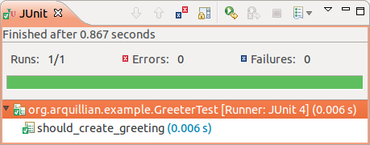

= Szybki start
:sectids!:

// Historical arquillian-core version 1.4.0.Final from https://arquillian.org/guides/getting_started_pl/ (captured 2026-11-13).

To wprowadzenie omawia podstawowe koncepcje Arquilliana. Po jego przeczytaniu będziesz potrafił:

* Dodać Arquilliana do Twojego projektu opartego o Mavena.
* Napisać test z wykorzystaniem Arquilliana, który będzie weryfikował działanie beana CDI (Contexts and Dependency Injection).
* Uruchomić test w wielu kontenerach, które wspiera Arquillian.

Nauczysz się tego wszystkiego wykorzystując Arquilliana do pisania testów aplikacji opartej na platformie Java EE, z wykorzystaniem Mavena jako narzędzia do jej budowania. Stworzyliśmy ten przewodnik w taki sposób, abyś jak najszybciej mógł zacząc korzystać z tej technologii.

[discrete,id="założenia"]
=== Założenia

Najprostszym sposobem, aby zacząć korzystać z Arquilliana w testach Twojego projektu jest dodanie go jako części procesu budowania aplikacji (najlepiej takiego, który wspiera również zarządzanie zależnościami). Obecnie najpopularniejszym tego typu narzędziem jest http://maven.apache.org[Apache Maven]. Wprowadzenie to pomoże Ci zdobyć Twój pierwszy *[.greenbar]#zielony pasek#* używając przykładowego projektu opartego o Mavena.

[.info]
Arquillian nie jest zależny od Mavena, ani od jakiegokolwiek innego narzędzia do budowania projektu. Działa tak samo dobrze (jeśli nie lepiej), użyty w projekcie z Ant bądź Gradle. Jednak dobrze by było, gdyby wybrane przez Ciebie narzędzie oferowało zarządzanie zależnościami. Ułatwi to dodawanie wszystkich niezbędnych bibliotek Arquillian do Twojego projektu. Dostępne są one w http://search.maven.org[repozytorium Maven Central]

Zakładamy w tym wprowadzeniu, że masz dostępnego Mavena, (czy to z linii komend, czy bezpośrednio z Twojego pass:[<acronym title="Integrated Development Environment">IDE</acronym>]). Jeśli jeszcze tego nie zrobiłeś, najlepiej zacznij właśnie od http://maven.apache.org/download.html[tego]. Będziesz potrzebował także http://www.oracle.com/technetwork/java/javase/downloads[pass:[<acronym title="Java Development Kit">JDK</acronym>] 1.5] lub nowszej wersji zainstalowanej na Twoim komputerze.

[discrete,id="stwórz_nowy_projekt"]
=== Stwórz nowy projekt

Polecamy Ci jedną z dwóch metod stworzenia projektu opartego o Mavena:

. link:#generate_project_from_archetype[Wygenerowanie projektu za pomocą archetypu Mavena]
. link:#create_project_using_forge[Stworzenie i dostosowanie projektu do własnych wymagań&#44; korzystając z JBoss Forge]

http://jboss.org/forge[JBoss Forge] oferuje prostsze podejście, omówimy jednak oba sposoby w razie gdybyś nie był jeszcze gotowy, aby z niego skorzystać. Wybierz jedną z dwóch możliwości powyżej aby przejść do odpowiedniej sekcji

[.info]
Jeśli posiadasz już projekt oparty o Mavena, możesz wykorzystać tę sekcję do zweryfikowania czy masz wszystkie niezbędne zależności, zanim przejdziesz do następnej częsci tego wprowadzenia.

[discrete,id="generate_project_from_archetype"]
==== Wygenerowanie projektu za pomocą archetypu Mavena

Po pierwsze stwórz projekt Javowy oparty o Mavena używając komend podanych poniżej.

[listing,role=command,subs=verbatim]
----
$ mvn archetype:generate -DarchetypeGroupId=net.avh4.mvn.archetype \
-DarchetypeArtifactId=java-1.6-archetype
----

_Skopiuj text po ``+$+`` i wklej go do linii komend._ Odpowiedz na poniższe pytanie wprowadzając wartości podane po podwójnym dwukropku. Naciśnij Entry po każdej linii (zaznaczone przez ``+<ENTER>+``).

[listing,role=output,subs=verbatim]
----
Define value for property 'groupId': : org.arquillian.example <ENTER>
Define value for property 'artifactId': : arquillian-tutorial <ENTER>
Define value for property 'version': : <ENTER>
Define value for property 'package': : <ENTER>
Confirm properties configuration:
groupId: org.arquillian.example
artifactId: arquillian-tutorial
version: 1.0-SNAPSHOT
package: org.arquillian.example
Y: : <ENTER>
----

Za pomocą powyższej komendy wygenerowaliśmy projekt, który znajduje się w folderze ``+arquillian-tutorial+``. Poniżej przedstawiona jest struktura naszego projektu:

[.filetree]
* src/
** main/
*** java/ – Tutaj powinny znajdować się wszystkie pliki źrodłowe Twojej aplikacji, które napisane są w Javie (w odpowiednich pakietach)
*** resources/ – Tutaj powinny znajdować się wszystkie pliki konfiguracyjne aplikacji
** test/
*** java/ – Tutaj powinny znajdować się wszystkie pliki źródłowe testów (w odpowiednich pakietach)
*** resources/ – Tutaj powinna znajdować się pliki konfiguracyjne wykorzystowane w testach (np. arquillian.xml)
* pom.xml – Plik Mavena. Zawiera informacje jak Twój projekt powinien zostać zbudowany.

[.info]
Projekt jest domyślnie skonfigurowany dla Java 1.6 oraz JUnit 4.8, które są minimalnymi wersjami wymaganymi przez Arquilliana.

Generator stworzył również pakiet ``+org.arquillian.example+`` w dwóch folderach ``+java+``. Tam właśnie powinieneś umieścić swoje klasy, nie w folderze głównym projektu.

[.warning]
Arquillian wspiera także TestNG 5. Jednak w tym wprowadzeniu korzystać będziemy z JUnit.

Możesz teraz śmiało otworzyć ``+pom.xml+`` w Twoim edytorze. Powinieneś zobaczyć plik XML zawierający podstawowe informacje o projekcie, sekcję dotyczącą procesu budowania oraz zależności. *Możesz usunąć wszystkie elmenty ``+<dependency>+`` poniżej definicji JUnit, ponieważ nie są one wymagane.*

Po wprowadznie tych zmian powinieneś otrzymać plik podobny do przedstawionego poniżej

[.filename]
pom.xml

[listing,role=prettify,subs=verbatim]
----
<?xml version="1.0" encoding="UTF-8"?>
<project xmlns="http://maven.apache.org/POM/4.0.0"
    xmlns:xsi="http://www.w3.org/2001/XMLSchema-instance"
    xsi:schemaLocation="
        http://maven.apache.org/POM/4.0.0
        http://maven.apache.org/xsd/maven-4.0.0.xsd">
    <modelVersion>4.0.0</modelVersion>

    <groupId>org.arquillian.example</groupId>
    <artifactId>arquillian-tutorial</artifactId>
    <version>1.0-SNAPSHOT</version>
    <packaging>jar</packaging>

    <name>arquillian-tutorial</name>
    <url>http://arquillian.org</url>

    <properties>
        <project.build.sourceEncoding>UTF-8</project.build.sourceEncoding>
    </properties>

    <build>
        <plugins>
            <plugin>
                <groupId>org.apache.maven.plugins</groupId>
                <artifactId>maven-compiler-plugin</artifactId>
                <version>2.3.2</version>
                <configuration>
                    <source>1.6</source>
                    <target>1.6</target>
                </configuration>
            </plugin>
        </plugins>
    </build>
    <dependencies>
        <dependency>
            <groupId>junit</groupId>
            <artifactId>junit</artifactId>
            <version>4.12</version>
            <scope>test</scope>
        </dependency>
    </dependencies>
</project>
----

Będziemy pisać komponenty Java EE 7, a więc musimy również dodać Java EE 7 API. W przeciwnym wypadku nie moglibyśmy ich kompilować.

W tym celu otwórz ponownie ``+pom.xml+`` i dodej następujący fragment w sekcji ``+<dependencies>+``. Poniżej możesz zobaczyć jak to powinno wyglądać:

[.filename]
pom.xml

[listing,role=prettify,subs=verbatim]
----
<!-- clip -->
<dependencies>
    <dependency>
        <groupId>org.jboss.spec</groupId>
        <artifactId>jboss-javaee-7.0</artifactId>
        <version>1.0.3.Final</version>
        <type>pom</type>
        <scope>provided</scope>
    </dependency>
    <dependency>
        <groupId>junit</groupId>
        <artifactId>junit</artifactId>
        <version>4.12</version>
        <scope>test</scope>
    </dependency>
</dependencies>
<!-- clip -->
----

Szkielet Twojego projektu jest już gotowy! Omiń następną sekcję i przejdź od razu do link:#open_project_in_eclipse[otwórz projekt w Eclipse]. Czas zacząć pisać kod!

[discrete,id="create_project_using_forge"]
==== Stworzenie i dostosowanie projektu do własnych wymagań korzystając z JBoss Forge

http://jboss.org/forge[JBoss Forge] jest narzędziem obsługiwanym z linii komend do błyskawicznego tworzenia aplikacji opartych o standardowe komponenty. Innymi słowy jest on jak zbiór archetypów Mavena na sterydach.

Zainstalowanie Forge to całkiem prosta i krótka czynność, a to wprowadzenie pomoże Ci zrozumieć podstawowe cechy tego narzędzia. Aby go zainstalować wykonaj poniższe proste kroki:

. http://downloads.jboss.org/forge/releases/3.4.0.Final/forge-distribution-3.4.0.Final-offline.zip[Ściągnij Forge] i rozpakuj go do katalogu na Twoim dysku. Folder ten będziemy nazywać ``+$FORGE_HOME+`` +
Zakładamy, że rozpakowałeś go do folderu o nazwie ``+forge+`` w Twoim folderze domowym.
. Dodaj ``+$FORGE_HOME/bin+`` do ścieżki systemowej (Windows, Linux or Mac OSX)

W systemach opartych na Unix dodanie Forge do ścieżki systemowej oznacza najczęściej edycję pliku $HOME/.bashrc lub $HOME/.profile; kolejnym krokiem jest zdefiniowanie następujących zmiennych systemowych:

[listing,role=command,subs=verbatim]
----
$ export FORGE_HOME=$HOME/forge/
$ export PATH=$PATH:$FORGE_HOME/bin
----

[.info]
W systemie Windows kliknij prawym przyciskiem myszy na "`Panelu Sterowanie`", a następnie na "`Właściwości Systemu`". Otwórz zakładkę "`Zaawansowane`" a potem kliknij "`Zmienne systemowe`" i dodaj powyższe dwie zmienne. Zalecamy ustawienie ich jako zmiennych użytkownika, o ile nie umieściłeś folderu z dystrybucją Forge, który jest dostępny dla wszystkich użytkowników.

Gdy już zainstalujesz Forge (czyli tak naprawdę po go prostu rozpakujesz), w konsoli wpisz komendę ``+forge+``:

[listing,role=command,subs=verbatim]
----
$ forge
   _____
  |  ___|__  _ __ __ _  ___
  | |_ / _ \| `__/ _` |/ _ \  \\
  |  _| (_) | | | (_| |  __/  //
  |_|  \___/|_|  \__, |\___|
                  |___/

[no project] ~ $
----

To wszystko! Możesz już używać JBoss Forge. Czas zatem stworzyć nowy projekt.

Aby stworzyć pusty projekt, wykonaj następujące polecenie w powłoce Forge (analogicznie jak tworzyliśmy go za pomocą archetypu Mavena):

[listing,role=command,subs=verbatim]
----
$ project-new --named arquillian-tutorial --topLevelPackage org.arquillian.example
----

Komenda ta stworzy Javowy projekt oparty o Maven wewnątrz katalogu o nazwie ``+arquillian-tutorial+`` (w aktualnym katalogu).

Struktura plików i folderów, które wygenerował Forge przedstawiona jest poniżej:

[.filetree]
* src/
** main/
*** java/ – Tutaj powinny znajdować się wszystkie pliki źrodłowe Twojej aplikacji, które napisane są w Javie (w odpowiednich pakietach)
*** resources/ – Tutaj powinny znajdować się wszystkie pliki konfiguracyjne aplikacji
**** META-INF/
***** forge.xml – Pusty plik konfiguracyjny Forge
** test/
*** java/ – Tutaj powinny znajdować się wszystkie pliki źródłowe testów (w odpowiednich pakietach)
*** resources/ – Tutaj powinna znajdować się pliki konfiguracyjne wykorzystowane w testach (np. arquillian.xml)
* pom.xml – Plik Mavena. Zawiera informacje, jak Twój projekt powinien zostać zbudowany.

Forge ustawi również katalog świeżo stworzonego projektu jako swój aktualny katalog.

[listing,role=command,subs=verbatim]
----
[arquillian-tutorial] arquillian-tutorial $
----

To czego teraz potrzebujemy, to API platformy Java EE. Wystarczy użyć do tego polecenia ``+project add-dependency+``:

[listing,role=command,subs=verbatim]
----
$ project-add-dependencies org.jboss.spec:jboss-javaee-7.0:1.0.3.Final:pom:provided
----

Będziemy potrzebować także JUnit 4.12, ponownie minimalną wersję wymaganą przez Arquilliana, jako zależność w zakresie testowym:

[listing,role=command,subs=verbatim]
----
$ project-add-dependencies junit:junit:4.12:test
----

W rezultacie otrzymamy plik pom.xml, który został wygenerowany przez Forge. Wygląda on następująco:

[.filename]
pom.xml

[listing,role=prettify,subs=verbatim]
----
<?xml version="1.0" encoding="UTF-8"?>
<project xsi:schemaLocation="http://maven.apache.org/POM/4.0.0 http://maven.apache.org/xsd/maven-4.0.0.xsd" xmlns="http://maven.apache.org/POM/4.0.0"
    xmlns:xsi="http://www.w3.org/2001/XMLSchema-instance">
    <modelVersion>4.0.0</modelVersion>
    <groupId>org.arquillian.tutorial</groupId>
    <artifactId>arquillian-tutorial</artifactId>
    <version>1.0.0-SNAPSHOT</version>
    <packaging>war</packaging>
    <properties>
    <maven.compiler.source>1.8</maven.compiler.source>
    <maven.compiler.target>1.8</maven.compiler.target>
    <project.build.sourceEncoding>UTF-8</project.build.sourceEncoding>
    </properties>
    <dependencyManagement>
      <dependencies>
        <dependency>
          <groupId>org.jboss.spec</groupId>
          <artifactId>jboss-javaee-7.0</artifactId>
          <version>1.0.3.Final</version>
          <type>pom</type>
          <scope>provided</scope>
        </dependency>
        <dependency>
          <groupId>junit</groupId>
          <artifactId>junit</artifactId>
          <version>4.12</version>
          <scope>test</scope>
        </dependency>
      </dependencies>
    </dependencyManagement>
    <dependencies>
      <dependency>
        <groupId>org.jboss.spec</groupId>
        <artifactId>jboss-javaee-7.0</artifactId>
        <type>pom</type>
        <scope>provided</scope>
      </dependency>
      <dependency>
        <groupId>junit</groupId>
        <artifactId>junit</artifactId>
        <scope>test</scope>
      </dependency>
    </dependencies>
    <build>
      <finalName>arquillian-tutorial</finalName>
      <plugins>
        <plugin>
          <artifactId>maven-war-plugin</artifactId>
          <version>2.4</version>
          <configuration>
            <failOnMissingWebXml>false</failOnMissingWebXml>
          </configuration>
        </plugin>
      </plugins>
    </build>
</project>
----

[.info]
Arquillian jest już dostępny w repozytorium Maven Central, zatem możesz usunąć odniesienie do repozytorium JBoss Public. Pamiętaj jednak, że możesz go potrzebować do pobrania innych bibliotek, z których być może będziesz chciał kiedyś skorzystać w swoim projekcie.

[.warning]
Jeśli uważasz, że definiowanie repozytoriów bezpośrednio w pliku ``+pom.xml+`` projektu nie jest dobrą praktyką, przeczytaj http://community.jboss.org/wiki/MavenGettingStarted-Users[tę instruckję], aby dowiedzieć się jak udostępniać repozytoria globalnie dla wszystkich projektów w pliku settings.xml file.

Szkielet Twojego projektu jest już gotowy! Otwórz więc swoje IDE (na przykład Eclipse) i zacznijmy pisać kod!

[discrete,id="otwórz_projekt_w_eclipse"]
=== [[open_project_in_eclipse]]Otwórz projekt w Eclipse

Pisząc projekt w Javie korzystasz z pewnością z jakiegoś IDE, na przykład Eclipsa. Stworzyliśmy Arquilliana w taki sposób, aby był przyjazny dla IDE. Możesz zatem uruchamiać swoje testy bazujące na Arquillianie bez wprowadzania niekowencjonalnych zmian w swoim środowisku. Zacznijmy zatem od razu korzystać z IDE!

Zacznijmy od uruchomienia Eclipsa. Ponieważ nasz projekt oparty jest na Mavenie będziemy musieli zainstalować wtyczkę http://eclipse.org/m2e[integrującą Mavena z Eclipsem] (m2e), aby go otworzyć. Jeśli nie masz jej jeszcze zainstalowanej, najprostszym sposobem jest dodanie http://jboss.org/tools[JBoss Tools]. Wykonaj opisane tam kroki, aby zainstalować ten zestaw narzędzi z Eclipse Marketplace (coś w stylu App Store dla Eclipse).

. Wybierz ``+Help > Eclipse Marketplace...+`` z głównego menu
. Wpisz "`jboss tools`" w polu "`Find`" (bez cudzysłowów) i naciśnij Enter
. Kliknij przycisk "`Install`" obok opisu JBoss Tools (Indigo)
. Wykonaj wszystkie wymagane kroki instalatora, po czym uruchom Eclipse ponownie

JBoss Tools oferuje wygodne środowisko do tworzenia aplikacji opartych na Java EE. Posiada także doskonałe wsparcie dla CDI. Nie obawiaj się jednak, mimo mnogości opcji jakie oferuje, wcale nie jest ciężką wtyczką.

Jeśli jednak zadowala Cię podstawowe wsparcie dla Mavena, bez dodatków oferowanych przez JBoss Tools, możesz wykonać następujące czynności:

. Wybierz ``+Help > Eclipse Marketplace...+`` z głównego menu
. Wpisz "`maven`" w polu "`Find`" (bez cudzysłowów) i naciśnij Enter
. Kliknij przycisk "`Install`" obok opisu Maven Integration for Eclipse
. Wykonaj wszystkie wymagane kroki instalatora, po czym uruchom Eclipse ponownie
. Powtórz powyższe kroki dla dodatku Maven Integration for Eclipse WTP

Gdy już jesteś wyposażony we wspracie dla Mavena, jedyne co musisz zrobić, aby zaimportować projekt to:

. Wybierz ``+File > Import...+`` z głównego menu
. Wpisz "`existing maven`" w polu "`input source`"
. Wybierz opcję "`Existing Maven Projects`", a następnie kliknij "`Next`"
. Naciśnij przycisk "`Browse…`"
. Wskaż folder z projektem na Twoim komputerze, a następnie wciśnij OK
. Aby otworzyć projekt naciśnij przycisk "`Finish`"

Eclipse rozpozna projekt oparty na Mavenie i otworzy go w widoku Project Navigator. Jeśli go rozwiniesz, powinieneś zobaczyć strukturę podobną do przedstawionej na obrazku poniżej:

image:/images/guides/arquillian_tutorial_eclipse_project.png[/images/guides/arquillian++_++tutorial++_++eclipse++_++project]

Teraz możemy się wreszcie zabrać do roboty!

[discrete,id="stwórz_komponent"]
=== Stwórz komponent

Aby napisać test wykorzystający Arquilliana musimy stworzyć komponent, którego zachowanie bądź stan chcemy zweryfikować. Zacznijmy zatem od stworzenia prostej klasy, dzięki której nauczysz się jak uruchamiać Arquillian bez zbędnych, nieistotnych w tym momencie szczegółów. Powoli dojdziemy jednak do bardziej złożonych zagadnień.

Stwórz w swoim IDE nową klasę w pakiecie ``+org.arquillian.example+``, nazwij ją ``+Greeter+`` i dodaj następującą logikę:

[.filename]
src/main/java/org/arquillian/example/Greeter.java

[listing,role=prettify,subs=verbatim]
----
package org.arquillian.example;

import java.io.PrintStream;

/**
 * A component for creating personal greetings.
 */
public class Greeter {
    public void greet(PrintStream to, String name) {
        to.println(createGreeting(name));
    }

    public String createGreeting(String name) {
        return "Hello, " + name + "!";
    }
}
----

Naszym celem jest zweryfikowanie, czy klasa zachowuje się poprawnie gdy wywołana jest jako komponent pass:[<acronym title="Contexts and Dependency Injection">CDI</acronym>]. Oczywiście, dla tak prostego przypadku moglibyśmy zrobić to pisząc prosty test jednostkowy. Załóżmy jednak na chwilę, że komponent ten korzysta z innych mechanizmów Java EE, takich jak wstrzykiwanie zależności czy JMS i musi przez to zostać uruchomiony w kontenerze. (Poza tym dajemy w ten sposób szansę na rozwój +~;)+)

Aby użyć klasę jako ziarno CDI będziemy ją wstrzykiwać do klasy testowej za pomocą adnotacji ``+@Inject+``. To wymaga testu z Arquillianem! Najwyższy czas dodać API Arquilliana do projektu!

[discrete,id="dodaj_api_arquilliana"]
=== Dodaj API Arquilliana

Po raz kolejny będziemy musieli zmodyfikować plik ``+pom.xml+``, który znajduje się w głównym folderze projektu. Musimy poinstruować Mavena, które wersje artefaktów użyć. Wklej poniższy fragment XML bezpośrednio po znaczniku ``+<build>+``, aby zaimportować pass:[<acronym title="Bill of Materials - listę niezbędnych zależności">BOM</acronym>] (zwanego także macierzą wersji), w celu dołączenia wszystkich zależności przechodnich.

[.filename]
pom.xml

[listing,role=prettify,subs=verbatim]
----
<!-- clip -->
<dependencyManagement>
    <dependencies>
        <dependency>
            <groupId>org.jboss.arquillian</groupId>
            <artifactId>arquillian-bom</artifactId>
            <version>1.4.0.Final</version>
            <scope>import</scope>
            <type>pom</type>
        </dependency>
    </dependencies>
</dependencyManagement>
<!-- clip -->
----

Następnie dołącz poniższy fragment po ostatnim elemencie ``+<dependency>+``, aby dodać integrację Arquilliania z JUnit.

[.filename]
pom.xml

[listing,role=prettify,subs=verbatim]
----
<!-- clip -->
<dependency>
    <groupId>org.jboss.arquillian.junit</groupId>
    <artifactId>arquillian-junit-container</artifactId>
    <scope>test</scope>
</dependency>
<!-- clip -->
----

Integracja Arquilliania z JUnitem doda do testowych zależności projektu zarówno Arquilliana, jak również ShrinkWrap API. Wszystkie te biblioteki są niezbędne, aby skompilować i uruchomić nasz test.

[.info]
Jeśli chcesz korzystać z TestNG zamiast JUnit, zastąp integrację Arquilliana z JUnitem odpowiednikiem dla TestNG.

Jeśli masz problemy z prawidłowym zdefiniowem ``+pom.xml+``, możesz ściagnąć kompletny plik z tego https://gist.github.com/1263892[gista].

*Jesteśmy gotowi, aby napisać nasz pierwszy test z Arquillianem!*

[discrete,id="napisz_test_wykorzystujący_arquilliana"]
=== Napisz test wykorzystujący Arquilliana

Test korzystający z Arquilliana wygląda praktycznie tak samo jak zwyczajny test jednostkowy, poza kilkoma sprytnymi dodatkami.

[.warning]
Jeśli zobaczysz komunikat "`Project configuration is out of date with pom.xml`", kliknij na niego prawym przyciskiem myszy i wybierz Project ++>++ Maven ++>++ Update Project Configuration w celu odświeżenie konfiguracji projektu.

Zacznijmy zatem od stworzenia nowego testu JUnit w ``+src/test/java+`` w pakiecie ``+org.arquillian.example+``. Nazwijmy go ``+GreeterTest+``. Nie będziesz potrzebować metod konfigurujących środowisko przed i po wykonaniu zestawu testu (setup/``+@BeforeClass+`` oraz teardown/``+@AfterClass+`` ), Arquillian sam zajmie się wiekszością zadań. Oto co do tej pory udało się nam napisać:

[.filename]
src/test/java/org/arquillian/example/GreeterTest.java

[listing,role=prettify,subs=verbatim]
----
package org.arquillian.example;

import org.junit.Assert;
import org.junit.Test;

public class GreeterTest {
    @Test
    public void should_create_greeting() {
        Assert.fail("Not yet implemented");
    }
}
----

Wrócmy teraz do tych sprytnych dodatków. Test korzystający z Arquilliana musi posiadać trzy elementy:

. Adnotację ``+@RunWith(Arquillian.class)+`` na poziomie klasy
. Metodę statyczną z adnotacją ``+@Deployment+``, która zwróci archiwum stworzone za pomocą ShrinkWrapa
. Przynajmniej jedną metodę testową (oznaczoną adnotacją ``+@Test+``)

Adnotacja ``+@RunWith+`` mówi JUnitowi, aby wykorzystał Arquilliana do uruchamiania testów. Pierwsze co zrobi Arquillian po uruchomieniu takiego testu, to wyszuka metody adnotowanej ``+@Deployment+``, która tworzy archiwum testowe (tzw. micro-deployment). Potem przy odrobinie magii każda metoda testowa zostanie wykonana w wybranym kontenerze.

[discrete]
==== Co to jest archiwum testowe?

Głównym celem archiwum testowego jest odizolowanie klas i zasobów, wymaganych przez test, od pozostałych bibliotek, z których korzysta nasz projekt. W odróżnieniu od najczęściej spotykanych "`testów jednostkowych`", które zawierają wszystkie możliwe zależności, Arquillian daje Ci możliwość zdefiniowania tego, co potrzebujesz (jeśli potrzebujesz, mogą być to wszystkie klasy i biblioteki wykorzystywane w Twojej aplikacji). Archiwum testowe definiujemy przy pomocy biblioteki http://jboss.org/shrinkwrap[ShrinkWrap], API napisanym w Javie, dzięki któremu możemy programistycznie tworzyć archiwa (np. jar, war, ear). Strategia tzw. "`micro-deployments`" pozwala Ci skupić się dokładnie na tych klasach, których Twój test potrzebuje. Dzięki temu pozostaje on niewielkich rozmiarów.

[.info]
ShrinkWrap pozwala także na dołączanie artefaktów (bibliotek) i tworzenie konfiguracji bezpośrednio w kodzie. Mogą one być dołączone do naszego archiwum testowego. Jeśli chcesz dowiedzieć się więcej na temat tego, co oferuje ShrinkWrap, zobacz link:/guides/shrinkwrap_introduction[Wprowadzenie do ShrinkWrapa] guide.

Dodajmy więc troche sprytu Arquilliana do naszego testu:

[.filename]
src/test/java/org/arquillian/example/GreeterTest.java

[listing,role=prettify,subs=verbatim]
----
package org.arquillian.example;

import org.jboss.arquillian.container.test.api.Deployment;
import org.jboss.arquillian.junit.Arquillian;
import org.jboss.shrinkwrap.api.ShrinkWrap;
import org.jboss.shrinkwrap.api.asset.EmptyAsset;
import org.jboss.shrinkwrap.api.spec.JavaArchive;
import org.junit.Assert;
import org.junit.Test;
import org.junit.runner.RunWith;

@RunWith(Arquillian.class)
public class GreeterTest {

    @Deployment
    public static JavaArchive createDeployment() {
        return ShrinkWrap.create(JavaArchive.class)
            .addClass(Greeter.class)
            .addAsManifestResource(EmptyAsset.INSTANCE, "beans.xml");
    }

    @Test
    public void should_create_greeting() {
        Assert.fail("Not yet implemented");
    }
}
----

Korzystając ze ShrinkWrapa zdefiniowaliśmy archiwum Java (jar) zawierające klasę ``+Greeter+``, której działanie weryfikował będzie nasz test. Dodaliśmy także pusty plik ``+beans.xml+`` do folderu META-INF, aby uaktywnić CDI.

Jedyne co musimy jeszcze zrobić, to wstrzyknąć instancję klasy ``+Greeter+`` do pola w klasie testowej i zaimplementować nasz test tak, aby weryfikował on zachowanie naszego komponentu. Żebyś nie czuł się zbyt zdezorientowany, wypiszemy pozdrowienie na konsolę.

[.filename]
src/test/java/org/arquillian/example/GreeterTest.java

[listing,role=prettify,subs=verbatim]
----
// clip
import javax.inject.Inject;
// clip

@Inject
Greeter greeter;

@Test
public void should_create_greeting() {
    Assert.assertEquals("Hello, Earthling!",
        greeter.createGreeting("Earthling"));
    greeter.greet(System.out, "Earthling");
}
----

Tak powinien wyglądać test w finalnej postaci:

[.filename]
src/test/java/org/arquillian/example/GreeterTest.java

[listing,role=prettify,subs=verbatim]
----
package org.arquillian.example;

import javax.inject.Inject;
import org.jboss.arquillian.container.test.api.Deployment;
import org.jboss.arquillian.junit.Arquillian;
import org.jboss.shrinkwrap.api.ShrinkWrap;
import org.jboss.shrinkwrap.api.asset.EmptyAsset;
import org.jboss.shrinkwrap.api.spec.JavaArchive;
import org.junit.Test;
import org.junit.Assert;
import org.junit.runner.RunWith;

@RunWith(Arquillian.class)
public class GreeterTest {

    @Deployment
    public static JavaArchive createDeployment() {
        return ShrinkWrap.create(JavaArchive.class)
            .addClass(Greeter.class)
            .addAsManifestResource(EmptyAsset.INSTANCE, "beans.xml");
    }

    @Inject
    Greeter greeter;

    @Test
    public void should_create_greeting() {
        Assert.assertEquals("Hello, Earthling!",
            greeter.createGreeting("Earthling"));
        greeter.greet(System.out, "Earthling");
    }
}
----

Napisałeś właśnie swój pierwszy test z Arquillanem.

Pewnie zastanawiasz się teraz jak go uruchomić +~:S+. Jeśli Twoje przeczucie podpowiada Ci, że "`pewnie tak jak zwykły test jednostkowy`" to masz rację! Ale zanim to zrobimy musimy jeszcze tylko dodać adapter dla wybranego kontenera.

[discrete,id="dodaj_adapter_kontenera"]
=== Dodaj Adapter Kontenera

Mówiliśmy już dosyć sporo na temat testowania w konterze, ale nie sprecyzowaliśmy jeszcze o jaki dokładnie kontener nam chodzi. Wszystko przez to, że nie jest to tak naprawdę istotne z punktu widzenia samego testu. Jest to decyzja pozostawiona na później – w trakcie działania testu.

Arquillian wybiera docelowy kontener na podstawie tego jaki adapter dostępny jest w trakcie działania testu. Oznacza to, że musimy dodać kilka bibliotek do naszego projektu.

Test wykorzystujący Arquilliana może być uruchomiony w każdym kontenerze, który wspiera model programistyczny, w jakim stworzony jest nasz test i komponenty (o ile istenieje odpowiedni adapter). Nasz test wykorzystuje model CDI, więc będziemy potrzebować któregoś z kontenerów, który go wspiera. Chcemy oczywiście być jak najbardziej produktywni i zależy nam na tym, żeby testy działały szybko. Zaczniemy zatem od osadzonego kontenera Weld EE (Weld EE embedded container).

Otwórzmy zatem plik ``+pom.xml+`` i dodajmy następujący zbiór zależności:

[.filename]
pom.xml

[listing,role=prettify,subs=verbatim]
----
<!-- clip -->
<dependency>
    <groupId>org.jboss.arquillian.container</groupId>
    <artifactId>arquillian-weld-ee-embedded-1.1</artifactId>
    <version>1.0.0.CR9</version>
    <scope>test</scope>
</dependency>
<dependency>
    <groupId>org.jboss.weld</groupId>
    <artifactId>weld-core</artifactId>
    <version>2.3.5.Final</version>
    <scope>test</scope>
</dependency>
<dependency>
    <groupId>org.slf4j</groupId>
    <artifactId>slf4j-simple</artifactId>
    <version>1.6.4</version>
    <scope>test</scope>
</dependency>
<!-- clip -->
----

Podsumowując, oto niezbędne biblioteki, których będziesz potrzebował do uruchomienia Arquilliana z JUnitem.

. Integracja Arquilliana z JUnit
. Adapter wybranego kontenera dla Arquilliana
. Środowisko uruchomieniowe kontenera (kontener osadzony) lub klient kontenera (dla kontenerów zdalnych)

Korzystamy w tym przykładzie z kontenera osadzonego, więc potrzebujemy środowisko uruchomieniowe jakim jest Weld.

Wróćmy teraz do testu.

[discrete,id="uruchom_test_z_arquillianem"]
=== Uruchom test z Arquillianem

Po tym jak dodałeś już wszystkie biblioteki, możesz uruchomić test wykorzystujący Arquilliana tak jak zwyczajny test jednostkowy. Czy to z Twojego ulubionego IDE, skryptu budującego projekt czy w jakiś inny sposób. My uruchomimy go z Eclipse.

Z okna IDE kliknij prawym przyciskiem myszy na GreeterTest.java w "`Package Explorer`" (lub bezpośrednio w otwartym oknie edytora). Następnie wybierz Run As ++>++ JUnit Test z menu kontekstowego.

image:/images/guides/arquillian_tutorial_run_junit_test.png[/images/guides/arquillian++_++tutorial++_++run++_++junit++_++test]

W czasie wykonywania się testu powinieneś zaobserwować następujące komunikaty pojawiające się w oknie konsoli:

[listing,role=output,subs=verbatim]
----
21 [main] INFO org.jboss.weld.Version - WELD-000900 2.3.5 (Final)
Hello, Earthling!
----

Następnie Twoim oczom ukazać powinien się widok JUnita, pokazujący *[.greenbar]#zielony pasek#*!

Możesz również uruchomić test z linii poleceń, używając w tym celu Mavena:

[listing,role=command,subs=verbatim]
----
$ mvn test
----

W czasie wykonywania się testu powinieneś zaobserwować następujące komunikaty pojawiające się w konsoli:

[listing,role=output,subs=verbatim]
----
-------------------------------------------------------
T E S T S
-------------------------------------------------------
Running org.arquillian.example.GreeterTest
19 [main] INFO org.jboss.weld.Version - WELD-000900 2.3.5 (Final)
Hello, Earthling!
Tests run: 1, Failures: 0, Errors: 0, Skipped: 0, Time elapsed: 0.907 sec
----

*Gratulacje!* Zdobyłeś właśnie swój pierwszy *[.greenbar]#zielony pasek#* z Arquillianem!

[discrete,id="spojrzenie_z_bliska"]
=== Spojrzenie z bliska

Skąd możesz być jednak pewien, że CDI rzeczywiście działało? Jedyne co wiesz na chwilę obecną, to że Arquillian stworzył nową instancję klasy ``+Greeter+`` i wstrzyknął ją do testu bez jakiejkolwiek ingerencji ze strony CDI. Udowodnijmy zatem, że CDI jednak działa.

Stworz nowego beana CDI w pakiecie ``+org.arquillian.example+`` i nazwij go ``+PhraseBuilder+``. Jego zadaniem będzie tworzenie zdań z szablonów.

[.filename]
src/main/java/org/arquillian/example/PhraseBuilder.java

[listing,role=prettify,subs=verbatim]
----
package org.arquillian.example;

import java.text.MessageFormat;
import java.util.HashMap;
import java.util.Map;
import javax.annotation.PostConstruct;

public class PhraseBuilder {
    private Map<String, String> templates;

    public String buildPhrase(String id, Object... args) {
        return MessageFormat.format(templates.get(id), args);
    }

    @PostConstruct
    public void initialize() {
        templates = new HashMap<String, String>();
        templates.put("hello", "Hello, {0}!");
    }
}
----

Następnie otwórz klasę ``+Greeter+`` i dodaj nowy konstruktor, który posłuży jako punkt wstrzyknięcia ``+PhraseBuilder+``. Kolejnym krokiem będzie zlecenie tworzenia powitań wstrzykniętej klasie.

[.filename]
src/main/java/org/arquillian/example/Greeter.java

[listing,role=prettify,subs=verbatim]
----
package org.arquillian.example;

import java.io.PrintStream;
import javax.inject.Inject;

public class Greeter {

    private PhraseBuilder phraseBuilder;

    @Inject
    public Greeter(PhraseBuilder phraseBuilder) {
        this.phraseBuilder = phraseBuilder;
    }

    public void greet(PrintStream to, String name) {
        to.println(createGreeting(name));
    }

    public String createGreeting(String name) {
        return phraseBuilder.buildPhrase("hello", name);
    }
}
----

Żeby nasz test zadziałał, musi zajść następująca sekwencja zdarzeń: instancja ``+PhaseBuilder+`` musi zostać stworzona; jej metoda adnotowana ``+@PostConstruct+`` musi zostać wywołana; obiekt musi zostać wstrzyknięty podczas tworzenia nowej instancji klasy ``+Greeter+``. Jeśli wszystkie te warunki zostaną spełnione możemy być pewni, że CDI działa.

Ostatni krok. Stworzyliśmy nową klasę, musimy zatem dodać ją do archiwum testowego, ktore zwracane jest przez metodę adnotowaną ``+@Deployment+``. Po prostu zmień tę linię:

[listing,role=prettify,subs=verbatim]
----
.addClass(Greeter.class)
----

…na:

[listing,role=prettify,subs=verbatim]
----
.addClasses(Greeter.class, PhraseBuilder.class)
----

Uruchom test ponownie. Powinieneś zobaczyć kolejny *[.greenbar]#zielony pasek#*! Fajne uczucie, prawda?

[discrete,id="zdebuguj_test"]
=== Zdebuguj test

To będzie krótki rozdział. Dlaczego? Ponieważ testy korzystające z Arquilliana są tak proste do debugowania, jak zwyczajne testy jednostkowe. Po prostu dodaj breakpoint w dowolnym miejscu w teście lub klasach aplikacji, a następnie kliknij prawym przyciskiem myszy na plik testu i wybierz "`Debug As ++>++ JUnit Test`". Debugujesz teraz w kontenerze! Miłej zabawy!

image:/images/guides/arquillian_tutorial_debugging_test.png[/images/guides/arquillian++_++tutorial++_++debugging++_++test]

[.warning]
Jeśli używasz zdalnego kontenera, opcja "`Debug As`" nie aktywuje breakpointów. Zamiast tego musisz uruchomić kontener w trybie debugowania i podpiąć debugger. Jest to spowodowane faktem, że test wykonywany jest w innej maszynie wirtualnej (JVM) niż proces, który ten test uruchomił.

Właśnie przekonałeś się, że Arquillian jest idealnym narzędziem do testowania aplikacji opartych na modelu CDI. Bierze na siebie odpowiedzialność za załadowanie środowiska CDI i wstrzykiwanie beanów bezpośrednio do testów. Co najlepsze, jeśli korzystasz z kontenera osadzonego, Twoje testy działają tak szybko jak testy jednostkowe. Jeśli to wszystko czego Ci potrzeba, możesz zamknać ten tutorial i zacząć od razu pisać testy.

*Ale!* Czy kontener osadzony oddaje pełny obraz? Czy komponent będzie działał w pełnowymiarowym kontenerze?

Jedną z zalet Arquilliana jest to, że możesz ten sam test uruchomić na różnych, zgodnych ze sobą kontenerach, bez znaczenia czy jest to kontener osadzony czy samodzielny. Jeśli planujesz używać wielu kontenerów, zapraszam do dalszej lektury.

[discrete,id="dodaj_więcej_kontenerów"]
=== Dodaj więcej kontenerów

Jak już zdążyłeś się nauczyć, Arquillian wybiera kontener na podstawie adaptera dostępnego pośród innych zależności. Zatem aby skorzystać z innego kontenera musimy go zmienić zanim uruchomimy nasze testy.

[.important]
W danym momencie dostępny może być tylko jeden adapter.

Jednym ze spobosów podmiany bibliotek jest ręczna edycja zależności zdefiniownych w ``+pom.xml+``. Ale jest to po prostu szaleństwem. Istnieje lepsze rozwiązanie.

Możemy użyc profili Mavena aby podzielić zależności w grupy, gdzie jedna grupa odpowiadać będzie danemu kontenerowi i wszystkim wymaganym przez niego bibliotekom. W czasie uruchamiania testów możesz aktywować jedną z tych grup, aby wybrać potrzebny kontener używając flagi (-P) w linii poleceń lub ustawić we właściwościach IDE.

Otwórzmy zatem ``+pom.xml+`` i stworzmy nowy profil dla kontenera osadzonego Weld EE, wklejając poniższy fragmer XML zaraz po sekcji ``+<dependencies>+``:

[.filename]
pom.xml

[listing,role=prettify,subs=verbatim]
----
<!-- clip -->
<profiles>
    <profile>
        <id>arquillian-weld-ee-embedded</id>
        <dependencies>
            <dependency>
                <groupId>org.jboss.spec</groupId>
                <artifactId>jboss-javaee-7.0</artifactId>
                <version>1.0.3.Final</version>
                <type>pom</type>
                <scope>provided</scope>
            </dependency>
            <dependency>
                <groupId>org.jboss.arquillian.container</groupId>
                <artifactId>arquillian-weld-ee-embedded-1.1</artifactId>
                <version>1.0.0.CR9</version>
                <scope>test</scope>
            </dependency>
            <dependency>
                <groupId>org.jboss.weld</groupId>
                <artifactId>weld-core</artifactId>
                <version>2.3.5.Final</version>
                <scope>test</scope>
            </dependency>
            <dependency>
                <groupId>org.slf4j</groupId>
                <artifactId>slf4j-simple</artifactId>
                <version>1.6.4</version>
                <scope>test</scope>
            </dependency>
        </dependencies>
    </profile>
</profiles>
<!-- clip -->
----

Następnie *usuńmy* ``+jboss-javaee-7.0+`` oraz Weld EE Embedded zdefiniowane bezpośrednio w ``+<dependencies>+``. Oto jak powinno to wyglądać finalnie;

[.filename]
pom.xml

[listing,role=prettify,subs=verbatim]
----
<!-- clip -->
<dependencies>
    <dependency>
        <groupId>junit</groupId>
        <artifactId>junit</artifactId>
        <version>4.12</version>
        <scope>test</scope>
    </dependency>
    <dependency>
        <groupId>org.jboss.arquillian.junit</groupId>
        <artifactId>arquillian-junit-container</artifactId>
        <scope>test</scope>
    </dependency>
</dependencies>
<profiles>
    <profile>
        <id>arquillian-weld-ee-embedded</id>
        <dependencies>
            <dependency>
                <groupId>org.jboss.spec</groupId>
                <artifactId>jboss-javaee-7.0</artifactId>
                <version>1.0.3.Final</version>
                <type>pom</type>
                <scope>provided</scope>
            </dependency>
            <dependency>
                <groupId>org.jboss.arquillian.container</groupId>
                <artifactId>arquillian-weld-ee-embedded-1.1</artifactId>
                <version>1.0.0.CR9</version>
                <scope>test</scope>
            </dependency>
            <dependency>
                <groupId>org.jboss.weld</groupId>
                <artifactId>weld-core</artifactId>
                <version>2.3.5.Final</version>
                <scope>test</scope>
            </dependency>
            <dependency>
                <groupId>org.slf4j</groupId>
                <artifactId>slf4j-simple</artifactId>
                <version>1.6.4</version>
                <scope>test</scope>
            </dependency>
        </dependencies>
    </profile>
</profiles>
<!-- clip -->
----

[.info]
API Java EE zostało przeniesione do profilu, ponieważ niektóre kontenery, na przykład GlassFish Embedded, zawierają od razu wszystkie niezbędne biblioteki. Posiadanie dupliaktów może skutkować konfliktami, co może zmusić nas do żąglerki zależnościami.

Teraz dodamy dwa kolejne profile w ``+pom.xml+``, w obrębie sekcji ``+<profiles>+``. Pierwszym z nich będzie osadzony kontener http://embedded-glassfish.java.net[GlassFish] :

[.filename]
pom.xml

[listing,role=prettify,subs=verbatim]
----
<!-- clip -->
<profile>
    <id>arquillian-glassfish-embedded</id>
    <dependencies>
        <dependency>
            <groupId>org.jboss.arquillian.container</groupId>
            <artifactId>arquillian-glassfish-embedded-3.1</artifactId>
            <version>1.0.0.CR4</version>
            <scope>test</scope>
        </dependency>
        <dependency>
            <groupId>org.glassfish.main.extras</groupId>
            <artifactId>glassfish-embedded-all</artifactId>
            <version>3.1.2</version>
            <scope>provided</scope>
        </dependency>
    </dependencies>
</profile>
<!-- clip -->
----

drugim będzie zarządzany kontener JBoss AS:

[.filename]
pom.xml

[listing,role=prettify,subs=verbatim]
----
<!-- clip -->
<profile>
    <id>arquillian-jbossas-managed</id>
    <dependencies>
        <dependency>
            <groupId>org.jboss.spec</groupId>
            <artifactId>jboss-javaee-7.0</artifactId>
            <version>1.0.3.Final</version>
            <type>pom</type>
            <scope>provided</scope>
        </dependency>
        <dependency>
            <groupId>org.jboss.as</groupId>
            <artifactId>jboss-as-arquillian-container-managed</artifactId>
            <version>7.1.1.Final</version>
            <scope>test</scope>
        </dependency>
    </dependencies>
</profile>
<!-- clip -->
----

Teraz masz wybór – możesz uruchamiać testy w trzech różnych kontenerach.

Jeśli masz problemy z konfiguracją ``+pom.xml+``, możesz pobrać gotową wersją https://gist.github.com/1263934[z tego gista].

[discrete,id="testuj_w_różnych_kontenerach"]
=== Testuj w różnych kontenerach

Kiedy odświeżysz konfigurację projektu w Eclipse, zauważysz od razu, że aplikacja przestała się kompilować. Spowodowane jest to brakiem aktywnego kontenera. Aby to naprawić uaktywnijmy osadzony kontener Weld EE.

Można to zrobić na dwa sposoby:

. Konfiguracja ręczna (podejście standardowe)
. Wybór profilu Mavena za pomocą JBoss Tools

[discrete]
==== Ustawienie aktywnego profilu Mavena: konfiguracja reczna

Wykonaj następujące kroki, aby uaktywnić profil:

. Kliknij prawym przyciskiem myszy i wybierz "`Properties`"
. Wybierz zakładkę ustawień "`Maven`"
. Wprowadź identyfikator profilu w polu "`Active Maven Profiles`" (np. ``+arquillian-weld-ee-embedded+``)
. Naciśnij OK i zaakceptuj zmiany w projekcie.

Tak powinny wyglądać ustawienia aktywnego profilu Mavena:

image:/images/guides/arquillian_tutorial_maven_properties.png[/images/guides/arquillian++_++tutorial++_++maven++_++properties]

[discrete]
==== Ustawienie aktywnego profilu Mavena: wybór za pomocą JBoss Tools

Jeśli masz zainstalowany zbiór wtyczek JBoss Tools, wybór aktywnego profilu staje się prostszy:

. Kliknij prawym przyciskiem myszki na projekcie i wybierz "`Maven ++>++ Select Active Profiles…`" (możesz także skorzystać ze skrótu klawiszego Ctrl{plus}Shift{plus}P lub guzika w pasku narzędzi)
. Zaznacz pole obok profilu, który chcesz aktywować (np. ``+arquillian-weld-ee-embedded+``)
. Naciśnij przycisk OK

Tak wygląda wybór profilu Mavena za pomocą JBoss Tools:

image:/images/guides/arquillian_tutorial_maven_profile_selector.png[/images/guides/arquillian++_++tutorial++_++maven++_++profile++_++selector]

Gdy już aktywujesz profil, będziesz mógł znowu uruchomiać testy.

Wiemy już, że testy działają w osadzonym kontenerze Weld EE. Przełączmy się zatem na GlassFish i powtórzmy te same kroki, tym razem korzystając z profilu ``+arquillian-glassfish-embedded+``. Odpalmy testy z linii komendy… i kolejny *[.greenbar]#zielony pasek#*!

Uruchomiliśmy już te same testy w dwóch różnych kontenerach osadzonych, w kontenerze CDI (Weld) i w kontenerze Java EE (GlassFish). Aby być pewnym, że nasze komponenty będą działać w środowisku docelowym, musimy użyć samodzielnego kontenera. Przełączmy się zatem na JBoss AS.

W celu uruchomienia testów w odrębnej instancji JBoss AS, najpierw musimy ją skonfigurować. Możemy zatem:

. ściągnąć i rozpakować serwer poza projektem, bądź
. kazać Mavenowi ściągnać i rozpakować serwer w trakcie budowania aplikacji

Wykonaj poniższe kroki, aby skonfigurować JBoss AS 7 poza Twoim projektem:

. http://jboss.org/jbossas/downloads[Ściągnij JBoss AS 7] +
(upewnij się, że wersja, którą zamierzasz ściągnąć jest identyczna z tą, która zdefiniowana jest dla ``+<artifactId>jboss-as-arquillian-container-managed</artifactId>+``)
. Rozpakuj archiwum
. (opcjonalnie) Ustaw zmienną środowiskową ``+JBOSS_HOME+`` wskazując na ścieżkę, gdzie rozpakowane zostało archiwum

Jeśli chcesz, żeby Maven zajął się tym za Ciebie, dodaj następujący framgent XML po elemencie ``+<id>+`` profilu ``+arquillian-jbossas-managed+``:

[.filename]
pom.xml

[listing,role=prettify,subs=verbatim]
----
<!-- clip -->
<build>
    <plugins>
        <plugin>
            <artifactId>maven-dependency-plugin</artifactId>
            <executions>
                <execution>
                    <id>unpack</id>
                    <phase>process-test-classes</phase>
                    <goals>
                        <goal>unpack</goal>
                    </goals>
                    <configuration>
                        <artifactItems>
                            <artifactItem>
                                <groupId>org.jboss.as</groupId>
                                <artifactId>jboss-as-dist</artifactId>
                                <version>7.1.1.Final</version>
                                <type>zip</type>
                                <overWrite>false</overWrite>
                                <outputDirectory>target</outputDirectory>
                            </artifactItem>
                        </artifactItems>
                    </configuration>
                </execution>
            </executions>
        </plugin>
    </plugins>
</build>
<!-- clip -->
----

Aby obsłużyć instancję JBoss AS7, będziemy potrzebować odrobinę konfiguracji Arquilliana. Stwórz plik na wzór poniższego i przypisz ``+jbossHome+`` ścieżkę, w której jest zainstalowany JBoss AS 7. Jeśli korzystasz z wtyczki Mavena, jest to ``+target/jboss-as-7.1.1.Final+``.

[.filename]
src/test/resources/arquillian.xml

[listing,role=prettify,subs=verbatim]
----
<arquillian xmlns="http://jboss.org/schema/arquillian"
    xmlns:xsi="http://www.w3.org/2001/XMLSchema-instance"
    xsi:schemaLocation="
        http://jboss.org/schema/arquillian
        http://jboss.org/schema/arquillian/arquillian_1_0.xsd">
    <container qualifier="jbossas-managed" default="true">
        <configuration>
            <property name="jbossHome">target/jboss-as-7.1.1.Final</property>
        </configuration>
    </container>
</arquillian>
----

Zmień teraz aktywny profil Mavena na ``+arquillian-jbossas-managed+`` i uruchom testy ponownie. Powinieneś zobaczyć w konsoli jak JBoss AS się uruchamia… i kolejny *[.greenbar]#zielony pasek#*!

[.info]
Informację zapisana za pomocą ``+System.out+`` znajdziesz w logach serwera, a nie w konsoli.

To _ten sam_ test, ale działający tym razem w standardowym (nie osadzonym) kontenerze Java EE. Arquillian stworzył paczkę z testami, zainstalował ją w konterze jako archiwum Java EE, wykonał test zdalnie, zebrał wyniki i przekazał je do widoku JUnit w Eclipsie (lub do wyników zebranych przez Maven Surefire).
