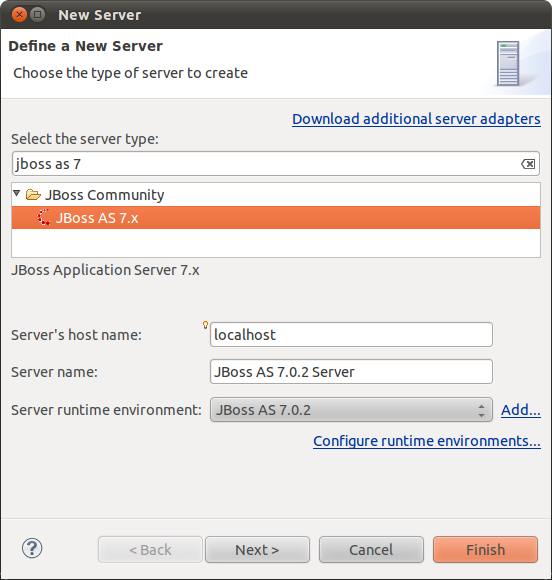
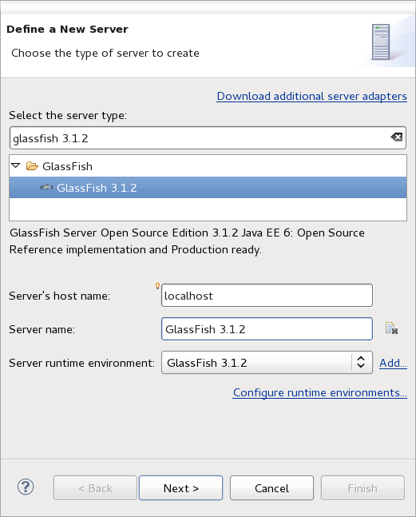
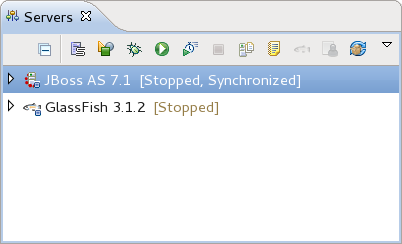
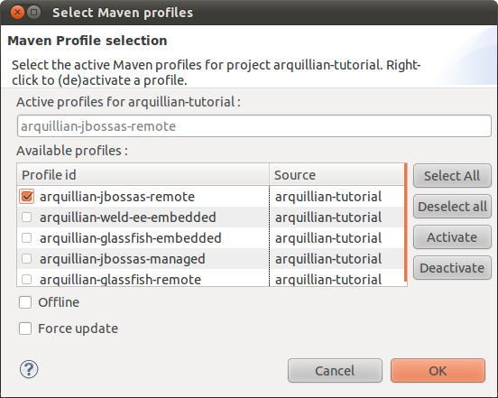
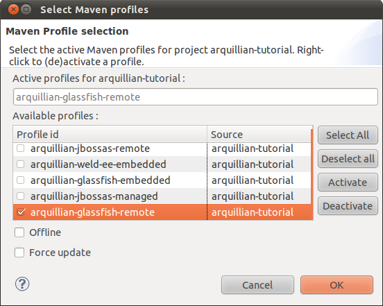
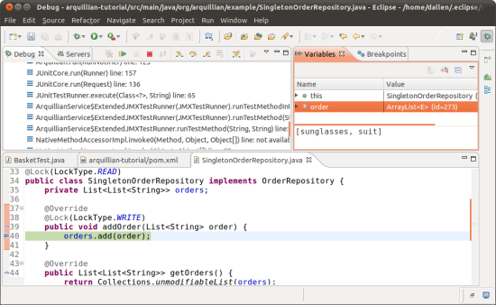
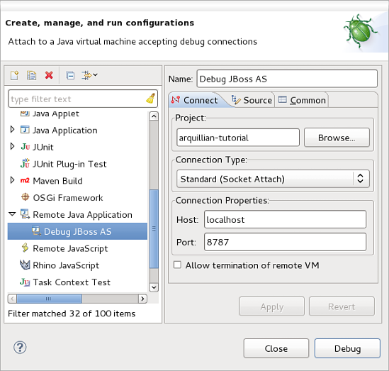

= Guía de introducción: Aclarar y repetir
:sectids!:

En esta continuación de la link:/guides/getting_started_es[Guía de introducción], tendrás la oportunidad de recapitular lo que has aprendido sobre Arquillian explorando un ejemplo ligeramente más complejo. Después de leer esta guía serás capaz de:

* Escribir un test de Arquillian que use pass:[<acronym title="Contexts and Dependency Injection">CDI</acronym>] y pass:[<acronym title="Enterprise JavaBeans">EJB</acronym>] al mismo tiempo
* Ejecutar un test de Arquillian en un contenedor remoto
* Depurar un test de Arquillian en un contedor remoto

Como parte del aprendizaje añadirás perfiles de Maven adicionales al proyecto. Cuando los actives, estos perfiles harán que Arquillian ejecute los tests en el contenedor remoto (por ejemplo el servidor de aplicaciones). Lo que significa que vas a probar la aplicación real, sin piedras ni cartones. Nada de mocks ni de entornos embebidos. Y como ya has hecho lo más difícil en la guía anterior, no te va costar mucho conseguirlo.

[discrete,id="asunciones"]
=== Asunciones

En esta guía se asume que ya has añadido la infraestructura de Arquillian a tu proyecto y que has escrito y ejecutado al menos un test de Arquillian. Si no lo has hecho todavía, por favor léete la link:/guides/getting_started_es[Guía de introducción] para familiarizarte con los fundamentos de Arquillian. También necesitaras el software requerido que se menciona en esa guía.

[discrete,id="crear_los_componentes"]
=== Crear los componentes

En esta guía vamos a crear un backend básico para una aplicación de tienda online. Vamos a crear un componente de cesta de la compra para guardar las cosas seleccionadas por el visitante y un componente para un repositorio donde guardar y recuperar los pedidos. Implementaremos estos componentes utilizando CDI y EJB respectivamente. Podemos empezar a utilizar estos dos nuevos modelos de programación inmediatamente ya que ya disponemos del API de Java EE 6 en el classpath. (Consulta la link:/guides/getting_started_es[Guía de introducción] si necesitas instrucciones adicionales para añadir este API en tu proyecto)

Comencemos con un componente que mueve los pedidos hacia el almacenamiento persistente y viceversa. Siguiendo directrices para un buen diseño de software, y para simplificar los tests, empezaremos definiendo una interfaz que establezca el contrato. En el IDE, crea una nueva interfaz EJB local que se llame ``+OrderRepository+`` y rellénala con el siguiente contenido:

[.filename]
src/main/java/org/arquillian/example/OrderRepository.java

[listing,role=prettify,subs=verbatim]
----
package org.arquillian.example;

import java.util.List;
import javax.ejb.Local;

@Local
public interface OrderRepository {
    void addOrder(List<String> order);
    List<List<String>> getOrders();
    int getOrderCount();
}
----

Nos ocuparemos de la implementación un poco más adelante. Vamos a ver ahora cómo usar este contrato.

Según vayan los visitantes navegando por el sitio irán metiendo objetos en la cesta para comprarlos. Para modelar este escenario vamos a usar un bean de CDI que esté asociado con la sesión HTTP del visitante. Este componente delegará en el ``+OrderRepository+`` (repositorio de pedidos) cuando el visitante quiera comprar los objetos seleccionados.

En el IDE, crea una clase que se llame ``+Basket+`` y engánchala al contexto de la sesión HTTP añadiéndole la anotación ``+@SessionScoped+`` tal y como se muestra a continuación:

[.filename]
src/main/java/org/arquillian/example/Basket.java

[listing,role=prettify,subs=verbatim]
----
package org.arquillian.example;

import java.io.Serializable;
import java.util.ArrayList;
import java.util.Collections;
import java.util.List;

import javax.annotation.PostConstruct;
import javax.ejb.EJB;
import javax.enterprise.context.SessionScoped;

@SessionScoped
public class Basket implements Serializable {
    private static final long serialVersionUID = 1L;
    private List<String> items;
    
    @EJB
    private OrderRepository repo;
    
    public void addItem(String item) {
        items.add(item);
    }
    
    public List<String> getItems() {
        return Collections.unmodifiableList(items);
    }
    
    public int getItemCount() {
        return items.size();
    }
    
    public void placeOrder() {
        repo.addOrder(items);
        items.clear();
    }
    
    @PostConstruct
    void initialize() {
        items = new ArrayList<String>();
    }
}
----

Como podrás ver, estamos inyectando un EJB a un bean de CDI ¡Justo la integración que queremos probar!

[discrete,id="implementación_por_fases"]
=== Implementación por fases

No estamos listos todavía para escribir el test, ya que no tenemos todavía una implementación del ``+OrderRepository+``.

Para el propósito del ejemplo asumiremos que otro equipo está implementado el ``+OrderRepository+`` (o que se va a implementar en otra iteración). Aqui es donde destaca realmente la capacidad de micro-despliegues de Arquillian. Podemos crear una implementación "`de memoria temporal`", con un EJB singleton, y empaquetarlo en el archivo del test para conseguir tener una aplicación funcional en el corto plazo. Puede que incluso decidamos guardar esta implementación para probar este extremo posteriormente.

Crea una clase ``+SingletonOrderRepository+`` en tu _test classpath_ y rellénala con el código que se muestra a continuación:

[.filename]
src/test/java/org/arquillian/example/SingletonOrderRepository.java

[listing,role=prettify,subs=verbatim]
----
package org.arquillian.example;

import java.util.ArrayList;
import java.util.Collections;
import java.util.List;

import javax.annotation.PostConstruct;
import javax.ejb.Lock;
import javax.ejb.LockType;
import javax.ejb.Singleton;

@Singleton
@Lock(LockType.READ)
public class SingletonOrderRepository implements OrderRepository {
    private List<List<String>> orders;
    
    @Override
    @Lock(LockType.WRITE)
    public void addOrder(List<String> order) {
        orders.add(order);
    }
    
    @Override
    public List<List<String>> getOrders() {
        return Collections.unmodifiableList(orders);
    }
    
    @Override
    public int getOrderCount() {
        return orders.size();
    }
    
    @PostConstruct
    void initialize() {
        orders = new ArrayList<List<String>>();
    }
}
----

La ventaja que tiene esta implementación es que tenemos la oportunidad de jugar con la nueva funcionalidad singleton de EJB 3.1 en un entorno seguro (sandbox) de Arquillian. Por eso nos gusta decir que Arquillian es un entorno de aprendizaje, además de ser una herramienta para pruebas.

Ahora sí estamos listos para escribir el test de Arquillian.

[discrete,id="escribir_un_test"]
=== Escribir un test

Ahora vamos a escribir un test que simule el añadir objetos a una instancia de ``+Basket+``, usa esa instancia para colocar un pedido y después valida que el pedido se procesa y se guarda en la única instancia de ``+OrderRepository+``.

[.info]
Por supuesto solo vamos a probar la implementación de "`memoria temporal`". Aprenderemos cómo escribir un test que use una base de datos en la guía link:/guides/testing_java_persistence[Testing Java Persistence]. Entonces puedes volver a esta guía y profundizar en la implementación de JPA

Crea la clase ``+BasketTest+`` y anótala con ``+@RunWith(Arquillian.class)+`` para convertirla en un test de Arquillian:

[.filename]
src/test/java/org/arquillian/example/BasketTest.java

[listing,role=prettify,subs=verbatim]
----
package org.arquillian.example;

import org.jboss.arquillian.junit.Arquillian;
import org.junit.runner.RunWith;

@RunWith(Arquillian.class)
public class BasketTest {
}
----

Lo siguiente que haremos será definir un archivo de test que incluya la cesta de la compra, la interfaz del repositorio de pedidos y su implementación singleton. Necesitamos también un fichero beans.xml vacío para activar el CDI (EJB se activa automáticamente). Date cuenta de que tenemos control total sobre el classpath, ya que definimos explícitamente lo que va a ir dentro del fichero.

[.filename]
src/test/java/org/arquillian/example/BasketTest.java

[listing,role=prettify,subs=verbatim]
----
package org.arquillian.example;

import org.jboss.arquillian.container.test.api.Deployment;
import org.jboss.arquillian.junit.Arquillian;
import org.jboss.shrinkwrap.api.ShrinkWrap;
import org.jboss.shrinkwrap.api.asset.EmptyAsset;
import org.jboss.shrinkwrap.api.spec.JavaArchive;
import org.junit.runner.RunWith;

@RunWith(Arquillian.class)
public class BasketTest {
    @Deployment
    public static JavaArchive createDeployment() {
        return ShrinkWrap.create(JavaArchive.class, "test.jar")
            .addClasses(Basket.class, OrderRepository.class, SingletonOrderRepository.class)
            .addAsManifestResource(EmptyAsset.INSTANCE, "beans.xml");
    }
}
----

Lo único que queda es inyectar la cesta de la compra y el repositorio de pedidos en el test y comprobar su interacción. Inyectamos la interfaz EJB, no la implementación. El contenedor de EJB encontrará la implementación de la interfaz que usemos automáticamente.

En JUnit, por defecto, los methodos ``+@Test+`` se ejecutan en orden aleatorio. La integración con JUnit de Arquillian proporciona una anotación ``+@InSequence+`` que se puede usar para definir un orden de ejecución explícito. Vamos a usar ``+@InSequence+`` en esta prueba para garantizar, en el segundo test, que el repositorio contiene el número correcto de elementos en el pedido que creamos en el primer test.

[.filename]
src/test/java/org/arquillian/example/BasketTest.java

[listing,role=prettify,subs=verbatim]
----
package org.arquillian.example;

import javax.ejb.EJB;
import javax.inject.Inject;

import org.jboss.arquillian.container.test.api.Deployment;
import org.jboss.arquillian.junit.Arquillian;
import org.jboss.arquillian.junit.InSequence;
import org.jboss.shrinkwrap.api.ShrinkWrap;
import org.jboss.shrinkwrap.api.asset.EmptyAsset;
import org.jboss.shrinkwrap.api.spec.JavaArchive;
import org.junit.Assert;
import org.junit.Test;
import org.junit.runner.RunWith;

@RunWith(Arquillian.class)
public class BasketTest {
    @Deployment
    public static JavaArchive createDeployment() {
        return ShrinkWrap.create(JavaArchive.class, "test.jar")
            .addClasses(Basket.class, OrderRepository.class, SingletonOrderRepository.class)
            .addAsManifestResource(EmptyAsset.INSTANCE, "beans.xml");
    }
    
    @Inject
    Basket basket;
    
    @EJB
    OrderRepository repo;
    
    @Test
    @InSequence(1)
    public void place_order_should_add_order() {
        basket.addItem("sunglasses");
        basket.addItem("suit");
        basket.placeOrder();
        Assert.assertEquals(1, repo.getOrderCount());
        Assert.assertEquals(0, basket.getItemCount());
        
        basket.addItem("raygun");
        basket.addItem("spaceship");
        basket.placeOrder();
        Assert.assertEquals(2, repo.getOrderCount());
        Assert.assertEquals(0, basket.getItemCount());
    }
    
    @Test
    @InSequence(2)
    public void order_should_be_persistent() {
        Assert.assertEquals(2, repo.getOrderCount());
    }
}
----

El test está escrito. Ahora tenemos que prepararnos para ejecutarlo.

[discrete,id="añadir_los_contenedores_remotos"]
=== Añadir los Contenedores Remotos

El test que hemos escrito usa tanto CDI como EJB. Esta combinación excede la funcionalidad que pueden ofrecer los contenedores embebidos (como Weld Embedded o OpenEJB Embedded). En cualquier caso es más sencillo utilizar un contenedor Java EE compatible. Además nos proporciona resultados más precisos, con lo que dejaremos los contenedores embebidos por ahora.

En la guía anterior usamos tanto contenedores embebidos como administrados. En ambos casos Arquillian tiene que iniciar el contenedor cuando la serie de tests comience y pararlo cuando los tests hayan acabado. ¿Qué pasa si ya tienes un contenedor arrancado (o si quieres arrancar uno para el propósito de los tests)? Obviamente esa va a ser la manera más rápida de ejecutar los tests. Incluso si el contenedor arrancase muy rápido no hay comparación con tenerlo ya arrancado.

Los contenedores remotos suponen un entorno de desarrollo ideal para las pruebas de integración. También la depuración de los tests se simplifica mucho, como podrás comprobar más adelante. Ya que no hay ninguna referencia al contenedor en el test, usar un contenedor remoto durante el desarrollo no te impide usar uno administrado para la integración continua. De hecho, los contenedores administrados son los más adecuados en un entorno de integración continua.

[.warning]
El término _remoto_ se refiere a un proceso distinto, no necesariamente una máquina distinta, aunque soporta los dos escenarios.

Un contenedor remoto es un proceso independiente en el que Arquillian despliega usando las API de cliente de despliegue del contenedor. Por lo tanto, las librerías que necesitas son:

* APIs del modelo de programación (solo necesitas empaquetarlas en caso de que el contenedor no las provea)
* El adaptador de Arquillian para el contenedor remoto.
* Las APIs del cliente de despliegues para comunicar con el proceso contenedor.

En tu fichero pom.xml de Maven, añade dos nuevos perfiles dentro del elemento ``+<profiles>+``. El primer perfil usa un contenedor JBoss AS 7.1 remoto:

[.filename]
pom.xml

[listing,role=prettify,subs=verbatim]
----
<!-- clip -->
<profile>
    <id>arquillian-jbossas-remote</id>
    <dependencies>
        <dependency>
            <groupId>org.jboss.spec</groupId>
            <artifactId>jboss-javaee-6.0</artifactId>
            <version>1.0.0.Final</version>
            <type>pom</type>
            <scope>provided</scope>
        </dependency>
        <dependency>
            <groupId>org.jboss.as</groupId>
            <artifactId>jboss-as-arquillian-container-remote</artifactId>
            <version>7.1.1.Final</version>
            <scope>test</scope>
        </dependency>
        <dependency>
            <groupId>org.jboss.arquillian.protocol</groupId>
            <artifactId>arquillian-protocol-servlet</artifactId>
            <scope>test</scope>
        </dependency>
    </dependencies>
</profile>
<!-- clip -->
----

[.info]
Por defecto JBoss AS 7 despliega los archivos de test al servidor usando el protocolo JMX. Nos hemos adelantado y hemos añadido la dependencia del protocolo servlet en el perfil ``+arquillian-jbossas-managed+`` para que esté ahí en caso de que lo necesites usar más adelante. Echa un vistazo a https://community.jboss.org/wiki/WhyDoIGetNoActiveContextsForScopeTypeWhenTestingOnJBossAS7[estas preguntas frecuentes] si quieres instrucciones para activarlo.

El segundo perfil usa un contenedor GlassFish 3.1.2 remoto:

[.filename]
pom.xml

[listing,role=prettify,subs=verbatim]
----
<!-- clip -->
<profile>
    <id>arquillian-glassfish-remote</id>
    <dependencies>
        <dependency>
            <groupId>org.jboss.spec</groupId>
            <artifactId>jboss-javaee-6.0</artifactId>
            <version>1.0.0.Final</version>
            <type>pom</type>
            <scope>provided</scope>
        </dependency>
        <dependency>
            <groupId>org.jboss.weld</groupId>
            <artifactId>weld-api</artifactId>
            <version>1.1.Final</version>
            <scope>test</scope>
        </dependency>
        <dependency>
            <groupId>org.jboss.arquillian.container</groupId>
            <artifactId>arquillian-glassfish-remote-3.1</artifactId>
            <version>1.0.0.CR3</version>
            <scope>test</scope>
        </dependency>
    </dependencies>
</profile>
<!-- clip -->
----

[.info]
El adaptador para GlassFish remoto utiliza Jersey para comunicarse con el contenedor vía JAX-RS (REST), el cual se descarga como una dependencia transitiva. El API de Weld se necesita para reconstruir las excepciones que devuelven los test ejecutados en el contenedor.

Una vez que has añadido los perfiles al pox.xml, haz click con el botón derecho en el proyecto de Eclipse y selecciona Maven ++>++ Update Project Configuration. Si el proyecto te da errores de compilación entonces tienes que activar uno de los perfiles.

Recuerda que hay dos maneras de activar un perfil de Maven en Eclipse (dando por hecho que estás usando http://www.eclipse.org/m2e[Maven Integration for Eclipse]):

. Configuración manual (aproximación estándar)
. Selector de perfiles de Maven (JBoss Tools)

Consulta la link:/guides/getting_started_es#pruebas_sobre_varios_contenedores[Guía de introducción] para encontrar instrucciones sobre cómo activar un perfil. Una vez que has activado el perfil el proyecto debería compilar sin problemas.

Los adaptadores de contenedores remotos esperan que los contenedores estén arrancados. Así que vamos a configurar los contenedores para que podamos arrancarlos desde la comodidad de nuestro IDE antes de que ejecutemos el test.

[discrete,id="control_de_los_servidores"]
=== Control de los servidores

La manera más sencilla de administrar un contenedor remoto es configurarlo en el IDE. Si eres más de línea de comandos puedes saltarte este paso y arrancar los servidores usando los scripts de arranque apropiados.

Vamos a mostrarte cómo añadir los controles del servidor (contenedor) en Eclipse. El proceso es similar en otros IDEs. Para Eclipse necesitas tanto http://jboss.org/tools[JBoss Tools] como http://marketplace.eclipse.org/content/glassfish-java-ee-application-server-plugin-eclipse/metrics[GlassFish Java EE Application Server Plugin]. Ambos están disponibles en el Eclipse MarketPlace.

En Eclipse selecciona Window ++>++ Show View ++>++ Servers en la barra de menu principal. Una vez que se abra la vista, haz click con el botón derecho y selecciona New ++>++ Server. Crea un control para servidores JBoss AS 7.1:

y otro para GlassFish 3.1.2:

[.info]
El asistente te pide que selecciones una instalación existente. El asistente para GlassFish 3.1.2 dispone de una opción para descargar y extraer la distribución automáticamente.

Una vez que hayas completado los asistentes deberías ver sendos controles aparecer en la vista de servidores:

Para arrancar un servidor selecciona la entrada (como se muestra arriba en la imagen) y haz click en el botón verde con el símbolo del "`Play`" (Reproducir).

[.info]
Arquillian da por sentado que los contenedores están escuchando en los puertos por defecto. Si has cambiado los puertos puedes usar arquillian.xml para especificar los puertos que estés usando para cada contenedor. Consulta la https://docs.jboss.org/author/display/ARQ/Container+adapters[Guía de referencia] si quieres más detalles.

Ahora que ya tienes los contenedores preparados y esperando, es hora de lanzarles el test.

[discrete,id="ejecutar_el_test_con_arquillian"]
=== Ejecutar el test con Arquillian

Para ejecutar el test con Arquillian tienes que realizar los siguientes pasos:

. Arrancar el contenedor remoto
. Activar el perfil de Maven que añade el adaptador correspondiente para el contenedor en el classpath
. Ejecutar el test

Empecemos por JBoss AS.

[discrete]
==== Ejecutar el test en JBoss AS

Para ejecutar el test en JBoss AS comienza por arrancar el contenedor. Abre la vista de servidores, selecciona JBoss AS 7.1 y después haz click en el botón verde de "`Play`" (Reproducir). Espera a que arranque (no debería tardar mucho).

Una vez que esté arrancado y funcionando activa el perfil de Maven ``+arquillian-jbossas-remote+`` usando bien la pestaña de propiedades de Maven o bien el selector de perfiles de Maven de JBoss Tools. Aquí abajo el selector de perfiles muestra la configuración correcta.

Finalmente haz click con el botón derecho sobre la clase ``+BasketTest+`` y selecciona Run As ++>++ JUnit Test. Deberías ver una actividad frenética en la consola y después… ¡ *[.greenbar]#Barra verde#* en la vista de JUnit!

También puedes ejecutar el test en la línea de comandos utilizando Maven:

[listing,role=command,subs=verbatim]
----
$ mvn test -Parquillian-jbossas-remote -Dtest=BasketTest
----

Deberías ver lo siguiente impreso en la consola:

[listing,role=output,subs=verbatim]
----
-------------------------------------------------------
T E S T S
-------------------------------------------------------
Running org.arquillian.example.BasketTest
...
Tests run: 2, Failures: 0, Errors: 0, Skipped: 0, Time elapsed: 1.844 sec
----

*¡Enhorabuena!* Te has ganado tu primera *[.greenbar]#barra verde#* usando un contenedor remoto con Arquillian.

[.info]
También puedes inyectar el EJB ``+OrderRepository+`` usando ``+@Inject+`` en lugar de ``+@EJB+``. ¡Pruébalo!

Si quieres comprobar que el singleton esté realmente funcionando, reemplaza la anotación ``+@Singleton+`` en la clase ``+SingletonOrderRepository+`` con ``+@Stateful+``. Deberías ver un error de verificación (assertion error) cuando ejecutes el test. Deshaz el cambio y la barra volverá a ser verde.

Hemos terminado con JBoss AS por el momento, así que utiliza la vista de servidores para parar el servidor. Vamos a realizar exactamente la misma prueba en GlassFish 3.1.2.

[discrete]
==== Ejecutar el test en GlassFish

Para ejecutar el test en el servidor GlassFish independiente comienza arrancando el servidor. Abre la vista de servidores, selecciona GlassFish 3.1.2 y después haz click sobre el botón verde de "`Play`" (Reproducir). Espera a que arranque.

Una vez que esté arrancado y funcionando activa el perfil de Maven ``+arquillian-glassfish-remote+``, bien utilizando la pestaña de propiedades de Maven o bien el selector de perfiles de Maven de JBoss Tools. Acuérdate de desactivar el perfil ``+arquillian-jbossas-remote+``. Abajo, en el editor de perfiles, se muestra la configuración correcta.

Finalmente haz click con el botón derecho sobre la clase ``+BasketTest+`` y selecciona Run As ++>++ JUnit Test. Deberías ver una actividad frenética en la consola y después… ¡Una *[.greenbar]#barra verde#* en la vista de JUnit!

También puedes ejecutar el test en la línea de comandos usando Maven:

[listing,role=command,subs=verbatim]
----
$ mvn test -Parquillian-glassfish-remote -Dtest=BasketTest
----

Deberías ver las siguientes líneas impresas en la consola:

[listing,role=output,subs=verbatim]
----
-------------------------------------------------------
T E S T S
-------------------------------------------------------
Running org.arquillian.example.BasketTest
...
Tests run: 2, Failures: 0, Errors: 0, Skipped: 0, Time elapsed: 3.549 sec
----

*¡Enhorabuena!* Te has ganado otra *[.greenbar]#barra verde#*.

Deberías también poder ejecutar el test en el GlassFish Embebido usando el perfil que preparaste en la guía anterior. Inténtalo. Deberías también poder depurar el test fácilmente.

Depurar el test en un contenedor embebido es, por supuesto, fácil ya que el test ejecuta en el mismo proceso que el lanzador de tests pero ¿Qué pasa con los contenedores remotos?

[discrete,id="depurar_el_test_de_arquillian"]
=== Depurar el test de Arquillian

¿Depurar un test en un contenedor remoto? Suena difícil. ¡Sorpresa! No lo es en absoluto. Solo tienes que alterar uno de los pasos anteriores y añadir un paso adicional.

. *Ejecuta el contenedor remoto en depuración (Debug)*
. Activa el perfil de Maven que añade el adaptador correspondiente para el contenedor al classpath.
. *Establece un punto de ruptura (breakpoint)*
. Ejecuta el test

En la vista de servidores deberías ver que hay un icono con un bicho (insecto) justo al lado del boton con el "`Play`" (Reproducir) verde. Pulsa este botón para arrancar el servidor seleccionado en modo depuración (Debug). Eclipse automáticamente conecta el depurador al contenedor.

Establece un punto de ruptura (breakpoint) en el método ``+addOrder()+`` del bean ``+SingletonOrderRepository+``. Ahora ejecuta otra vez el test con el botón derecho del ratón y seleccionando Run As ++>++ JUnit Test.

[.warning]
No tienes que usar Debug As ++>++ JUnit Test. El código del test se está ejecutando dentro del contenedor, el cual ya se está ejecutando en modo depuración.

El test debería pararse en el punto de ruptura (breakpoint). Si estás usando JBoss AS puedes abrir la consola de administración y verificar que la aplicación de test está en este momento desplegada en el servidor.

Si miras el stack trace en la vista de depuración de Eclipse (Debug View), verás que el servidor se controla mediante un protocolo remoto (ya sea JMX o Servlet) y que JUnit se ha lanzado también dentro del contenedor.

Estás curioseando en el servidor desde la comodidad de tu IDE.

[.warning]
Si te aparece un mensaje "`Source not found`" (Código fuente no encontrado) en la vista del editor al pararse el depurador en el breakpoint, tienes que añadir el proyecto a la configuración de depuración. Haz click en "`Edit Source Lookup Path…`", después haz click en "`Add…`", selecciona Java Project, activa la casilla al lado de tu proyecto y después pulsa "`OK`". ¡Voila! Código fuente

[discrete]
==== Depurando dentro (stepping into) de librerías externas

Si estabas pensando depurar dentro de una clase de una librería externa (código que se encuentra fuera de tu aplicación) necesitas enlazar la librería a su código fuente.

[.info]
No necesitas esta configuración si estás usando un proyecto de Maven y las fuentes de la librería están disponibles en el repositorio de Maven. Cuando llegues a un breakpoint en una librería que no esté todavía disponible localmente, dale un poco de tiempo para que se descargue las fuentes y el código al final aparecerá. De no ser así el código fuente probablemente no esté disponible y necesites seguir leyendo.

Estos son los pasos que tienes que seguir en caso de que quieras enlazar una librería con su código fuente en la configuración de depuración:

. Selecciona la opción ``+Run > Debug Configurations...+`` en la barra de menu principal
. Selecciona el nombre de la clase de test en la categoría JUnit (o TestNG)
. Selecciona la pestaña Source (Fuente)
. Haz click en el botón Add… a la derecha
. Si el código fuente está en otro proyecto:
.. Selecciona Java Project
.. Marca el proyecto que contiene la clase que quieres depurar
.. Haz click en OK en la ventana de seleccion de proyecto (Project Selection)
. Si el código fuente está en una librería
.. Selecciona External Archive
.. Navega hasta el archivo que contiene el código fuente (que, por supuesto, te tienes que descargar tú mismo)
. Haz click en Close en la ventana de Debug Configurations

Tienes que repetir estos pasos para cada clase que quieras depurar, aunque solo tienes que hacerlo una vez (la configuración de depuración se queda para siempre).

[discrete,id="depurar_en_un_servidor_administrado"]
=== Depurar en un servidor administrado

¿Es posible depurar usando un contenedor administrado? ¡Por supuesto que sí! Sólo necesitamos un poco más de configuración.

Ya que es Arquillian quién se encarga de arrancar y parar el contenedor tenemos que instruirle para que lo haga en modo depuración. Hay una propiedad de la JVM que Arquillian tiene que pasar al servidor usando las propiedades de configuración del contenedor.

Antes de ponernos con eso, tenemos que pensar cómo vamos a conectar el depurador. A menos que seas super rápido con el ratón vas a tenerlo difícil para conectar el depurador antes de que Arquillian empiece a ejecutar los tests. Afortunadamente podemos pedirle a la JVM que espere a que el depurador se conecte antes de ejecutar la aplicación, en este caso JBoss AS. Eso nos da el tiempo suficiente para pulsar el botón de depuración en el IDE para conectarnos al proceso.

Esta es la configuración que tienes que añadir al descriptor de configuración de Arquillian, arquillian.xml, para que Arquillian arranque el servidor en modo depuración: (No se permiten espacios justo después de la etiqueta ``+<property>+``)

[.filename]
src/test/resources/arquillian.xml

[listing,role=prettify,subs=verbatim]
----
<arquillian xmlns="http://jboss.org/schema/arquillian"
    xmlns:xsi="http://www.w3.org/2001/XMLSchema-instance"
    xsi:schemaLocation="
        http://jboss.org/schema/arquillian
        http://jboss.org/schema/arquillian/arquillian_1_0.xsd">
    <container qualifier="jbossas-managed" default="true">
        <configuration>
            <property name="jbossHome">target/jboss-as-7.1.1.Final</property>
            <property name="javaVmArguments">-Xmx512m -XX:MaxPermSize=128m
                -Xrunjdwp:transport=dt_socket,address=8787,server=y,suspend=y
            </property>
        </configuration>
    </container>
</arquillian>
----

Fíjate en la opción ``+suspend=y+``. Eso le dice al proceso que espere a que se conecte el depurador. Hemos configurado el puerto de depuración en el 8787, que es el puerto que tienes que poner en la configuración del depurador. Llegaremos a eso en un momento. Primero comencemos el test.

. Activa el perfil de Maven ``+arquillian-jbossas-managed+`` (Consulta la link:/guides/getting_started_es[Guía de introducción])
. Ejecuta el test

En la consola deberías ver que Arquillian ha arrancado la instancia de JBoss AS y que está esperando a que se conecte el depurador:

[listing,role=output,subs=verbatim]
----
Listening for transport dt_socket at address: 8787
----

Lo único que tenemos que hacer ahora es conectar un depurador. Así es como se lanza el depurador en Eclipse:

. Selecciona ``+Run > Debug Configurations...+`` en el menú principal
. Haz click con el botón derecho en Remote Java Application y selecciona New
. En el campo Name pon "`Debug JBoss AS`"
. En el campo Port pon "`8787`"
. Haz click en el botón Debug

Aquí podemos ver la pantalla de configuración mostrando el perfil de depuración que acabamos de crear:

Cuando pulses el botón Debug, JBoss AS debería reanudarse y después volverse a parar cuando alcance el breakpoint del test. ¡Voila! ¡Estás depurando un contenedor administrado!

[discrete,id="exportar_el_despliegue"]
=== Exportar el despliegue

Algunas veces necesitas un poco más de información sobre lo que Arquillian despliega en el servidor. Afortunadamente Arquillian dispone de una forma de exportar el fichero de test justo antes de desplegarlo. Asigna un directorio absoluto o relativo a la propiedad ``+deploymentExportPath+`` del elemento ``+<engine>+`` en arquillian.xml y Arquillian exportará el archivo en esa ubicación cada vez que ejecutes un test de Arquillian.

[.filename]
src/test/resources/arquillian.xml

[listing,role=prettify,subs=verbatim]
----
<arquillian xmlns="http://jboss.org/schema/arquillian"
    xmlns:xsi="http://www.w3.org/2001/XMLSchema-instance"
    xsi:schemaLocation="
        http://jboss.org/schema/arquillian
        http://jboss.org/schema/arquillian/arquillian_1_0.xsd">
    <engine>
        <property name="deploymentExportPath">target/deployments</property>
    </engine>
</arquillian>
----

Para activar la exportación solo para un test usa el argumento de la máquina virtual ``+arquillian.deploymentExportPath+``. Por ejemplo: ``+-Darquillian.deploymentExportPath=target/deployments/+``.

Ahora ejecuta un test y comprueba el directorio target/deployments. Deberías ver un fichero con la extensión .jar, .war o .ear (Puede ser que Arquillian haya empaquetado el archivo definido en el test dentro de otro archivo para añadirle un poco de magia). Puedes inspeccionar el contenido de este fichero usando un gestor de ficheros. Con suerte el contenido del fichero te dará la información suficiente para solucionar excepciones de clases o recursos ausentes.

Hasta aquí has aprendido como ejecutar y depurar los tests en contenedores embebidos, remotos y administrados. No hay nada que te pueda detener. ¡Sigue escribiendo _tests de verdad_ y haz que Ike se sienta orgulloso!
