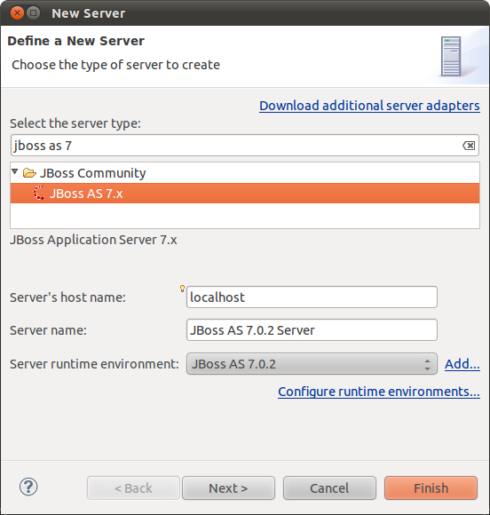
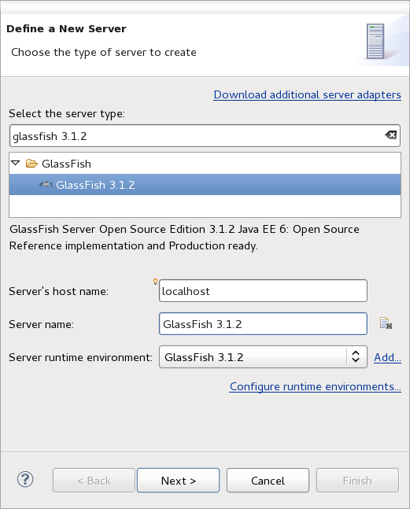
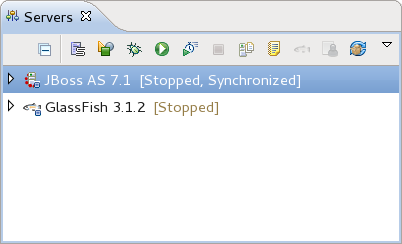
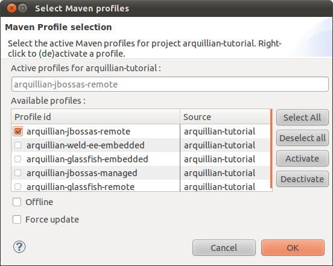
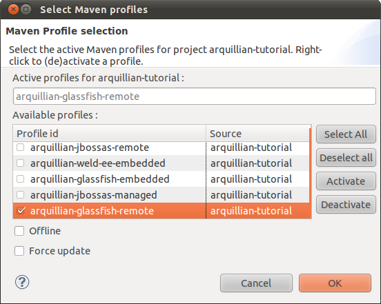
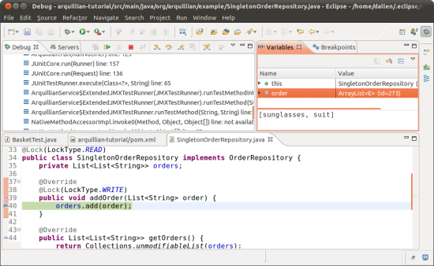
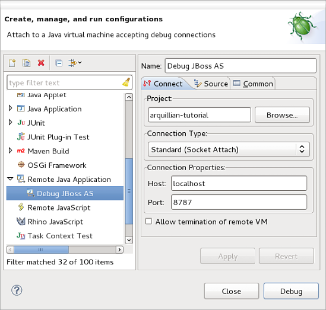

= Szybki start: Zróbmy to raz jeszcze
:sectids!:

To wprowadzenie jest kontynuacją serii link:/guides/getting_started[Szybki start]. Dzięki niemu będziesz mógł ugruntować swoją wiedzę na temat Arquilliana, wykorzystując bardziej skomplikowany przykład. Po przeczytaniu tego przewodnika będziesz potrafił:

* Napisać testy Arquilliana wykorzystujące pass:[<acronym title="Contexts and Dependency Injection">CDI</acronym>] oraz pass:[<acronym title="Enterprise JavaBeans">EJB</acronym>].
* Wykonywać testy Arquilliana wykorzytując zdalny kontener.
* Debugować testy Arquilliana wykorzytując zdalny kontener.

W oparciu o ten przewodnik dodasz nowy profil budowania swojej aplikacji w Mavenie. Dzięki niemu będziesz mógł wskazać Arquillianowi kiedy uruchomić testy na zdalnym kontenerze (np. serwera aplikacji). To znaczy, że będziesz testował _w realnym środowisku_. Żadnych mocków. Żadnych środowisk testowych! A ponieważ najcięższą pracę wykonałeś w pierwszej części wprowadzenia, nie powinno zająć to zbyt wiele czasu.

[discrete,id="założenia"]
=== Założenia

Wprowadzenie zakłada, że skonfigurowałeś już swój projekt do pracy z Arquillianem oraz napisałeś i wykonałeś przynajmniej jeden test. Jeśli jeszcze tego nie zrobiłeś, wróć proszę do przewodnika link:/guides/getting_started[Szybki start] i poznaj podstawy Arquilliana.

[discrete,id="stwórz_komponenty"]
=== Stwórz komponenty

Będziesz przygotowywał bardzo prosty backend dla aplikacji sklepu. Użyjemy komponent koszyka zakupów do przechowywania produktów wybranych przez odwiedzających i komponent repozytorium do przechowywania i pobierania złożonych zamówień. Zaimplementujemy je korzystając z odpowiednio CDI i EJB. Ponieważ korzystamy z Java EE 6 API możemy wykorzystać obie te technologie bez żadnego dodatkowego nakładu pracy. (Jeżeli potrzebujesz, dowiedz się z przewodnika link:/guides/getting_started[Szybki start] jak dołączyć wspomniane API do swojego projektu).

Zacznijmy od komponentu przenoszącego zamówienia do i z magazynu danych. Trzymając się dobrych praktyk tworzenia oprogramowania, oraz w celu ułatwienia pisania testów, zaczniemy od zdefiniowania interfejsu. W swoim IDE utwórz nowy lokalny interfejs EJB ``+OrderRepository+`` i uzupełnij go podanym kodem:

[.filename]
src/main/java/org/arquillian/example/OrderRepository.java

[listing,role=prettify,subs=verbatim]
----
package org.arquillian.example;

import java.util.List;
import javax.ejb.Local;

@Local
public interface OrderRepository {
    void addOrder(List<String> order);
    List<List<String>> getOrders();
    int getOrderCount();
}
----

Implementacją zajmiemy się później. Póki co przejdźmy do opisu wykorzystania tego API.

W trakcie korzystania ze strony, odwiedzający będą dodawać produkty do swoich koszyków z zakupami. Żeby wymodelować ten scenariusz wykorzystamy komponent CDI, który będzie powiązany z sesją HTTP odwiedzającego. Gdy kupujący zechce zrealizować zakupy ze swojego koszyka, komponent ten będzie delegował żądanie do ``+OrderRepository+``.

W IDE utwórz klasę ``+Basket+`` i powiąż ją z kontekstem sesji, dodając adnotację zakresu ``+@SessionScoped+``, jak w przykładzie poniżej:

[.filename]
src/main/java/org/arquillian/example/Basket.java

[listing,role=prettify,subs=verbatim]
----
package org.arquillian.example;

import java.io.Serializable;
import java.util.ArrayList;
import java.util.Collections;
import java.util.List;

import javax.annotation.PostConstruct;
import javax.ejb.EJB;
import javax.enterprise.context.SessionScoped;

@SessionScoped
public class Basket implements Serializable {
    private static final long serialVersionUID = 1L;
    private List<String> items;
    
    @EJB
    private OrderRepository repo;
    
    public void addItem(String item) {
        items.add(item);
    }
    
    public List<String> getItems() {
        return Collections.unmodifiableList(items);
    }
    
    public int getItemCount() {
        return items.size();
    }
    
    public void placeOrder() {
        repo.addOrder(items);
        items.clear();
    }
    
    @PostConstruct
    void initialize() {
        items = new ArrayList<String>();
    }
}
----

Jak widzisz, wiążemy komponent EJB do naszego komponentu CDI, dokładnie tą integrację będziemy chcieli przetestować!

[discrete,id="implementuj_etapami"]
=== Implementuj etapami

Nie jesteśmy jeszcze zupełnie gotowi do tworzenia kolejnych testów, ponieważ nie dostarczyliśmy żadnej implementacji dla ``+OrderRepository+``.

Na potrzeby tego przykładu, załóżmy że interfejs ``+OrderRepository+`` jest implementowany przez inny zespół (lub w kolejnej iteracji). To idealne miejsce dla wykorzystania funkcjonalności micro-deploymentu. Przygotujemy implementację singletona EJB działającego w pamięci i dostarczymy ją w archiwum testowym w celu szybkiego uruchomienia aplikacji. (W przyszłości możemy nawet zdecydować o zachowaniu tej implementacji dla testów tego punktu styku).

Utwórz klasę ``+SingletonOrderRepository+`` w testowym folderze i uzupełnij ją kodem pokazanym poniżej:

[.filename]
src/test/java/org/arquillian/example/SingletonOrderRepository.java

[listing,role=prettify,subs=verbatim]
----
package org.arquillian.example;

import java.util.ArrayList;
import java.util.Collections;
import java.util.List;

import javax.annotation.PostConstruct;
import javax.ejb.Lock;
import javax.ejb.LockType;
import javax.ejb.Singleton;

@Singleton
@Lock(LockType.READ)
public class SingletonOrderRepository implements OrderRepository {
    private List<List<String>> orders;
    
    @Override
    @Lock(LockType.WRITE)
    public void addOrder(List<String> order) {
        orders.add(order);
    }
    
    @Override
    public List<List<String>> getOrders() {
        return Collections.unmodifiableList(orders);
    }
    
    @Override
    public int getOrderCount() {
        return orders.size();
    }
    
    @PostConstruct
    void initialize() {
        orders = new ArrayList<List<String>>();
    }
}
----

Dodatkową zaletą tej implementacji jest możliwość zapoznania się z nową funkcjonalnością singletonów z EJB 3.1 w środowisku testowym Arquilliana. Dlatego właśnie lubimy nazywać Arquilliana, poza narzędziem testującym, środowiskiem do nauki.

Teraz jesteśmy gotowi do pisania testów Arquilliana.

[discrete,id="napisz_testy"]
=== Napisz testy

Napiszemy test, który będzie symulował dodanie produktów do instancji klasy ``+Basket+`` i wykorzystanie jej do złożenia zamówienia. Zweryfikuje on czy zamówienie zostało przetworzone i zapisze je w instancji klasy ``+OrderRepository+``.

[.info]
Oczywiście będziemy testować tylko implementację działającą w pamięci. Nauczysz się jak pisać testy wykorzystujące bazę danych w przewodniku link:/guides/testing_java_persistence[Testowanie Java Persistence]. Możesz wtedy powrócić do tego przewodnika i przygotować implementację opartą o JPA.

Utwórz klasę ``+BasketTest+`` i oznacz ją adnotacją ``+@RunWith(Arquillian.class)+``, aby wykorzystać Arquilliana do uruchomienia tego testu:

[.filename]
src/test/java/org/arquillian/example/BasketTest.java

[listing,role=prettify,subs=verbatim]
----
package org.arquillian.example;

import org.jboss.arquillian.junit.Arquillian;
import org.junit.runner.RunWith;

@RunWith(Arquillian.class)
public class BasketTest {
}
----

W następnym kroku zdefiniujemy archiwum testowe, zawierające koszyk, interfejs repozytorium zamówień oraz jego implementację jako singleton. Dodatkowo potrzebujemy pusty plik beans.xml, który uaktywni CDI (EJB jest aktywowane automatycznie). Zauważ, że poprzez konkretne zdefiniowanie co ma trafić do archiwum, mamy pełną kontrolę nad classpathem aplikacji

[.filename]
src/test/java/org/arquillian/example/BasketTest.java

[listing,role=prettify,subs=verbatim]
----
package org.arquillian.example;

import org.jboss.arquillian.container.test.api.Deployment;
import org.jboss.arquillian.junit.Arquillian;
import org.jboss.shrinkwrap.api.ShrinkWrap;
import org.jboss.shrinkwrap.api.asset.EmptyAsset;
import org.jboss.shrinkwrap.api.spec.JavaArchive;
import org.junit.runner.RunWith;

@RunWith(Arquillian.class)
public class BasketTest {
    @Deployment
    public static JavaArchive createDeployment() {
        return ShrinkWrap.create(JavaArchive.class, "test.jar")
            .addClasses(Basket.class, OrderRepository.class, SingletonOrderRepository.class)
            .addAsManifestResource(EmptyAsset.INSTANCE, "beans.xml");
    }
}
----

Jedyne co nam pozostało to wstrzyknięcie koszyka i repozytorium zamówień do klasy testowej oraz przetestowanie ich współdziałania. Będziemy wstrzykiwać interfejs EJB, nie jego implementację. Kontener EJB automatycznie odnajdzie odpowiadającą implementację i ją wykorzysta.

JUnit domyślnie wykonuje metody ``+@Test+`` w nieokreślonej kolejności. Arquillianowa wersja testów JUnitowych dostarcza adnotację ``+@InSequence+`` pozwalającą określić wprost kolejność wykonywania metod testowych. Wykorzystamy ją, żeby w pierwszej metodzie testowej dodać dwa zamówienia oraz w drugiej sprawdzić czy nadal znajdują się w repozytorium.

[.filename]
src/test/java/org/arquillian/example/BasketTest.java

[listing,role=prettify,subs=verbatim]
----
package org.arquillian.example;

import javax.ejb.EJB;
import javax.inject.Inject;

import org.jboss.arquillian.container.test.api.Deployment;
import org.jboss.arquillian.junit.Arquillian;
import org.jboss.arquillian.junit.InSequence;
import org.jboss.shrinkwrap.api.ShrinkWrap;
import org.jboss.shrinkwrap.api.asset.EmptyAsset;
import org.jboss.shrinkwrap.api.spec.JavaArchive;
import org.junit.Assert;
import org.junit.Test;
import org.junit.runner.RunWith;

@RunWith(Arquillian.class)
public class BasketTest {
    @Deployment
    public static JavaArchive createDeployment() {
        return ShrinkWrap.create(JavaArchive.class, "test.jar")
            .addClasses(Basket.class, OrderRepository.class, SingletonOrderRepository.class)
            .addAsManifestResource(EmptyAsset.INSTANCE, "beans.xml");
    }
    
    @Inject
    Basket basket;
    
    @EJB
    OrderRepository repo;
    
    @Test
    @InSequence(1)
    public void place_order_should_add_order() {
        basket.addItem("sunglasses");
        basket.addItem("suit");
        basket.placeOrder();
        Assert.assertEquals(1, repo.getOrderCount());
        Assert.assertEquals(0, basket.getItemCount());
        
        basket.addItem("raygun");
        basket.addItem("spaceship");
        basket.placeOrder();
        Assert.assertEquals(2, repo.getOrderCount());
        Assert.assertEquals(0, basket.getItemCount());
    }
    
    @Test
    @InSequence(2)
    public void order_should_be_persistent() {
        Assert.assertEquals(2, repo.getOrderCount());
    }
}
----

Napisaliśmy nasz test. Pora przygotować środowisko, w którym go uruchomimy.

[discrete,id="dodaj_zdalne_kontenery"]
=== Dodaj zdalne kontenery

Napisany przez nas test wykorzystuje zarówno CDI, jak i EJB. Ta kombinacja przesuwa granicę tego, co może dostarczyć nam osadzone środowisko testowe (takie jak Weld Embedded czy OpenEJB Embedded). Dużo prościej jest wykorzystać kontener zgodny ze standardem Java EE. Dodatkowo zwiększymy wiarygodność naszych przypadków testowych. Dlatego, póki co, zapomnimy o osadzanych kontenerach.

W poprzednim wprowadzeniu wykorzystywaliśmy zarówno osadzane, jak i zarządzane kontenery. W obu przypadkach Arquillian musi uruchomić kontener przed rozpoczęciem zestawu testów oraz zatrzymać go po ich zakończeniu. Co jeżeli kontener jest już uruchomiony (bądź zamierzasz taki uruchomić na potrzeby testów)? To oczywiście najszybsza metoda uruchamiania testów. Nawet jeżeli kontener uruchamia się błyskawicznie, nigdy testy nie wykonają się szybciej niż gdyby nie musiały nic uruchamiać.

Zdalny kontener dostarcza nam idealne środowisko programistyczne dla testów integracyjnych. Jak przekonasz się później, umożliwia również bardzo łatwe debugowanie testów. Ponieważ nie ma żadnych odniesień do kontenera w testach, nic nie stoi na przeszkodzie żeby wykorzystać kontener zdalny w trakcie programowania, a zarządzany w przypadku środowiska ciągłej integracji. W zasadzie, zarządzane kontenery najlepiej się sprawdzają w przypadku środowisk ciągłe integracji.

[.warning]
Określenie _zdalny_ odnosi się do kontenera w osobnym procesie, nie zawsze na zdalnej maszynie. Chociaż oba scenariusze są wspierane

Zdalny kontener to samodzielny proces, w którym Arquillian uruchamia testy wykorzystując jego klienckie API. W związku z tym, będziesz potrzebował:

* API modelu programowania (muszą być spakowane razem z archiwum testowym jedynie gdy kontener ich nie zapewnia).
* Adapter Arquilliana dla wybranego zdalnego kontenera.
* API aplikacji klienckiej kontenera, w celu komunikacji z jego procesem.

W swoim pliku pom.xml dodaj dwa nowe profile wewnątrz elementu ``+<profiles>+``. +
Pierwszy z nich wykorzystuje zdalny kontener JBoss AS 7.1:

[.filename]
pom.xml

[listing,role=prettify,subs=verbatim]
----
<!-- clip -->
<profile>
    <id>arquillian-jbossas-remote</id>
    <dependencies>
        <dependency>
            <groupId>org.jboss.spec</groupId>
            <artifactId>jboss-javaee-6.0</artifactId>
            <version>1.0.0.Final</version>
            <type>pom</type>
            <scope>provided</scope>
        </dependency>
        <dependency>
            <groupId>org.jboss.as</groupId>
            <artifactId>jboss-as-arquillian-container-remote</artifactId>
            <version>7.1.1.Final</version>
            <scope>test</scope>
        </dependency>
        <dependency>
            <groupId>org.jboss.arquillian.protocol</groupId>
            <artifactId>arquillian-protocol-servlet</artifactId>
            <scope>test</scope>
        </dependency>
    </dependencies>
</profile>
<!-- clip -->
----

[.info]
Domyślnie, JBoss AS 7 instaluje archiwa na serwerze wykorzystując protokół JMX. My jednak poszliśmy o krok dalej i dodaliśmy wsparcie dla protokołu wykorzystującego Servlety w profilu ``+arquillian-jbossas-managed+``, W razie gdybyśmy chcieli z niego skorzystać w przyszłości. Zajrzyj do https://community.jboss.org/wiki/WhyDoIGetNoActiveContextsForScopeTypeWhenTestingOnJBossAS7[FAQ] żeby sprawdzić jak się pomiędzy nimi przełączać.

Drugi profil wykorzystuje zdalny kontener GlassFish 3.1.2:

[.filename]
pom.xml

[listing,role=prettify,subs=verbatim]
----
<!-- clip -->
<profile>
    <id>arquillian-glassfish-remote</id>
    <dependencies>
        <dependency>
            <groupId>org.jboss.spec</groupId>
            <artifactId>jboss-javaee-6.0</artifactId>
            <version>1.0.0.Final</version>
            <type>pom</type>
            <scope>provided</scope>
        </dependency>
        <dependency>
            <groupId>org.jboss.weld</groupId>
            <artifactId>weld-api</artifactId>
            <version>1.1.Final</version>
            <scope>test</scope>
        </dependency>
        <dependency>
            <groupId>org.jboss.arquillian.container</groupId>
            <artifactId>arquillian-glassfish-remote-3.1</artifactId>
            <version>1.0.0.CR3</version>
            <scope>test</scope>
        </dependency>
    </dependencies>
</profile>
<!-- clip -->
----

[.info]
Adapter zdalny dla GlassFisha wykorzystuje bibliotekę Jersey do komunikacji z kontenerem poprzez JAX-RS (REST), dlatego też przez co został dodany do zależności. API Welda jest potrzebne do unmarshallingu wyjątków zwracanych przez testy w kontenerze.

Jak już dodasz nowe profile do swojego pliku pom.xml, kliknij prawym przyciskiem na projekcie w Eclipse i wybierze Maven ++>++ Update Project Configuration. Jeżeli na projekcie zostały oznaczone błędy kompilacji musisz aktywować jeden z przygotowanych profili.

Pamiętaj, że masz dwie możliwości wyboru profili Mavena w Eclipse (zakładając że wykorzystuje http://www.eclipse.org/m2e[Maven Integration for Eclipse]):

. Ręczna konfiguracja (standardowe podejście)
. Maven profile selector (JBoss Tools)

W przewodniku link::/guides/getting_started#test_across_containers[Szybki start] znajdziesz instrukcję jak uaktywnić profil Mavena. Kiedy już to zrobisz, projekt powinien budować się bez błędów.

Adaptery zdalnych kontenerów zakładają, że te są uruchomione. W związku z tym, zajmijmy się ich konfiguracją, abyśmy mogli uruchamiać je komfortowo z IDE przed uruchomieniem testów.

[discrete,id="zarządzaj_serwerami"]
=== Zarządzaj serwerami

Najprostszym sposobem na zarządzanie zdalnymi kontenerami jest skonfigurowanie ich w swoim IDE. Jeżeli wolisz korzystać z konsoli, możesz pominąć ten krok i wystartować serwery odpowiednimi skryptami startującymi.

Pokażemy jak dodać serwer (kontener) w Eclipse. Proces dla innych IDE jest podobny. Będziesz potrzebował zarówno http://jboss.org/tools[JBoss Tools] jak i http://marketplace.eclipse.org/content/glassfish-java-ee-application-server-plugin-eclipse/metrics[GlassFish Java EE Application Server Plugin], oba dostępne w Eclipse MarketPlace.

W Eclipse, wybierz Window ++>++ Show View ++>++ Servers z paska menu. Gdy widok już się otworzy, kliknij prawym przyciskiem i wybierz New ++>++ Server. Utwórz server dla JBoss AS 7.1:

oraz kolejny dla GlassFish 3.1.2:

[.info]
Kreator konfiguracji dla JBoss AS wymaga wskazania istniejącej instalacji. Natomiast kreator dla GlassFish 3.1.2 pozwala ściągnąć i rozpakować dystrybucję automatycznie.

Po zakończeniu procesu dodawania kontenerów, powinieneś zobaczyć je na liście w widoku serwerów:

Żeby wystartować serwer, wybierz go z listy (jak na obrazku powyżej) i kliknij zieloną ikonę uruchomienia na pasku narzędzi.

[.info]
Arquillian zakłada, że kontenery pracują na swoich domyślnych portach. Jeżeli je zmieniłeś musisz uaktualnić plik arquillian.xml i podać odpowiednie porty dla każdego kontenera. Zapoznaj się z https://docs.jboss.org/author/display/ARQ/Container+adapters[przewodnikiem referencyjnym], aby dowiedzieć się jak to zrobić.

Teraz, gdy Twój kontener jest gotowy i uruchomiony, przyszła pora na wykonanie testów.

[discrete,id="uruchom_testy_arquilliana"]
=== Uruchom testy Arquilliana

W celu uruchomienia testów Arquilliana, musisz wykonać następujące kroki:

. Uruchom zdalny kontener
. Uaktywnij profil Mavena odpowiadający uruchomionemu kontenerowi
. Uruchom testy

Zacznijmy od JBoss AS.

[discrete]
==== Uruchom testy na JBoss AS

Zacznij od uruchomienia kontenera JBoss AS. Otwórz widok Servers, wybierz JBoss AS i kliknij zielony przycisk "`odtwarzania`". Poczekaj aż serwer się uruchomi (nie powinno to zająć zbyt wiele czasu).

Gdy kontener jest już uruchomiony, uaktywnij profil ``+arquillian-jbossas-remote+`` używając konfiguracji we właściwościach Mavena lub JBoss Tools Maven Profile selector. Edytor profili poniżej pokazuje poprawne ustawienia.

Na koniec kliknij prawym przyciskiem na klasę ``+BasketTest+`` i wybierz Run As ++>++ JUnit Test. Powinieneś zauważyć sporą aktywność w oknie Console i później… *[.greenbar]#zielony pasek#* w oknie testów JUnita!

Testy możesz również uruchomić z linii poleceń, używając Mavena:

[listing,role=command,subs=verbatim]
----
$ mvn test -Parquillian-jbossas-remote -Dtest=BasketTest
----

Powinieneś zobaczyć następujący wynik wypisany na konsoli:

[listing,role=output,subs=verbatim]
----
-------------------------------------------------------
T E S T S
-------------------------------------------------------
Running org.arquillian.example.BasketTest
...
Tests run: 2, Failures: 0, Errors: 0, Skipped: 0, Time elapsed: 1.844 sec
----

*Gratulacje!* Zdobyłeś swój pierwszy *[.greenbar]#zielony pasek#* testując Arquillianem na zdalnym kontenerze!

[.info]
Możesz również wstrzyknąć bean EJB ``+OrderRepository+`` używając ``+@Inject+`` zamiast ``+@EJB+``. Spróbuj sam!

Jeżeli chcesz się upewnić, że singleton faktycznie wykonuje swoje zadanie, śmiało usuń adnotację ``+@Singleton+`` z klasy ``+SingletonOrderRepository+`` i zastąp ją adnotacją ``+@Stateful+``. Powinieneś zobaczyć błąd asercji podczas uruchamiania testów. Cofnij wprowadzone zmiany a pasek z powrotem stanie się zielony.

Zostawmy na chwilę JBoss AS, więc skorzystaj widoku Servers i zatrzymaj go. Uruchomimy dokładnie ten sam test na serwerze GlassFish 3.1.2.

[discrete]
==== Uruchom testy na GlassFishu

Żeby uruchomić testy na serwerze GlassFish, zacznij od jego wystartowania. Otwórz widok Servers, wybierz GlassFish 3.1.2 i kliknij zielony przycisk "`odtwarzania`". Poczekaj aż kontener się uruchomi.

Gdy wszystko już jest gotowe, aktywuj profil Mavena ``+arquillian-glassfish-remote+`` używając zakładki właściwości Mavena lub JBoss Tools Maven profile selector. Pamiętaj żeby deaktywować profil ``+arquillian-jbossas-remote+``. Edytor profili poniżej pokazuje poprawną konfigurację.

Na koniec, kliknij prawym przyciskiem na klasę ``+BasketTest+`` i wybierz Run As ++>++ JUnit Test. Powinieneś dostrzec dużą aktywność w oknie Console i później… *[.greenbar]#zielony pasek#* w oknie testów JUnita!

Testy możesz również uruchomić z linii poleceń, używając Mavena:

[listing,role=command,subs=verbatim]
----
$ mvn test -Parquillian-glassfish-remote -Dtest=BasketTest
----

Powinieneś zobaczyć następujący wynik wypisany na konsoli:

[listing,role=output,subs=verbatim]
----
-------------------------------------------------------
T E S T S
-------------------------------------------------------
Running org.arquillian.example.BasketTest
...
Tests run: 2, Failures: 0, Errors: 0, Skipped: 0, Time elapsed: 3.549 sec
----

*Gratulacje!* Zdobyłeś kolejny *[.greenbar]#zielony pasek#*.

Nadal powinieneś mieć możliwość uruchomienia test w osadzonym środowisku Embedded GlassFish używając profilu z poprzedniego przewodnika. Sprawdź to. Powinieneś również móc bez przeszkód debugować swój test.

Oczywiście debugowanie testów w osadzonym kontenerze jest proste, skoro oba działają w tym samym procesie co środowisko uruchomieniowe. Ale co ze zdalnymi kontenerami?

[discrete,id="debuguj_testy_arquilliana"]
=== Debuguj testy Arquilliana

Debugowanie testów w zdalnym kontenerze? Wydaje się być trudne. Niespodzianka! Wcale takie nie jest. Jedyne co musisz zrobić, to zmodyfikować jeden z kroków i dodać jeden dodatkowy:

. *Debuguj zdalny kontener*
. Uaktywnij profile Mavena odpowiadający uruchomionemu kontenerowi
. *Ustaw breakpoint*
. Uruchom test

W widoku Servers, powinieneś widzieć ikonę robaka zaraz obok zielonej ikony odtwarzania. Kliknij ją aby uruchomić serwer w trybie debugowania. Eclipse automatycznie podłączy swój debuger do kontenera.

Ustaw breakpoint w metodzie ``+addOrder()+`` w ``+SingletonOrderRepository+``. +
Uruchom test ponownie klikając prawym przyciskiem i wybierając Run As ++>++ JUnit Test.

[.warning]
Nie musisz wybierać Debug As ++>++ JUnit Test. Kod testu jest uruchamiany wewnątrz kontenera, który już jest w trybie debugowania.

Test powinien zatrzymać się na breakpoincie. Jeżeli korzystasz z JBoss AS możesz otworzyć konsolę administracyjną i potwierdzić, że aplikacja jest faktycznie uruchomiona na serwerze.

Jeżeli przyjrzysz się sekcji stack trace w widoku Eclipse Debug, zauważysz że serwer jest sterowany przez zdalny protokół (JMX bądź Servlet) i JUnit został uruchomiony ponownie wewnątrz kontenera.

Możesz teraz spokojnie majsterkować przy serwerze korzystając z wygody swojego IDE.

[.warning]
Jeżeli widzisz komunikat "`Source not found`" w edytorze podczas wstrzymania wykonywania na breakpoincie musisz dodać konfigurację debugowania do swojego projektu. Kliknij "`Edit Source Lookup Path…`", wtedy "`Add…`", wybierz Java Project, zaznacz checkbox obok swojego projektu i wybierz "`OK`". Voila!

[discrete]
==== Otwieranie klas zewnętrznych bibliotek

Jeżeli zamierzasz otwierać klasy z zewnętrznych bibliotek (kod spoza Twojej aplikacji), musisz je połączyć z ich kodami źródłowymi.

[.info]
Można pominąć tę konfigurację gdy korzystasz z Mavena do zarządzania projektem oraz dana biblioteka jest dostępna w repozytoriach Mavena. Gdy natrafisz na breakpoint w jeszcze nie ściągniętej bibliotece, poczekaj chwilę aż zostanie pobrana i kod źródłowy zostanie wyświetlony. Jeżeli tak się nie stanie, to najprawdopodobniej kod nie jest dostępny w repozytorium i musisz kontynuować czytanie.

Oto kroki które musisz wykonać żeby podpiąć kody źródłowe biblioteki w konfiguracji debugowania:

. Wybierz ``+Run > Debug Configurations...+`` z głównego paska narzędzi
. Wybierz nazwę klasy testowej w kategorii JUnit (lub TetNG)
. Wybierz zakładkę Source
. Kliknij przycisk Add… po prawej stronie
. Jeżeli kody źródłowe są w innym projekcie:
.. Wybierz Java Project
.. Zaznacz projekt zawierający klasę którą chcesz debugować
.. Kliknij OK w oknie Project Selection
. Jeżeli kody źródłowe są w bibliotece:
.. Wybierz External Archive
.. Przejdź do archiwum zawierającego kody źródłowe (które oczywiście musisz sam ściągnąć)
. Kliknij Close w oknie Debug Configurations

Będziesz musiał powtórzyć te kroki dla każdej klasy którą chcesz debugować, jednak musisz zrobić to tylko raz (raz ustawiona konfiguracja debugowania jest stała).

[discrete,id="debuguj_zarządzany_serwer"]
=== Debuguj zarządzany serwer

Czy jest możliwe debugowanie gdy używasz zarządzanego kontenera? Pewnie, że tak! Po prostu potrzebujemy trochę dodatkowej konfiguracji.

Ponieważ to Arquillian odpowiada za uruchomienie i zatrzymanie kontenera, musimy mu powiedzieć że ma go uruchamiać w trybie debugowania. To prosty parametr uruchomieniowy JVM, który Arquillian musi przekazać do serwera. Zapiszemy go w pliku konfiguracji kontenera.

Jednak zanim to zrobimy, musimy zastanowić się w jaki sposób będziemy łączyć się z debuggerem. O ile nie jesteś mistrzem prędkości w obsłudze myszki, będziesz miał problemy z podłączeniem debuggera zanim Arquillian wystartuje testy. Na szczęscie, możemy wskazać JVM żeby oczekiwał na połączenie do debuggera przed wykonaniem aplikacji, w tym przypadku JBoss AS. To da nam czas na kliknięcie przycisku debugowania w IDE.

Oto konfiguracja którą należy dodać do konfiguracji Arquilliana w pliku arquillian.xml: (żadne białe znaki nie są dozwolone bezpośrednio po tagu ``+<property>+``):

[.filename]
src/test/resources/arquillian.xml

[listing,role=prettify,subs=verbatim]
----
<arquillian xmlns="http://jboss.org/schema/arquillian"
    xmlns:xsi="http://www.w3.org/2001/XMLSchema-instance"
    xsi:schemaLocation="
        http://jboss.org/schema/arquillian
        http://jboss.org/schema/arquillian/arquillian_1_0.xsd">
    <container qualifier="jbossas-managed" default="true">
        <configuration>
            <property name="jbossHome">target/jboss-as-7.1.1.Final</property>
            <property name="javaVmArguments">-Xmx512m -XX:MaxPermSize=128m
                -Xrunjdwp:transport=dt_socket,address=8787,server=y,suspend=y
            </property>
        </configuration>
    </container>
</arquillian>
----

Zauważ flagę ``+suspend=y+``. Informuje ona proces, że powinien poczekać na podłączenie debuggera. Ustawiliśmy port debugowania na 8787, ten port należy podać w konfiguracji debuggera. Wrócimy do tego za minutę. Najpierw spróbujmy uruchomić test.

. Aktywuj profil Mavena ``+arquillian-jbossas-managed+`` (zajrzyj do link:/guides/getting_started[Szybki Start] guide)
. Uruchom test

W widoku Console powinieneś zauważyć, że Arquillian wystartował instancję JBoss AS i oczekuje na podłączenie debuggera:

[listing,role=output,subs=verbatim]
----
Listening for transport dt_socket at address: 8787
----

Wszystko co musimy teraz zrobić to podłączyć debugger. Żeby skonfigurować i uruchomić debugger w Eclipse musisz:

. Wybierz ``+Run > Debug Configurations...+`` z głównego menu
. Kliknij prawym przyciskiem na Remote Java Application i wybierz New
. W polu Name wpisz "`Debug JBoss AS`"
. W polu Port wpisz "`8787`"
. Kliknij przycisk Debug

Poniżej przedstawiamy ekran konfiguracji debuggera którą przed chwilą stworzyliśmy:

Gdy klikniesz przycisk Debug, JBoss AS powinien wznowić działanie, następnie zatrzymać się znowu gdy natrafi na breakpoint w Twoich testach. Voila! Debugujesz zarządzany kontener!

[discrete,id="eksport_archiwum_testowego"]
=== Eksport archiwum testowego

Czasami potrzebujesz nieco dokładniejszego wglądu w to co Arquillian instaluje na serwerze. Na szczęście, Arquillian daje Ci możliwość wyeksportowania archiwum zaraz przed jego instalacją na serwerze. Przypisz absolutną lub względną ścieżkę do właściwości ``+deploymentExportPath+`` w elemencie ``+<engine>+`` Twojego pliku arquillian.xml i Arquillian wyeksportuje do niej archiwum dla każdego uruchamianego testu.

[.filename]
src/test/resources/arquillian.xml

[listing,role=prettify,subs=verbatim]
----
<arquillian xmlns="http://jboss.org/schema/arquillian"
    xmlns:xsi="http://www.w3.org/2001/XMLSchema-instance"
    xsi:schemaLocation="
        http://jboss.org/schema/arquillian
        http://jboss.org/schema/arquillian/arquillian_1_0.xsd">
    <engine>
        <property name="deploymentExportPath">target/deployments</property>
    </engine>
</arquillian>
----

Żeby wyeksportować pojedynczy test skorzystaj z parametru VM ``+arquillian.deploymentExportPath+``. Na przykład ``+-Darquillian.deploymentExportPath=target/deployments/+``.

Teraz uruchom test i sprawdź zawartość katalogu target/deployments. Powinieneś zobaczyć plik z rozszerzeniem .jar, .war lub .ear (Arquillian mógł spakować Twoje archiwum w innym archiwum w celu dodania do niego trochę magii). Możesz zbadać zawartość tego pliku używając oprogramowania do zarządzania archiwami. Archiwum powinno zawierać odpowiednie informacje przydatne przy analizowaniu wyjątków typu '`class not found`', czy '`resource missing`'.

Nauczyłeś się jak uruchomić i debugować testy w osadzonym, zdalnym i zarządzanym kontenerze. Już nic Cię nie wstrzymuje. Zacznij pisać _prawdziwe testy_!
