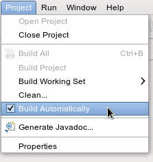
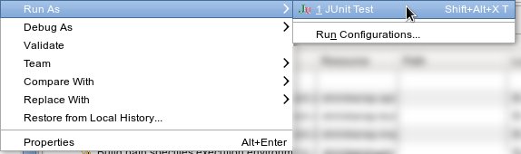

ShrinkWrap est la manière la plus simple de créer des archives en Java, et c'est le moteur du mécanisme de déploiement d'Arquillian. Ce guide sert de cours accéléré à la construction d'objets qui représenteront vos déploiements. Nous couvrirons:

* La motivation et les avantages de ShrinkWrap sur les traditionnelles archives de type fichier.
* La création d'une nouvelle archive à partir de rien.
* Les différents mécanismes pour ajouter du contenu.
* L'import d'archives existantes depuis système de fichiers.

=== Justification

Dès le début, ShrinkWrap est né du besoin de tester les déploiements Java EE plus facilement. Traditionnellement il s'agit de fichiers archives qui respectent les standards ZIP, cela demande donc l'ajout d'une étape de build pour assembler toutes les ressources d'une application. Et une étape de build cela prend du temps :

[source,output]
----
$ mvn clean install
... traces terrifiantes ...
[INFO] ------------------------------------------------------------------------
[INFO] BUILD SUCCESS
[INFO] ------------------------------------------------------------------------
[INFO] Total time: 1:13.492s
[INFO] ------------------------------------------------------------------------
----
Mais, en tant que développeurs, nous vivons dans le monde du code. Quitter cet état d'esprit pour exécuter un build est un gâchis.

Et donc nous nous sommes demandé : « Et si nous pouvions déclarer en java un objet qui représente cette archive ? »

Cela a donné naissance à une API Java analogue à l'outil «jar», un système de fichiers virtuel avec une syntaxe intuitive.

[source]
----
[source]
----
JavaArchive archive = ShrinkWrap.create(JavaArchive.class,"myarchive.jar")
   .addClasses(MyClass.class, MyOtherClass.class)
   .addResource("mystuff.properties");
----
Cela a donné naissance au fait que l'on profite des caractéristiques de compilation incrémentale de l'EDI, ce qui nous permet d'éviter le build.

Cela a donné naissance à une façon d'exécuter les tests directement depuis l'EDI.

Cela a donné naissance à ShrinkWrap.

=== Commencer

La première étape est de récupérer les binaires de ShrinkWrap.  Le coeur se compose de 3 éléments :

|===
| Nom
| Coordonnées Maven
| API
| org.jboss.shrinkwrap:shrinkwrap-api
| SPI
| org.jboss.shrinkwrap:shrinkwrap-spi
| Implementation
| org.jboss.shrinkwrap:shrinkwrap-impl-base
|===

Seule l'API devrait se trouver dans votre classpath de compilation, alors que les modules SPI et Implementation sont tous les deux nécessaires à l'exécution. Cela garantit une bonne séparation entre les classes destinées à être utilisées directement et les classes internes du projet.

Avec Maven, ces derniers peuvent être configurés facilement dans les bons scopes en utilisant le POM ShrinkWrap Dependency Chain, disponible sur Maven Central:

[source]
----
[source]
----
<project xmlns="http://maven.apache.org/POM/4.0.0"
  xmlns:xsi="http://www.w3.org/2001/XMLSchema-instance"
  xsi:schemaLocation="
  http://maven.apache.org/POM/4.0.0
  http://maven.apache.org/xsd/maven-4.0.0.xsd">
  <!-- snip -->
----
  <dependency>
    <groupId>org.jboss.shrinkwrap</groupId>
    <artifactId>shrinkwrap-depchain</artifactId>
    <version>${version.shrinkwrap}</version>
    <type>pom</type>
  </dependency>

  <!-- snip -->
</project>

Pour les projets n'utilisant pas les dépôts Maven, la distribution ShrinkWrap permet de télécharger tous les modules et vous n'avez plus qu'à configurer manuellement vos dépendances selon vos besoins.

==== Prérequis

* JRE5+ Runtime
* Aucune dépendance supplémentaire

ShrinkWrap s'exécute sur une plateforme Java5 ou supérieure, mais nécessite au moins un JDK6 pour compiler.

==== Documentation de l'API

La JavaDoc de chaque version se trouve «ici» : http://docs.jboss.org/shrinkwrap .

==== Développement Open Source

Forkez nous et participez au «développement» : http://github.com/shrinkwrap/shrinkwrap .

=== Création d'archive

Le principal point d'entrée de la bibliothèque ShrinkWrap est la classe `org.jboss.shrinkwrap.api.ShrinkWrap`. A partir de cette dernière vous pouvez appeler la méthode `create` pour faire votre nouvelle `Archive`, une vue générique du système de fichiers virtuel auquel on ajoute du contenu sous forme d' `Asset` selon le chemin `ArchivePath`. Le tableau suivant présente de manière simple la nomenclature de ShrinkWrap aux cotés de termes usuels :

|===
| Nom commun
| Class ShrinkWrap
| Description
| Archive
| @org.jboss.shrinkwrap.api.Archive@
| Un ensemble de ressources, essentiellement un système de fichiers virtuel
| File
| @org.jboss.shrinkwrap.api.Node@
| Une entrée dans une @Archive@; peut représenter un contenu ou un répertoire
| Path
| @org.jboss.shrinkwrap.api.ArchivePath@
| Chemin dans une @Archive@ où se trouve un @Node@
| Asset
| @org.jboss.shrinkwrap.api.Asset@
| Contenu binaire à l'intérieur d'un @Node@
|===

De plus, les `Archive` s peuvent avoir plusieurs représentations et dans la plupart des cas, vous ne devriez pas manipuler la classe `Archive` directement.  En effet, ShrinkWrap fournit un ensemble d'extensions à `Archive` qui facilitent la manipulation de contenus qui leur sont propres.

|===
| Archive Type
| Description
| @org.jboss.shrinkwrap.api.GenericArchive@
| Le type concret le plus simple d'une @Archive@ pour un utilisateur; supporte les opérations génériques
| @org.jboss.shrinkwrap.api.spec.JavaArchive@
| Type JAR; permet l'ajout de @Class@ es, @Package@ s et de manipuler le Manifest
| @org.jboss.shrinkwrap.api.spec.EnterpriseArchive@
| Type Java EE EAR; permet de manipuler le Manifest et supporte les opérations des spcécifications associées
| @org.jboss.shrinkwrap.api.spec.WebArchive@
| Type Java EE WAR; permet d'effectuer les opérations de déploiement propres à une application web
| @org.jboss.shrinkwrap.api.spec.ResourceAdaptorArchive@
| Type Java EE RAR; permet d'effectuer les opérations de déploiement propres à un resource adaptor
|===

Pour créer une `Archive`, choisissez simplement le type désiré et optionnellement, donnez lui un nom via la méthode static `ShrinkWrap:create`:

[source]
----
GenericArchive monArchive = ShrinkWrap.create(GenericArchive.class,"monArchive.jar");
----
Ça y est !  Vous avez votre première archive Shrinkwrap !

=== Ajout de contenu

Bien sûr, un objet représentant une archive vide n'est pas très utile.  Regardons donc comment y ajouter du contenu.  Comme nous l'avons dit précédemment, le contenu est modélisé au travers de la classe `Asset` , aussi intéressons nous aux implémentations d' `Asset` fournies par ShrinkWrap:

|===
| Asset
| Représente
| @org.jboss.shrinkwrap.api.asset.ArchiveAsset@
| Un contenu de type @Archive@
| @org.jboss.shrinkwrap.api.asset.ByteArrayAsset@
| Un @byte[]@ ou un @InputStream@
| @org.jboss.shrinkwrap.api.asset.ClassAsset@
| Un contenu de type Java @Class@
| @org.jboss.shrinkwrap.api.asset.ClassLoaderAsset@
| Une ressource qui peut être chargée par un @ClassLoader@ optionnel
| @org.jboss.shrinkwrap.api.asset.FileAsset@
| Un contenu de type @File@
| @org.jboss.shrinkwrap.api.asset.StringAsset@
| Un contenu de type @String@
| @org.jboss.shrinkwrap.api.asset.UrlAsset@
| Un contenu qui se trouve à une certaine @URL@
| @org.jboss.shrinkwrap.api.asset.EmptyAsset@
| Un contenu vide (0-byte)
|===

De plus, comme `Asset` est une interface, vous pouvez écrire votre propre implémentation pour fournir n'importe quel contenu binaire qui peut être représenté sous la forme d'un `InputStream` .  Par exemple, le bloc de code ci-desous montre comment fournir une `DataSource` Activation Framework sous la forme d'un `Asset` :

[source]
----
final DataSource dataSource = null; // Supposons qu'elle existe
Asset asset = new Asset() {
  @Override
  public InputStream openStream() {
    try {
      return dataSource.getInputStream();
    } catch (final IOException e) {
      throw new RuntimeException(e);
    }
  }
};
----
La méthode `Archive:add` permet de fournir un contenu sous forme d' `Asset` et de l'ajouter selon un `ArchivePath`.

[source]
----
myArchive.add(myAsset,"path/to/content");
System.out.println(myArchive.toString(true));
----
Passer le mode verbeux à `true` dans la méthode `toString` de `Archive` crée l'équivalent de la commande `"ls -l"` récursive ce qui donne comme sortie :

[source,output]
----
myArchive.jar:
/path/
/path/to/
/path/to/content
----
Les différentes formes d' `Archive` que nous avons vues précédemment sont aussi très pratiques selon le type de contenu que vous manipulez. Par exemple, un fichier JAR standard contient en général des fichiers `.class` et d'autres ressources, et donc le type `JavaArchive` vous permet de les ajouter.

ShrinkWrap possède un mécanisme simple afin de vous permettre de basculer entre les différents "vues" de votre archive, cela se fait au travers de la méthode `as` de l'interface `org.jboss.shrinkwrap.api.Assignable`; chaque vue, à son tour, étend `Assignable`. Donc pour que vous puissiez utiliser la vue `JavaArchive` pour votre archive afin de pouvoir facilement y ajouter des `Class`, vous pourriez simplement écrire :

[source]
----
myArchive.as(JavaArchive.class).addClasses(String.class, Integer.class);
System.out.println(myArchive.toString(true));
----
[source,output]
----
archive.jar:
/java/
/java/lang/
/java/lang/String.class
/java/lang/Integer.class
----
L'utilisation de ce mécanisme est central pour rendre l'usage de ShrinkWrap propre et intuitif, tout en ayant une versatilité propre aux langages à héritage multiple.

=== Travailler avec des fichiers

Bien que ShrinkWrap ait ses racines dans le monde Java EE et qu'il soit étroitement lié à la plateforme de test Arquillian, il n'est pas limité à ces domaines.  En effet, ShrinkWrap est intentionnellement limité à ne fournir qu'un système de fichier virtuel pour les archives.  Et en tant que tel, il fournit un mécanisme simple pour manipuler proprement des structures de fichiers à plat.

Reprenons notre exemple précédent, nous souhaiterions utiliser ShrinkWrap pour assembler tous les fichiers `.class` dans le package courant et les sortir sous la forme d'un JAR standard au format ZIP.  Le code en question serait en effet très simple :

[source]
----
JavaArchive archive = ShrinkWrap
  .create(JavaArchive.class,"myPackage.jar")
  .addPackage(this.getClass().getPackage());
System.out.println(archive.toString(true));
archive.as(ZipExporter.class)
  .exportTo(new File("/home/alr/Desktop/myPackage.jar"), true);
----
[source,output]
----
myPackage.jar:
/org/
/org/alr/
/org/alr/test/
/org/alr/test/TestClass.class
----
Regardons donc ce qu'il se passe.  Premièrement nous créons une `JavaArchive` à laquelle nous ajoutons tous le contenu du `Package` de la `Class` . Puis nous sortons le résultat sur la console afin de voir ce qu'il contient. Dans la dernière ligne, nous utilisons de nouveau les possibilités `Assignable` de la vue `JavaArchive` pour obtenir une nouvelle vue : une vue capable d'exporter au format ZIP.  Dans ce cas nous utilisons la classe fort bien nommée `ZipExporter`, ce qui nous permet d'exporter vers un `File`, un `OutputStream`, ou même de proposer l'ensemble du contenu sous la forme d'un `InputStream` pour que nous puissions nous même manipuler les octets.

Il existe 3 types d'exports livrés avec ShrinkWrap:

|===
| Exporter
| Format de sortie
| @org.jboss.shrinkwrap.api.exporter.TarExporter@
| TAR
| @org.jboss.shrinkwrap.api.exporter.TarGzExporter@
| TAR.GZ
| @org.jboss.shrinkwrap.api.exporter.ZipExporter@
| ZIP
|===

Bien sûr, nous pouvons aussi obtenir une archive ShrinkWrap à partir d'un fichier plat de la même manière en utilisant les outils standard d'import :

|===
| Importer
| Format d'entrée
| @org.jboss.shrinkwrap.api.importer.TarImporter@
| TAR
| @org.jboss.shrinkwrap.api.importer.TarGzImporter@
| TAR.GZ
| @org.jboss.shrinkwrap.api.importer.ZipImporter@
| ZIP
|===

Le code pour exécuter un import faisant le pendant à l'exemple précédent pourrait ressembler à celui-ci :

[source]
----
JavaArchive roundtrip = ShrinkWrap
  .create(ZipImporter.class, "myPackageRoundtrip.jar")
  .importFrom(new File("/home/alr/Desktop/myPackage.jar"))
  .as(JavaArchive.class);
----
Remarquez comment nous avons passé le `ZipImporter` à la méthode `ShrinkWrap.create`, car c'est un `Assignable` lui aussi ! Vous commencez à connaître la musique, non ?

C'est ainsi que se termine notre brève introduction à la manipulation d'archives avec ShrinkWrap.  Nous espèrons que vous trouverez l'API intuitive et cohérente et nous vous souhaitons la bienvenue dans la communauté.
