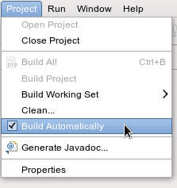
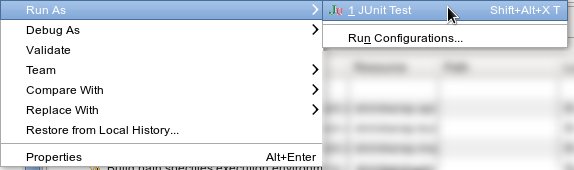

= Creating Deployable Archives with ShrinkWrap
:sectids!:

ShrinkWrapは、Javaでアーカイブを作成する、もっとも簡単な方法で、Arquillianのデプロイメントメカニズムに力を与えます。このガイドでは、デプロイメントを表すことになるオブジェクト作成の速習コースを提供します。以下を含みます：

* 伝統的なファイルベースのアーカイブを越えた、ShrinkWrapの背後にある動機と利益
* スクラッチからの新しいアーカイブ作成
* コンテンツを追加するための様々なメカニズム
* 既存のファイル構成からアーカイブをインポートする

[discrete,id="理由"]
=== 理由

当初、ShrinkWrapは、Javaエンタープライズデプロイメントをより簡単にテストするために生まれました。ZIPの標準に従ったフラットファイルのアーカイブという伝統的な定義は、アプリケーションリソースをすべてまとめるビルドの手順で必要とされてきました。そしてビルドステップは時間を要します：

[listing,role=output,subs=verbatim]
----
[alr@alr-laptop shrinkwrap]$ mvn clean install
... terrifying output trace ...
[INFO] ------------------------------------------------------------------------
[INFO] BUILD SUCCESS
[INFO] ------------------------------------------------------------------------
[INFO] Total time: 1:13.492s
[INFO] ------------------------------------------------------------------------
----

しかしデベロッパーとして、私達はコーディング環境で生活しています。マインドセットをビルド実行に切り替えるのは無駄です。

それで、問いかけました：“Javaにおいて、オブジェクトをアーカイブとして表せたらどうなる？”

その結果は、“jar”ツールに似た、Java APIで、直感的な書式を持つ仮想的なファイルシステムでした。

[.filename]
ShrinkWrapアーカイブを作成する

[listing,role=prettify,subs=verbatim]
----
JavaArchive archive = ShrinkWrap.create(JavaArchive.class,"myarchive.jar") 
   .addClasses(MyClass.class, MyOtherClass.class)
   .addResource("mystuff.properties");
----

その結果は、IDEの継続的なコンパイル機能の利点を享受するための方法で、ビルドをスキップできます。

その結果は、テストをIDEから直接実行するやり方でした。

その結果は、ShrinkWrapでした。

[discrete,id="スタート"]
=== スタート

最初のステップは、ShrinkWrapのバイナリを入手することです。コアは3つのピースからなります：

[cols=",",options="header",]
|===
|名称 |Mavenコーディネート
|API |org.jboss.shrinkwrap:shrinkwrap-api
|SPI |org.jboss.shrinkwrap:shrinkwrap-spi
|Implementation |org.jboss.shrinkwrap:shrinkwrap-impl-base
|===

APIは、コンパイル時のクラスパスでのみ、利用できるべきで、SPIと実装モジュールは、実行時に必要です。これは、直接使用することを目的としたクラスと、プロジェクト内部で使用することを目的としたクラスの良好な分離を強制するためです。

Mavenでは、ShrinkWrap依存チェーンPOMを利用することで簡単に適切なスコープの元で、利用できます。これは、Maven Centralで入手できます：

[.filename]
ユーザーのプロジェクトのpom.xml

[listing,role=prettify,subs=verbatim]
----
<project xmlns="http://maven.apache.org/POM/4.0.0"
  xmlns:xsi="http://www.w3.org/2001/XMLSchema-instance"
  xsi:schemaLocation="
  http://maven.apache.org/POM/4.0.0
  http://maven.apache.org/xsd/maven-4.0.0.xsd">
  <!-- snip -->
  
  <dependency>
    <groupId>org.jboss.shrinkwrap</groupId>
    <artifactId>shrinkwrap-depchain</artifactId>
    <version>${version.shrinkwrap}</version>
    <type>pom</type>
  </dependency>

  <!-- snip -->
</project>
----

Mavenリポジトリシステムを使用しないプロジェクトのためにShrinkWrapディストリビューションでは、すべてのモジュールをダウンロードできるようになっていて、ユーザーは必要に応じて手動で依存性を設定できます。

[discrete]
==== 必須条件

* JRE5以上のランタイム
* 他の依存性は無し

ShrinkWrapはJava5以上のランタイムであれば実行できますが、コンパイルには少なくともJDK6が必要です。

[discrete]
==== APIドキュメント

各リリースのJavaDocは、 http://docs.jboss.org/shrinkwrap[ここ] にあります。

[discrete]
==== オープンソースコーディング

フォークして http://github.com/shrinkwrap/shrinkwrap[開発] に参加してください。

[discrete,id="アーカイブの作成"]
=== アーカイブの作成

ShrinkWrapライブラリの最初の入り口は、 ``+org.jboss.shrinkwrap.api.ShrinkWrap+`` クラスです。ここから、新しい ``+Archive+`` を作るために、 ``+create+`` メソッドを呼べます。 ``+Archive+`` はアセットと呼ばれるコンテンツをArchivePathと呼ばれる場所への追加を許可する仮想ファイル・システムについての一般的なビューです。以下の表では、ShrinkWrapの用語とより一般的な用語を、より簡単に示します：

[cols=",,",options="header",]
|===
|一般用語 |ShrinkWrapクラス |定義
|アーカイブ |``+org.jboss.shrinkwrap.api.Archive+`` |リソースのコレクション。本質的には、仮想ファイルシステム
|ファイル |``+org.jboss.shrinkwrap.api.Node+`` |``+Archive+`` に登録されたもの。コンテンツまたはディレクトリ
|パス |``+org.jboss.shrinkwrap.api.ArchivePath+`` |``+Archive+`` 内で、 ``+Node+`` がある場所
|アセット |``+org.jboss.shrinkwrap.api.Asset+`` |``+Node+`` 内のバイトベースのコンテンツ
|===

これに加えて、 ``+Archive+`` にはたくさんのビューがあります。そして、一般的には、 ``+Archive+`` クラスを直接扱うのは好まれません。その代わり、ShrinkWrapは、それらのタイプに応じてコンテンツを操作する便利な方法である、いくつかの ``+Archive+`` 拡張を提供しています。

[cols=",",options="header",]
|===
|アーカイブタイプ |定義
|``+org.jboss.shrinkwrap.api.GenericArchive+`` |もっとも簡単な ``+Archive+`` の具象的なユーザービューの型です。一般的な操作をサポートします。
|``+org.jboss.shrinkwrap.api.spec.JavaArchive+`` |JAR型で、 ``+Class+`` や ``+Package+`` の追加やマニフェストの操作が許可されています。
|``+org.jboss.shrinkwrap.api.spec.EnterpriseArchive+`` |Java EE EAR型で、マニフェストと関連する規格の操作をサポートします。
|``+org.jboss.shrinkwrap.api.spec.WebArchive+`` |Java EE WAR型で、ウェブアプリケーションのデプロイメントに一般的な操作をサポートします。
|``+org.jboss.shrinkwrap.api.spec.ResourceAdaptorArchive+`` |Java EE RAR型で、リソースアダプタのデプロイメントに一般的な操作をサポートします。
|===

``+Archive+`` を作成するには、シンプルに ``+ShrinkWrap:create+`` スタティックメソッドに必要なアーカイブ型と、オプションで名前を渡します：

[listing,role=prettify,subs=verbatim]
----
GenericArchive myArchive = ShrinkWrap.create(GenericArchive.class,"myArchive.jar");
----

これだけです！最初のShrinkWrapアーカイブができました！

[discrete,id="コンテンツの追加"]
=== コンテンツの追加

もちろん、空のアーカイブとしてのオブジェクトはほとんど無意味です。それでは、コンテンツの追加を見てみましょう。前述のように、コンテンツは、 ``+Asset+`` クラスとしてモデル化されているので、最初にShrinkWrapが提供している ``+Asset+`` 実装を調べてみましょう：

[cols=",",options="header",]
|===
|アセット |表すもの
|``+org.jboss.shrinkwrap.api.asset.ArchiveAsset+`` |ネストした ``+Archive+`` コンテンツ
|``+org.jboss.shrinkwrap.api.asset.ByteArrayAsset+`` |``+byte[]+`` または ``+InputStream+`` コンテンツ
|``+org.jboss.shrinkwrap.api.asset.ClassAsset+`` |Java ``+Class+`` コンテンツ
|``+org.jboss.shrinkwrap.api.asset.ClassLoaderAsset+`` |オプションで設定された ``+ClassLoader+`` でロードされるリソース
|``+org.jboss.shrinkwrap.api.asset.FileAsset+`` |``+File+`` コンテンツ
|``+org.jboss.shrinkwrap.api.asset.StringAsset+`` |``+String+`` コンテンツ
|``+org.jboss.shrinkwrap.api.asset.UrlAsset+`` |与えられた ``+URL+`` によって指し示されるコンテンツ
|``+org.jboss.shrinkwrap.api.asset.EmptyAsset+`` |空(0バイト)のコンテンツ
|===

これに加えて、 ``+Asset+`` はインターフェースなので、ユーザーが ``+InputStream+`` として表せるバイトベースとのコンテンツを追加するための、独自の実装を提供できます。例えば、以下のスニペットは、 ``+DataSource+`` のアクティベーションフレームワークをどのようにを ``+Asset+`` として提供できるか、示します：

[listing,role=prettify,subs=verbatim]
----
final DataSource dataSource = null; // すでにこれは持っていると仮定します
  Asset asset = new Asset() {
  @Override
  public InputStream openStream() {
    try {
      return dataSource.getInputStream();
    } catch (final IOException e) {
      throw new RuntimeException(e);
    }
  }
};
----

``+Archive:add+`` メソッドを使うと、 ``+Asset+`` コンテンツを渡して、 ``+ArchivePath+`` 以下に追加することができます。

[listing,role=prettify,subs=verbatim]
----
myArchive.add(myAsset,"path/to/content");
System.out.println(myArchive.toString(true));
----

``+true+`` 冗長化フラグを ``+Archive+`` の ``+toString+`` メソッドに渡すと、再帰的に ``+"ls -l"+`` スタイルで出力します：

[listing,role=output,subs=verbatim]
----
myArchive.jar:
/path/
/path/to/
/path/to/content
----

また、以前に触れた ``+Archive+`` ビューは、ユーザーが利用しているコンテンツの種類に応じて、とても有用です。たとえば、標準のJARファイルは、通常、 ``+.class+`` ファイルや他のリソースが含まれており、JavaArchiveタイプは、これらを追加することができるように。

ShrinkWrapは、アーカイブのビューを変更する単純なメカニズムをサポートし、それは ``+org.jboss.shrinkwrap.api.Assignable+`` インターフェースの ``+as+`` メソッドとして提供されます。 それぞれのビューは、 ``+Assignable+`` を継承しています。それで、簡単に ``+Class+`` リソースを追加するために、アーカイブを ``+JavaArchive+`` として使うためには、単純に以下のようにできます：

[listing,role=prettify,subs=verbatim]
----
myArchive.as(JavaArchive.class).addClasses(String.class, Integer.class);
System.out.println(myArchive.toString(true));
----

[listing,role=output,subs=verbatim]
----
archive.jar:
/java/
/java/lang/
/java/lang/String.class
/java/lang/Integer.class
----

このメカニズムを使うことは、一般的に真の多重継承言語に見られる多様性を提供しながら、ShrinkWrapの使い方をクリーンで直感的な状態のまま保つための核心部です。

[discrete,id="ファイルコンテンツを扱う"]
=== ファイルコンテンツを扱う

ShrinkWrapはそのルーツをJava EEに持ち、Arquillianテストプラットフォームと強く結びついているものの、これらのドメインには確実に限定されていません。実際、ShrinkWrapは意図的にアーカイブ用の仮想ファイルシステムを越えません。そのように、それはフラットファイル構成でうまく遊べる、単純なメカニズムを提供します。

上のサンプルから借りてくると、おそらくShrinkWrapには現在のパッケージのすべての ``+.class+`` ファイルをまとめて、ZIPフォーマットの標準的なJARとして出力してもらいたいでしょう。そのためのコードは実際にはとても簡単です：

[listing,role=prettify,subs=verbatim]
----
JavaArchive archive = ShrinkWrap.create(JavaArchive.class,
  "myPackage.jar").addPackage(this.getClass().getPackage());
  System.out.println(archive.toString(true));
  archive.as(ZipExporter.class).exportTo(
    new File("/home/alr/Desktop/myPackage.jar"), true);
----

[listing,role=output,subs=verbatim]
----
javalang.jar:
/org/
/org/alr/
/org/alr/test/
/org/alr/test/TestClass.class
----

ここで何が起きているのか見てみましょう。初めに、 ``+JavaArchive+`` を作成し、現在の ``+Class+`` が属する ``+Package+`` のすべてのコンテンツを加えます。それからなにが含まれているかちょっと見るために、コンソールに出力をダンプします。最後の行で、新しいビュー、一つの出力可能な形式であるZIPフォーマット、を得るために、また ``+JavaArchive+`` ビューの ``+Assignable+`` ファシリティを使います。今回は、 ``+ZipExporter+`` という名前のものを使います。これは、 ``+File+`` や ``+OutputStream+`` として出力したり、あるいはコンテンツを ``+InputStream+`` として受け取り、それ自身をバイト列として操作することもできます。

3種類のエクスポーターがShrinkWrapには含まれています：

[cols=",",options="header",]
|===
|エクスポーター |出力フォーマット
|``+org.jboss.shrinkwrap.api.exporter.TarExporter+`` |TAR
|``+org.jboss.shrinkwrap.api.exporter.TarGzExporter+`` |TAR.GZ
|``+org.jboss.shrinkwrap.api.exporter.ZipExporter+`` |ZIP
|===

もちろん、標準のインポーターを使って同じ形式のフラットファイルから、ShrinkWrapアーカイブを得ることもできます：

[cols=",",options="header",]
|===
|インポーター |出力フォーマット
|``+org.jboss.shrinkwrap.api.importer.TarImporter+`` |TAR
|``+org.jboss.shrinkwrap.api.importer.TarGzImporter+`` |TAR.GZ
|``+org.jboss.shrinkwrap.api.importer.ZipImporter+`` |ZIP
|===

前の例の ``+JavaArchive+`` に戻すコードは、以下のようになるでしょう：

[listing,role=prettify,subs=verbatim]
----
JavaArchive roundtrip = ShrinkWrap
  .create(ZipImporter.class, "myPackageRoundtrip.jar")
  .importFrom(new File("/home/alr/Desktop/myPackage.jar"))
  .as(JavaArchive.class);
----

どのように ``+ZipImporter+`` を ``+ShrinkWrap.create+`` に渡すかという点が、 ``+Assignable+`` と同様であることに注意してください！ここのテーマに気づき始めましたか？

これで、シュリンクラップでアーカイブの内容を操作する、簡単な紹介を終わります。APIが直感的で一貫性があるとユーザーが判断してくれることを期待し、我々のコミュニティに歓迎します。
