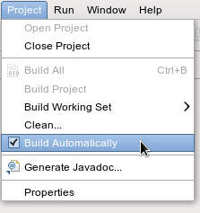
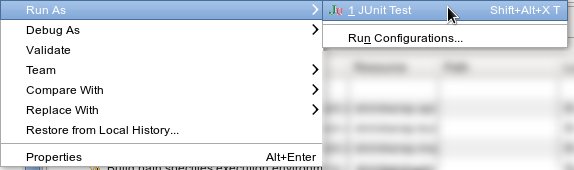

ShrinkWrap pozwala w prosty sposób tworzyć archiwa w Javie. Wspomaga także mechanizm deploymentów Arquilliana. Ten poradnik opisuje pierwszy kontakt z tworzeniem obiektów, które będą reprezentować Twoje deploymenty. Przedstawiamy:

* Motywację i zalety stosowania ShrinkWrapa w porównaniu do tradycyjnych mechanizmów opartych na plikach
* Tworzenie nowego archiwum od zera
* Różne metody dodawania zawartości
* Mechanizm importowania archiwów z istniejących struktur plikowych

=== Motywacja

ShrinkWrap został stworzony aby ułatwić testowania deploymentów Java EE. Archiwum tradycyjnie zdefiniowane jako plik związany ze standardem ZIP wymaga wykonania pewnych etapów budowania w celu spakowania wszystkich zasobów aplikacji. Każde budowanie jest długim procesem:

[source,output]
----
$ mvn clean install
... terrifying output trace ...
[INFO] ------------------------------------------------------------------------
[INFO] BUILD SUCCESS
[INFO] ------------------------------------------------------------------------
[INFO] Total time: 1:13.492s
[INFO] ------------------------------------------------------------------------
----
Jako developerzy żyjemy w naszych środowiskach programistycznych. Przełączanie się z nich by uruchomić budowanie jest marnotrawstwem.

Dlatego zapytaliśmy: "Co, gdybyśmy mogli zadeklarować w języku Java obiekt reprezentujący archiwum?"

W odpowiedzi otrzymaliśmy API w języku Java, analogiczne do narzędzia "jar", reprezentujące wirtualny system plików z intuicyjną składnią.

[source]
----
[source]
----
JavaArchive archive = ShrinkWrap.create(JavaArchive.class,"myarchive.jar")
   .addClasses(MyClass.class, MyOtherClass.class)
   .addResource("mystuff.properties");
----
Dzięki temu podejściu mogliśmy wykorzystać przyrostową kompilację stosowaną przez większość środowisk programistycznych i pominąć proces budowania całej aplikacji.

Możemy zatem uruchamiać nasze testy bezpośrednio z IDE.

I tak właśnie powstał ShrinkWrap.

=== Pierwsze kroki

Pierwszym krokiem jest pozyskanie plików binarnych ShrinkWrapa. Główny komponent składa się z trzech części:

|===
| Nazwa
| Koordynaty Maven'a
| API
| org.jboss.shrinkwrap:shrinkwrap-api
| SPI
| org.jboss.shrinkwrap:shrinkwrap-spi
| Implementation
| org.jboss.shrinkwrap:shrinkwrap-impl-base
|===

Tylko API powinno być dostępne na ClassPath na etapie kompilacji, podczas gdy moduły SPI (Service Provider Interface) i implementacja (Implementation) są wymagane w trakcie runtime'u. Jest to niezbędne do zagwarantowania właściwej separacji między klasami służącymi do bezpośredniego użycia i wewnętrzną implementacją projektu.

Jeśli korzystasz z mavena, możesz osiągnąć to w prosty sposób korzystając ze Shrinkwrap Dependency Chain POM dostępnego w repozytorium Maven Central .

[source]
----
[source]
----
<project xmlns="http://maven.apache.org/POM/4.0.0"
  xmlns:xsi="http://www.w3.org/2001/XMLSchema-instance"
  xsi:schemaLocation="
  http://maven.apache.org/POM/4.0.0
  http://maven.apache.org/xsd/maven-4.0.0.xsd">
  <!-- snip -->
----
  <dependency>
    <groupId>org.jboss.shrinkwrap</groupId>
    <artifactId>shrinkwrap-depchain</artifactId>
    <version>${version.shrinkwrap}</version>
    <type>pom</type>
  </dependency>

  <!-- snip -->
</project>

Dla projektów nie używających repozytoriów Maven'owych, wszystkie moduły Dystrybucji ShrinkWrapa są dostępne do pobrania. Można je skonfigurować manualnie dla własnych potrzeb.

==== Wymagania

* Środowisko JRE5+
* Brak dodatkowych zależności

ShrinkWrap może być uruchomiony w środowisku Java 5 lub wyższym, ale wymaga przynajmniej JDK6 do kompilacji.

==== Dokumentacja API

JavaDoc dla każdego wydania można znaleźć link:http://docs.jboss.org/shrinkwrap[tutaj] .

==== Open Source Coding

Sklonuj projekt i zaangażuj się w jego link:http://github.com/shrinkwrap/shrinkwrap[rozwój] .

=== Tworzenie Archiwów

Kluczowym elementem biblioteki ShrinkWrap jest klasa `org.jboss.shrinkwrap.api.ShrinkWrap`. Stąd możesz wywołać metodę `create` w celu utworzenia nowego archiwum `Archive`. Jest to abstrakcja reprezentująca wirtualny systemu plików, która pozwala na dodawanie zawartości nazywanej `Asset` do lokalizacji nazywanej `ArchivePath`. Poniższa tabela w prostszy sposób przedstawia nomenklaturę dla podstawowych terminów:

|===
| Podstawowy termin
| Klasa ShrinkWrap
| Opis
| Archive
| @org.jboss.shrinkwrap.api.Archive@
| Kolekcja zasobów, wirtualny system plików
| File
| @org.jboss.shrinkwrap.api.Node@
| Wpis w archiwum @Archive@; może prezentować zawartość lub folder
| Path
| @org.jboss.shrinkwrap.api.ArchivePath@
| Lokalizacja w archiwum @Archive@ pod którą znajduje się wierzchołek @Node@
| Asset
| @org.jboss.shrinkwrap.api.Asset@
| Zawartość binarna w wierzchołku @Node@
|===

Dodatkowo archiwum `Archive` może mieć wiele specjalizacji, więc zwykle nie będziesz korzystał bezpośrednio z klasy `Archive`. Zamiast tego, ShrinkWrap dostarcza kilka rozszerzeń `Archive` które oferują pomocne metody do manipulowania zawartością zależną od ich typu.

|===
| Typ Archiwum
| Opis
| @org.jboss.shrinkwrap.api.GenericArchive@
| Najprostsza reprezentacja archiwum @Archive@; dostarcza podstawowe operacje
| @org.jboss.shrinkwrap.api.spec.JavaArchive@
| Archiwum JAR; pozwala na dodawanie klas @Class@, pakietów @Package@, i operacje związane z  Manifestami
| @org.jboss.shrinkwrap.api.spec.EnterpriseArchive@
| Archiwum Java EE EAR; wspiera operacje na Manifestach oraz związane specyficzne operacje
| @org.jboss.shrinkwrap.api.spec.WebArchive@
| Archiwum Java EE WAR; wspiera operacje powszechne dla deploymentów aplikacji webowych
| @org.jboss.shrinkwrap.api.spec.ResourceAdaptorArchive@
| Archiwum Java EE RAR; wspiera operacje powszechne dla deploymentów adapterów zasobów (resource adaptor)
|===

Aby utworzyć archiwum `Archive`, wybierz docelowy typ archiwum i opcjonalnie podaj jego nazwę w statycznej metodzie `ShrinkWrap:create`:

[source]
----
GenericArchive myArchive = ShrinkWrap.create(GenericArchive.class,"myArchive.jar");
----
Tyle wystarczy! Utworzyłeś swoje pierwsze archiwum ShrinkWrapa!

=== Dodawanie zawartości

Oczywiście obiekt reprezentujący puste archiwum jest raczej bezużyteczny. Dlatego zwróćmy uwagę na dodawanie zawartości. Jak zauważyliśmy wcześniej zawartość jest modelowana za pomocą klasy `Asset`. Dlatego wpierw zwróćmy uwagę na kilka implementacji `Asset` dostarczanych przez ShrinkWrapa:

|===
| Asset
| Reprezentacja
| @org.jboss.shrinkwrap.api.asset.ArchiveAsset@
| Zagnieżdzone archiwum @Archive@
| @org.jboss.shrinkwrap.api.asset.ByteArrayAsset@
| Tablica bajtów @byte[]@ lub strumień @InputStream@
| @org.jboss.shrinkwrap.api.asset.ClassAsset@
| Klasa @Class@ Javowa
| @org.jboss.shrinkwrap.api.asset.ClassLoaderAsset@
| Zasób który może zostać załadowany przez opcjonalnie wyspecyfikowany @ClassLoader@
| @org.jboss.shrinkwrap.api.asset.FileAsset@
| Zawartość plikowa @File@
| @org.jboss.shrinkwrap.api.asset.StringAsset@
| Zawartość będąca @String@'em
| @org.jboss.shrinkwrap.api.asset.UrlAsset@
| Zawartość zlokalizowana pod danym @URL@'em
| @org.jboss.shrinkwrap.api.asset.EmptyAsset@
| Pusta (0-bajtów) zawartość
|===

Dodatkowo, ponieważ `Asset` jest interfejsem, możesz stworzyć swoją własną implementację dostarczającą dowolną binarną zawartość, która może zostać zaprezentowana jako strumień `InputStream`. Przykładowo fragment kodu poniżej prezentuje `DataSource` jako `Asset`:

[source]
----
final DataSource dataSource = null; // Przyjmijmy, że to masz
  Asset asset = new Asset() {
  @Override
  public InputStream openStream() {
    try {
      return dataSource.getInputStream();
    } catch (final IOException e) {
      throw new RuntimeException(e);
    }
  }
};
----
Metoda `Archive:add` pozwala nam wzbogacić archiwum o zawartość (reprezentowaną przez `Asset`) i dołączyć ją pod daną ścieżką `ArchivePath`.

[source]
----
myArchive.add(myAsset,"path/to/content");
System.out.println(myArchive.toString(true));
----
Przekazanie flagi verbosity `true` do metody `toString` klasy `Archive` tworzy rekursywne reprezentacje w stylu `"ls -l"`:

[source,output]
----
myArchive.jar:
/path/
/path/to/
/path/to/content
----
Widoki archiwum `Archive` które przed chwilą opisaliśmy są bardzo pomocne, polegając na typie z którym pracujesz. Na przykład standardowy plik JAR zwykle zawiera pliki `.class` i inne zasoby, więc `JavaArchive` pozwala dodawać te typy.

ShrinkWrap wspiera prosty mechanizm pozwalający na przełączanie "widoków" Twojego archiwum i jest dostarczany przez metodę `as` interfejsu `org.jboss.shrinkwrap.api.Assignable`; każdy widok rozszerza `Assignable`. W celu sprawienia, aby Twoje archiwum używało specjalizacji `JavaArchive` by móc prosto dodawać zasoby `Class`, wystarczy:

[source]
----
myArchive.as(JavaArchive.class).addClasses(String.class, Integer.class);
System.out.println(myArchive.toString(true));
----
[source,output]
----
archive.jar:
/java/
/java/lang/
/java/lang/String.class
/java/lang/Integer.class
----
Mechanizm ten jest kluczowym elementem, sprawiającym, że korzystanie ze ShrinkWrapa jest proste i intuicyjne. Oferuje on także wszechstronność znaną z języków wspierających dziedziecznie wielokrotne.

=== Praca z zawartością plikową

Shrinkwrap wywodzi się z kręgu technologii Java EE i jest bardzo blisko związany z Arquillianem. Nie jest oczywiście ograniczony do tych obszarów. W rzeczywistości ShrinkWrap idzie dalej, zachowując się jak wirtualny system plików dla archiwów. Dostarcza mechanizmy pozwalające na proste operowanie na strukturach plikowych.

Zapożyczając z powyższego przykładu, chcemy użyć ShrinkWrapa do spakowania wszystkich plików `.class` w aktualnym pakiecie i utworzyć z nich standardowy JAR w formacie ZIP. Kod pozwalający na to jest dosyć prosty:

[source]
----
JavaArchive archive = ShrinkWrap.create(JavaArchive.class,
  "myPackage.jar").addPackage(this.getClass().getPackage());
  System.out.println(archive.toString(true));
  archive.as(ZipExporter.class).exportTo(
    new File("/home/alr/Desktop/myPackage.jar"), true);
----
[source,output]
----
javalang.jar:
/org/
/org/alr/
/org/alr/test/
/org/alr/test/TestClass.class
----
Przyjrzyjmy się co dokladnie ten kod robi. Po pierwsze utworzyliśmy `JavaArchive` do którego dodaliśmy zawartość
pakietu `Package` aktualnej klasy `Class`. Następnie wypisaliśmy zawartość. W ostatniej linii ponownie używamy ułatwień widoku `JavaArchive` by otrzymać nowy widok: potrafiący eksportować do formatu ZIP. W tym wypadku używamy odpowiednio nazwanej klasy `ZipExpoerter`, pozwalającej eksportować do pliku `File`, strumienia `OutputStream`, lub nawet pobrać zawartość strumienia jako `InputStream` by móc samemu obsłużyć zawartość binarną.

Są 3 typy eksporterów dołączonych do ShrinkWrapa:

|===
| Eksporter
| Format wyjściowy
| @org.jboss.shrinkwrap.api.exporter.TarExporter@
| TAR
| @org.jboss.shrinkwrap.api.exporter.TarGzExporter@
| TAR.GZ
| @org.jboss.shrinkwrap.api.exporter.ZipExporter@
| ZIP
|===

Oczywiście, możemy uzyskać archiwum ShrinkWrapa z pliku używając w podobny sposób używając jednego ze standardowych importerów:

|===
| Importer
| Format wyjściowy
| @org.jboss.shrinkwrap.api.importer.TarImporter@
| TAR
| @org.jboss.shrinkwrap.api.importer.TarGzImporter@
| TAR.GZ
| @org.jboss.shrinkwrap.api.importer.ZipImporter@
| ZIP
|===

Kod do uruchomienia importu może wyglądać następująco:

[source]
----
JavaArchive roundtrip = ShrinkWrap
  .create(ZipImporter.class, "myPackageRoundtrip.jar")
  .importFrom(new File("/home/alr/Desktop/myPackage.jar"))
  .as(JavaArchive.class);
----
Zauważ jak możemy przekazać `ZipImporter` do metody `ShrinkWrap.create`, ponieważ implementuje również `Assignable`! Zaczynasz widzieć schemat?

To podsumowuje nasz krótki wstęp do zarządzania zawartością archiwów z użyciem ShrinkWrapa. Mamy nadzieję, że odnajdziesz to API intuicyjne i przejrzyste. Witamy w naszej społeczności!
