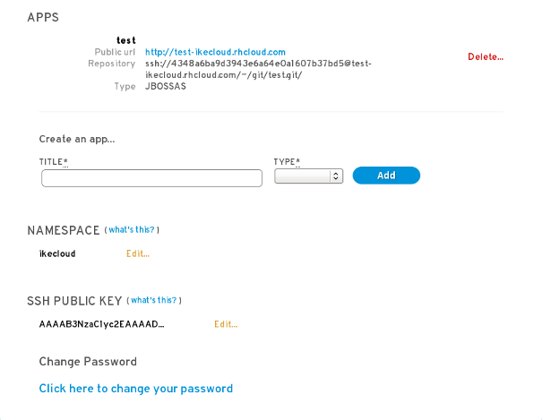

= Testing in the Cloud
:sectids!:

This guide introduces you to the Arquillian OpenShift Container. After reading this guide, you’ll be able to:

* Create an account on OpenShift Express, the free PaaS from Red Hat.
* Configure Arquillian to use OpenShift Express
* Run your Arquillian tests in the cloud (on OpenShift Express)

[discrete,id="assumptions"]
=== Assumptions

We’ll assume that you’ve read the link:/guides/getting_started[Getting Started] guide and the link:/guides/functional_testing_using_drone[Functional Testing]. This tutorial builds on the applications you built in those tutorials.

We’ll show you how to get a free OpenShift Express account, set up an application that uses the JBoss AS 7 cartridge and run the tests in that environment.

Whenever we refer to OpenShift in this guide, we are referring specifically to OpenShift Express. OpenShift Express is free, but does not include auto-scaling, so it’s ideally suited for development.

In this guide, we’ll be using the following technologies:

* OpenShift Express
* Arquillian OpenShift Container

[discrete,id="create_an_openshift_express_account"]
=== Create an OpenShift Express Account

. Go to http://openshift.redhat.com[pass:[http://openshift.redhat.com]]
. Click on "`Sign up and try it`" button
. Fill in the form and follow the instructions in the welcome mail

[discrete,id="setup_openshift_express"]
=== Setup OpenShift Express

You can now sign-in into OpenShift with your credentials. We will be using OpenShift Express, so click on "`Express`". OpenShift Express is usually managed with client tools, but their use in this tutorial is optional as we can create an app from the OpenShift Express Web Console. Refer to the OpenShift website for additional documentation and tutorials about using OpenShift.

You need to follow these steps to create your app using the web console. Skip to the next part if you prefer to use the command line client tools.

OpenShift Express uses git over SSH to upload your application. You can use your existing SSH key, which can be found by in ~/.ssh/id++_++rsa.pub on most GNU/Linux systems by default. You can generate an SSH keypair with ssh-keygen command.

[listing,role=command,subs=verbatim]
----
$ ssh-keygen
----

The output should look like this

[listing,role=output,subs=verbatim]
----
Generating public/private rsa key pair.
Enter file in which to save the key (/home/foobar/.ssh/id_rsa):  
Created directory '/home/foobar/.ssh'.
Enter passphrase (empty for no passphrase): 
Enter same passphrase again: 
Your identification has been saved in /home/foobar/.ssh/id_rsa.
Your public key has been saved in /home/foobar/.ssh/id_rsa.pub.
The key fingerprint is:
3f:91:5e:01:ab:e8:15:b3:6c:0b:20:7e:5d:64:5a:2e foobar@example
----

You can now find your public key in the ~/.ssh/id++_++rsa.pub file.

You may now login into OpenShift and open the Express Console and follow these steps to create your first app:

. Upload Your SSH public key.
. Choose a namespace. You may have multiple apps running in your OpenShift Express account, all in one _namespace_. Our OpenShift Express applications will be available on URI in the form pass:[http://app-namespace.rhcloud.com.]
. Create an app, choose jbossas-7.0 as its type. We have chosen _test_ as its name in this example:

You can now try to go to the URL of the app in your web browser, you should see a page with the message "`Welcome to OpenShift, JBossAS7 Cartridge`". You can now skip to creating an OpenShift Express Maven profile.

[discrete,id="use_the_openshift_client_tools"]
=== Use the OpenShift Client Tools

First you have to https://openshift.redhat.com/app/express#install_client_tools[install the client tools]. Follow the OpenShift documentation for the specific instructions for Your platform.

Next you have to choose your _namespace_. This will be the namespace which will be part of the URL of all your applications. Change _ikecloud_ for your chosen namespace and _foobar@example.com_ for your login in the following command, you will be asked for your OpenShift password.

[listing,role=command,subs=verbatim]
----
$ rhc-create-domain -n ikecloud -l foobar@example.com
----

[.warning]
You might get an error if your chosen namespace has already been taken.

The _rhc-create-domain_ will create an SSH keypair and also update your ~/.openshift/express.conf file so you won’t have to specify your login on further commands.

Now you can create an application.

[listing,role=command,subs=verbatim]
----
$ rhc-create-app -a test -t jbossas-7.0
----

You should be seeing something like this:

[listing,role=output,subs=verbatim]
----
Password: 
Creating application: test
Now your new domain name is being propagated worldwide (this might take a minute)...
Warning: Permanently added 'test-ikecloud.rhcloud.com,107.22.54.121' (RSA) to the list of known hosts.
Confirming application 'test' is available:  Success!

test published:  http://test-ikecloud.rhcloud.com/
git url:  ssh://bf0e04dea4b946d89c55283a0dd4136e@test-ikecloud.rhcloud.com/~/git/test.git/
Successfully created application: test
----

The app has now been created and its sources are available via git on the "`git url`". The command has also cloned the git repository into _test_ directory in your current working directory. You can now modify your local copy and use "`git push`" to deploy the new version into the cloud. We will not do that in this tutorial, as we will just use the OpenShift Express as a test container for our existing application.

[discrete,id="create_an_openshift_express_profile"]
=== Create an OpenShift Express Profile

Add another entry to the dependency management section defining version of the Arquillian OpenShift Express container adapter.

[.filename]
pom.xml

[listing,role=prettify,subs=verbatim]
----
<!-- clip -->
<dependencyManagement>
    <dependency>
        <groupId>org.jboss.arquillian.container</groupId>
        <artifactId>arquillian-openshift-express</artifactId>
        <version>1.0.0.Alpha1</version>
        <scope>test</scope>
    </dependency>
</dependencyManagement>
<!-- clip -->
----

Next create a new profile with the id arquillian-openshift-express.

[.filename]
pom.xml

[listing,role=prettify,subs=verbatim]
----
<!-- clip -->
<profile>
    <id>arquillian-openshift-express</id>
    <dependencies>
        <dependency>
            <groupId>org.jboss.spec</groupId>
            <artifactId>jboss-javaee-6.0</artifactId>
            <version>1.0.0.Final</version>
            <type>pom</type>
            <scope>provided</scope>
        </dependency>

        <dependency>
            <groupId>org.jboss.arquillian.container</groupId>
            <artifactId>arquillian-openshift-express</artifactId>
            <scope>test</scope>
        </dependency>
    </dependencies>
</profile>
<!-- clip -->
----

Configure the arquillian.xml, enter your own values. The _sshUserName_ can be found in the _Repository_ URL in the Express Console, e.g. ssh:// *4348a6ba9d3943e6a64e0a1607b37bd5* @test-ikecloud.rhcloud.com/~/git/test.git/

[.filename]
src/test/resources/arquillian.xml

[listing,role=prettify,subs=verbatim]
----
<!-- clip -->
<container qualifier="openshift-express">
    <configuration>
        <property name="namespace">ikecloud</property>
        <property name="application">test</property>
        <property name="sshUserName">4348a6ba9d3943e6a64e0a1607b37bd5</property>
        <property name="passphrase">Password</property>
        <property name="login">foobar@example.com</property>
    </configuration>
</container>
<!-- clip -->
----

[.info]
You can also set the passphrase via SSH++_++PASSPHRASE environment variable.

You can now test in the cloud by executing the following command:

[listing,role=command,subs=verbatim]
----
$ mvn test -Parquillian-openshift-express -Darquillian.launch=openshift-express
----

We can also make the openshift-express the default container, configure the openshift-express as the active profile in Eclipse and run the test from Eclipse the same way as we did in the previous tutorial. *[.greenbar]#Green bar#*!

Hey, look, Ike is on OpenShift!
