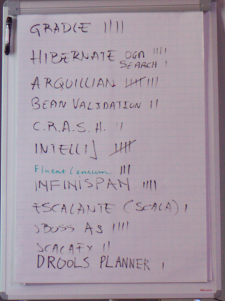

=== Kick-off

 Each project represented at Hackergarten briefly introduced itself and presented ideas to hack on. The presence of Red Hat community projects was very strong (~75%). We're happy to report that there was lots of interest in Arquillian. It received the most votes for hacking, with JBoss Forge drawing in the second most.

=== General impressions

The Hackergarten was held in open areas at the back of the pavilion. The areas gave plenty of privacy, but also gave people freedom to move around. We didn't have to experience that awkwardness of peeking through a door or the distraction of doors opening and closing. We were able to do demos in one section without affecting hacks or discussions going on in other sections because there was enough ambient noise, mostly music from the trade floor. The wired connections provided by switches at each table removed the distraction of getting on wifi, although it took a bit of time and some shuffling around in the morning to figure all that out.

Once we knew to get everyone plugged into the switches, we were off to the hacking races!

=== Pictures!

See more pictures in link:https://plus.google.com/u/0/photos/117676046064764850842/albums/5810277955405607153[Album 1] and link:https://plus.google.com/u/0/photos/117676046064764850842/albums/5810332735729924609.[Album 2]

=== Hacking Overview (related to testing)

=== Code Contributions

* link:https://github.com/papousek/arquillian-extension-fluentlenium[Arquillian Drone + FluentLenium]
** Related hack: link:https://github.com/MathildeLemee/thucydides/tree/fluentLenium[Thucydides + FluentLenium]
* link:https://github.com/aslakknutsen/arquillian-gradle-plugin[Arquillian Gradle Plugin]
* link:https://github.com/bartoszmajsak/devoxx12-ape[Arquillian Ape (persistence)] demo code
* Improvements to link:https://github.com/bartoszmajsak/arquillian-extension-transaction/commit/a4e3ee02953053d9c05b4f821279d2ad192b4753[Arquillian Transaction]
* link:https://github.com/arquillian/arquillian-container-cloudbees/commit/2c31cd22a244337babc433cf233215cd0b2f7adb[EJB injection] for link:https://github.com/arquillian/arquillian-container-cloudbees[Arquillian CloudBees adapter]
* Bootstrap API for Thucydides
* Bootstrap API for NoSQLUnit

=== Design Discussions

* Arquillian Drone + Thucydides
* Arquillian Ape + NoSQLUnit
* Drools rules, Drools decision tables and Drools planner for filtering, prioritizing and coordinating distribution of tests in a suite
* IntelliJ support for Arquillian, JBoss Forge
* Using the web browser as a "container" to incorporate JavaScript tests into a Drone test
* Juzu demo and shout out to use of Arquillian for testing
* Jersey looking into adoption of Arquillian in test suite
* Using Thucydides for CDI test suite and supporting spec documentation

=== Activity Stream (related to testing)

* At the start of the event, I suggested the hack idea to integrate Arquilliun Drone and link:https://github.com/FluentLenium/FluentLenium[FluentLenium] to link:https://github.com/papousek[Jan Papoušek]
** Jan and I introduced ourselves to link:https://github.com/MathildeLemee[Mathilde Lemee] and they got to work on the integration straight away, starting off by sharing with each other how their respective projects worked.
** By days end, they completed a link:https://github.com/papousek/arquillian-extension-fluentlenium[working integration]
** Mathilde also link:https://github.com/MathildeLemee/thucydides/tree/fluentLenium[integrated FluentLenium with Thucydides] ("2 CDs"); stay tuned because that integration and the integration with Drone may become one and the same
** In both cases, the integration with FluentLenium was so straightforward (and thus hackable) because of the nice link:https://github.com/FluentLenium/FluentLenium/blob/master/fluentlenium-core/src/main/java/org/fluentlenium/core/FluentAdapter.java[abstraction layer] Mathilde created that handled bootstrapping FluentLenium
* Aslak hacked with link:https://twitter.com/hans_d,[Hans Dockter] creator of Gradle, on a link:https://github.com/aslakknutsen/arquillian-gradle-plugin[gradle deployment plugin] that uses Arquillian Containers to handle life cycle of dozens of containers (application servers, servlet containers and beyond)
* link:http://twitter.com/majson[Bartosz Majsak] hacked on a demo for link:https://github.com/arquillian/arquillian-extension-persistence[Arquillian Ape] and link:https://github.com/bartoszmajsak/arquillian-extension-transaction/commit/a4e3ee02953053d9c05b4f821279d2ad192b4753[enhanced] link:https://github.com/arquillian/arquillian-extension-transaction[Arquillian Transaction] to work both in-container and embedded
* I spoke with two of the IntelliJ developers (Peter and Yann) about:
** a plugin for Arquillian (similar to the link:https://github.com/snjeza/arquillian-eclipse)[Eclipse Arquillian plugin]
** adding an embedded Forge shell with UI interplay (similar to the JBoss Forge view in JBoss Tools)
* I chatted with link:https://twitter.com/julienviet[Julien Viet] about:
** use of link:https://github.com/arquillian/arquillian-extension-portal[Arquillian for testing portlets] in isolation and within the portal container
** treating the web browser as a "container" to incorporate JavaScript testing into a Drone test (link:https://github.com/lfryc/arquillian-qunit,[prototype] link:https://community.jboss.org/wiki/GSoC12Ideas#Automate_JavaScript_tests_in_an_integration_environment_using_Arquillian)[proposal]
* Later in the day, Julien gave a presentation and demo of link:https://github.com/juzu/juzu,[Juzu] excited to say it's link:https://github.com/juzu/juzu/blob/master/core/src/test/java/juzu/test/AbstractWebTestCase.java[tested w/ Arquillian Core and Arquillian Drone]
* I brainstormed with link:https://github.com/ge0ffrey,[Geoffrey De Smet] lead of Drools Planner, about:
** using rules to handle the filtering decision for tests
** the role decision tables can play in declaring conditions for which tests to run
** optimizing test suite execution using Drools Planner and distributing tests over a grid
* I spoke with link:http://twitter.com/wakeleo[John Smart] about Arquillian Core and Arquillian Drone integration with link:http://thucydides.info[Thucydides]
** We discussed how much the two projects align and what it would take to integrate
** We concluded the first step is adding a bootstrap API in Thucydides, which he began to flesh out, that could be hooked to the Arquillian event model and all the integrations with individual test runners can be done once in Arquillian
** We talked about how Drone could likely provide management of WebDriver
** John Smart has been busy all week working on a bootstrap API for Thucydides (hacking on it with an ATDD approach, of course)
* link:https://github.com/koentsje[Koen Aers] gave a demonstration of the JBoss Forge integration in JBoss Tools, talked about each of elements it brings to the Forge experience in the IDE
** Koen wrote his first "Hello, World" IntelliJ plugin to get spun up and prepare to help with the integration
** IntelliJ said they would put it on their roadmap and support the effort where possible
* link:https://github.com/lordofthejars[Alex Soto] and Bartosz discussed integrating NoSQLUnit into Arquillian Ape (peristence extension)
** These projects closely align and it pushes Arquillian's definition of container management forward
** I told Marek Jelen about Alex's link:https://github.com/lordofthejars/nosql-unit/tree/master/nosqlunit-demo[NoSQLUnit demo] of testing MongoDB on OpenShift through the port forwarding setup by JBoss Tools; a blog entry may be in the works;
** Arquillian + NoSQLUnit has lots of application, one of which may be testing NoSQL backends in the Infinispan project
* link:http://twitter.com/alexishassler[Alexis Hassler] was busy improving the Arquillian adapter for CloudBees by adding link:https://github.com/arquillian/arquillian-container-cloudbees/commit/2c31cd22a244337babc433cf233215cd0b2f7adb.[EJB injection support]
* Aslak discussed with JAX-RS lead about using Arquillian for JAX-RS TCK; not likely soon, but Jersey is entertaining idea of using Arquillian to test Jersey (JAX-RS reference implementation)
* I spoke with Paul Bakker briefly about combining the link:https://github.com/forge/plugin-arquillian[Forge Arquillian plugin] and the link:https://github.com/mojavelinux/forge-plugin-arquillian-extensions[Forge Arquillian Extension plugin] into one code base
* I brainstormed with link:http://twitter.com/dblevins,[David Blevins] lead of TomEE, about the role a test suite can play in the early and in-progress development of a specification
** proposed idea of using a ATDD approach where tests could be not only marked as pending (before a ref impl is in place), but also proposed, open question and alternative
** agreed that using tests can focus the discussion about the spec, clarify ambiguities & resolve different interpretations
** John Smart gave a demo of Thucydides and we contemplated using it for the CDI test suite

=== Wrap-up

As the event wound down, I discussed with Andres Almiray, who organized the Hackergarten, about what went on during the day, whether Hackergarten accomplished his goals. He talked about the importance of giving people a chance to make a concrete contribution, give them a win to take home with them, lower perception of a barrier to contributing. I talked to him about the fact that Hackergarten is a catalyst for ideas, some of which come into play before the event, already successful and is also ongoing throughout the week, so we'll only know total impact once conference is over. Some ideas take time to soak. I can attest, we're still hacking ;)

Finally, Arquillian was invited to join the link:http://steveonjava.com/nighthacking/[Nighthacking Tour] hosted by Steven Chin on on Wednesday night, so look for that coverage when it comes online.

=== What people were tweeting...

* Bartosz Majsak (link:http://twitter.com/majson)[`majson] link:https://twitter.com/majson/status/268386503560949760:[posted] #devoxx #arquillian `aslakknutsen you have some pull requests
* Markus Eisele (link:http://twitter.com/myfear)[`myfear] link:https://twitter.com/myfear/status/268326931567628289:[posted] What could be the next cool #Arquillian feature? creative `aslakknutsen at the  #hackergarden http://twitpic.com/bcv2lv
* Alexis Hassler (link:http://twitter.com/AlexisHassler)[`AlexisHassler] link:https://twitter.com/AlexisHassler/status/268327078951264257:[posted] GREEN BAR on my #arquillian test. Cloudbees Container Adapter is getting further, thanks to `majson & @aslakknutsen
* Aslak Knutsen (link:http://twitter.com/aslakknutsen)[@aslakknutsen] link:https://twitter.com/aslakknutsen/status/268295841536700416:[posted] Hacking #Arquillian Container control plugin for #SBT & #Leiningen. #Gradle next...
* Jan Papousek (link:http://twitter.com/jan_papousek)[`jan_papousek] link:https://twitter.com/jan_papousek/status/268326970113269761:[posted] `MathildeLemee the first attempt of integration FluentLenium and Arquillian is here https://github.com/papousek/arquillian-extension-fluentlenium
* Mathilde Lemee (link:http://twitter.com/MathildeLemee)[`MathildeLemee] link:https://twitter.com/MathildeLemee/status/268293223762509825:[posted] integrating FluentLenium to Arquillian Drone with `jan_papousek
* John Smart (link:http://twitter.com/wakaleo)[`wakaleo] link:https://twitter.com/wakaleo/status/268361581530841089:[posted] Awesome concentrated hacking session with `MathildeLemee: integrating #thucydides and FluentLenium in less than 10 lines of code.
* Alex Soto (link:http://twitter.com/alexsotob)[`alexsotob] link:https://twitter.com/alexsotob/status/268474599174447104:[posted] `majson Back home ty Arquillian guys for treat me as one of your team
