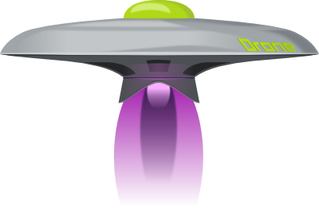

In this release, there has been added support for two cloud-based browser/mobile automated testing solutions:

<i class="icon-star"></i> BrowserStack
<i class="icon-star"></i> Sauce Labs

Both implementations have been added as additional Arquillian Drone extensions. They are not included in the arquillian-drone-webdriver-depchain, so you need to explicitly specify the dependencies (but their versions are managed by Arquillian Drone Bom):

For BrowserStack

[source]
----
<dependency>
    <groupId>org.jboss.arquillian.extension</groupId>
    <artifactId>arquillian-drone-browserstack-extension</artifactId>
    <version>2.0.0.CR1</version>
</dependency>
----
For Sauce Labs

[source]
----
<dependency>
    <groupId>org.jboss.arquillian.extension</groupId>
    <artifactId>arquillian-drone-saucelabs-webdriver</artifactId>
    <version>2.0.0.CR1</version>
</dependency>
----
Both extensions behave as a standard WebDriver, so you can easily integrate them into your existing test suites. You just have to specify some necessary parameters there in your arquillian descriptor such as username, access.key and the combination of the testing platform and browser.
Both extensions supports also local testing and running appropriate binary when needed and required.
For more information see the link:https://github.com/arquillian/arquillian-extension-drone/tree/master/extension/arquillian-drone-browserstack-extension[BrowserStack README] and link:https://github.com/arquillian/arquillian-extension-drone/tree/master/extension/arquillian-drone-saucelabs-extension[SauceLabs README]
